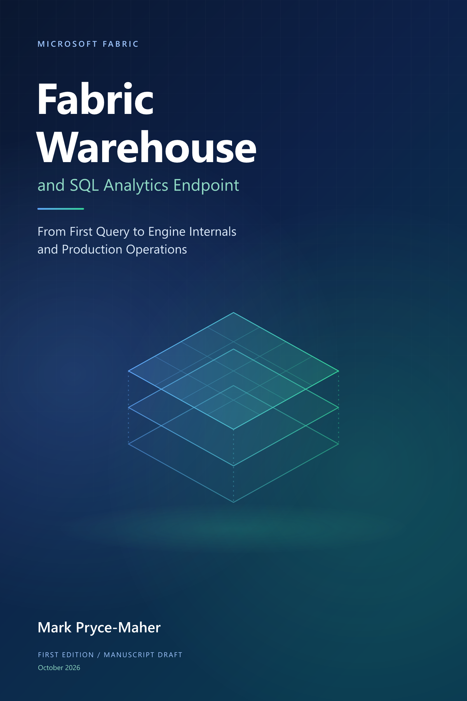

# Microsoft Fabric Warehouse and SQL Analytics Endpoint

## From First Query to Engine Internals and Production Operations

**Mark Pryce-Maher**  
**First edition - illustrated manuscript draft | Revised 9 November 2026**

> **Start with an answer you can explain.** Understand who owns the data, how the engine serves it, and what it takes to operate the solution responsibly.

From the first query over a small retail model to distributed execution, security, performance, capacity and migration, this book connects Fabric SQL's familiar surface to the responsibilities beneath it.

**[Read the book](front-matter/title-page.md)** | **[Complete contents](index.md)** | **[What's new](whats-new.md)** | **[Start Chapter 1](parts/01-getting-started/01-introduction-to-fabric.md)**

## Seven parts, one learning journey

The 42 chapters keep their sequential numbering. Each part has its own folder, introduction and chapter index; every chapter links back to its part and forward to the next chapter.

| Part | Focus | Chapters |
| --- | --- | --- |
| [I. Getting started](parts/01-getting-started/README.md) | Fabric/OneLake, Delta anatomy, first items and introductory GPU concepts. | 1-6 |
| [II. Building analytical solutions](parts/02-building-analytical-solutions/README.md) | T-SQL, models, architectures, ingestion, transactions, SQL security and clients. | 7-13 |
| [III. The SQL analytics endpoint](parts/03-sql-analytics-endpoint/README.md) | Endpoint differences, metadata sync, and OneLake access control/RLS/CLS. | 14-16 |
| [IV. How the engine works](parts/04-how-the-engine-works/README.md) | Architecture, Polaris, optimization/execution, transactions and Delta publication. | 17-25 |
| [V. Statistics and performance](parts/05-statistics-and-performance/README.md) | Statistics, plans, file layout, caching and maintenance. | 26-28 |
| [VI. Operating the platform](parts/06-operating-the-platform/README.md) | Monitoring, troubleshooting, consumption, capacity, pools, GPU and lifecycle. | 29-36 |
| [VII. Migration to Fabric Data Warehouse and production design](parts/07-migration-and-production-design/README.md) | Native migration, Synapse toolkit, source-specific moves, cutover and capstone. | 37-42 |

## Before the first chapter

The [preface](front-matter/preface.md) introduces the purpose and audience. The [reader guide](front-matter/how-to-use-this-book.md) explains reading routes, conventions, the fictional dataset and safe use of the examples.

The front matter also includes [publication notes](front-matter/publication-notes.md), [acknowledgements](front-matter/acknowledgements.md) and [the author's foreword](front-matter/foreword.md), reflecting more than 20 years of data-warehousing experience and the purpose of this book. No guest endorsement is claimed.

## Find a topic or follow its evidence

| Resource | Use it to |
| --- | --- |
| [Subject index](appendices/G-subject-index.md) | Find a topic alphabetically and jump to its principal discussions. |
| [Glossary and reader routes](appendices/A-glossary-and-reader-routes.md) | Clarify terminology or choose a background-specific route. |
| [List of figures](appendices/F-diagram-index.md) | Browse 24 original figures and 26 locally copied, credited Microsoft documentation images. |
| [What's new](whats-new.md) | Compare verified announcements, current contracts, earlier improvements and manuscript changes. |
| [Dated roadmap snapshot](appendices/H-roadmap-snapshot.md) | Read the 25-card Data Warehouse planning snapshot taken 9 November 2026 without treating it as a delivery promise. |
| [Chapter-by-chapter review](appendices/I-chapter-review.md) | Follow the blog comparison and illustration review through all 42 chapters. |
| [Appendix index](appendices/README.md) | Find the bibliography, source register, feature ledger and coverage map. |
| [Companion scripts](scripts/README.md) | Read each standalone example's target, prerequisites and effects. |
| [Edition history](history.md) | See what changed in the manuscript. |

The two introductory implementations are independent, not automatically replicated. Their small dataset demonstrates correctness, not performance or capacity sizing. Follow the chapter before running its code.

## A source-backed, evolving manuscript

The expanded structure adds an early [Delta-table anatomy chapter](parts/01-getting-started/03-anatomy-of-a-delta-table.md), a dedicated [SQL analytics endpoint part](parts/03-sql-analytics-endpoint/README.md), and explicit links between SQL-engine and OneLake security. [Part II](parts/02-building-analytical-solutions/09-loading-and-accessing-data.md#building-architectures-with-warehouse) develops the hosted-data/shortcut/Warehouse hybrid; [Part VII](parts/07-migration-and-production-design/README.md) covers native migration and the Synapse mirroring/migration toolkit. All 42 chapters remain sequential and illustrated.

The **9 November 2026 refresh** incorporates newer documentation plus the **Fabric Updates** and **sqltidy** blogs: REGEX/fuzzy-string contracts, scalar-UDF guidance, view refresh, GA Capacity Metrics navigation, iterative migration definitions, Direct Lake parameters and bounded AI-assisted review. The same-day SQL-pool announcement adds **mid-December/January preparation**, not an already active API change. See the [dated review](appendices/C-feature-status.md#9-november-2026-documentation-refresh) and [sources](appendices/D-bibliography.md#revision-2026-11-09); documentation additions are not presented as backend release dates.

The 10 October 2026 revision adds a dedicated architecture chapter, a chapter for each documented building block, and expanded [GPU paper summaries](parts/06-operating-the-platform/34-gpu-acceleration.md#find-the-full-papers-and-view-source-figures). TQP, TQP++ and CoddSpeed are distinguished, with precisely attributed awards and links to the papers.

Public documentation, research, attributed technical articles and pinned code sources have different evidential roles; availability and preview qualifications remain visible. New metadata sync still has no verified upgrade of existing endpoints; on-demand billing/cache cooldown remain forward-looking, and whole-Warehouse cloning remains planned. The selective-refresh example now requires successful endpoint provisioning before submitting a request. CoddSpeed's summary remains based on its public abstract and award article because its full text was inaccessible. This is not a claim that every exercise has been executed in every Fabric configuration.

Read the [publication notes](front-matter/publication-notes.md) and [third-party notices](THIRD_PARTY_NOTICES.md) before distributing material. Existing rights and source licences are retained; no blanket publication licence is introduced by this edition.

The cover is original artwork inspired by the visual style of the author's *Fabric Mirroring: A Practical Guide*. Its [editable SVG](assets/cover/front-cover.svg) is kept alongside the embedded PNG. The decorative geometry is not a product architecture diagram.
