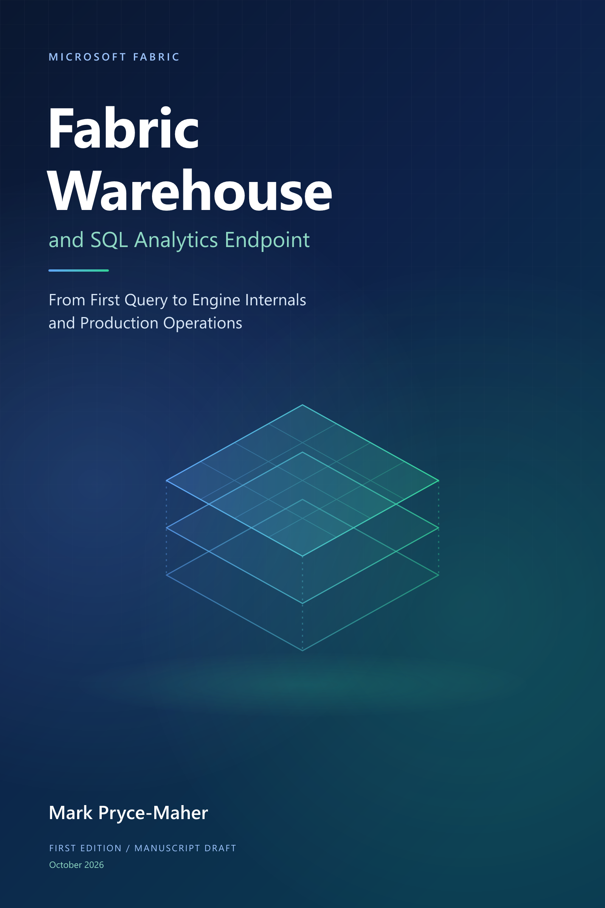

# Microsoft Fabric Warehouse and SQL Analytics Endpoint

## From First Query to Engine Internals and Production Operations

**Mark Pryce-Maher**

**First edition - illustrated manuscript draft**  
**Revised 10 November 2026**

An illustrated guide to building, understanding and operating analytical solutions with Microsoft Fabric SQL.

Forty-two chapters in seven parts, with practical examples, explanatory figures, credited documentation images and linked reference material.

---

[Cover](../README.md) | [Book contents](../index.md) | [Next: Publication notes](publication-notes.md)
