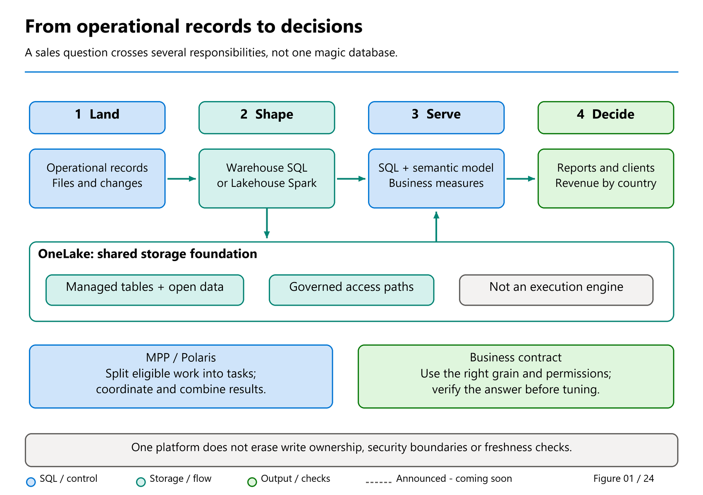
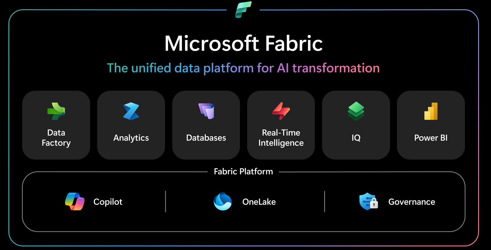

# 01. Introduction to Fabric: from a sale to a trustworthy answer

[Book contents](../../index.md) | [Part I contents](README.md) | [Previous: How to use this book](../../front-matter/how-to-use-this-book.md) | [Next: Chapter 2](02-fabric-concepts-and-onelake.md)

**Applies to:** Microsoft Fabric, with a focus on Warehouse and SQL analytical readers. **Level:** 100. **Feature scope:** public documentation checked 9 October 2026; later chapters identify preview features separately.

## A number on a screen is the end of a journey

"How much did we sell?"

It sounds like a five-minute question. One person opens the order system, another downloads a spreadsheet, and a third presents a dashboard. They produce three different totals. Perhaps one counted units, another counted order lines, and the third included a sale that arrived after the reporting cutoff.

None of them necessarily made an arithmetic mistake. They answered different questions using different data.

This book begins with that familiar problem rather than a wall of product icons. A useful analytical system must connect a business event to an answer people can explain and trust. It must preserve meaning, avoid accidental duplication, show sufficiently current data, and let the right people use it. Speed matters, but a fast query over the wrong rows is still wrong.

Microsoft Fabric brings tools for that journey into a software-as-a-service platform. You work with managed experiences instead of assembling every infrastructure component yourself. Fabric does not, however, decide what your business means by "sales," who owns a correction, or whether two datasets really represent the same thing. Those remain design decisions.

*Figure 1. A conceptual journey from business events to answers, not a mandatory deployment topology.*

Read the diagram from the original event toward its consumer. Each transition asks a different question: did we bring in the right rows, prepare them correctly, query the intended model, and present the right measure? OneLake supports reuse across experiences. The arrows do not mean every solution must copy its data at every stage.

For our first journey, the source will be a tiny, fictional dataset included with the book. That keeps credentials, connector setup, and large downloads out of the way while we learn the essential boundaries.

## A small cast of useful tools

**Data Factory** provides integration and orchestration capabilities: bringing data in and arranging when work runs. **Data Engineering** supplies tools such as Spark notebooks for preparing files and tables. **Warehouse** offers an analytical home for SQL-managed tables and transformations. **Power BI** supplies semantic models and reports that turn data into consistent business measures and usable views.

**OneLake** is the common logical data-lake foundation. It makes supported data reuse possible across engines, rather than requiring an export solely because another tool wants to read it.

Fabric also includes Data Science for model development and experimentation, Real-Time Intelligence for event-oriented analysis, and operational database capabilities. You do not need to use every workload to build a useful solution. Start with the question, then choose the tools that support its data and operating requirements.

For example, a SQL team maintaining a curated sales model can start with Warehouse. A team already parsing varied files with Python can prepare Lakehouse tables and expose them to SQL readers. Neither choice is a beginner version of the other. [Chapter 14](../03-sql-analytics-endpoint/14-sql-analytics-endpoint.md) explains how to make that decision deliberately.

## Microsoft's Fabric platform map

The official architecture diagram places the specialist experiences above Fabric's shared SaaS foundation. Use it alongside the business journey in Figure 1: one explains the platform's organization, while the other explains the responsibilities in a working analytical solution.

*Documentation image D08. Microsoft, [What is Microsoft Fabric?](https://learn.microsoft.com/en-us/fabric/fundamentals/microsoft-fabric-overview); [original diagram](https://learn.microsoft.com/en-us/fabric/fundamentals/media/microsoft-fabric-overview/fabric-architecture.png#lightbox). Reproduced unmodified; retrieved 9 November 2026 under [CC BY 4.0](https://creativecommons.org/licenses/by/4.0/) from the [Fabric documentation repository](https://github.com/MicrosoftDocs/fabric-docs/blob/aadea08f35c3edaa9c32535c772792f02555c9a4/LICENSE). This is Microsoft's platform overview, not an observed book deployment or a claim that every depicted feature has the same release status.*

Read from the shared foundation upward. OneLake supplies common logical storage; Copilot and governance provide cross-platform capabilities; the workloads specialize how data is prepared, analyzed and consumed. This book concentrates on Warehouse and the related SQL reader surfaces within that wider platform.

A shared foundation does not make every engine's write, transaction or security rules identical. SQL permissions, OneLake policies and semantic-model security still need the route-specific design explained later. The diagram is an orientation map, not permission to assume those boundaries disappear.

## Learn three questions before learning every menu

First, **which item am I using?** An item is a Fabric artifact such as a Warehouse, Lakehouse, or notebook. It lives in a workspace, a collaboration area backed by appropriate capacity. A similar-looking SQL editor does not prove you opened the same kind of item.

Second, **where do these rows come from?** A query may read SQL-managed Warehouse data, a Spark-created Lakehouse table, or a replicated analytical copy of an upstream database. Those origins matter when an answer looks stale or incorrect.

Third, **who can change them?** Warehouse supports SQL table writes. A Lakehouse SQL analytics endpoint reads underlying table data written through supported Lakehouse paths. A mirrored database's analytical copy follows an upstream writer. "I can query it" is not the same statement as "this is where I should correct it."

[Chapter 2](02-fabric-concepts-and-onelake.md) gives these places and relationships their names. [Chapter 14](../03-sql-analytics-endpoint/14-sql-analytics-endpoint.md) compares their ownership rules. For now, remember to identify the target before running any code, especially code that writes.

## Meet MPP and Polaris without opening the engine

A large sales total need not be calculated by one worker reading everything in sequence. Different workers can calculate partial totals, then combine them. That is the basic idea of **massively parallel processing**, or **MPP**: divide suitable work, perform it in parallel, and coordinate the answer.

Fabric's warehousing SQL engine uses this distributed approach. It plans how to scan, join, and aggregate data, assigns work to execution resources, and brings the results together. Coordination and data movement take work too; doubling the available workers does not guarantee that every query finishes in half the time.

For a purely illustrative total, imagine one worker returning 130, another 55, and another 180. Combining them gives 365. Those are our sample's daily totals, not an observed execution plan or a claim that Fabric assigns one worker per date.

**Polaris** is an important part of the engine's architectural lineage, described in a public 2020 research paper. At this level, remember its central idea: distributed coordination works with mature SQL execution, while compute is separated from persistent storage. OneLake holds durable table data; the resources doing a particular query are not the data itself.

The current product documentation describes a query optimizer that chooses a plan, distributed processing that coordinates it, and execution engines that perform the assigned work. You do not need to memorize their internals yet. The historical paper is not a promise about today's exact node count, hardware, or topology.

Warehouse and the Lakehouse SQL analytics endpoint share this SQL-engine foundation. Shared execution technology does not erase their different write permissions or freshness paths. [Chapter 18](../04-how-the-engine-works/18-polaris.md) returns to Polaris, and [Chapter 25](../04-how-the-engine-works/25-query-processing.md) follows a query in detail. [Chapter 6](06-gpu-acceleration-overview.md) first introduces GPU assistance at the same beginner level.

## The dataset you will come to know

Our retailer is imaginary. Three customers buy four products over three dates. `DimCustomer` describes Aster Retail, Birch Stores, and Cedar Market. `DimProduct` describes a desk lamp, travel bag, notebook, and headphones. `DimDate` holds 1-3 January 2026. `FactSales` contains six sales lines with customer, product, and date keys, quantity, unit price, and a common modification timestamp.

The starting contract is deliberately small enough to check by hand:

| Check | Expected value |
|---|---:|
| Customers / products / dates | 3 / 4 / 3 |
| Sales lines | 6 |
| Units sold | 10 |
| Revenue | 365.00 |
| Revenue for GB customers | 185.00 |
| Revenue for DE customers | 180.00 |

Revenue uses one notional currency throughout. A customer's country does not imply a different currency or an exchange-rate conversion. `LastModifiedUtc` is an audit value, not the sale date. These distinctions are part of the data contract, not cosmetic documentation.

The keys are assigned explicitly so both independent copies can be compared. A column named `SalesKey` does not acquire uniqueness enforcement merely because its name ends in "Key." Later chapters introduce quality checks and model declarations without pretending the six-row seed is a performance benchmark.

## Safe exercise: prepare a learning boundary

**Prerequisites:** a Fabric-capable organizational account, an available trial or paid capacity, and permission to create items in an isolated workspace. Contributor or a higher workspace role is a straightforward authoring setup for these labs; use your organization's approval process rather than requesting excessive access.

First, open Fabric and select the intended workspace. Inspect its name, assigned capacity, and your role. If you cannot create the workspace yourself, ask its administrator to provide a learning area. Do not reuse a production workspace simply because its creation menu is available.

Second, inspect the workspace's Data Warehouse collation setting before creating items. Collation influences string comparison and identifier behavior. The default is case-sensitive, and changing the workspace default later does not change existing items. Keep the default for this book unless you have deliberately chosen and documented the alternative; [Chapter 8](../02-building-analytical-solutions/08-dimensional-modeling.md) explains the consequences.

Third, decide who will own the learning items and when they will be removed. These samples contain no customer data, but the workspace still consumes shared organizational resources. Record the names `BookWarehouse` and `BookLakehouse` and avoid creating multiple indistinguishable copies.

Fourth, examine this responsibility exercise before using any editor:

| Request | Correct starting point |
|---|---|
| Create and insert a SQL-managed sales table | Warehouse T-SQL editor |
| Parse source files with Python and save a Delta table | Lakehouse notebook |
| Query that Delta table with T-SQL | Lakehouse SQL analytics endpoint |
| Define a business measure for reports | Power BI semantic model |
| Grant access for direct file or Spark consumption | Appropriate Lakehouse/OneLake governance path |

The expected outcome is a verified workspace and a written mental model, not a changed tenant configuration. This preparatory exercise changes no settings or data. No code or cloud operation was executed in preparing this manuscript. After the conceptual tour, [Chapter 4](04-first-warehouse.md) and [Chapter 5](05-first-lakehouse-and-sql-endpoint.md) provide the creation walkthroughs and the [Warehouse seed](../../scripts/04-create-book-warehouse.sql) and [Lakehouse seed](../../scripts/05-create-book-lakehouse.py).

There is no data cleanup for this preparatory exercise. After later labs, retain the items while continuing the book; delete them only after checking dependencies and confirming they belong solely to the lab.

## Reading a changing product accurately

Fabric evolves quickly. This edition dates its feature scope because an old limitation list can be as misleading as an unqualified preview announcement. A feature can be documented, announced, and still unavailable in a particular tenant or configuration. If a command fails, collect its exact error and compare the item type and current feature documentation before rewriting the entire design.

Our examples prefer a small, explicit supported surface. Later chapters discuss newer features when they solve a concrete problem. The goal is not to memorize every menu; it is to understand enough of the execution and ownership model to diagnose what a menu change cannot tell you.

By the end of Part I, you will have built two deliberately independent examples, reconciled their answers, and explained their different writers. That is a stronger foundation than a large solution whose totals you cannot check. The rest of the book grows the same habits into modeling, governance, performance, operations, and migration.

## Key takeaways

- Distinguish workspace, item, schema, and execution endpoint before running code.
- Warehouse owns SQL table writes; a Lakehouse SQL endpoint queries Lakehouse-owned data.
- Shared storage does not remove freshness, permission, or writer boundaries.
- Learn correctness with six known rows before measuring scale.

## References

1. Microsoft Learn, [What is Microsoft Fabric?](https://learn.microsoft.com/en-us/fabric/fundamentals/microsoft-fabric-overview).
2. Microsoft Learn, [Choose a data store](https://learn.microsoft.com/en-us/fabric/fundamentals/decision-guide-data-store).
3. Microsoft Learn, [What is the SQL analytics endpoint for a lakehouse?](https://learn.microsoft.com/en-us/fabric/data-engineering/lakehouse-sql-analytics-endpoint).
4. Microsoft Learn, [T-SQL surface area](https://learn.microsoft.com/en-us/fabric/data-warehouse/tsql-surface-area).
5. Microsoft Learn, [Data Warehouse collation](https://learn.microsoft.com/en-us/fabric/data-warehouse/collation).
6. Microsoft Learn, [Architecture of Fabric Data Warehouse](https://learn.microsoft.com/en-us/fabric/data-warehouse/architecture), current product responsibilities.
7. Josep Aguilar-Saborit and coauthors, [Polaris: The Distributed SQL Engine in Azure Synapse](https://www.vldb.org/pvldb/vol13/p3204-saborit.pdf), PVLDB 13(12), 2020; [Microsoft Research publication summary](https://www.microsoft.com/en-us/research/publication/polaris-the-distributed-sql-engine-in-azure-synapse/), historical lineage.

---

[Previous: How to use this book](../../front-matter/how-to-use-this-book.md) | [Book contents](../../index.md) | [Next: Chapter 2](02-fabric-concepts-and-onelake.md)
