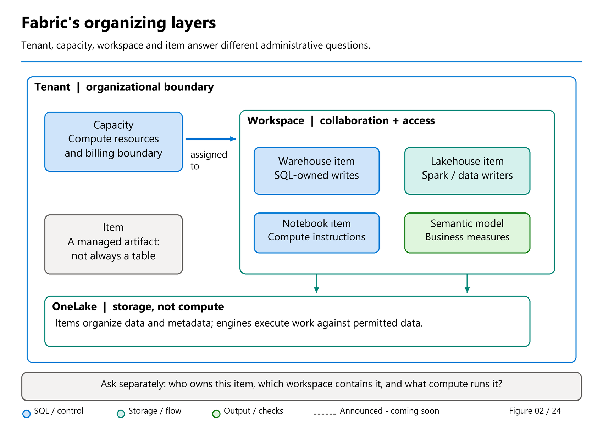
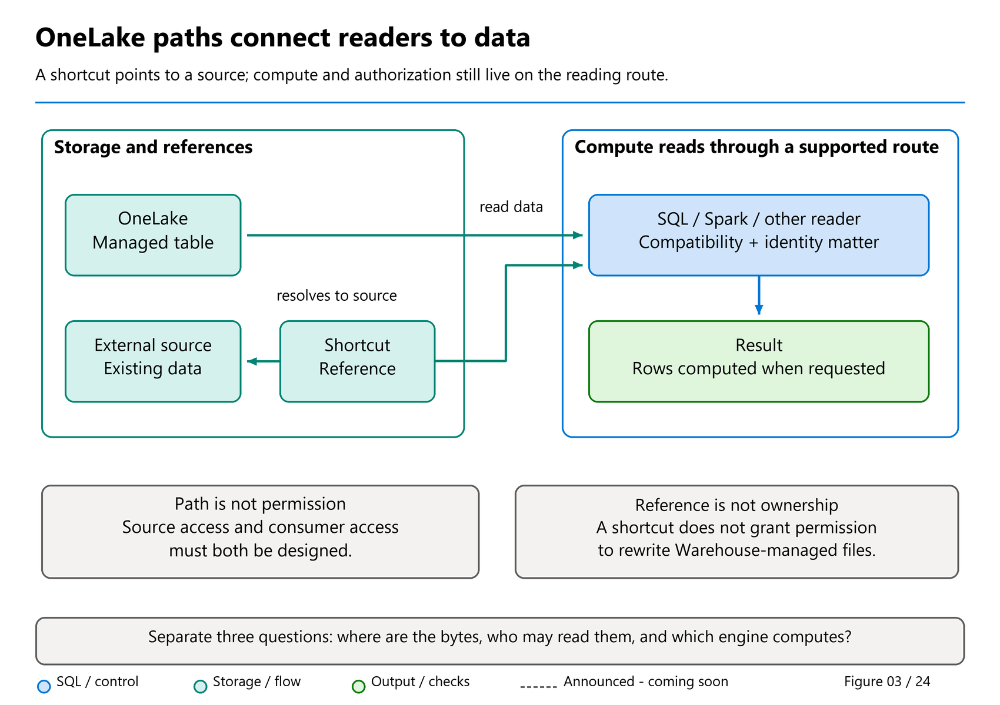

# 02. Fabric concepts and OneLake: a place for every responsibility

[Book contents](../../index.md) | [Part I contents](README.md) | [Previous: Chapter 1](01-introduction-to-fabric.md) | [Next: Chapter 3](03-anatomy-of-a-delta-table.md)

**Applies to:** Microsoft Fabric platform concepts, OneLake, and the learning workspace used in this book. **Level:** 100. **Evidence cutoff:** 9 October 2026. This chapter requires no preview feature or configuration change.

## Find the room before opening the cupboard

Imagine arriving at a new office with instructions to find "the sales data." That description is not enough. Which department owns it? Is it a spreadsheet, a database, or a report? Are you allowed to read it, change it, or merely discover that it exists?

Fabric presents the same questions through a small collection of nouns. Learning those nouns is more useful than memorizing the position of every portal button. Once you can distinguish a workspace from a capacity, and an item from an endpoint, you can explain where work belongs even when the interface changes.

Our retailer needs a learning area containing `BookWarehouse`, `BookLakehouse`, and a notebook. Later, it might add a pipeline, semantic model, and report. These are collaborators in a solution, not aliases for one large database.

## Tenant, capacity, workspace, item

A **tenant** is the organizational environment associated with Microsoft Entra ID. It is the broad boundary in which identities, administrative policies, and Fabric resources are organized. Your personal access is still narrower than that environment: belonging to the tenant does not grant permission to browse every table.

A **capacity** supplies compute resources for supported Fabric workloads. Think of it as the resource provision behind the work, not as the folder containing your tables. Several workspaces can share a capacity. Consequently, a quiet Warehouse does not prove its capacity is quiet, and a separate workspace does not automatically provide separate compute.

A **workspace** is a collaboration and management container. It groups items and assigns workspace roles such as Admin, Member, Contributor, and Viewer. For this book, use an isolated workspace assigned to available Fabric capacity. A workspace also has settings, ownership responsibilities, and a lifecycle: someone must decide who maintains it and when its learning artifacts can be removed.

An **item** is a particular Fabric artifact: a Warehouse, Lakehouse, notebook, pipeline, semantic model, or report, for example. The item type tells you what responsibilities it has. A notebook contains executable analysis or transformation code; it is not itself the Lakehouse whose tables the code writes.

*Figure 2. Organizing the solution, conceptually; this is not a diagram of physical servers.*

Read the containment relationships separately from the compute relationship. Items belong to workspaces; capacity supplies resources to assigned workspaces. If two teams create separate workspaces on one capacity, they have separated their organization of work, but not necessarily the resources supporting execution. That distinction will matter when we discuss concurrency and cost.

### Before setup: choose the writer, not the editor

| Item/surface | Who changes its business rows? | SQL reader's responsibility |
| --- | --- | --- |
| Warehouse | A supported Warehouse write path, commonly T-SQL. | Use the correct database, permissions and transaction contract. |
| Lakehouse SQL analytics endpoint | A supported Lakehouse writer, such as Spark; not endpoint T-SQL DML. | Verify compatible tables, discovery/freshness and the configured security mode. |
| Mirrored-database SQL analytics endpoint | The upstream source and its supported replication path. | Treat it as analytical consumption, not a second operational writer. |

This short distinction is enough for the first setup exercises. [Chapter 14](../03-sql-analytics-endpoint/14-sql-analytics-endpoint.md) later develops the full item/comparison material in the dedicated endpoint part.

## Two useful namespaces

Inside our SQL-facing items, a **schema** groups database objects. In `book.FactSales`, `book` is the schema and `FactSales` is the table. Neither part names a Fabric workspace.

The surrounding database context determines which table that two-part name identifies. In `BookWarehouse`, it refers to the SQL-managed seed. In the SQL analytics endpoint for `BookLakehouse`, it refers to the independently created Lakehouse seed. Identical names and values do not establish shared storage or replication.

An **endpoint** is an access surface through which a client reaches data or services. A SQL connection has a server address and database context; a Spark notebook has its own session and attached Lakehouse context. Changing the editor does not change who owns the underlying data. [Chapter 14](../03-sql-analytics-endpoint/14-sql-analytics-endpoint.md) makes that distinction concrete.

This gives us a practical habit: say both the item and the surface. "Run it against `BookLakehouse` through its SQL analytics endpoint" is safer than "run it in SQL."

## OneLake is the shared storage foundation

Each Fabric tenant includes one logical **OneLake**, built on Azure Data Lake Storage. You do not create a separate storage account simply to start the exercises. Workspaces and data items organize the contents of that tenant-wide namespace.

"One" is an organizational and access model, not a claim that every byte lives on one machine or in one region. Capacity placement and the service's supported residency arrangements still matter. Nor does one logical lake mean that everyone receives one unrestricted permission.

OneLake lets supported engines reuse data without exporting a new copy merely because a different tool wants to read it. That is a powerful capability, but it is not an automatic description of every architecture. If a pipeline copies one table into another item, there are now two maintained datasets. Our two seed scripts likewise create two independent datasets on purpose.

For our tables, the important open format is **Delta**: Parquet data files accompanied by a transaction log describing table state and changes. A compatible reader uses that table structure; it should not guess the current contents by adding up every file it finds. Understanding the entire log protocol is unnecessary at this stage, but respecting the table abstraction is essential.

## Storage and compute answer different questions

Storage answers, "Where is the durable data?" Compute answers, "What executes this operation?" Fabric Warehouse uses SQL compute; a notebook can use Spark compute; a semantic model has its own analytical responsibilities. OneLake provides a common foundation without making those engines interchangeable.

Suppose Spark writes a curated sales table and the Lakehouse SQL endpoint reads it. There is no requirement to insert those rows into a second Warehouse merely to issue a supported SQL query. Yet SQL still needs compatible table metadata, and its view of newly written data must become current through the endpoint's synchronization mechanisms.

Conversely, a Warehouse-managed table remains under Warehouse's supported write contract even when another engine can read its published Delta representation. Open-format storage is not an invitation to edit managed files directly. The writer's contract protects much more than a filename: it protects the table's consistency and metadata.

Compute can also cache data to avoid repeating expensive reads. A cache improves an access path; it does not become the authoritative business record. An empty cache and an empty table are very different problems.

## Files, tables, and paths

A Lakehouse separates **Files**, useful for source documents and other file-based inputs, from **Tables**, where supported table data is organized. Uploading a CSV under Files does not turn it into `book.FactSales`. Some supported process must interpret its columns, types, and records and produce or expose a table.

*Figure 3. A conceptual storage-and-access map, not a request to manipulate managed table files.*

Read the left-hand side as storage and references, and the right-hand side as the engine doing the work. The shortcut resolves to its source; it is not evidence that the source has been copied into the receiving item. The reader still needs a compatible access route and the right identity. A path locates data, but does not itself grant permission to read it.

The documented OneLake URI model includes workspace, item, and a path within that item. Some APIs accept friendly names and item-type suffixes; stable workspace and item identifiers avoid dependence on renaming. Specific commands may impose stricter rules, so copy the appropriate path from the product and check the command's documentation rather than constructing addresses from memory.

For example, `book.FactSales` is a SQL object name, not a complete OneLake URL. An actual SQL client needs the item's connection information; a storage reader needs a supported OneLake path and authorization. Giving one client the other's address will not convert its protocol.

## Shortcuts: reuse without another scheduled copy

A **shortcut** points to another supported storage location. It can reference data elsewhere in OneLake or in a supported external store. To a consumer, that reference appears within its local organization of data, while the source remains the target.

Suppose the finance team already owns a curated exchange-rate table. A retail Lakehouse could reference that table through a supported shortcut instead of running a daily copy solely to make it discoverable beside sales. Finance still owns publication; retail gains a dependency on finance's availability and schema.

A different requirement leads to a different decision. If the retailer must reproduce the exact inputs used for a signed monthly submission, a reference to changing source data is not by itself a frozen monthly record. A governed snapshot or maintained copy may be appropriate. Avoiding duplication is useful only when it preserves the required business meaning.

Shortcuts also retain real security boundaries. Authorization depends on the source type, configured connection, and consuming access mode. Do not assume every engine passes through the same user's identity. In particular, SQL endpoint delegated and user identity modes behave differently. [Chapter 16](../03-sql-analytics-endpoint/16-onelake-security.md) develops those rules; this chapter's exercise does not change them.

## Safe exercise: draw your learning address

**Prerequisites:** none for the paper exercise; approved read access if inspecting an existing workspace. **Effect:** observation only, with no data writes, shortcut creation, or permission changes.

Write five lines: tenant, capacity, workspace, item, and access surface. For a planned first query, fill the last two with `BookWarehouse` and its Warehouse SQL connection. For the second, use `BookLakehouse` and its SQL analytics endpoint. Add the object name `book.FactSales` below both.

Now answer: do those matching object names prove the rows are shared? No. Our seeds independently populate the items. Would moving a notebook into a workspace prove it writes the intended Lakehouse? No. Its actual attachment and execution context still need checking.

If you can inspect your approved learning workspace, compare your sketch with its item list and capacity assignment without changing settings. Record unknowns rather than inventing values. A correct sketch with one unanswered ownership question is more useful than an elaborate architecture with an assumed owner.

## What to carry forward

The tenant organizes the environment, the workspace organizes collaboration, the item defines a responsibility, and the endpoint defines an access surface. Capacity supplies compute; OneLake provides shared logical storage. None of these concepts removes the need to name a writer, a reader, and an owner.

Next we open the table abstraction itself: Parquet values, Delta state and Warehouse publication. The later endpoint part returns to the detailed comparison after the first setup exercises.

## References

Public documentation consulted 9 October 2026:

1. Microsoft Learn, [What is Microsoft Fabric?](https://learn.microsoft.com/en-us/fabric/fundamentals/microsoft-fabric-overview).
2. Microsoft Learn, [Workspaces](https://learn.microsoft.com/en-us/fabric/fundamentals/workspaces).
3. Microsoft Learn, [OneLake overview](https://learn.microsoft.com/en-us/fabric/onelake/onelake-overview).
4. Microsoft Learn, [OneLake access and URI syntax](https://learn.microsoft.com/en-us/fabric/onelake/onelake-access-api).
5. Microsoft Learn, [OneLake shortcuts](https://learn.microsoft.com/en-us/fabric/onelake/onelake-shortcuts).
6. Microsoft Learn, [OneLake security for SQL analytics endpoints](https://learn.microsoft.com/en-us/fabric/onelake/security/sql-analytics-endpoint-onelake-security).

---

[Previous: Chapter 1](01-introduction-to-fabric.md) | [Book contents](../../index.md) | [Next: Chapter 3](03-anatomy-of-a-delta-table.md)
