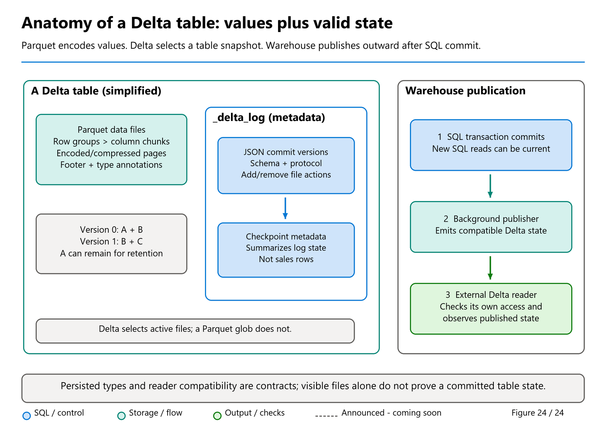
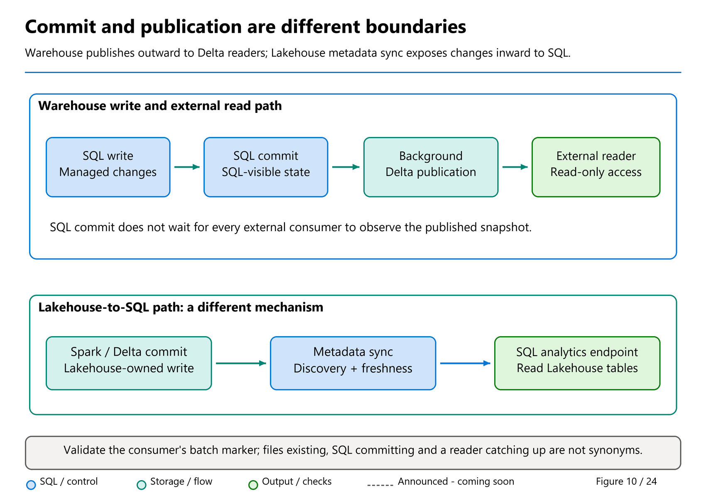

# 03. Anatomy of a Delta table: files, types and published state

[Book contents](../../index.md) | [Part I contents](README.md) | [Previous: Chapter 2](02-fabric-concepts-and-onelake.md) | [Next: Chapter 4](04-first-warehouse.md)

**Applies to:** Parquet/Delta concepts, Warehouse-managed storage and compatible Lakehouse readers. **Level:** 100-200. **Evidence review:** 9 November 2026. Generic format capabilities are distinguished from Fabric's supported writer, type and reader contracts. This chapter edits no files, logs or service settings.

## A table is more than the files that hold its values

Warehouse stores user-table data in **Parquet files** and publishes **Delta Lake logs** for supported external readers. Understanding that foundation explains both the opportunities of open storage and restrictions that can otherwise seem arbitrary.

There are three related descriptions to keep apart. **Parquet** describes the physical columnar data and its types. **Delta** describes a valid table state over data files, including schema and transaction actions. The **SQL catalog and engine** expose their own objects, types, permissions and transaction behavior. They cooperate; they are not one interchangeable metadata file.



*Figure 24. A conceptual table anatomy, not the private physical layout of a Fabric deployment.* Data files contain values; the transaction log identifies the valid table state. A Warehouse's outward Delta publication is a separate boundary from SQL commit.

## Inside a Parquet file

Parquet is columnar. Rather than arranging every complete row like a CSV line, it organizes values so a reader can fetch the columns needed by a query.

| Building block | What it contributes | What not to infer |
| --- | --- | --- |
| Row group | A horizontal group of rows, with a column chunk for each column. | One row group is not automatically one Fabric compute node or distributed task. |
| Column chunk | The values for one column within a row group. | It is not a SQL index or a separate business table. |
| Page | A smaller encoded/compressed unit within a column chunk. | Compression does not determine business meaning or uniqueness. |
| Footer metadata | Schema and locations of column chunks, with applicable statistics and encoding information. | File statistics are not the optimizer's complete SQL histogram or an access-control policy. |
| Physical and logical types | Primitive storage plus annotations that explain interpretation, such as strings, decimals or timestamps. | A value encodable by Parquet is not automatically an accepted Warehouse column type. |

A reader can use metadata to locate relevant chunks and, where supported, skip irrelevant data. Reading fewer columns or skipping files can reduce work, but a small file and a large file have different overhead/parallelism trade-offs. Later performance chapters connect layout to measured queries.

The [Parquet format](https://parquet.apache.org/docs/file-format/) places metadata at the end of the file. A footer is not a transaction log: it describes that file, not which combination of files represents a committed table.

## What Delta adds

A simplified, illustrative directory might contain:

```text
FactSales\
  part-A.parquet
  part-B.parquet
  part-C.parquet
  _delta_log\
    00000000000000000000.json
    00000000000000000001.json
    00000000000000000001.checkpoint.parquet
    _last_checkpoint
```

These are teaching names, not paths to create or a promise that Warehouse uses this exact naming/layout. A real Delta table can contain additional files and feature metadata.

The [Delta transaction protocol](https://github.com/delta-io/delta/blob/master/PROTOCOL.md) describes ordered table versions. JSON commits contain actions that update the previous state: for example, changing metadata, adding a file or removing a file from the active snapshot. Reader/writer protocol requirements and table features determine whether an implementation can interpret that state correctly.

Imagine version 0 references A and B. Version 1 removes A and adds C. A version-1 reader uses **B and C**, even if A remains physically present for retention. Scanning every Parquet file would read A, B and C and could double-count or expose superseded rows.

A remove action does not necessarily delete the physical file immediately. Retention and `VACUUM` govern removal of eligible unreferenced files. Conversely, an incomplete or aborted operation can leave files that never become part of the committed state. File presence alone is not evidence that a row was committed.

### A checkpoint is metadata, not a second copy of the sales table

A checkpoint summarizes table/log state so a reader need not replay an indefinitely long history of JSON actions. It can itself be stored in Parquet, but its rows describe **metadata**, not another batch of business sales.

The reader combines a suitable complete checkpoint with later actions to reconstruct its requested snapshot. Neither checkpoint creation nor a large log-version number proves that a particular business batch is complete. Table versions are local to the table; version 100 in one table has no general ordering relationship with version 100 in another.

Deletion vectors, column mapping, change-data files and newer checkpoint features add capabilities, but also reader requirements. A writer supporting a feature does not establish support in every SQL, Spark, Power BI or external reader. [Chapter 15](../03-sql-analytics-endpoint/15-metadata-sync-v1-v2.md) makes that compatibility check concrete for the SQL analytics endpoint.

## Why persisted SQL types have limits

Fabric supports a defined subset of SQL types for persisted tables and other supported persisted objects. That contract must work across more than the SQL expression evaluator: the writer, Parquet representation, Delta schema and intended readers must agree on meaning.

Parquet separates primitive storage from logical interpretation. For example, its UTF-8 string annotation uses a byte-array physical representation, and decimal annotations describe precision/scale over an unscaled value. It is incorrect to conclude that Parquet cannot store Unicode merely because Warehouse does not persist SQL Server's `nvarchar` type: Warehouse's UTF-8 `varchar` can store Unicode, with a different byte budget.

| Example | SQL-facing consideration | Storage/interoperability lesson |
| --- | --- | --- |
| `varchar` versus `nvarchar` | Warehouse persists the documented UTF-8 character types; some other SQL types remain usable in memory. | Encoding and byte width matter; changing a type name is not proof of lossless conversion. |
| `decimal(p,s)` | Preserve exact scale, precision and intermediate arithmetic. | Physical integer/binary storage needs logical decimal metadata to retain meaning. |
| `datetime2(6)` versus a source `datetime2(7)` | Warehouse's current persisted fractional-second limit is six digits. | The supported Delta timestamp path has microsecond precision, so a finer source value requires a deliberate conversion policy. |
| `datetimeoffset` | Preserve a normalized instant and any required original offset/zone separately when mapping to persisted supported types. | A timestamp value does not automatically preserve the source's timezone representation. |
| `uniqueidentifier` | Warehouse supports the SQL type, but the documented external/endpoint representation has restrictions. | The SQL engine can know a meaning that another Delta reader does not expose identically. |

Use the [current Fabric data-type reference](https://learn.microsoft.com/en-us/fabric/data-warehouse/data-types) for actual supported columns and sizes. A generic format specification is not a substitute for that product contract.

### The seventh fractional digit: a precise explanation

`datetime2(7)` can represent fractions in 100-nanosecond increments. Six fractional digits represent microseconds. The Delta protocol's `timestamp` and timestamp-without-timezone definitions use **microsecond precision**, while Fabric documents a maximum of six fractional digits for persisted `datetime2` and `time`.

That explains why a source `datetime2(7)` definition cannot simply be carried unchanged into a Warehouse table. Values with meaningful seventh digits need an explicit conversion and validation policy; distinct source timestamps can collapse to the same stored value. Test rounding/truncation for the actual load path rather than silently discarding precision or treating the reduced timestamp as a unique event identifier.

There is an important qualification: **Parquet itself is not universally limited to six digits**. Its [logical-type specification](https://parquet.apache.org/docs/file-format/types/logicaltypes/#timestamp) describes millisecond, microsecond and nanosecond timestamp units, with different physical representations and reader considerations. The constraint here is the **supported Fabric/Delta interoperability contract**, not an assertion that the broader Parquet format can never encode a finer timestamp.

As formats and engines evolve, more representations can become possible. A newly specified type still needs implementation, protocol/feature negotiation, SQL support and compatible readers before it is safe to depend on. Do not promise that a future format revision automatically enables a new Warehouse type.

Mark's [19 March 2025 time-zone article](https://medium.com/@sqltidy/handling-time-zones-in-fabric-warehouse-a-simple-workaround-4a9670e7c3dc) motivates keeping zone context separately. This book distinguishes a UTC instant, a local wall-clock value and the original zone/offset. An ordinary Delta timestamp does not retain the original zone name merely because Spark displays it in a session's timezone. Normalize deliberately and retain the extra context required by the business; an implicit cast from an offset-bearing value is not a universal UTC-conversion policy.

## Why a variable can use a type a table cannot

A local SQL variable or expression is evaluated by the SQL engine; it does not, merely by existing, become a persisted Delta column. The supported surface for variables, parameters and function outputs can therefore be broader than the persisted-column surface.

**Runnable read-only T-SQL - Warehouse or SQL analytics endpoint.** This creates only a local variable, returns a synthetic value and performs no table write:

```sql
DECLARE @DisplayName nvarchar(40) = N'Aster Retail';

SELECT @DisplayName AS InMemoryValue,
       CAST(@DisplayName AS varchar(160)) AS ExplicitUtf8Candidate;
```

The expected text is Aster Retail in both columns. This ASCII-only example demonstrates the boundary, not a maximum-length Unicode conversion test. Successful declaration does **not** make `nvarchar(40)` a supported persisted Warehouse column, and it does not establish that every SQL Server type or function works in every Fabric context.

Before persisting a result, choose a supported destination type, validate actual values and byte lengths, and inspect downstream representation. [Chapter 11](../02-building-analytical-solutions/11-tsql-compatibility.md) develops that migration/compatibility discipline.

## How Warehouse publishes its Delta representation

For an ordinary Delta writer, the protocol explains how new files and log actions form an atomic table version. Do not assume that description exposes every private Warehouse transaction-management structure.

The [Warehouse publication reference](https://learn.microsoft.com/en-us/fabric/data-warehouse/query-delta-lake-logs) documents a specific outward handoff:

1. A supported Warehouse write produces data and metadata under Warehouse's transaction rules.
2. The SQL transaction commits. Warehouse SQL readers can observe the appropriate committed state.
3. A background process publishes updated Delta Lake logs for affected user tables, describing the externally readable table state over the Parquet data.
4. A compatible, authorized external reader observes that publication and uses its Delta metadata to choose the correct state.

This is the useful meaning of "making the Warehouse's Parquet data available as Delta tables." It is not a requirement to load those rows into another Lakehouse or rewrite every data file just to add a log. The SQL commit decision and public Delta visibility are separate boundaries.



*Figure 10. Follow committed SQL state and published Delta state separately.* This conceptual boundary is not a measured delay, a SQL durability dependency on an external reader, or a supported interface to private manifests.

### What the sqltidy publishing experiments teach

Mark's [Delta Log Publishing article](https://medium.com/@sqltidy/fabric-warehouse-delta-log-publishing-477c1508d060), dated **2 September 2025** in his author-maintained archive, compares a small insert's client completion with file/log observations. His few trials observed approximately **3-12 seconds** before the new log appeared. Those observations illustrate asynchronous visibility, not a service-level agreement or a ten-second polling rule. File timestamp precision and timezone normalization also limit exact attribution.

His [Part 2](https://medium.com/@sqltidy/fabric-warehouse-delta-log-publishing-part-2-0730cc6fba06), dated **5 September 2025**, automates observation through a notebook. The enduring lesson is to verify the downstream handoff. The book's advanced publication lab in [Chapter 23](../04-how-the-engine-works/23-storage-onelake-and-delta-log-publishing.md) strengthens a row-count comparison with a unique marker, finite polling and explicit timeout failure. Matching counts can otherwise miss updates, offsetting inserts/deletes or a coincidentally equal state.

These article bodies and their canonical Medium links were rechecked through [Mark's public author-maintained archive](https://github.com/MarkPryceMaherMSFT/MarkPryceMaherMSFT.github.io) on **9 November 2026**. Their publication dates and experiments are not relabeled as November releases.

## Pausing publication does not pause SQL commits

The documented publication controls are Warehouse-wide. In **PAUSED**, external Delta consumers retain the previously published view while Warehouse SQL can see newer committed changes. Returning to **AUTO** resumes publication. This is not a per-table cache flush, a transaction rollback or a generic Lakehouse metadata refresh.

Changing the setting affects other readers, so this early chapter does not issue an ALTER. After the later Warehouse setup, an authorized reader can optionally inspect state:

**Optional read-only Warehouse T-SQL - only after Chapter 4 created `BookWarehouse`; no setting change.**

```sql
SELECT name, DATA_LAKE_LOG_PUBLISHING_DESC
FROM sys.databases
WHERE database_id = DB_ID();
```

Do not edit `_delta_log`, delete Warehouse files, or run Spark maintenance against Warehouse-owned paths to repair a delay. Use supported controls and preserve evidence.

## Three different freshness directions

| Boundary | Direction | What it is not |
| --- | --- | --- |
| Warehouse Delta-log publication | Committed Warehouse SQL state becomes available to external Delta readers. | Lakehouse-to-SQL metadata sync. |
| Lakehouse SQL analytics endpoint sync | Supported Lakehouse Delta data/schema becomes SQL-readable. | A second writer or a Warehouse retention policy. |
| Semantic-model/report refresh and caching | A consuming model or client observes its supported source state. | Proof that every earlier boundary completed at one universal instant. |

Open formats also do not install SQL RLS/CLS on every direct file reader. [Chapter 12](../02-building-analytical-solutions/12-security-and-governance.md) covers SQL-engine permissions, RLS and CLS; [Chapter 16](../03-sql-analytics-endpoint/16-onelake-security.md) covers the separate OneLake enforcement model.

## Paper exercise: choose the valid state

At version 0, A and B are active. Version 1 removes A and adds C, while all three files remain physically present. Which files does a version-1 Delta reader use? **B and C**. Does A's presence prove a corrupt table? **No**; it may be retained legitimately.

Next, explain why a successful `nvarchar` variable, an existing Parquet file and a completed SQL insert prove different things. Finally, name the evidence needed if SQL sees a new batch but an external report does not: SQL commit/marker evidence, publication state and the actual consumer's observed version.

No files, tables or settings are created by this exercise. The variable listing is synthetic and source-backed; no tenant execution or measured publication result is claimed.

## References

1. Microsoft Learn, [Data types in Fabric Data Warehouse](https://learn.microsoft.com/en-us/fabric/data-warehouse/data-types), persisted subset, variables/expressions and six-digit fractional precision; checked 9 November 2026.
2. Apache Parquet, [File format](https://parquet.apache.org/docs/file-format/) and [logical types](https://parquet.apache.org/docs/file-format/types/logicaltypes/), physical/logical distinction, UTF-8 strings and timestamp units; checked 9 November 2026.
3. Delta Lake, [Transaction log protocol](https://github.com/delta-io/delta/blob/master/PROTOCOL.md), snapshots, actions, checkpoints, feature requirements and microsecond timestamp definitions. Generic protocol, not a declaration that Fabric exposes every listed feature.
4. Microsoft Learn, [Delta Lake logs in Warehouse](https://learn.microsoft.com/en-us/fabric/data-warehouse/query-delta-lake-logs), supported external read-only access, background publication and PAUSED/AUTO controls.
5. Mark Pryce-Maher, [Delta Log Publishing](https://medium.com/@sqltidy/fabric-warehouse-delta-log-publishing-477c1508d060) and [Part 2](https://medium.com/@sqltidy/fabric-warehouse-delta-log-publishing-part-2-0730cc6fba06); bodies/Medium links/date fields verified at [author-archive revision `6fbe0f3`](https://github.com/MarkPryceMaherMSFT/MarkPryceMaherMSFT.github.io/tree/6fbe0f311b5de5c0d0d18eeb17053170c79a5164), not assumed from RSS titles.
6. Mark Pryce-Maher, [Handling time zones in Fabric Warehouse](https://medium.com/@sqltidy/handling-time-zones-in-fabric-warehouse-a-simple-workaround-4a9670e7c3dc), 19 March 2025 in the same verified archive; retain the separate-context lesson, with the Delta protocol/current type contract governing actual representation.

---

[Previous: Chapter 2](02-fabric-concepts-and-onelake.md) | [Book contents](../../index.md) | [Next: Chapter 4](04-first-warehouse.md)
