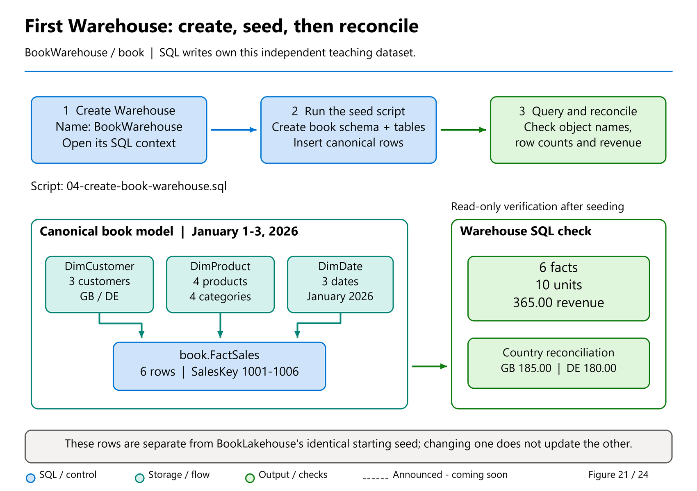

# 04. Your first Warehouse

[Book contents](../../index.md) | [Part I contents](README.md) | [Previous: Chapter 3](03-anatomy-of-a-delta-table.md) | [Next: Chapter 5](05-first-lakehouse-and-sql-endpoint.md)

**Applies to:** Fabric Warehouse; the creation and seed steps do not run on a Lakehouse SQL analytics endpoint. **Level:** 100. **Feature scope:** core walkthrough checked 8 October 2026; editor references rechecked 9 November; targeted Build editor-announcement follow-up 10 November. No preview integration is required for the seed.

## What a successful first lab proves

The first milestone is not seeing a green execution indicator. It is producing a known result in the intended item and understanding how it was produced. By the end of this chapter, `BookWarehouse` will contain four tables in the `book` schema. You will inspect their definitions, check six sales rows, and reconcile revenue to 365.00.

This is a learning database, not a benchmark or a reusable production ingestion framework. Six rows remove scale as a distraction so that database context, column types, transaction boundaries, and query results remain visible. Keep this initial dataset unchanged; later experiments use separately named lab objects.

**Prerequisites:** an isolated Fabric workspace backed by available capacity, permission to create a Warehouse, and access to the [complete Warehouse seed file](../../scripts/04-create-book-warehouse.sql). Workspace Contributor or higher is suitable for this authoring walkthrough. Confirm the workspace's collation decision from [Chapter 1](01-introduction-to-fabric.md) before creating the item.



*Figure 21. The first Warehouse lab, conceptually: verify the destination, write through SQL, then prove the result.*

Follow the checkpoints rather than racing to the last box. The seed's transaction groups its table creation and loading, but the schema is created before that transaction. The independent checks at the end matter even when execution reports success. A result of six facts, ten units, and 365.00 revenue is our data contract, not a measured performance target.

## Create the item, not the sample database

Open the chosen workspace and select **New item**. Find **Warehouse**, enter `BookWarehouse`, and create it. Choose the blank Warehouse rather than **Sample warehouse**. The product's sample is useful, but it has different tables and would make our later checks ambiguous. The [creation guide](https://learn.microsoft.com/en-us/fabric/data-warehouse/create-warehouse) documents both choices.

When provisioning finishes, inspect the item type in the workspace and the name in the editor. A Warehouse and a Lakehouse SQL endpoint can look similar once a SQL editor opens. Our seed performs table creation and inserts, so the target must be the Warehouse.

Open a new SQL query. Do not begin by copying a server name into an unfamiliar external client; the browser editor is enough for this chapter. SSMS and the MSSQL extension for Visual Studio Code are useful later, once database context and authentication are understood.

**Runnable, read-only T-SQL; execute in the `BookWarehouse` query editor.** These statements return context and catalog information, not application data.

```sql
SELECT DB_NAME() AS CurrentDatabase;

SELECT name, collation_name
FROM sys.databases
WHERE name = DB_NAME();
```

The first result must identify `BookWarehouse`. The second records the current database's collation. Do not assume case-insensitive comparisons because a previous SQL Server database behaved that way. New Warehouse items inherit the workspace's configured default, and an existing item's collation cannot subsequently be changed through the workspace setting.

For item identity, Mark Pryce-Maher's `info.sql` gist and the Toolbox `dw-properties` sample provide a useful additional diagnostic pattern. This optional listing consolidates their property lookups; it performs no discovery loop or dynamic execution.

**Runnable, read-only diagnostic T-SQL; execute in `BookWarehouse`.** This is a published sample pattern, not a complete supported-property contract. Treat null or unexpected values as unavailable information and verify item identity in the portal rather than guessing.

```sql
-- Adapted from Mark Pryce-Maher, info.sql, 22 May 2025.
-- Canonical: https://gist.github.com/MarkPryceMaherMSFT/a244cf5e4ff58ec2a89c7d330342cceb
-- Pinned revision 379032325627883a87db564fa951852d9ec15a42:
-- https://gist.github.com/MarkPryceMaherMSFT/a244cf5e4ff58ec2a89c7d330342cceb/379032325627883a87db564fa951852d9ec15a42
-- Rights: no explicit public license; author-authorized manuscript use only.
-- This authorization is not a general downstream license.
-- Change: one current-context result set; no cross-database generator.
SELECT DB_NAME() AS CurrentDatabase,
       DATABASEPROPERTYEX(DB_NAME(), 'Edition') AS Edition,
       DATABASEPROPERTYEX('master', 'workspaceid') AS WorkspaceId,
       DATABASEPROPERTYEX(DB_NAME(), 'ArtifactId') AS ArtifactId;
```

These item identifiers are not generated row keys. Keep diagnostic output internal; it need not be published with a question or screenshot.

If creation is unavailable, investigate workspace role, capacity assignment, and tenant policy. A missing creation card is not a SQL syntax error. If the item exists but the query fails, distinguish an authentication or permission failure from a capacity or service-availability problem. Changing table definitions cannot fix either.

<a id="your-editor-as-of-9-october-2026"></a>
## Your editor, reviewed 9 November 2026

The portal is part of the learning experience, but the script should remain understandable without a particular screenshot. The [September feature summary](https://community.fabric.microsoft.com/blog/fbc_fabricupdatesblogs/fabric-september-2026-feature-summary/5325825) identifies the core SQL editor improvements as generally available. The dedicated [editor announcement](https://community.fabric.microsoft.com/blog/fbc_fabricupdatesblogs/advancing-the-microsoft-fabric-sql-query-editor/5364033) explains what changed. Availability of an adjacent preview integration is a separate question.

### A faster grid is not a faster SQL plan

The refreshed results grid improves browser inspection, including resizing columns and handling larger values. Use it to read `LastModifiedUtc` and the calculated revenue without confusing a clipped display with a truncated stored value. The documented SQL results preview shows at most **10,000 rows**; the separate **Data preview** shows at most **1,000**.

These are display limits, not table-size limits. For a large table, scrolling to the bottom of a preview cannot establish its row count. Our `COUNT_BIG` and revenue checks ask the engine for explicit answers. A more responsive grid also does not prove that the underlying query scanned fewer files or consumed less compute.

### Browse the local catalog deliberately

Object Explorer and IntelliSense have improved responsiveness for large schemas, and frequently used objects can be pinned. Locate `book` and inspect its four tables once the seed completes. Here, "faster catalog" refers to the SQL editor's **Object Explorer** experience, not a measured performance improvement across the entire OneLake Catalog.

Explorer helps you navigate. The catalog queries later in this chapter give you reproducible evidence of actual types and nullability. Keep both habits: browse for orientation, query metadata for precise inspection.

### Save text without confusing it with saved data

Autosave can now be switched on or off. It preserves query text; it is not a database commit, an execution history, or proof that a script ran successfully. Likewise, bulk query management helps organize accumulated queries, not manage the rows those queries happen to reference.

The editor also supports importing and exporting **`.sql` files**. You can import the supplied seed rather than paste it, but still read the complete text and verify the target before execution. Exporting a validation query is useful for review; exporting SQL text is not exporting or backing up the Warehouse's table data. This lab needs no secrets in saved query text.

### Table Overview and inline Copilot: inspect first, review generated SQL

Tino Tereshko's [4 June 2026 Build roundup](https://community.fabric.microsoft.com/blog/fbc_fabricupdatesblogs/from-query-acceleration-to-cache-cooldown-everything-new-in-fabric-data-warehous/5191621), reviewed 10 November, announced a **Table Overview Page**, streamlined query management and **inline Copilot chat** as preview web experiences. Table Overview is a landing page for table structure and key details before Data preview; it is not proof that the full dataset arrived or that every later table-profiling/deep-dive feature is available.

Inline Copilot brings questions and SQL generation/refinement into the editor context. That convenience does not validate the proposed query's meaning, permissions or write effects. Use approved synthetic context, inspect the target item and complete SQL, and check the result against the explicit expectations in this chapter. A suggestion to create, change or delete an object requires a separate deliberate execution; generated text is not permission to run it.

The current [SQL editor guide](https://learn.microsoft.com/en-us/fabric/data-warehouse/sql-query-editor) documents Copilot actions and its chat pane. That corroborates an authoring integration, not a new GA date for the entire June preview bundle. The later September core-productivity GA labels above remain separately sourced.

### No-code creation and table deep dive: announced, not a guessed walkthrough

Tino Tereshko's [29 September roundup](https://www.linkedin.com/posts/valentinotereshko_speed-run-of-fabric-data-warehouse-announcements-activity-7510726240522293248-r4tC) names **no-code table creation** and **table deep dive** among a mixed preview/GA group of UI updates. Their individual release status and exact workflows were not independently established by the public sources available for this revision.

No-code creation addresses the desire to define a table without hand-authoring every statement; a deeper table inspection experience can help a reader understand an existing object. Neither description removes the need to check types, names, permissions, or data meaning. We therefore keep the explicit, reproducible seed rather than inventing a sequence of buttons.

The already documented **Save as table** action is a specific alternative: it uses `CREATE TABLE AS SELECT` to materialize a query into a selected Warehouse. That is a write creating another table, not simply saving a query tab, and it is not proof of the newly announced no-code workflow. Do not use it to replace the book's core tables.

### Charts: distinguish existing tools from new promises

The current editor documentation describes **Visualize results** and **Explore this data (preview)**. The latter supports ad hoc exploration before building a full report. Those known capabilities should not be relabeled as the unspecified new "charts" in the roundup; the exact new chart types and release status remain unconfirmed.

The country aggregate later in this chapter is a good small result to understand before visualizing anything. Retain the ordered SQL version for reconciliation. The documented visualizer currently does not support a query containing `ORDER BY`; an optional visualization would need a separate appropriate query, not an unexplained alteration of the validation script. No chart is required to complete this lab.

### Carry validated SQL into other experiences

Salil Kanade's **8 September 2026** [editor article](https://community.fabric.microsoft.com/blog/fbc_fabricupdatesblogs/advancing-the-microsoft-fabric-sql-query-editor/5364033) distinguishes several integrations that a broad "better editor" headline can hide:

| Integration | Article's status | Responsibility that remains |
| --- | --- | --- |
| Copy/share a query with result context or a tool link | Preview | Review what data and identities the shared output exposes; query text/results are not automatically safe to distribute. |
| Start notebook or Eventhouse analysis over Warehouse data | GA | Use supported read/integration paths and their permissions. Another engine is not licensed to overwrite Warehouse files. |
| Create a Direct Lake over OneLake semantic model from the editor | GA | Choose the model deliberately, define relationships/measures and verify source/query/refresh identities. |
| Create an Activator rule from a SQL SELECT | Preview | Scheduled query work and notification/activity actions have cost, permission and outbound effects. A rule is not enabled by reading this chapter. |

These are component-specific announcement labels, not a promise that every adjacent preview has shipped. [Chapter 13](../02-building-analytical-solutions/13-power-bi-and-clients.md) handles semantic models and identity; [Chapter 29](../06-operating-the-platform/29-monitoring.md) distinguishes diagnosis from alerting or intervention.

The June Build roundup additionally names **Copy Job creation** and **Fabric Ontologies** in its preview editor-integration group. Creating a Copy job configures movement with source, target, schedule and write-policy responsibilities; it is not CTAS or automatic CDC. An ontology supplies business concepts and relationships over governed data, not a second SQL engine or automatic access grants. [Chapter 9](../02-building-analytical-solutions/09-loading-and-accessing-data.md#client-bulk-copy-is-not-server-side-copy-into) explains the loading routes, and [Chapter 13](../02-building-analytical-solutions/13-power-bi-and-clients.md) separates ontology, model and SQL contracts. No additional job, ontology or AI call is required for the first lab.

## Read the seed before running it

The [seed script](../../scripts/04-create-book-warehouse.sql) is a runnable file, not a fragment requiring placeholder replacement. Open it locally, read the header, then paste the complete contents into the Warehouse query editor. Run the whole file in one invocation with no previously open user transaction.

Its first checks reject an incorrect database name, an ambient transaction, and an existing `book` schema. This intentionally makes a second run fail rather than quietly inserting duplicate rows. "Safe to repeat" can mean refusing to act; it does not have to mean pretending every execution is a successful reload.

The script creates `book` in its own dynamic batch because `CREATE SCHEMA` has batch requirements. It then groups the four table definitions, inserts, and reconciliation checks in an explicit transaction. Supported table DDL can participate in Warehouse transactions, as described in [Transactions](https://learn.microsoft.com/en-us/fabric/data-warehouse/transactions). The schema itself is created before that transaction. If the load fails, an empty schema can remain; the script does not silently remove it.

This division matters when troubleshooting. Never delete a schema just because a notebook or editor suggests rerunning a failed cell. Inspect what exists and establish which objects the failed attempt created. For a disposable failed lab, a newly created, separately verified learning item is often clearer than improvised cleanup. Any adjustment of the database-name guard must be deliberate.

The script contains no `DROP`, `TRUNCATE`, identity generation, or unenforced key declarations. It supplies every column explicitly in each `INSERT`, so a later column-order change cannot silently redirect values.

## Understand the four tables

`DimCustomer` has an integer key, a customer name, and a two-character country code. `DimProduct` has a product key, product name, and category. `DimDate` has an integer date key together with a true `date`, year, and month. These descriptive tables give meaning to the numbers in `FactSales`.

The fact table holds a `bigint` sales key, three integer dimension keys, an integer quantity, `decimal(12,2)` unit price, and `datetime2(6)` modification timestamp. There is no physically stored revenue column: revenue is calculated as quantity multiplied by unit price. Avoid storing both a derivable amount and its inputs without specifying which value is authoritative when they disagree.

Types are decisions about meaning and interoperability. `decimal` preserves the intended fixed-point price representation; floating-point arithmetic is not needed here. `datetime2(6)` uses supported microsecond precision. [Chapter 3](03-anatomy-of-a-delta-table.md#the-seventh-fractional-digit-a-precise-explanation) explains the Parquet/Delta/product-contract distinction rather than assuming every SQL expression type is persistable. The `Utc` suffix documents a convention; the type does not carry a time-zone offset. All seed modification timestamps represent midnight UTC on 4 January 2026.

Warehouse persisted types are a supported subset of T-SQL types. For example, this model uses UTF-8 `varchar`, not `nvarchar`, and `smallint`, not `tinyint`. The [data-type reference](https://learn.microsoft.com/en-us/fabric/data-warehouse/data-types) is the authority for persisted storage; a type that can appear in an expression is not necessarily a type you can persist in a Warehouse table.

`NOT NULL` is also not a substitute for a key policy. It prevents a missing value in these columns, but says nothing about whether two rows share the same `SalesKey` or whether a `CustomerKey` exists in the dimension.

## Execute, then inspect independently

Run the complete seed. Its final result sets should show six facts, quantity 10, and revenue 365.00, followed by country totals DE 180.00 and GB 185.00. These are expected results calculated from the supplied dataset, not measurements from a tenant used to prepare this book.

Now verify the persisted objects rather than trusting only the seed's own output.

**Runnable, read-only T-SQL; execute in `BookWarehouse`.** The first statement inspects catalog metadata. The second reads the six sales rows.

```sql
SELECT s.name AS SchemaName, t.name AS TableName,
       c.column_id, c.name AS ColumnName,
       ty.name AS TypeName, c.max_length,
       c.precision, c.scale, c.is_nullable
FROM sys.tables AS t
JOIN sys.schemas AS s ON s.schema_id = t.schema_id
JOIN sys.columns AS c ON c.object_id = t.object_id
JOIN sys.types AS ty ON ty.user_type_id = c.user_type_id
WHERE s.name = 'book'
ORDER BY t.name, c.column_id;

SELECT SalesKey, DateKey, CustomerKey, ProductKey,
       Quantity, UnitPrice, LastModifiedUtc,
       CAST(Quantity * UnitPrice AS decimal(18,2)) AS LineRevenue
FROM book.FactSales
ORDER BY SalesKey;
```

The line revenues should be 50.00, 80.00, 30.00, 25.00, 100.00, and 80.00, in key order. Their sum is 365.00. Quantity totals 2 + 1 + 3 + 1 + 2 + 1 = 10. Explicit ordering is essential: a table has no presentation order merely because rows were inserted in a particular sequence.

Keep system-catalog queries separate from queries over application tables. Fabric's T-SQL surface documents restrictions on queries combining system and user data. Our metadata query joins catalog views only, and the sales query reads user data only.

## Your first business answer

A meaningful aggregate usually needs descriptive data. The following joins a fact's customer key to the customer dimension before grouping.

**Runnable, read-only T-SQL; execute in `BookWarehouse`.**

```sql
SELECT c.CountryCode,
       COUNT_BIG(*) AS SalesLines,
       SUM(f.Quantity) AS Units,
       CAST(SUM(f.Quantity * f.UnitPrice) AS decimal(18,2)) AS Revenue
FROM book.FactSales AS f
JOIN book.DimCustomer AS c
  ON c.CustomerKey = f.CustomerKey
GROUP BY c.CountryCode
ORDER BY c.CountryCode;
```

DE has two sales lines, three units, and revenue 180.00. GB has four lines, seven units, and revenue 185.00. Together they reconcile to the fact-only totals.

That reconciliation is a miniature quality test. A duplicate customer key could multiply joined sales rows; a missing customer could remove a sales line from this inner join. A successful query does not prove its join is correct. [Chapter 8](../02-building-analytical-solutions/08-dimensional-modeling.md) develops explicit checks for those problems.

Try explaining why `COUNT_BIG(*)` differs from `SUM(Quantity)` without running anything else. The former counts rows at the fact's grain; the latter counts units sold. Calling both measures "sales count" would create a business ambiguity even when their SQL is syntactically perfect.

## Failure recovery and lab hygiene

An "already exists" refusal on the second seed run is the intended outcome. Do not remove the guard and press Run again. Open a separate query and inspect the existing tables and totals. If they are correct, setup is finished.

If the script fails during loading, preserve the original error text. The catch handler rolls back an active table/load transaction and rethrows the error. A connection interruption can still leave the client uncertain whether a commit completed; inspect persisted state before deciding what to do. Retrying the entire script without inspection is not a recovery strategy.

Save useful queries with descriptive names so you can return to them. Do not paste access tokens, connection passwords, or private source data into the query text. This lab needs none.

No cleanup is required before the next chapter. Keep `BookWarehouse` and its six-row dataset for comparison. When the entire book lab is finished, review item dependencies and delete only the isolated learning artifacts you created. The seed deliberately contains no automatic teardown.

## Key takeaways

- Verify item type and database context before executing a write.
- Use explicit column lists and deliberate persisted types.
- A rerun refusal protects the sample from duplication.
- Reconcile row counts and business measures independently of execution status.

## References

1. Microsoft Learn, [Create a Warehouse](https://learn.microsoft.com/en-us/fabric/data-warehouse/create-warehouse).
2. Microsoft Learn, [Tables in Fabric Data Warehouse](https://learn.microsoft.com/en-us/fabric/data-warehouse/tables).
3. Microsoft Learn, [Data types](https://learn.microsoft.com/en-us/fabric/data-warehouse/data-types).
4. Microsoft Learn, [Transactions](https://learn.microsoft.com/en-us/fabric/data-warehouse/transactions).
5. Microsoft Learn, [T-SQL surface area](https://learn.microsoft.com/en-us/fabric/data-warehouse/tsql-surface-area).
6. Microsoft Learn, [Data Warehouse collation](https://learn.microsoft.com/en-us/fabric/data-warehouse/collation).
7. Mark Pryce-Maher, [`info.sql` canonical source](https://gist.github.com/MarkPryceMaherMSFT/a244cf5e4ff58ec2a89c7d330342cceb) ([pinned revision](https://gist.github.com/MarkPryceMaherMSFT/a244cf5e4ff58ec2a89c7d330342cceb/379032325627883a87db564fa951852d9ec15a42)), substantive revision 22 May 2025; no explicit gist license, used with the author's authorization for this book.
8. Mark Pryce-Maher / Microsoft Fabric Toolbox, [`dw-properties` canonical source](https://github.com/microsoft/fabric-toolbox/blob/main/scripts/dw-properties/properties.sql) ([pinned revision](https://github.com/microsoft/fabric-toolbox/blob/44f214fd7ccf7c81d93c4b61db8ffcd25c597b3b/scripts/dw-properties/properties.sql)), 11 July 2025, MIT; related pattern reviewed, not separately copied.
9. Fabric product team, [Advancing the Microsoft Fabric SQL query editor](https://community.fabric.microsoft.com/blog/fbc_fabricupdatesblogs/advancing-the-microsoft-fabric-sql-query-editor/5364033), and [September 2026 feature summary](https://community.fabric.microsoft.com/blog/fbc_fabricupdatesblogs/fabric-september-2026-feature-summary/5325825), consulted 9 October 2026.
10. Microsoft Learn, [SQL query editor](https://learn.microsoft.com/en-us/fabric/data-warehouse/sql-query-editor) and [Data preview](https://learn.microsoft.com/en-us/fabric/data-warehouse/data-preview), consulted 9 October 2026; distinct result limits and existing visualization features.
11. Tino Tereshko, [Warehouse announcement roundup](https://www.linkedin.com/posts/valentinotereshko_speed-run-of-fabric-data-warehouse-announcements-activity-7510726240522293248-r4tC), 29 September 2026; individual no-code creation, table-deep-dive, and new-chart contracts remain unconfirmed.

---

[Previous: Chapter 3](03-anatomy-of-a-delta-table.md) | [Book contents](../../index.md) | [Next: Chapter 5](05-first-lakehouse-and-sql-endpoint.md)
