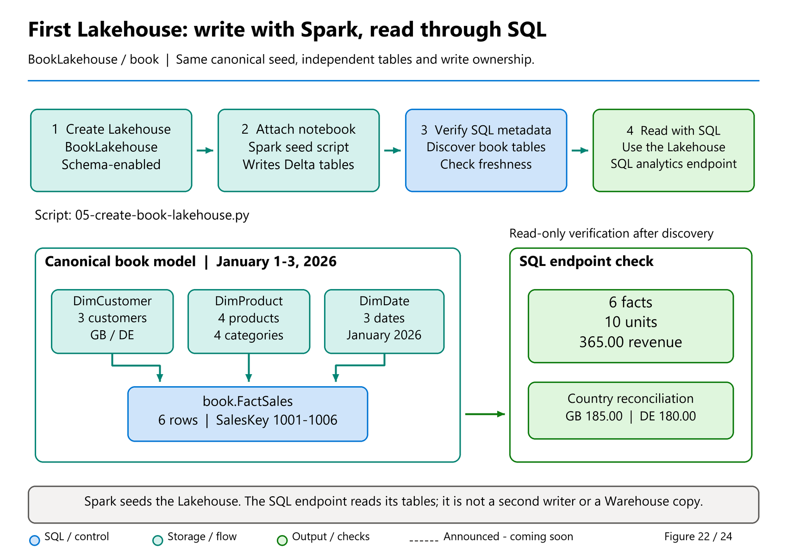
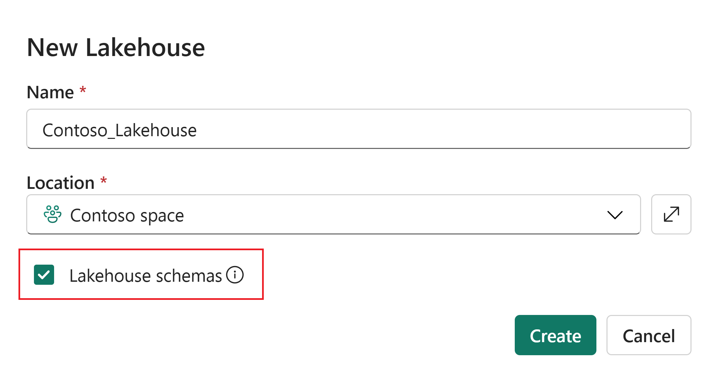

# 05. Your first Lakehouse and SQL analytics endpoint

[Book contents](../../index.md) | [Part I contents](README.md) | [Previous: Chapter 4](04-first-warehouse.md) | [Next: Chapter 6](06-gpu-acceleration-overview.md)

**Applies to:** a schema-enabled Fabric Lakehouse, its Spark notebook, and its SQL analytics endpoint. **Level:** 100. **Feature scope:** core walkthrough checked 8 October 2026; UI guide updated 9 October; discovery and provisioning boundaries rechecked 9 November. This seed does not require the new metadata-sync preview.

## One dataset, a different writer

In the previous chapter, T-SQL created and populated tables in `BookWarehouse`. This chapter produces an independent copy of the same dataset in `BookLakehouse`. A Spark notebook writes the Delta tables; the Lakehouse SQL analytics endpoint then queries them with T-SQL.

The distinction is deliberate. We are not connecting a second SQL client to the Warehouse, and we are not creating a replica maintained by Fabric. After these two setup exercises, you have two separate copies with matching initial values. Changing either copy does not automatically change the other. That makes comparison useful and also creates a responsibility: retain the original sample unless an exercise explicitly asks you to change a separately named lab object.

**Prerequisites:** an isolated capacity-backed workspace, Contributor or higher authoring access, a notebook capable of running PySpark, and the [complete Lakehouse seed](../../scripts/05-create-book-lakehouse.py). No private source, storage credential, or external package installation is needed. The sample uses built-in PySpark, Python standard-library types, and Fabric NotebookUtils.



*Figure 22. Two checkpoints in one learning flow: Spark persists the tables; the SQL endpoint independently reads them.*

The synchronization boundary is the important pause in this picture. A successful Spark save proves a write happened, not that the SQL reader has already discovered every object. Conversely, an empty explorer is not an instruction to overwrite the Lakehouse. Compare this with Figure 21 in the previous chapter: our four Spark saves are separate writes, not the Warehouse seed's single table/load transaction.

## Create a schema-enabled item

In the same learning workspace, select **New item**, then **Lakehouse**. Enter `BookLakehouse` and keep **Lakehouse schemas** selected. Current portal creation enables schemas by default, but inspect the checkbox rather than assuming all older Lakehouses support them. The [creation guide](https://learn.microsoft.com/en-us/fabric/data-engineering/create-lakehouse) and [schema guide](https://learn.microsoft.com/en-us/fabric/data-engineering/lakehouse-schemas) distinguish portal defaults from REST creation, where schema enablement must be requested explicitly.

After creation, the Lakehouse explorer shows **Tables** and **Files**. Under Tables, a schema-enabled Lakehouse has a default `dbo` schema. Use the Tables menu's **New schema** action to create `book`. Leave it empty.

Creating the schema through the explorer makes this first exercise easier to diagnose. The seed expects that schema and will stop before writing if it cannot list its tables. Do not create a folder called `book` under Files and expect it to be equivalent; a storage folder and a table namespace have different purposes.

Fabric also provisions the SQL analytics endpoint for the Lakehouse. If provisioning fails, the documented retry action can reprovision the endpoint without first deleting the Lakehouse. An endpoint-provisioning failure is not evidence that your future Delta data needs to be rebuilt.

For larger deployments, the endpoint overview documents a combined limit of **150 Warehouse and SQL analytics endpoint items per workspace**, not 150 of each. Include automatically provisioned endpoints in the deployment inventory. This is a rechecked existing limit, not a new November allocation or a reason to delete a working item to complete this lab.



*Documentation image D25. Microsoft, [Creating a schema-enabled Lakehouse](https://learn.microsoft.com/en-us/fabric/data-engineering/lakehouse-schemas); [original image](https://learn.microsoft.com/en-us/fabric/data-engineering/media/lakehouse-schemas/new-lakehouse.png). Unmodified source copy, retrieved 9 November 2026; [CC BY 4.0](https://creativecommons.org/licenses/by/4.0/) under the [Fabric documentation licence](https://github.com/MicrosoftDocs/fabric-docs/blob/aadea08f35c3edaa9c32535c772792f02555c9a4/LICENSE). This public creation dialog illustrates schema enablement; the reader must still verify the actual item/default attachment.*

## Attach the notebook correctly

Create or open a notebook in this workspace and attach `BookLakehouse` as its **default** Lakehouse. Verify the default indicator in the notebook explorer. Merely listing a Lakehouse among attached data items is not enough when code uses two-part names such as `book.FactSales`.

Set the code cell language to PySpark/Python, not Spark SQL. Paste the full contents of [05-create-book-lakehouse.py](../../scripts/05-create-book-lakehouse.py) into one cell. It is ordinary notebook-cell code; it is not a command-line program for your laptop.

Before writing, the script reads `notebookutils.runtime.context`. It requires the default Lakehouse name to be `BookLakehouse` and its workspace to match the notebook's current workspace. These are defensive checks based on the documented [runtime-context properties](https://learn.microsoft.com/en-us/fabric/data-engineering/notebookutils/notebookutils-runtime). They do not prove you selected the intended organizational workspace, so you must still inspect that workspace yourself.

For this lab, do not change the active Lakehouse or namespace midway through the cell. If you changed an attachment after starting a session, ensure the running session reflects the change before execution; restarting the session is preferable to ignoring a failed context check. A safety check that stops the notebook is more valuable than a seed that succeeds in the wrong item.

## Why the Python types are explicit

Spark can infer a schema from Python rows, but inference is a poor contract for a teaching example intended to match SQL types. A Python integer might infer as a long where we wanted an integer. A floating-point price might infer as a double where we wanted an exact decimal. The script therefore supplies a `StructType` for every table.

Customer and product keys use `IntegerType`. The sales key uses `LongType`, which maps to SQL `bigint`. Year and month use `ShortType`, which maps to SQL `smallint`. Dates are Python `date` objects with `DateType`. Unit prices are `Decimal` objects with `DecimalType(12,2)`. The modification timestamp uses `TimestampType` and a timezone-aware UTC Python value.

The notebook temporarily sets Spark's time zone to UTC and case-sensitive name resolution while creating and checking the explicitly cased tables, then restores both settings. This makes timestamp display and identifier handling deliberate without leaving the session reconfigured. The SQL endpoint exposes a `datetime2` representation; the business convention remains that `LastModifiedUtc` represents UTC, not a local wall-clock time.

String columns use `StringType`. This is intentionally compatible with the endpoint, but it does not reproduce the Warehouse's `varchar(100)`, `varchar(50)`, and `varchar(2)` declarations byte for byte. SQL endpoint types and widths are derived from Delta metadata according to the service's [mapping rules](https://learn.microsoft.com/en-us/fabric/data-warehouse/data-types). Inspect the actual endpoint catalog if widths matter. The current documentation also distinguishes extended string support by metadata-sync generation, so a universal width assumption would be unsafe.

All sample strings are short ASCII values. Nothing here tests maximum-length Unicode data, nested structures, or new Delta protocol features. Do not infer support for an entire production schema merely because these four simple tables appear.

## Write once, refuse replacement

Run the complete cell. It first lists the `book` schema and checks all four target names. If any target exists, it refuses to write. It builds all explicitly typed DataFrames before saving the first table, and every write uses Delta format with `errorifexists`.

That mode is essential. A convenient-looking `overwrite` sample can replace a table's contents and potentially its schema; it is not appropriate for a seed that might be run against an already populated item. An existence precheck is also not sufficient by itself because another writer could create a table between the check and the save. The write mode provides the second protection.

There is no atomic transaction spanning all four saves in this notebook. If a later save fails, earlier tables may remain. The exception path prints which saves completed, performs no cleanup, and preserves the error. Do not respond to a partial run by changing the mode to overwrite or append. Inspect the partial state and decide whether to repair the isolated lab deliberately or start in a newly verified learning item.

On success, the script checks the stored row counts and calculates totals from the persisted Delta tables. Expect the message "6 facts; quantity 10; revenue 365.00" and country totals DE 180.00 and GB 185.00. These are specified expected outcomes; this manuscript was not prepared by executing a notebook in a real tenant.

## Open the SQL endpoint and verify independently

Use the Lakehouse explorer's experience selector to switch to **SQL analytics endpoint**, or select the endpoint item with the Lakehouse's name in the workspace. Open a new SQL query. You are now issuing T-SQL, not Spark SQL.

**Runnable, read-only T-SQL; execute in the SQL analytics endpoint for `BookLakehouse`, after the four tables are visible.**

```sql
SELECT DB_NAME() AS CurrentDatabase;

SELECT COUNT_BIG(*) AS FactRows,
       SUM(Quantity) AS Units,
       CAST(SUM(Quantity * UnitPrice) AS decimal(18,2)) AS Revenue
FROM book.FactSales;

SELECT c.CountryCode,
       CAST(SUM(f.Quantity * f.UnitPrice) AS decimal(18,2)) AS Revenue
FROM book.FactSales AS f
JOIN book.DimCustomer AS c ON c.CustomerKey = f.CustomerKey
GROUP BY c.CountryCode
ORDER BY c.CountryCode;
```

The same 6 / 10 / 365.00 and country totals must appear here. A Spark success message alone does not verify endpoint visibility. Conversely, a table temporarily missing from the endpoint does not prove the Spark write failed.

For a second inspection, read the column metadata.

**Runnable, read-only T-SQL; execute in the Lakehouse SQL analytics endpoint.**

```sql
SELECT s.name AS SchemaName, t.name AS TableName,
       c.name AS ColumnName, TYPE_NAME(c.user_type_id) AS TypeName,
       c.max_length, c.precision, c.scale
FROM sys.tables AS t
JOIN sys.schemas AS s ON s.schema_id = t.schema_id
JOIN sys.columns AS c ON c.object_id = t.object_id
WHERE s.name = 'book'
ORDER BY t.name, c.column_id;
```

Compare numeric, decimal, and date types with the Warehouse definitions, then notice the service-derived string widths. Equivalent data and compatible analytical types do not imply identical metadata.

## Use the current SQL interface without crossing the write boundary

**Dated feature guide: 9 October 2026.** The shared SQL editor's current documentation applies to Warehouse, SQL analytics endpoint, and mirrored-database query experiences. The September GA improvements to the grid, Object Explorer, IntelliSense, autosave, bulk query management, and `.sql` import/export make navigating and retaining your work easier. [Chapter 4](04-first-warehouse.md#your-editor-as-of-9-october-2026) separates these shipped improvements from individually unconfirmed announcements.

In this endpoint, use the improved grid to inspect the totals and the explorer to locate `book`. The SQL results preview's 10,000-row limit and Data preview's 1,000-row limit still are not row-count tests. Our six facts fit in either view, but a production reconciliation should use an explicit aggregate rather than counting visible grid rows.

Save or export the read-only verification query with a name that identifies `BookLakehouse`. Autosaving its text does not rerun Spark or refresh SQL metadata. Similarly, importing the Warehouse seed into a familiar-looking SQL editor would not make its table-creation and insert operations valid here.

The announcement of no-code table creation does not establish a new Lakehouse endpoint write path. The individually announced table-deep-dive experience also lacks a confirmed workflow and release status in this revision's public evidence. Until that contract is clear, the catalog query above provides an explicit way to inspect SQL's view of the table without inventing menu actions.

For optional analysis, the existing **Visualize results** and **Explore this data (preview)** features are documented; unspecified newly announced charts are not assumed to be those same features. Reconcile the country totals first. A visual can help compare GB's 185.00 with DE's 180.00, but it cannot explain a missing table or prove synchronization completed.

Finally, **Save as table** in the SQL editor is documented as CTAS into a chosen **Warehouse**. It does not update the Lakehouse Delta table through this endpoint. Such a materialization would introduce another object and refresh responsibility, so it is outside this read-only verification exercise.

## When the table is not visible

Work through the ownership boundary in order. First, confirm that the Spark table is registered under the default Lakehouse's `book` schema. Second, confirm that it is a managed Delta table, not a CSV under Files or an external Spark registration pointing somewhere the endpoint does not discover. Third, inspect whether the endpoint has discovered its schema and supported columns.

Not every absence is a delay:

| Observation | Check before refreshing again |
| --- | --- |
| External Delta data is visible only through a Spark registration | Use the documented **Tables shortcut** route for external Delta data; a Spark registration alone is not SQL discovery. |
| The table appears, but a required column does not | Compare the Delta type with supported SQL mappings. Unsupported nested or unlisted types are not automatically flattened into SQL columns. |
| A later schema change does not appear | Check endpoint foreign-key metadata and OneLake RLS/CLS dependencies; do not assume waiting removes those constraints. |
| A schema fails to synchronize | Check for names conflicting with system schemas or database security principals, as well as permissions and provisioning. |

These are inspection steps, not instructions to drop a constraint, remove a security policy, or rewrite the source table. [Chapter 15](../03-sql-analytics-endpoint/15-metadata-sync-v1-v2.md#check-table-features-and-column-representation-separately) separates table-feature compatibility from SQL column exposure.

The [metadata-sync documentation](https://learn.microsoft.com/en-us/fabric/data-engineering/sql-analytics-endpoint-metadata-sync) explains background discovery and refresh. Use the endpoint explorer's refresh action when appropriate, and allow the operation to finish. Repeatedly rerunning the seed will not make discovery safer or faster.

As of this edition, new metadata sync is a preview that must be enabled for newly created endpoints; existing endpoints do not automatically upgrade when the workspace option changes. Its query-triggered data refresh does not make every table-discovery or schema-change operation synchronous. This lab works without opting into that preview. [Chapter 15](../03-sql-analytics-endpoint/15-metadata-sync-v1-v2.md) covers version-specific diagnostics and refresh commands.

Do not try to fix a missing Lakehouse table by running the Warehouse `CREATE TABLE` seed at the endpoint. The endpoint is read-only for the underlying table data. Creating a view there is a different operation and cannot repair a failed Spark load.

## Safety and completion

Completion means both Spark and SQL return the expected totals, the four tables occupy `book`, and you can explain which engine wrote them. Keep the notebook and its output as lab evidence, but do not mistake an output cell from yesterday for a new verification today.

Leave both sample items intact for [Chapter 14](../03-sql-analytics-endpoint/14-sql-analytics-endpoint.md). Do not delete the Lakehouse merely to clear a notebook error: item deletion removes much more than the failed cell's output and can affect dependent artifacts. No automatic cleanup is included.

## Key takeaways

- Attach a schema-enabled default Lakehouse and verify its context.
- Explicit Spark types make the SQL comparison meaningful.
- `errorifexists` protects existing data; separate table writes can still leave partial progress.
- Verify endpoint visibility independently of the Spark commit.

## References

1. Microsoft Learn, [Create a lakehouse](https://learn.microsoft.com/en-us/fabric/data-engineering/create-lakehouse).
2. Microsoft Learn, [Lakehouse schemas](https://learn.microsoft.com/en-us/fabric/data-engineering/lakehouse-schemas).
3. Microsoft Learn, [NotebookUtils runtime context](https://learn.microsoft.com/en-us/fabric/data-engineering/notebookutils/notebookutils-runtime).
4. Microsoft Learn, [Lakehouse SQL analytics endpoint](https://learn.microsoft.com/en-us/fabric/data-engineering/lakehouse-sql-analytics-endpoint).
5. Microsoft Learn, [SQL analytics endpoint metadata sync](https://learn.microsoft.com/en-us/fabric/data-engineering/sql-analytics-endpoint-metadata-sync).
6. Microsoft Learn, [Data types and Delta-to-SQL mappings](https://learn.microsoft.com/en-us/fabric/data-warehouse/data-types).
7. Microsoft Learn, [SQL query editor](https://learn.microsoft.com/en-us/fabric/data-warehouse/sql-query-editor) and [Data preview](https://learn.microsoft.com/en-us/fabric/data-warehouse/data-preview), consulted 9 October 2026.
8. Fabric product team, [Advancing the SQL query editor](https://community.fabric.microsoft.com/blog/fbc_fabricupdatesblogs/advancing-the-microsoft-fabric-sql-query-editor/5364033) and [September 2026 feature summary](https://community.fabric.microsoft.com/blog/fbc_fabricupdatesblogs/fabric-september-2026-feature-summary/5325825), consulted 9 October 2026.
9. Tino Tereshko, [Warehouse announcement roundup](https://www.linkedin.com/posts/valentinotereshko_speed-run-of-fabric-data-warehouse-announcements-activity-7510726240522293248-r4tC), 29 September 2026; mixed UI announcement, not an endpoint table-write contract.

---

[Previous: Chapter 4](04-first-warehouse.md) | [Book contents](../../index.md) | [Next: Chapter 6](06-gpu-acceleration-overview.md)
