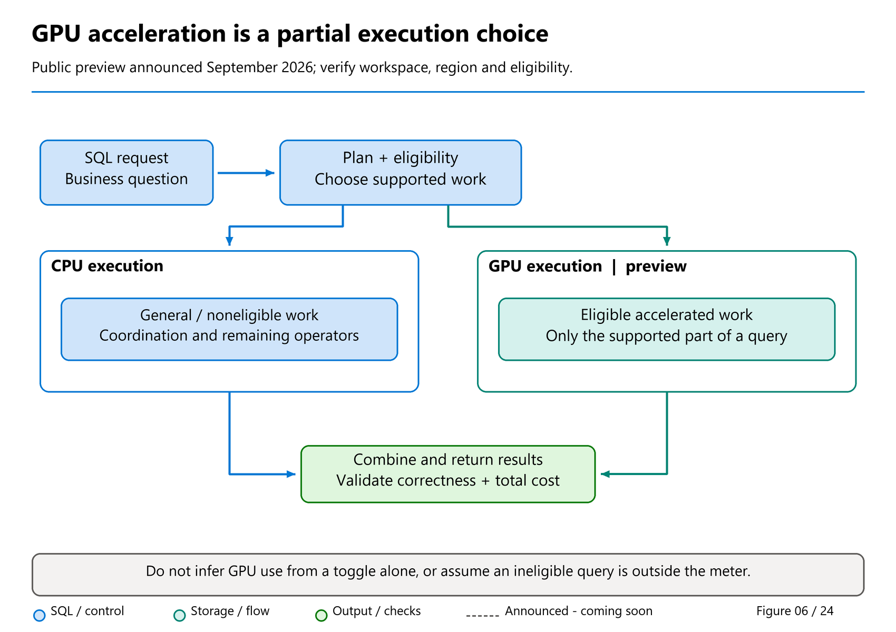

# 06. GPU acceleration: a faster helper, not a different database

[Book contents](../../index.md) | [Part I contents](README.md) | [Previous: Chapter 5](05-first-lakehouse-and-sql-endpoint.md) | [Next: Chapter 7](../02-building-analytical-solutions/07-tsql-for-analytics.md)

**Applies to:** eligible Warehouse and SQL analytics endpoint queries in a query-acceleration-enabled workspace. **Level:** 100. **Evidence cutoff:** 10 October 2026. **Status:** public preview announced 29 September 2026; older Learn onboarding guidance still describes limited-preview approval and regional restrictions. No acceleration setting is changed in this chapter.

## The sales question has become popular

Our six-row retailer has been easy to understand. Now imagine its model holds years of sales and hundreds of people open reports at the start of the day. The question is still recognizable: join sales to customers, group by country, and add the revenue. The volume of work—and the number of simultaneous questions—has changed.

You might first think, "Give the database more processors." That can help some workloads, but there is another possibility: give suitable parts of the calculation a different kind of processor. Fabric's **query acceleration** adds GPU-assisted execution to its SQL engine.

You do not need to learn GPU programming to understand the idea. More importantly, you do not need acceleration to complete this book's introductory labs. This chapter gives you enough vocabulary to read an announcement or discuss an evaluation. [Chapter 34](../06-operating-the-platform/34-gpu-acceleration.md) covers detailed eligibility, evidence, monitoring, and economics.

## CPU and GPU in everyday terms

A **CPU**, or central processing unit, is a versatile processor. It is well suited to coordinating work, handling different instructions, and executing complex control flow. Modern CPUs already perform substantial parallel analytical work; ordinary Warehouse execution is not a single clerk adding every row one at a time.

A **GPU**, or graphics processing unit, is especially useful when many similar operations can run in parallel. Its name reflects its graphics origins, not a requirement that the workload draw pictures. Processing large batches of values can be useful for analytical scans, filters, joins, and aggregations as well.

Think of preparing a large mailout. Someone must interpret the request, decide who belongs on the list, and coordinate the stages. A specialized machine can rapidly perform a repetitive stage such as applying labels. Buying that machine does not remove the coordination work, fix the address list, or make every activity equally faster.

The analogy has limits: database operations and hardware are more complex. Its useful lesson is simply that **specialization complements coordination**. Fabric's documented model uses GPUs as coprocessors alongside CPUs, rather than replacing the SQL service with a separate GPU database.

## What happens to a SQL query?

You submit ordinary supported T-SQL. Fabric plans the work and identifies eligible portions that can benefit from the accelerated execution path. CPU and GPU processing cooperate, and results return through the familiar SQL interface.



*Figure 6. Conceptual CPU/GPU cooperation, not a fixed device count or observed physical topology.*

Follow the query to the planning stage before following the two execution paths. The GPU branch contains eligible work, not necessarily the whole query. The CPU branch remains necessary. Both branches contribute to the same requested result; the figure does not show two independent copies of the database.

An important word here is **portion**. A useful accelerated join-and-aggregation fragment may dominate a query's work even when other operations remain on CPUs. Another query may have no suitable fragment. A workspace setting alone therefore does not prove that every query—or every operator in a query—used a GPU.

Microsoft's overview describes this as a transparent execution capability: no separate data migration, schema conversion, or special SQL syntax is required merely to use acceleration. That convenience does not expand the SQL language or turn an unsupported expression into a supported one.

## From research idea to Warehouse feature

Three names help explain the ancestry without requiring you to become a GPU programmer.

**TQP**, the original Tensor Query Processor research published in 2022, asked whether database calculations could use software already built for machine learning. It translated query operations into **tensor programs**: calculations over arrays of values. Reusing that software offered a way to explore different processors without building an entirely new database engine for each one. This was a research prototype, not an earlier name for a supported Warehouse setting.

**TQP++**, published in 2026, investigated better ways to generate those calculations. A **compiler** translates an operation into instructions a processor can run. TQP++ adapted machine-learning compiler technology to SQL: it coordinated GPU memory, combined compatible calculation steps, and chose algorithms according to the data. Its results explain the opportunity; they do not predict how quickly your report will finish.

**CoddSpeed** describes the production-oriented integration with Fabric Warehouse. The public abstract and Microsoft's award article explain how eligible pieces of a plan can be handed to an accelerator while the existing database continues planning and coordinating work. Moving data efficiently matters alongside calculating quickly. CoddSpeed received the **SIGMOD 2026 Industry Track Best Paper** award, independently listed by the conference.

This is an ancestry, not three interchangeable engine names. TQP++'s productization account says the initial implementation integrated PyTorch, a machine-learning framework; its GPU kernels later evolved to handwritten CUDA code for NVIDIA GPUs, with extra work for correct SQL behavior. The product did not adopt **just-in-time fusion**, which compiles combined calculation steps for a query, because that compilation adds waiting time. Research can guide a product without every research technique becoming a shipped feature. The chapter 4 revenue query still needs exactly the same decimal answer.

### Find the papers without confusing the downloads

| Read this | What it explains | Public discovery and reading links |
|---|---|---|
| **Original TQP:** *Query Processing on Tensor Computation Runtimes* (2022) | The initial idea of translating SQL into tensor calculations | [Microsoft Research record](https://www.microsoft.com/en-us/research/publication/query-processing-on-tensor-computation-runtimes/) · [Full paper, 15 pages](https://www.vldb.org/pvldb/vol15/p2811-he.pdf) |
| **TQP++:** *Bridging ML Compilers and Analytical Query Processing on GPUs* (2026) | More efficient, portable GPU query compilation | [Microsoft Research record](https://www.microsoft.com/en-us/research/publication/tqp-bridging-ml-compilers-and-analytical-query-processing-on-gpus/) · [Full paper, 14 pages](https://www.vldb.org/pvldb/vol19/p4116-cui.pdf) |
| **CoddSpeed:** *Hardware Accelerated Query Processing in Microsoft Fabric* (2026) | Integration, data movement, and the path to a production engine | [Microsoft Research abstract](https://www.microsoft.com/en-us/research/publication/coddspeed-hardware-accelerated-query-processing-in-microsoft-fabric/) · [Publisher paper](https://doi.org/10.1145/3788853.3803077) · [Accessible award article](https://community.fabric.microsoft.com/blog/fbc_fabricupdatesblogs/from-research-to-product-microsoft-fabric-wins-best-industry-paper-at-sigmod-202/5191608) |

The TQP++ discovery URL contains `tqp`, but its title and current content describe **TQP++**. Its Microsoft-hosted PDF download is a short presentation; the linked PVLDB PDF above is the complete paper. CoddSpeed's publisher full text could not be retrieved during this revision, so this book uses its abstract and award article rather than claiming a full-paper review.

For a beginner, the useful conclusion is not a headline speedup. It is that the feature rests on several years of research and engineering, and still needs workload-specific evaluation. [Chapter 34](../06-operating-the-platform/34-gpu-acceleration.md) separates the experiments, explains their limits, and shows what operators should measure.

## Which questions might benefit?

Consider a country-by-product revenue report over a large fact table. Reading relevant sales values, joining dimensions, and combining many rows into a small answer may expose substantial parallel work. If eligible work is a major part of elapsed time, acceleration is worth evaluating.

Now consider a tiny lookup returning one customer name. Connection overhead, compilation, or delivery to the browser may matter more than the arithmetic. Or consider a query returning millions of detailed rows: sending and displaying those rows can remain expensive even if some processing finishes sooner.

These examples describe hypotheses, not guarantees. Eligibility depends on query shape, supported operators, functions, and types. Workload benefit also depends on data distribution, concurrency, and the time spent outside accelerated processing. Do not promise a fixed speedup from the presence of a `JOIN` or `GROUP BY`.

It is also important to separate **latency** from **throughput**. Latency is how long a user waits for an answer. Throughput is how much work completes over a period. A team serving many concurrent analysts should investigate both, including the slowest portion of its user experience, not just its fastest isolated query.

## What acceleration does not change

Acceleration does not decide which rows belong in revenue. A join that duplicates sales remains a wrong query even if it completes sooner. Nor does it refresh a stalled upstream load, repair a broken shortcut, or grant permission to a reader.

The ownership rules from [Chapter 14](../03-sql-analytics-endpoint/14-sql-analytics-endpoint.md) still apply. Warehouse SQL can perform supported table writes. A Lakehouse or mirrored-database SQL analytics endpoint remains a reader over its underlying table data. GPU-assisted reading does not make that endpoint writable.

The feature is also not a blanket accelerator for everything in Fabric. The documented scope is eligible SQL execution. A Power BI DirectQuery scenario may benefit when it generates eligible Warehouse SQL; that is different from directly accelerating DAX or guaranteeing the same improvement in final report-rendering time. Spark processing has its own execution capabilities and should not be inferred from a Warehouse announcement.

## Read the preview date carefully

The public status changed during this book's revision window. Bogdan Crivat's **29 September 2026** FabCon Europe article announces GPU-accelerated Warehouse query execution in **public preview**. That is the current announcement-level status used here, not general availability.

The Learn overview dated **11 August 2026** still describes limited-preview registration, approval, and five supported regions. A later product article likewise discusses preview access. These sources answer different questions: the newer announcement establishes the broader preview milestone, while the onboarding material still warns that eligibility and access are not universal.

Before planning an evaluation, verify current availability for your tenant, capacity region, and workspace with the current product guidance and your administrator. Do not move a production workspace or assume an absent toggle is a defect merely because an announcement says "public preview."

There is no need to resolve this operational question for the six-row learning model. Leave acceleration unchanged and continue learning SQL.

## Two decisions before touching a setting

The first decision is whether there is a relevant workload to evaluate. A slow large analytical join is a stronger candidate than a screenshot showing that a tiny sample query took a moment. Establish the business target: perhaps a report must remain responsive during a busy reporting period.

The second decision is whether the evaluation is operationally acceptable. The documented setting applies across Warehouses and SQL analytics endpoints in a workspace. Enabling or disabling it cancels currently running queries there. It is therefore not a harmless personal preference comparable to changing an editor font.

Cost must also enter the decision. The current FAQ says that, once acceleration is enabled, **all queries in that workspace use the acceleration meter, including queries that are not accelerated**. A quicker eligible query does not by itself prove a cheaper overall workload.

Part I does not need a rate table. It needs the right question: "Does the complete workload meet its performance objective at an acceptable resource cost?" Chapter 34 explains how to collect the evidence and avoid confusing a faster individual execution with a better system-wide result.

## Safe exercise: identify the work, not the hardware

**Prerequisites:** the unchanged `BookWarehouse` seed from [Chapter 4](04-first-warehouse.md). **Preview prerequisites:** none; use the existing workspace configuration. **Effect:** one read-only query. Do not enable acceleration or generate concurrent load.

```sql
SELECT c.CountryCode,
       COUNT_BIG(*) AS SalesLines,
       CAST(SUM(f.Quantity * f.UnitPrice) AS decimal(18,2)) AS Revenue
FROM book.FactSales AS f
JOIN book.DimCustomer AS c ON c.CustomerKey = f.CustomerKey
GROUP BY c.CountryCode
ORDER BY c.CountryCode;
```

Expect DE to have two lines and revenue 180.00, and GB to have four lines and revenue 185.00. First explain which SQL parts identify matching customers and which combine revenue. Then imagine the fact table contains years of transactions: which steps might do substantially more work?

Finally, answer two questions without another execution. Would a faster run prove that GPU acceleration occurred? No; caches, compilation, and other conditions also affect time. Would equal totals prove equal cost? No; correctness and resource consumption are different measurements.

The point is to recognize candidate work while preserving the result contract. Six rows cannot establish a useful acceleration benchmark. In an approved larger evaluation, query history and execution-plan evidence—not a stopwatch alone—help determine whether acceleration actually applied.

## Keep the right mental model

GPU acceleration is a specialized helper inside the SQL execution story you already know. The same business meaning, write ownership, and security responsibilities remain. Learn the feature now; enable it only when eligibility, workload evidence, cost, and operational approval justify the change.

## References

Public sources consulted through 10 October 2026:

1. Bogdan Crivat, [Bringing governed analytics into the flow of work](https://community.fabric.microsoft.com/blog/fbc_fabricupdatesblogs/bringing-governed-analytics-into-the-flow-of-work-fabric-analytics-at-fabcon-eur/5368918), 29 September 2026, updated 30 September; public-preview announcement.
2. Microsoft Learn, [Query acceleration](https://learn.microsoft.com/en-us/fabric/data-warehouse/query-acceleration), 11 August 2026; execution model, eligibility, older onboarding limits, and cancellation warning.
3. Microsoft Learn, [Query acceleration FAQ](https://learn.microsoft.com/en-us/fabric/data-warehouse/query-acceleration-faq); partial eligibility, metering scope, and Power BI distinction.
4. Fabric product team, [Ten things to know about GPU-powered query acceleration](https://community.fabric.microsoft.com/blog/fbc_fabricupdatesblogs/10-things-to-know-about-gpu-powered-query-acceleration-in-fabric-data-warehouse-/5359441); eligible fragments and workload-dependent benefits.
5. [Chapter 34: GPU acceleration](../06-operating-the-platform/34-gpu-acceleration.md), for the book's deeper evaluation and operations treatment.
6. Dong He and coauthors, *Query Processing on Tensor Computation Runtimes*, PVLDB 15(11), 2022, §§3–4; Wei Cui and coauthors, *TQP++*, PVLDB 19(12), 2026, especially §10, pp.4126–4127. Full-paper links are in the discovery table; bibliography entries [PAPER05](../../appendices/D-bibliography.md#paper05) and [PAPER06](../../appendices/D-bibliography.md#paper06) record review scope.
7. Matteo Interlandi, *From research to product*, 2 June 2026, updated 3 June; article linked above and registered as [TEAM12](../../appendices/D-bibliography.md#team12). CoddSpeed's award is independently confirmed by the [SIGMOD 2026 awards list](https://2026.sigmod.org/sigmod_awards.shtml); its abstract is registered as [PAPER04](../../appendices/D-bibliography.md#paper04).

---

[Previous: Chapter 5](05-first-lakehouse-and-sql-endpoint.md) | [Book contents](../../index.md) | [Next: Chapter 7](../02-building-analytical-solutions/07-tsql-for-analytics.md)
