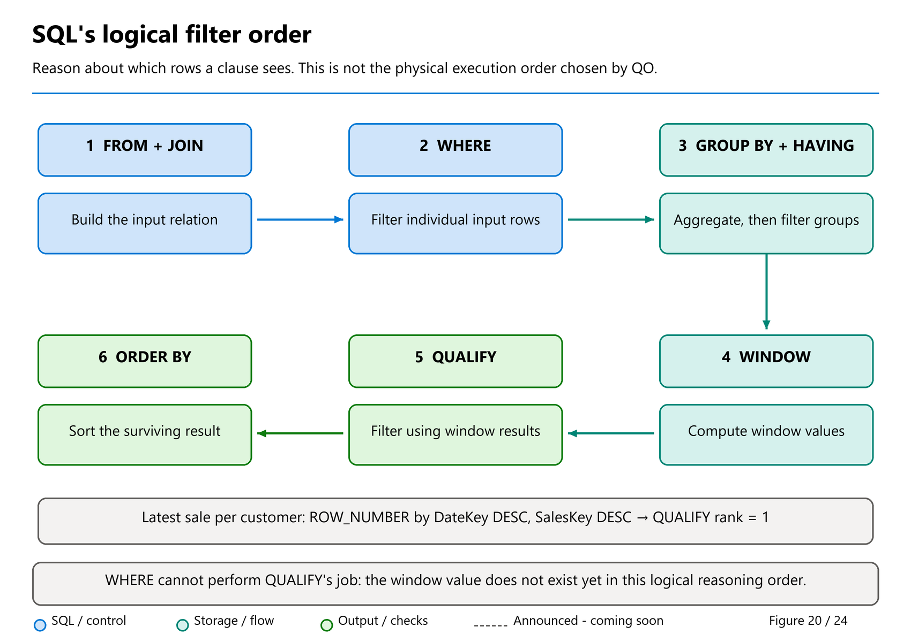

# 07. T-SQL fundamentals for trustworthy analytics

[Book contents](../../index.md) | [Part II contents](README.md) | [Previous: Chapter 6](../01-getting-started/06-gpu-acceleration-overview.md) | [Next: Chapter 8](08-dimensional-modeling.md)

**Applies to:** Fabric Warehouse and the Lakehouse SQL analytics endpoint for all queries below. **Level:** 100-200. **Feature scope:** established examples retained from 8 October 2026; the four-feature language bundle and REGEX/fuzzy-string contracts rechecked 9 November. Build-roundup concatenation, Unicode and date-bucketing additions checked 10 November 2026. Preserve each section's preview qualification; a current syntax reference is not an independently established GA date. Support here does not imply identical support in SQL Server or SQL database in Fabric.

## Ask what one result row means

SQL is a language for describing sets and relationships, not a request to process rows in the order you happen to see them. Before typing `SELECT`, finish this sentence: "One row of my result represents..." It might represent one sales line, one customer, or one day. That answer determines which columns belong together and where aggregation must occur.

Our input has one row per synthetic sales line. Quantity is a count of units on that line; unit price is the price of one unit; their product is line revenue. `SalesKey` identifies the line in this teaching dataset, but no database-enforced business-transaction uniqueness is assumed.

**Prerequisites:** either sample item from [Chapter 4](../01-getting-started/04-first-warehouse.md) or [Chapter 5](../01-getting-started/05-first-lakehouse-and-sql-endpoint.md), unchanged after its [Warehouse](../../scripts/04-create-book-warehouse.sql) or [Lakehouse](../../scripts/05-create-book-lakehouse.py) seed. Run queries in a T-SQL editor, not a PySpark or Spark SQL cell. Every listing in this chapter is read-only; there is no cleanup.

## Projection, filtering, and ordering

Projection chooses output columns. A filter chooses qualifying input rows. Ordering chooses presentation order. These are separate responsibilities.

**Runnable, read-only T-SQL; execute in either sample SQL editor.**

```sql
SELECT SalesKey, DateKey, Quantity, UnitPrice,
       CAST(Quantity * UnitPrice AS decimal(18,2)) AS LineRevenue
FROM book.FactSales
WHERE Quantity >= 2
ORDER BY SalesKey;
```

This returns keys 1001, 1003, and 1005, with revenues 50.00, 30.00, and 100.00. The alias names the calculated result; it does not add a stored column to `FactSales`.

Use explicit columns rather than `SELECT *` in durable interfaces. A newly added source column should not silently alter an extract's shape or expose an attribute a consumer never requested. `SELECT *` can be convenient while exploring a six-row lab, but convenience is not an interface contract.

The logical processing model helps explain a common error: `WHERE` is evaluated before the `SELECT` list's output aliases are available. To filter by calculated revenue, repeat the expression or put the calculation in a common table expression and filter its result. Do not assume the written order of clauses is the physical execution order; the optimizer can choose an equivalent plan.



*Figure 20 — Conceptual logical processing, not an observed physical execution plan.* Follow a sales line through the diagram: `WHERE` can remove it before it contributes to a total; `HAVING` can remove its resulting group; `QUALIFY` can remove a row after its window value has been calculated. Changing the spelling to FROM-first does not rearrange these responsibilities.

Always provide `ORDER BY` when order matters. Even a stable-looking preview does not establish a storage order. For a top-N result, include a tie-breaking column if the application requires deterministic selection.

## Dates, strings, and NULL are not decoration

Our integer `DateKey` is a relationship key, while `CalendarDate` has actual date semantics. Use the latter when expressing calendar rules. A half-open range includes its lower boundary and excludes its upper boundary; this pattern also extends cleanly to timestamps.

**Runnable, read-only T-SQL; execute in either sample SQL editor.**

```sql
SELECT d.CalendarDate,
       CAST(SUM(f.Quantity * f.UnitPrice) AS decimal(18,2)) AS Revenue
FROM book.FactSales AS f
JOIN book.DimDate AS d ON d.DateKey = f.DateKey
WHERE d.CalendarDate >= CAST('20260101' AS date)
  AND d.CalendarDate <  CAST('20260103' AS date)
GROUP BY d.CalendarDate
ORDER BY d.CalendarDate;
```

The result contains 1 January at 130.00 and 2 January at 55.00. It excludes 3 January. With a timestamp, a guessed upper bound such as 23:59:59 could miss fractional seconds. An exclusive next-day boundary avoids that particular defect.

String comparisons depend on collation. `CountryCode = 'GB'` expresses the actual stored code; do not expect a lowercase literal to match in every database. Standardize codes deliberately during ingestion rather than wrapping every query in transformations that hide inconsistent inputs.

`NULL` means an absent or unknown value, not an empty string and not zero. Use `IS NULL`, not `= NULL`. Most aggregates ignore null expressions; `COUNT(*)` counts result rows, while `COUNT(column)` counts rows whose specified column is non-null. Although the seed has no nulls, an outer join can introduce them immediately.

Avoid replacing all missing measures with zero merely to make a report look complete. "No sale occurred" and "the sale value is missing" are different facts. Choose the business interpretation before choosing `COALESCE`.

## Pipe concatenation: choose NULL behavior deliberately

**Build additions, announced as preview on 4 June 2026; detailed references checked 10 November for Warehouse and SQL analytics endpoint.** Tino Tereshko's [Build roundup](https://community.fabric.microsoft.com/blog/fbc_fabricupdatesblogs/from-query-acceleration-to-cache-cooldown-everything-new-in-fabric-data-warehous/5191621) includes `||`, `||=`, `UNISTR` and `DATE_BUCKET`, not just the later September language bundle. The specific references now explicitly include both analytical SQL surfaces; no later GA milestone is inferred here.

The [pipe concatenation operator](https://learn.microsoft.com/en-us/sql/t-sql/language-elements/string-concatenation-pipes-transact-sql?view=fabric&preserve-view=true) joins compatible character or binary expressions. Its [compound-assignment form](https://learn.microsoft.com/en-us/sql/t-sql/language-elements/compound-assignment-pipes-transact-sql?view=fabric&preserve-view=true), `SET @variable ||= expression`, appends and assigns to a variable. It does not update a table column.

**Optional T-SQL with feature availability - either SQL surface; local variables and literal expressions only, no persisted changes. Run the whole block together.**

```sql
DECLARE @label varchar(80) = 'Aster Retail';
SET @label ||= ' / GB';

SELECT @label AS Label,
       'Aster' || ' ' || 'Retail' AS ConcatenatedName,
       CASE
           WHEN ('Aster' || CAST(NULL AS varchar(10))) IS NULL
           THEN 'NULL propagated'
           ELSE 'Not NULL'
       END AS NullBehavior;
```

Expect `Aster Retail / GB`, `Aster Retail`, and `NULL propagated`. Either NULL input makes the concatenation NULL, independently of `CONCAT_NULL_YIELDS_NULL`; an empty string is different. This is not the same missing-value policy as `CONCAT`, which treats NULL arguments as empty strings. Choose the policy rather than mechanically replacing one spelling with another.

Type precedence and width still matter. A non-LOB intermediate concatenation can truncate at **8,000 bytes**, and `||=` can truncate to the declared variable width. Introducing a MAX operand only after an earlier intermediate has truncated does not recover the lost text. Size and convert deliberately, especially with UTF-8 byte lengths; a shorter operator is not a wider data contract.

## UNISTR: construct Unicode without changing the storage contract

**Same June preview announcement; detailed applicability checked 10 November 2026.** [UNISTR](https://learn.microsoft.com/en-us/sql/t-sql/functions/unistr-transact-sql?view=fabric&preserve-view=true) interprets Unicode escapes inside a string. With the default backslash escape, `\xxxx` identifies a UTF-16 code unit and `\+xxxxxx` identifies a Unicode code point. A second argument can choose a different escape character.

**Optional T-SQL with feature availability - either SQL surface; literal-only, read-only.**

```sql
SELECT UNISTR(N'Caf\00E9 Retail') AS UnicodeLabel;
```

Expect **Café Retail**. The `N` prefix makes the input a Unicode expression rather than relying on a legacy code page. For `char`/`varchar` inputs the reference requires a UTF-8 collation. This function constructs characters; it does not normalize customer identities, extend UTF-8's character repertoire, or make `nvarchar` a supported persisted Warehouse column type. [Chapter 3](../01-getting-started/03-anatomy-of-a-delta-table.md) explains why expression support and table storage differ.

## DATE_BUCKET: align intervals to an explicit origin

**Same June preview announcement; detailed applicability checked 10 November 2026.** [DATE_BUCKET](https://learn.microsoft.com/en-us/sql/t-sql/functions/date-bucket-transact-sql?view=fabric&preserve-view=true) returns the start of the interval containing a date/time value. Supply a literal datepart, a positive integer width, a typed date/time expression and, optionally, an origin of the **same type**. The default origin is Monday, 1 January 1900; specify your intended alignment instead of assuming that default expresses a business calendar.

**Optional T-SQL with feature availability - either unchanged seeded SQL surface; read-only.**

```sql
WITH BucketedSales AS
(
    SELECT DATE_BUCKET(day, 2, d.CalendarDate,
                       CAST('20260101' AS date)) AS BucketStart,
           f.Quantity, f.UnitPrice
    FROM book.FactSales AS f
    JOIN book.DimDate AS d ON d.DateKey = f.DateKey
)
SELECT BucketStart,
       COUNT_BIG(*) AS SalesLines,
       SUM(Quantity) AS Units,
       CAST(SUM(Quantity * UnitPrice) AS decimal(18,2)) AS Revenue
FROM BucketedSales
GROUP BY BucketStart
ORDER BY BucketStart;
```

Expect **1 January: four lines, seven units, 185.00** and **3 January: two lines, three units, 180.00**. The first interval contains 1 and 2 January; the second starts on 3 January. Both input and origin are `date`, so the bucket result is also `date`. The totals remain six lines, ten units and 365.00.

A bare string literal is not a valid typed date argument for this function, and mismatched date/origin types can error. Bucketing does not convert time zones, define a fiscal calendar, provide a unique event sequence or capture changes for a migration. Decide those contracts separately.

## Join cardinality determines whether totals are believable

A join connects rows according to its predicate. It does not automatically know that a dimension key is unique. If one fact row finds two matching customer rows, the result contains two copies of that fact's measures.

**Runnable, read-only T-SQL; execute in either sample SQL editor.**

```sql
SELECT c.CustomerKey, c.CustomerName,
       COUNT_BIG(*) AS SalesLines,
       SUM(f.Quantity) AS Units,
       CAST(SUM(f.Quantity * f.UnitPrice) AS decimal(18,2)) AS Revenue
FROM book.FactSales AS f
JOIN book.DimCustomer AS c ON c.CustomerKey = f.CustomerKey
GROUP BY c.CustomerKey, c.CustomerName
HAVING SUM(f.Quantity * f.UnitPrice) >= 100.00
ORDER BY Revenue DESC, c.CustomerKey;
```

This returns Birch Stores at 180.00 and Cedar Market at 105.00. Aster Retail's 80.00 does not satisfy `HAVING`. `WHERE` filters rows before grouping; `HAVING` filters the resulting groups. Moving a condition between them can change the question.

When you need customers with no facts, start from the customer dimension and use a left join. In that result, `COUNT(f.SalesKey)` can count actual matched sales while `COUNT(*)` would also count the dimension row preserved without a match. A predicate on the fact side placed in `WHERE` can inadvertently remove those preserved rows; place a qualifying fact-date condition in the join when that matches the intended question.

Do not add `DISTINCT` to an inflated join as a first response. It can conceal duplicates or remove legitimate equal-valued sales. Investigate key multiplicity and join grain, then correct the model or predicate.

Jovan Popovic's [ANY_VALUE article](https://community.fabric.microsoft.com/blog/fbc_fabricupdatesblogs/use-any-value-for-simpler-grouping-of-results-in-fabric-data-warehouse-generally/5172050) discusses carrying a descriptive attribute through grouping when it is functionally determined by the grouping key. That qualification is crucial: an arbitrary value is not a substitute for resolving conflicting customer names. We keep explicit grouping columns here so the beginner can see the relationship before adopting concise alternatives.

## Exact arithmetic and meaningful averages

The [Fabric type reference](https://learn.microsoft.com/en-us/fabric/data-warehouse/data-types) distinguishes persisted supported types from expression types. For arithmetic, also consider the result type: multiplication and aggregation can increase precision requirements, and integer arithmetic can truncate a ratio.

**Runnable, read-only T-SQL; execute in either sample SQL editor.**

```sql
SELECT COUNT_BIG(*) AS SalesLines,
       SUM(Quantity) AS Units,
       CAST(SUM(Quantity * UnitPrice) AS decimal(18,2)) AS Revenue,
       CAST(AVG(UnitPrice) AS decimal(18,2)) AS AverageLineUnitPrice,
       CAST(
           SUM(Quantity * UnitPrice) / NULLIF(SUM(Quantity), 0)
           AS decimal(18,2)
       ) AS WeightedUnitPrice
FROM book.FactSales;
```

The line-price average is 45.00; the quantity-weighted average is 36.50. Neither is "the average" without a definition. The weighted value divides 365.00 of revenue by 10 units, whereas the unweighted value gives each of the six lines equal influence regardless of quantity.

`NULLIF` turns a zero denominator into null, preventing divide-by-zero while preserving an undefined result. It does not assert that a null result should be displayed as zero. For larger datasets, explicitly size sums and intermediate types to avoid overflow; our final `decimal(18,2)` cast is a presentation choice for a tiny known range, not a universal financial-data standard.

## CTEs organize reasoning, not storage

A common table expression names a query result within the following statement. It can separate "calculate customer revenue" from "rank customers" without creating a permanent object. A CTE is not a promise that the engine materializes and caches that intermediate result.

**Runnable, read-only T-SQL; execute in either sample SQL editor.**

```sql
WITH CustomerRevenue AS
(
    SELECT c.CustomerKey, c.CustomerName,
           SUM(f.Quantity * f.UnitPrice) AS Revenue
    FROM book.FactSales AS f
    JOIN book.DimCustomer AS c ON c.CustomerKey = f.CustomerKey
    GROUP BY c.CustomerKey, c.CustomerName
),
RankedCustomers AS
(
    SELECT CustomerKey, CustomerName, Revenue,
           ROW_NUMBER() OVER
               (ORDER BY Revenue DESC, CustomerKey) AS RevenuePosition
    FROM CustomerRevenue
)
SELECT CustomerKey, CustomerName,
       CAST(Revenue AS decimal(18,2)) AS Revenue,
       RevenuePosition
FROM RankedCustomers
WHERE RevenuePosition <= 2
ORDER BY RevenuePosition;
```

Birch Stores is first and Cedar Market second. `ROW_NUMBER` assigns distinct positions, using the key to break revenue ties. If tied customers should share a rank, choose `RANK` or `DENSE_RANK` and define whether "top two" means two customers or two revenue levels.

The example uses ordinary sequential CTEs. It does not depend on nested CTE preview behavior or recursive queries. Fabric's [surface-area reference](https://learn.microsoft.com/en-us/fabric/data-warehouse/tsql-surface-area) should be checked before porting more advanced SQL patterns.

## Windows preserve rows while adding context

An aggregate with `GROUP BY` reduces detail to groups. A window aggregate adds a value across a defined set of rows while retaining the query's current row grain. For a running daily total, aggregate sales into days first, then window over those days.

**Runnable, read-only T-SQL; execute in either sample SQL editor.**

```sql
WITH DailyRevenue AS
(
    SELECT d.CalendarDate,
           SUM(f.Quantity * f.UnitPrice) AS Revenue
    FROM book.FactSales AS f
    JOIN book.DimDate AS d ON d.DateKey = f.DateKey
    GROUP BY d.CalendarDate
)
SELECT CalendarDate,
       CAST(Revenue AS decimal(18,2)) AS Revenue,
       CAST(SUM(Revenue) OVER
           (ORDER BY CalendarDate
            ROWS BETWEEN UNBOUNDED PRECEDING AND CURRENT ROW)
           AS decimal(18,2)) AS RunningRevenue
FROM DailyRevenue
ORDER BY CalendarDate;
```

Running revenue is 130.00, 185.00, then 365.00. The explicit `ROWS` frame documents exactly which preceding rows participate. If you window directly over sales lines, several lines share a date; an incomplete ordering or an unsuitable frame can produce a different result from the intended daily measure.

## FROM-first: start with the available data

**Preview, checked 9 October 2026 — Warehouse and SQL analytics endpoint.** The September additions are listed as preview in [What's new in Fabric](https://learn.microsoft.com/en-us/fabric/fundamentals/whats-new), even where an individual syntax page has no preview banner. Check availability in your approved learning environment before running these optional examples.

When you explore an unfamiliar model, choosing the tables before choosing the projection can feel more natural. [FROM-first syntax](https://learn.microsoft.com/en-us/sql/t-sql/queries/from-select-transact-sql?view=fabric) supports that authoring order. Complete the source expression, including joins, **then** write `SELECT`, followed by `WHERE`, grouping, and the remaining clauses.

**Runnable preview T-SQL — either seeded SQL surface with preview support; read-only.**

```sql
FROM book.FactSales AS f
JOIN book.DimCustomer AS c ON c.CustomerKey = f.CustomerKey
SELECT c.CountryCode,
       CAST(SUM(f.Quantity * f.UnitPrice) AS decimal(18,2)) AS Revenue
WHERE f.Quantity > 0
GROUP BY c.CountryCode
ORDER BY c.CountryCode;
```

Expect DE 180.00 and GB 185.00, exactly as with the equivalent SELECT-first query. This is not a new join algorithm, nor a performance hint. In particular, do not move `SELECT` after `WHERE`, or put another join after the projection. The form is `FROM complete-sources SELECT projection WHERE ...`, not an arbitrary rearrangement of SQL.

Omitting `SELECT` is permitted and means all available columns, but explicit projection remains the safer contract for reusable queries. Use whichever authoring style your team finds clearer; do not require a syntax migration merely to obtain the same result.

## GROUP BY ALL: convenience with a visible grain

**Preview, checked 9 October 2026 — Warehouse and SQL analytics endpoint.** [GROUP BY ALL](https://learn.microsoft.com/en-us/sql/t-sql/queries/select-group-by-transact-sql?view=fabric#group-by-all) groups by each nonaggregated expression in the projection. It saves repeating those expressions; it does not infer your business grain.

**Runnable preview T-SQL — either seeded SQL surface with preview support; read-only.**

```sql
SELECT c.CountryCode,
       COUNT_BIG(*) AS SalesLines,
       SUM(f.Quantity) AS Units,
       CAST(SUM(f.Quantity * f.UnitPrice) AS decimal(18,2)) AS Revenue
FROM book.FactSales AS f
JOIN book.DimCustomer AS c ON c.CustomerKey = f.CustomerKey
GROUP BY ALL
ORDER BY c.CountryCode;
```

DE has two lines, three units, and 180.00 revenue. GB has four lines, seven units, and 185.00 revenue. The only nonaggregated selected expression is `CountryCode`, so this is country-level aggregation.

Now imagine adding `c.CustomerName` for a tooltip. That edit also adds customer name to the grouping, splitting GB into Aster Retail and Cedar Market. An explicit `GROUP BY c.CountryCode` would force you to resolve the mismatch; `GROUP BY ALL` accepts the finer grain automatically. Review projection changes as model changes, not harmless display edits. This Fabric syntax has no trailing column list and is **not** the legacy SQL Server `GROUP BY ALL column-expression` form.

## ORDER BY ALL: projection changes can change presentation

**Preview, reviewed 9 November 2026 - Warehouse and SQL analytics endpoint.** Jovan Popovic's [20 October T-SQL language enhancements article](https://community.fabric.microsoft.com/blog/fbc_fabricupdatesblogs/t-sql-language-enhancements-in-microsoft-fabric-data-warehouse-preview/5375433) groups **four** features: `GROUP BY ALL`, `ORDER BY ALL`, `QUALIFY`, and `FROM ... SELECT`. They remain relevant earlier improvements, not features first launched by this November book revision.

The Fabric-specific [ORDER BY reference](https://learn.microsoft.com/en-us/sql/t-sql/queries/select-order-by-clause-transact-sql?view=fabric&preserve-view=true#all) defines `ORDER BY ALL` as sorting by **every projected column, in projection order**. The optional `ASC` or `DESC` applies to all of them; the default is ascending. It does not choose a business-specific sort key automatically.

**Runnable preview T-SQL - either seeded SQL surface with feature availability; read-only.**

```sql
SELECT c.CountryCode,
       SUM(f.Quantity) AS Units,
       CAST(SUM(f.Quantity * f.UnitPrice) AS decimal(18,2)) AS Revenue
FROM book.FactSales AS f
JOIN book.DimCustomer AS c ON c.CustomerKey = f.CustomerKey
GROUP BY c.CountryCode
ORDER BY ALL;
```

Expect DE / 3 / 180.00 followed by GB / 7 / 185.00. Here `CountryCode` is the first projected column and is unique in the grouped result. If you move Revenue to the first projected position, ascending `ORDER BY ALL` sorts primarily by revenue instead. Adding or rearranging display columns can therefore change presentation without editing the ORDER BY text.

Country and revenue happen to give the same country order in this tiny seed. That coincidence is not a general guarantee; compare the declared sort keys rather than assuming an unchanged two-row display proves unchanged ordering semantics.

Use an explicit sort list when different columns need different directions or a stable interface requires a deliberate order. Identical values across every projected column remain ties; ALL does not invent a unique row identifier. It is also not a storage-order promise, a physical clustering instruction, or a guarantee of faster execution.

## QUALIFY: filter the result of a window

**Preview, checked 9 October 2026 — Warehouse and SQL analytics endpoint.** [QUALIFY](https://learn.microsoft.com/en-us/sql/t-sql/queries/select-qualify-clause-transact-sql?view=fabric) can replace the outer filtering query in common ranking patterns. It runs after window computation, accepts a window-function alias, and must contain a window function or reference one through an alias.

Suppose the question is "which is each customer's latest sales line by sale date?" All six seed rows share `LastModifiedUtc = '2026-01-04T00:00:00'`. Ordering by that timestamp alone cannot choose a meaningful latest row. Use `DateKey` for this question, then `SalesKey` as the explicit tie-breaker.

**Runnable preview T-SQL — either seeded SQL surface with preview support; read-only.**

```sql
SELECT CustomerKey, SalesKey, DateKey,
       CAST(Quantity * UnitPrice AS decimal(18,2)) AS LineRevenue,
       ROW_NUMBER() OVER
       (
           PARTITION BY CustomerKey
           ORDER BY DateKey DESC, SalesKey DESC
       ) AS LatestPosition
FROM book.FactSales
QUALIFY LatestPosition = 1
ORDER BY CustomerKey;
```

The selected keys are 1003, 1005, and 1006 for customers 1, 2, and 3. Their revenues are 30.00, 100.00, and 80.00. Those are latest-line revenues, not each customer's total.

The earlier CTE technique remains valid and is a useful fallback where preview syntax is unavailable. Neither approach makes arbitrary tie-breaking a correct deduplication policy for conflicting source events. `QUALIFY` is not a replacement for ordinary `WHERE` conditions, cannot filter groups using a bare `SUM` instead of `HAVING`, and is not a direct clause of `UPDATE` or `DELETE`. Supported SELECT subqueries can feed a transformation without weakening its reconciliation rules.

## Medians and quantiles: say which distribution you mean

**Preview, checked 9 October 2026 — Warehouse and SQL analytics endpoint.** `MEDIAN(x)` and `QUANTILE(p, x)` express exact continuous distribution statistics concisely. In `QUANTILE`, the percentile is the **first** argument: a numeric literal from 0 through 1, not 90 for the 90th percentile. Continuous percentiles interpolate; their result need not occur in an actual sale.

**Runnable preview T-SQL — either seeded SQL surface with preview support; read-only.**

```sql
WITH LineValues AS
(
    SELECT CAST(Quantity * UnitPrice AS decimal(18,2)) AS LineRevenue
    FROM book.FactSales
)
SELECT MEDIAN(LineRevenue) AS MedianLineRevenue,
       QUANTILE(0.90, LineRevenue) AS P90LineRevenue,
       PERCENTILE_CONT(0.50)
           WITHIN GROUP (ORDER BY LineRevenue) AS ContinuousMedian,
       PERCENTILE_DISC(0.50)
           WITHIN GROUP (ORDER BY LineRevenue) AS DiscreteMedian
FROM LineValues;
```

The sorted revenues are **25, 30, 50, 80, 80, 100**. Exact median and continuous median are **65**, halfway between the two middle observations. Continuous p90 is **90**, halfway between the fifth and sixth observations. Discrete median is **50**, an observed value. These calculations use sales lines, not quantities as frequency weights.

The `PERCENTILE_CONT` and `PERCENTILE_DISC` listings use the new **aggregate forms**, without `OVER`. Their existing analytic forms append `OVER(...)` and preserve detail rows. Do not conclude that every older percentile implementation permits omitting `OVER`.

The four newer functions—`MEDIAN`, `QUANTILE`, `APPROX_MEDIAN`, and `APPROX_QUANTILE`—also support `OVER()` or `OVER(PARTITION BY ...)`. Their window clauses do **not** accept `ORDER BY`, `ROWS`, or `RANGE`. Each function determines the ordered distribution internally.

**Runnable preview T-SQL — either seeded SQL surface with preview support; read-only, retaining all six lines.**

```sql
SELECT c.CountryCode, f.SalesKey,
       MEDIAN(f.Quantity * f.UnitPrice)
           OVER (PARTITION BY c.CountryCode) AS CountryMedian
FROM book.FactSales AS f
JOIN book.DimCustomer AS c ON c.CustomerKey = f.CustomerKey
ORDER BY c.CountryCode, f.SalesKey;
```

Every DE line receives a median of 90; every GB line receives 40. The result still has six rows. Summing those repeated medians would not produce a meaningful total.

All four newer functions return `float(53)`, ignore null inputs, return null for an empty/all-null input, and do not accept `DISTINCT`. "Exact" describes the distribution calculation, not decimal storage: floating-point results still need appropriate comparison tolerances. Casting a displayed statistic to decimal cannot retrospectively make its intermediate arithmetic decimal.

### Approximation is a declared analytical choice

**Runnable preview T-SQL — either seeded SQL surface with preview support; read-only.**

```sql
SELECT APPROX_MEDIAN(Quantity * UnitPrice) AS EstimatedMedian,
       APPROX_QUANTILE(0.90, Quantity * UnitPrice) AS EstimatedP90
FROM book.FactSales;
```

There is deliberately **no fixed expected approximate value**. Approximate results can vary with execution plans and parallel merge paths. These functions are intended to reduce memory use and latency on large inputs; six rows demonstrate syntax, not a performance benefit or an accuracy guarantee. Compare estimates with exact statistics on representative distributions and agree an acceptable error policy before putting approximation in a contractual report. A dashboard's typical basket value and a settlement calculation can reasonably make different choices.

<a id="regex-announcement-a-capability-to-verify-not-invented-syntax"></a>
## Regular expressions: validate a shape, not a business fact

**Preview, reviewed 9 November 2026 - Warehouse and SQL analytics endpoint.** The October edition recorded the REGEX announcement without assuming another SQL product's applicability. The dedicated [Fabric regular-expression guide](https://learn.microsoft.com/en-us/fabric/data-warehouse/regular-expressions), added publicly on 14 October, now establishes the contract for both analytical SQL surfaces. That is a documentation change, not an independently established backend release date.

The supported scalar functions are `REGEXP_LIKE`, `REGEXP_REPLACE`, `REGEXP_SUBSTR`, `REGEXP_INSTR`, and `REGEXP_COUNT`. The table-valued `REGEXP_MATCHES` and `REGEXP_SPLIT_TO_TABLE` are **not supported**. Do not copy their examples from a SQL Server tutorial into a Fabric analytical query.

Jovan Popovic's **5 November 2026** Fabric Updates article, [Regular expression functions in Microsoft Fabric Data Warehouse (Preview)](https://community.fabric.microsoft.com/blog/fbc_fabricupdatesblogs/regular-expression-functions-in-microsoft-fabric-data-warehouse-preview/5382375), supplies the applied motivation: extract structured identifiers from free text and flag malformed values during refinement, before curated data reaches consumers. Its announcement explicitly includes the SQL analytics endpoint and retains preview status. A format check still is not proof of a real order, customer or deliverable email address.

Matching does **not** inherit the input's collation rules. The default is case-sensitive; use the documented `c` or `i` flag deliberately, with `m` and `s` for the supported multiline and dot-matching behaviors. When contradictory flags are supplied, the last takes precedence. Patterns are limited to **8,000 bytes**; supported `varchar(max)` input is limited to **2 MB**, not the larger column-storage limit discussed in Chapter 15.

**Runnable preview T-SQL - either seeded SQL surface with feature availability; read-only.**

```sql
SELECT CustomerKey, CustomerName, CountryCode,
       CASE
           WHEN REGEXP_LIKE(CountryCode, '^[A-Z]{2}$', 'c')
           THEN 'Valid shape'
           ELSE 'Review'
       END AS CountryCodeShape,
       REGEXP_SUBSTR(CustomerName, '^[^ ]+') AS FirstWord
FROM book.DimCustomer
ORDER BY CustomerKey;
```

All three seed customers have a valid two-uppercase-letter shape; the first words are Aster, Birch, and Cedar. `REGEXP_LIKE` is a predicate, so `CASE` projects its result rather than treating it as a directly selectable Boolean column. The pattern does not establish that a code is a recognized country, that a customer exists, or that a value is authorized. An approved reference list answers those different questions.

Use the narrowest suitable operation. `LIKE 'Aster%'` remains sufficient for a simple prefix; it is **not** a regular-expression language. For production patterns, test nulls, empty strings, Unicode, case flags, long inputs, and rejected values independently of the happy-path seed.

## Fuzzy strings: find candidates without inventing identities

**Preview, reviewed 9 November 2026 - Warehouse and SQL analytics endpoint.** The dedicated [string-similarity guide](https://learn.microsoft.com/en-us/fabric/data-warehouse/string-similarity) documents `EDIT_DISTANCE`, `EDIT_DISTANCE_SIMILARITY`, `JARO_WINKLER_DISTANCE`, and `JARO_WINKLER_SIMILARITY`. Similarity scores are integers from **0 to 100**, with larger values indicating closer strings. A distance has the opposite direction; Jaro-Winkler distance returns a floating-point value rather than that integer similarity score.

**Runnable preview T-SQL - either book SQL surface with feature availability; literal-only, read-only.**

```sql
SELECT EDIT_DISTANCE('Aster Retail', 'Aster Retail') AS ExactDistance,
       EDIT_DISTANCE_SIMILARITY('Aster Retail', 'Aster Retail')
           AS ExactSimilarity,
       EDIT_DISTANCE('Aster Retail', 'Birch Stores', 2)
           AS BoundedDistance;
```

Expect **0, 100, and 3**. The last result means the distance exceeds the supplied maximum of two: the documented return is `maximum_distance + 1`, not the complete distance. Do not rank all over-threshold candidates as if their returned threes were exact measurements.

These functions return null for null input and exclude `varchar(max)`/`nvarchar(max)` character arguments. This matters when an endpoint derives MAX metadata from a Lakehouse string column. Choose a validated bounded representation rather than blindly truncating production names to satisfy the function. Fuzzy comparisons follow input-expression collation, unlike the REGEX matching rules above; normalize case only when that matches the business requirement.

A high score is a candidate for review, not a customer key or a safe automatic join. Two different customers can share a name; a typo can produce a low score for the same customer. Establish trusted identifiers, candidate-blocking rules, false-match tolerance, and a human or governed resolution process before using similarity in ingestion. Existing phonetic functions such as `SOUNDEX` and `DIFFERENCE` are alternatives for different matching requirements, not newly announced equivalents of these four preview functions.

## Lab: establish a query review habit

Run the established listings and compare each result with its stated expectation. Run optional preview listings only where their prerequisites are met, including the REGEX and literal-only fuzzy-string examples. Then write a category-revenue query using `DimProduct`. Its groups should be Electronics 100.00, Home 75.00, Stationery 30.00, and Travel 160.00. Confirm those four groups total 365.00.

For the preview extension, compare FROM-first with SELECT-first, rewrite `GROUP BY ALL` as an explicit group list, and compare `ORDER BY ALL` with the equivalent explicit sort list. Then compare QUALIFY with a CTE plus outer `WHERE`. Independently sort the six line revenues to check 65, 90, and 50 for the exact statistics. Record approximate observations without making them equality assertions. No preview exercise changes the canonical data.

For the earlier Build additions, verify the pipe operators' NULL result, the Unicode label and the two explicitly aligned date buckets. Check their output shape as well as the unchanged revenue total; two groups with the same grand total are not necessarily the intended two groups.

Before calling the exercise complete, describe the input grain, output grain, join keys, treatment of missing values, and ordering for your query. Ask whether the same query would remain correct if a customer had no sales, two customers had the same name, or a product dimension accidentally contained a duplicate key. These are reasoning tests; do not damage the seed to simulate them.

Queries can execute successfully while answering the wrong question. Your strongest early tuning technique is therefore also your strongest correctness technique: express only the needed columns, rows, relationships, and aggregates, and verify the result against an independent expectation.

## Key takeaways

- Define the result grain before choosing aggregates.
- Join multiplicity and missing matches can corrupt otherwise valid totals.
- Distinguish row averages from weighted business measures.
- Use explicit ordering and window frames where results depend on sequence.
- Concise syntax still needs a grain contract; exact and approximate statistics need different acceptance criteria.
- Pattern validity and string similarity do not establish business identity.

## References

1. Microsoft Learn, [T-SQL surface area](https://learn.microsoft.com/en-us/fabric/data-warehouse/tsql-surface-area).
2. Microsoft Learn, [Data types in Fabric Data Warehouse](https://learn.microsoft.com/en-us/fabric/data-warehouse/data-types).
3. Microsoft Learn, [SELECT](https://learn.microsoft.com/en-us/sql/t-sql/queries/select-transact-sql?view=fabric).
4. Microsoft Learn, [OVER clause](https://learn.microsoft.com/en-us/sql/t-sql/queries/select-over-clause-transact-sql?view=fabric).
5. Microsoft Learn, [WITH common table expression](https://learn.microsoft.com/en-us/sql/t-sql/queries/with-common-table-expression-transact-sql?view=fabric).
6. Jovan Popovic, [Use ANY_VALUE for simpler grouping of results](https://community.fabric.microsoft.com/blog/fbc_fabricupdatesblogs/use-any-value-for-simpler-grouping-of-results-in-fabric-data-warehouse-generally/5172050), public product-team article, consulted 8 October 2026.
7. Microsoft Learn, [What's new in Fabric](https://learn.microsoft.com/en-us/fabric/fundamentals/whats-new), 2 October 2026 status baseline, consulted 9 October 2026.
8. Microsoft Learn, [FROM - SELECT](https://learn.microsoft.com/en-us/sql/t-sql/queries/from-select-transact-sql?view=fabric) and [GROUP BY ALL](https://learn.microsoft.com/en-us/sql/t-sql/queries/select-group-by-transact-sql?view=fabric#group-by-all), Fabric-specific syntax.
9. Microsoft Learn, [QUALIFY](https://learn.microsoft.com/en-us/sql/t-sql/queries/select-qualify-clause-transact-sql?view=fabric), placement, aliases, and supported contexts.
10. Microsoft Learn, [MEDIAN](https://learn.microsoft.com/en-us/sql/t-sql/functions/median-transact-sql?view=fabric) and [QUANTILE](https://learn.microsoft.com/en-us/sql/t-sql/functions/quantile-transact-sql?view=fabric), exact distribution semantics.
11. Microsoft Learn, [APPROX_MEDIAN](https://learn.microsoft.com/en-us/sql/t-sql/functions/approx-median-transact-sql?view=fabric) and [APPROX_QUANTILE](https://learn.microsoft.com/en-us/sql/t-sql/functions/approx-quantile-transact-sql?view=fabric), approximate semantics and restrictions.
12. Microsoft Learn, [PERCENTILE_CONT](https://learn.microsoft.com/en-us/sql/t-sql/functions/percentile-cont-transact-sql?view=fabric) and [PERCENTILE_DISC](https://learn.microsoft.com/en-us/sql/t-sql/functions/percentile-disc-transact-sql?view=fabric), Fabric aggregate forms.
13. Tino Tereshko, [Fabric Data Warehouse announcement roundup](https://www.linkedin.com/posts/valentinotereshko_speed-run-of-fabric-data-warehouse-announcements-activity-7510726240522293248-r4tC), 29 September 2026; historical announcement, now supplemented by the specific analytical-SQL contract.
14. Microsoft Learn, [Regular expressions](https://learn.microsoft.com/en-us/fabric/data-warehouse/regular-expressions), public source added 14 October 2026; both analytical SQL surfaces, preview scalar functions and size/flag limits; reviewed 9 November.
15. Microsoft Learn, [String similarity](https://learn.microsoft.com/en-us/fabric/data-warehouse/string-similarity) and [EDIT_DISTANCE](https://learn.microsoft.com/en-us/sql/t-sql/functions/edit-distance-transact-sql?view=fabric&preserve-view=true), preview scope, MAX exclusions, collation, nulls, and bounded-distance semantics; reviewed 9 November 2026.
16. Jovan Popovic, [Regular expression functions in Fabric Data Warehouse (Preview)](https://community.fabric.microsoft.com/blog/fbc_fabricupdatesblogs/regular-expression-functions-in-microsoft-fabric-data-warehouse-preview/5382375), 5 November 2026; extraction/refinement scenarios, not automatic business-key validation.
17. Jovan Popovic, [T-SQL language enhancements in Microsoft Fabric Data Warehouse (Preview)](https://community.fabric.microsoft.com/blog/fbc_fabricupdatesblogs/t-sql-language-enhancements-in-microsoft-fabric-data-warehouse-preview/5375433), 20 October 2026; actual article body/byline/date reviewed, covering all four language additions.
18. Microsoft Learn, [ORDER BY ALL](https://learn.microsoft.com/en-us/sql/t-sql/queries/select-order-by-clause-transact-sql?view=fabric&preserve-view=true#all), Fabric-specific applicability, projection order and common direction; updated 2 November 2026.
19. Tino Tereshko, [From query acceleration to cache cooldown: Everything new in Fabric Data Warehouse at Build 2026](https://community.fabric.microsoft.com/blog/fbc_fabricupdatesblogs/from-query-acceleration-to-cache-cooldown-everything-new-in-fabric-data-warehous/5191621), published 4 June, modified 5 June 2026; full article reviewed 10 November.
20. Microsoft Learn, [pipe concatenation](https://learn.microsoft.com/en-us/sql/t-sql/language-elements/string-concatenation-pipes-transact-sql?view=fabric&preserve-view=true) and [compound assignment](https://learn.microsoft.com/en-us/sql/t-sql/language-elements/compound-assignment-pipes-transact-sql?view=fabric&preserve-view=true), analytical-SQL applicability, NULL semantics and intermediate/variable truncation.
21. Microsoft Learn, [UNISTR](https://learn.microsoft.com/en-us/sql/t-sql/functions/unistr-transact-sql?view=fabric&preserve-view=true), Unicode escapes, input types and collation.
22. Microsoft Learn, [DATE_BUCKET](https://learn.microsoft.com/en-us/sql/t-sql/functions/date-bucket-transact-sql?view=fabric&preserve-view=true), positive width, typed origin, result type and errors. References 20-22 checked 10 November 2026.

---

[Previous: Chapter 6](../01-getting-started/06-gpu-acceleration-overview.md) | [Book contents](../../index.md) | [Next: Chapter 8](08-dimensional-modeling.md)
