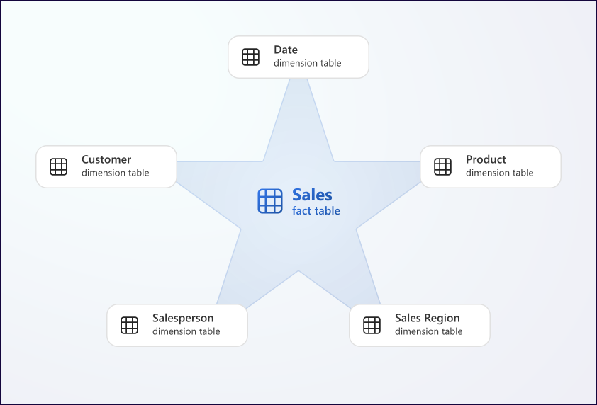

# 08. Dimensional modeling: grain, keys, constraints, and collation

[Book contents](../../index.md) | [Part II contents](README.md) | [Previous: Chapter 7](07-tsql-for-analytics.md) | [Next: Chapter 9](09-loading-and-accessing-data.md)

**Applies to:** Warehouse and Lakehouse analytical models; the identity and constraint creation labs are Warehouse-only. **Level:** 100-200. **Feature scope:** checked 9 October 2026; Warehouse IDENTITY, explicit identity inserts, and reseeding are generally available, announced in August 2026.

## Model the event before drawing the star

A star schema places measurements in fact tables and descriptive context in dimensions. The diagram is simple; the difficult work is deciding what every row means and how that meaning survives change. Microsoft's [dimensional-modeling guidance](https://learn.microsoft.com/en-us/fabric/data-warehouse/dimensional-modeling-overview) applies these principles to Fabric without making the model dependent on a particular ingestion tool.

Our `FactSales` grain is one synthetic sales line for a customer, product, and sale date, with its own quantity and unit price. It is not one customer per day or one invoice. Two legitimate sales lines could have identical dimension keys and identical measures. Combining them just because their visible attributes match would lose the event-level grain.

`SalesKey` distinguishes our six teaching rows, but a real ingestion contract also needs a source transaction identifier or another stable business deduplication rule. A generated number assigned every time a file is loaded cannot identify a repeated source event.

Quantity and line revenue are additive across our dimensions because all six facts share a compatible meaning and notional currency. Unit price is not additive. An inventory balance would be a different fact: summing daily closing balances over a month does not produce monthly stock on hand. Model transaction facts and periodic snapshots separately rather than placing incompatible grains in one convenient table.



*Documentation image D09. Microsoft, [Sales star schema](https://learn.microsoft.com/en-us/fabric/data-warehouse/dimensional-modeling-overview); [original image](https://learn.microsoft.com/en-us/fabric/data-warehouse/media/dimensional-modeling-overview/star-schema.svg). Unmodified source copy, retrieved 9 November 2026; [CC BY 4.0](https://creativecommons.org/licenses/by/4.0/) under the [Fabric documentation licence](https://github.com/MicrosoftDocs/fabric-docs/blob/aadea08f35c3edaa9c32535c772792f02555c9a4/LICENSE). Microsoft's star illustrates the fact/dimension relationship, not the book's exact three-dimension seed.*

## Dimensions carry business meaning

`DimCustomer` answers who bought and which customer country groups the sale. `DimProduct` supplies product and category. `DimDate` supplies a real date and reporting attributes. Repeating category within a product dimension is intentional denormalization that makes common grouping understandable; it does not require a separate category table solely to remove repeated text.

A production date dimension normally covers a continuous reporting range and includes agreed fiscal attributes. The three-row sample only covers the lab's dates. Its integer `DateKey` is a conventional meaningful-key exception; most surrogate dimension keys should not encode business meaning.

Conformed dimensions let different fact tables use the same agreed customer or product definitions. That does not mean joining sales lines directly to return lines and hoping their dimensions prevent multiplication. Aggregate each fact to the intended comparison grain or relate both through dimensions in the consuming model.

A customer's name is not a reliable natural key. In a real model, preserve a source customer identifier, often qualified by source-system identity. Map that business key to the warehouse surrogate key. The simplified seed omits those source attributes because no operational source exists; do not copy that omission into a production reconciliation design.

## History is a business requirement

If Cedar Market changes country, should its old sales move to the new country in historical reports? A type 1 dimension update overwrites the attribute, so reports show the current classification. A type 2 design creates a new dimension version with a new surrogate key and validity interval, retaining the old version for historical facts.

The [dimension-table guidance](https://learn.microsoft.com/en-us/fabric/data-warehouse/dimensional-modeling-dimension-tables) explains this separation. Type 2 loading needs nonoverlapping validity periods and exactly one applicable version for each fact's business timestamp. Joining a fact to every version of the same business key duplicates measures.

`LastModifiedUtc` alone does not implement history. It says when the row was modified according to the load contract, not necessarily when its business meaning became valid. Late-arriving facts and corrected source dates can require looking up a historical dimension version rather than the current one.

Mark's [10 June 2026 SCD Type 2 article](https://medium.com/@sqltidy/build-type-2-slowly-changing-dimensions-in-fabric-without-cdc-fc011566d086) introduces the history requirement and links his FindChanges project. Keep the **analytical source** separate from the **history writer**: a Lakehouse endpoint can supply supported reads, but it does not gain persistent table DML because a history-maintenance procedure exists elsewhere. Snapshot comparison also is not log-based CDC and can miss intermediate changes or duplicate multiplicity; Chapters 35 and 41 qualify that design.

Decide how unknown members are handled too. Rejecting or quarantining a missing customer may be appropriate; mapping to an explicit "Unknown" member may be appropriate when continuity matters. Silently dropping an unmatched fact in an inner join is not a policy. Our initial dataset needs no unknown member and remains unchanged.

## Constraints describe; validation proves

Fabric supports primary, unique, and foreign key declarations, but their supported form is **not enforced**. Primary and unique keys require `NONCLUSTERED` and `NOT ENFORCED`; foreign keys require `NOT ENFORCED`. Add them with `ALTER TABLE`, not inline in `CREATE TABLE`. These rules apply as documented in the [constraint reference](https://learn.microsoft.com/en-us/fabric/data-warehouse/table-constraints).

Such metadata can describe intended relationships, but it does not reject duplicate business keys or prevent orphan facts. A declared relationship is therefore a promise your load must maintain. `NOT NULL` addresses missing values, not uniqueness or referential integrity. Current documentation also says default constraints are unsupported; our seed explicitly provides each value.

**Runnable, read-only T-SQL; execute in either seeded sample SQL editor.** These checks leave the core data untouched.

```sql
SELECT CustomerKey, COUNT_BIG(*) AS Copies
FROM book.DimCustomer
GROUP BY CustomerKey
HAVING COUNT_BIG(*) > 1;

SELECT SalesKey, COUNT_BIG(*) AS Copies
FROM book.FactSales
GROUP BY SalesKey
HAVING COUNT_BIG(*) > 1;

SELECT f.SalesKey
FROM book.FactSales AS f
LEFT JOIN book.DimCustomer AS c ON c.CustomerKey = f.CustomerKey
LEFT JOIN book.DimProduct AS p ON p.ProductKey = f.ProductKey
LEFT JOIN book.DimDate AS d ON d.DateKey = f.DateKey
WHERE c.CustomerKey IS NULL
   OR p.ProductKey IS NULL
   OR d.DateKey IS NULL;
```

All three result sets should be empty. Repeat the dimension-duplicate pattern for product and date keys in a real validation gate. Check before publication and retain results by batch. Counting only the grand-total revenue is insufficient: two equal and opposite errors can preserve it.

Do not add foreign-key metadata casually to a Lakehouse SQL endpoint. Its current [limitations](https://learn.microsoft.com/en-us/fabric/data-engineering/lakehouse-sql-analytics-endpoint) warn that endpoint foreign keys can prevent subsequent schema changes from being reflected. Evaluate that trade-off separately from the value of documenting a relationship.

## IDENTITY now exists, but not as a SQL Server clone

Current Fabric Warehouse supports `BIGINT IDENTITY`. Historical statements that all Warehouse keys must be generated manually are obsolete. The supported syntax does not accept a custom seed or increment; do not copy `IDENTITY(1,1)` from a SQL Server script.

The [August 2026 feature summary](https://community.fabric.microsoft.com/blog/fbc_fabricupdatesblogs/fabric-august-2026-feature-summary/5325824) announced general availability, including explicit inserts and reseeding. That closes an important migration gap: existing fact-to-dimension relationships can retain their supplied keys while newly arriving dimension members receive generated keys. GA does not make the allocation rules identical to SQL Server.

The [identity documentation](https://learn.microsoft.com/en-us/fabric/data-warehouse/identity) guarantees unique generated values when explicit identity insertion is not used, while allowing gaps and nonsequential allocation. Neither ordering by the key nor subtracting adjacent keys is a valid way to infer ingestion order or missing business events.

Key generation is also not business deduplication. Loading Aster Retail twice with two generated keys still creates two customer members unless the loader matches its business key. The core book seed deliberately uses explicit, stable keys to keep both item copies comparable.

**Lab prerequisites:** completed Warehouse seed, `book` schema, and permission to create an isolated lab table. **Runnable T-SQL, Warehouse-only; execute as one batch in `BookWarehouse`.** Creates one table and two rows, refuses a rerun, and does not change the six facts.

```sql
IF DB_NAME() <> 'BookWarehouse'
    THROW 51060, 'Use the isolated BookWarehouse item.', 1;
IF OBJECT_ID('book.Lab06IdentityCustomer') IS NOT NULL
    THROW 51061, 'The identity lab already exists; inspect it instead.', 1;

CREATE TABLE book.Lab06IdentityCustomer
(
    CustomerKey bigint IDENTITY,
    CustomerCode varchar(20) NOT NULL,
    CustomerName varchar(100) NOT NULL
);

ALTER TABLE book.Lab06IdentityCustomer
ADD CONSTRAINT PK_Lab06IdentityCustomer
PRIMARY KEY NONCLUSTERED (CustomerKey) NOT ENFORCED;

INSERT INTO book.Lab06IdentityCustomer (CustomerCode, CustomerName)
VALUES ('ASTER', 'Aster Retail'), ('BIRCH', 'Birch Stores');

SELECT CustomerKey, CustomerCode, CustomerName
FROM book.Lab06IdentityCustomer
ORDER BY CustomerCode;
```

Expect two distinct generated keys, not particular values such as 1 and 2. If setup stops partway through, inspect the isolated object rather than removing the guard. No all-or-nothing claim is made for this short lab's separate statements.

For migration, current support includes `SET IDENTITY_INSERT` and `DBCC CHECKIDENT(..., RESEED)`, with specific restrictions. After explicit identity inserts, the documentation requires reseeding; Fabric chooses the next ranges, not a supplied reseed number. These are controlled migration operations, not necessary steps for the core seed.

**Runnable, read-only T-SQL; execute in `BookWarehouse` after the identity lab.**

```sql
SELECT s.name AS SchemaName, t.name AS TableName,
       ic.name AS IdentityColumn
FROM sys.identity_columns AS ic
JOIN sys.tables AS t ON t.object_id = ic.object_id
JOIN sys.schemas AS s ON s.schema_id = t.schema_id
WHERE s.name = 'book'
ORDER BY t.name;
```

Expect the lab table only. Do not interpret `sys.identity_columns.last_value` as the maximum allocated key: current Fabric documentation describes special null and -1 metadata behavior. Querying actual rows and understanding the allocation contract are different tasks.

### Lab extension: preserve imported keys, then resume generation

Use a **different** table for this exercise so the earlier generation lab remains intact. Imagine an upstream dimension has already assigned customer keys 41 and 42. Regenerating them during migration would break the meaning of facts that refer to those keys. Explicit insertion preserves them; reseeding makes subsequent allocation aware of the imported values.

**Prerequisites:** `BookWarehouse` and `book` exist; an isolated development identity can create/alter the table and run `DBCC CHECKIDENT`; no other session writes to this new table. **Runnable T-SQL — Warehouse only, GA; creates `book.Lab06IdentityImport`, imports two synthetic rows, reseeds, and generates one further key. Execute the entire block in one session. No core tables are changed.**

```sql
IF DB_NAME() <> 'BookWarehouse'
    THROW 51062, 'Use the isolated BookWarehouse item.', 1;
IF OBJECT_ID('book.Lab06IdentityImport') IS NOT NULL
    THROW 51063, 'The import lab already exists; inspect it instead.', 1;

CREATE TABLE book.Lab06IdentityImport
(
    CustomerKey bigint IDENTITY,
    CustomerCode varchar(20) NOT NULL,
    CustomerName varchar(100) NOT NULL
);

SET IDENTITY_INSERT book.Lab06IdentityImport ON;
BEGIN TRY
    INSERT INTO book.Lab06IdentityImport
        (CustomerKey, CustomerCode, CustomerName)
    VALUES
        (41, 'ASTER', 'Aster Retail'),
        (42, 'BIRCH', 'Birch Stores');

    SET IDENTITY_INSERT book.Lab06IdentityImport OFF;
    DBCC CHECKIDENT('book.Lab06IdentityImport', RESEED);
END TRY
BEGIN CATCH
    SET IDENTITY_INSERT book.Lab06IdentityImport OFF;
    THROW;
END CATCH;

INSERT INTO book.Lab06IdentityImport (CustomerCode, CustomerName)
VALUES ('CEDAR', 'Cedar Market');

SELECT CustomerKey, CustomerCode, CustomerName
FROM book.Lab06IdentityImport
ORDER BY CustomerCode;

SELECT CustomerKey, COUNT_BIG(*) AS Copies
FROM book.Lab06IdentityImport
GROUP BY CustomerKey
HAVING COUNT_BIG(*) > 1;
```

Expect three rows: Aster remains 41, Birch remains 42, and Cedar receives a distinct generated positive value—not necessarily 43. The duplicate check must be empty. These are intentionally isolated migration keys, not replacements for the canonical customers 1, 2, and 3.

Only one table in a session can have `IDENTITY_INSERT` on. While it is on, an explicit `INSERT` column list is required. Turn it off before normal inserts and run `DBCC CHECKIDENT('schema.table', RESEED)` **without a numeric reseed argument**. Fabric checks used and reserved distributed ranges; neither a custom reseed number nor `NORESEED` is supported.

This is a controlled sequence, not an atomic migration framework. If the connection fails after the explicit insert, stop automatic writers, reconnect, inspect the isolated target, and complete the required reseed before allowing generated inserts. The catch block restores the session setting for catchable errors, but cannot handle a terminated connection. Preserve a migration ledger and validate imported keys in a real load: explicit insertion is precisely where a simplistic "identity always prevents duplicates" claim becomes unsafe.

## Collation is part of the key contract

If a source treats `abc` and `ABC` as different customer identifiers but a target compares them case-insensitively, two distinct entities can collapse during matching. Conversely, a case-sensitive target can split identifiers a source treated as equivalent. Collation therefore affects correctness, not merely sorting.

The default Warehouse collation is `Latin1_General_100_BIN2_UTF8`; the supported case-insensitive database alternative is `Latin1_General_100_CI_AS_KS_WS_SC_UTF8`. New items inherit the workspace default, while existing Warehouse and SQL endpoint collations are immutable. Use the [collation guide](https://learn.microsoft.com/en-us/fabric/data-warehouse/collation) before creation, and test cross-item string comparisons when items differ.

Mark Pryce-Maher's [Toolbox case-insensitive-view generator](https://github.com/microsoft/fabric-toolbox/blob/a50e780e744dd847c331d85da56f544cabaaa2af/scripts/dw-ci-views/ci_views.sql), committed 11 July 2025 under MIT, demonstrates expression-level collation. We retain that idea but do not run its database-wide dynamic generator. Its broad replacement scope, bounded string construction, unquoted column names, and chosen accent-insensitive comparison require review.

**Runnable, read-only T-SQL; execute in `BookWarehouse`.** Original single-column exercise inspired by that pattern; changed to explicit, supported UTF-8 comparisons, with no generated DDL or view replacement.

```sql
SELECT
    CASE WHEN 'abc' COLLATE Latin1_General_100_BIN2_UTF8 = 'ABC'
         THEN 1 ELSE 0 END AS CaseSensitiveMatch,
    CASE WHEN 'abc' COLLATE Latin1_General_100_CI_AS_KS_WS_SC_UTF8 = 'ABC'
         THEN 1 ELSE 0 END AS CaseInsensitiveMatch;
```

Expect 0 and 1. This changes expression semantics, not the database's collation. For a real compatibility view, explicitly select reviewed columns and aliases, document which comparisons change, and test uniqueness under the new rules. `COLLATE` is not a universal instruction to repair incompatible business keys.

## Complete the model review

The lab is complete when the quality queries return no exceptions, identity produces two distinct lab keys without assumed sequencing, and the collation exercise returns the expected comparison results. None of these checks proves that a production source's business rules are correct.

Retain the identity labs while reviewing; once finished, remove only `book.Lab06IdentityCustomer` and, if created, `book.Lab06IdentityImport` through a deliberate, dependency-checked cleanup in the isolated Warehouse. There is no automatic destructive command. Keep the original [Warehouse](../../scripts/04-create-book-warehouse.sql) and [Lakehouse](../../scripts/05-create-book-lakehouse.py) datasets for later chapters. The `Lab06` prefix remains a stable lab identifier despite this chapter's new number.

## Key takeaways

- Grain, business identity, and history policy precede physical DDL.
- Unenforced constraints require explicit quality gates.
- Warehouse identity generates surrogate values, not ordered business events.
- Preserve imported keys with explicit insertion, then reseed before returning to generated values.
- Collation can change whether two business keys identify the same entity.

## References

1. Microsoft Learn, [Dimensional modeling overview](https://learn.microsoft.com/en-us/fabric/data-warehouse/dimensional-modeling-overview).
2. Microsoft Learn, [Dimension tables](https://learn.microsoft.com/en-us/fabric/data-warehouse/dimensional-modeling-dimension-tables).
3. Microsoft Learn, [Fact tables](https://learn.microsoft.com/en-us/fabric/data-warehouse/dimensional-modeling-fact-tables).
4. Microsoft Learn, [Primary, foreign, and unique keys](https://learn.microsoft.com/en-us/fabric/data-warehouse/table-constraints).
5. Microsoft Learn, [IDENTITY columns](https://learn.microsoft.com/en-us/fabric/data-warehouse/identity), documentation dated 18 August 2026.
6. Microsoft Learn, [Data Warehouse collation](https://learn.microsoft.com/en-us/fabric/data-warehouse/collation).
7. Microsoft Learn, [COLLATE](https://learn.microsoft.com/en-us/sql/t-sql/statements/collations?view=fabric).
8. Mark Pryce-Maher / Microsoft Fabric Toolbox, [`ci_views.sql` canonical source](https://github.com/microsoft/fabric-toolbox/blob/main/scripts/dw-ci-views/ci_views.sql) ([pinned revision](https://github.com/microsoft/fabric-toolbox/blob/a50e780e744dd847c331d85da56f544cabaaa2af/scripts/dw-ci-views/ci_views.sql)), substantive commit 11 July 2025, MIT; conceptual pattern adapted, generator not reproduced.
9. Microsoft Fabric, [August 2026 feature summary](https://community.fabric.microsoft.com/blog/fbc_fabricupdatesblogs/fabric-august-2026-feature-summary/5325824), 26 August 2026, IDENTITY general availability and explicit-insert additions.

---

[Previous: Chapter 7](07-tsql-for-analytics.md) | [Book contents](../../index.md) | [Next: Chapter 9](09-loading-and-accessing-data.md)
