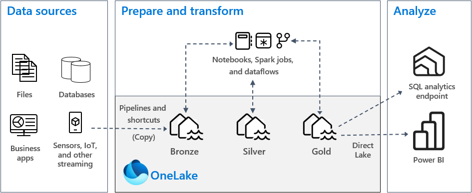
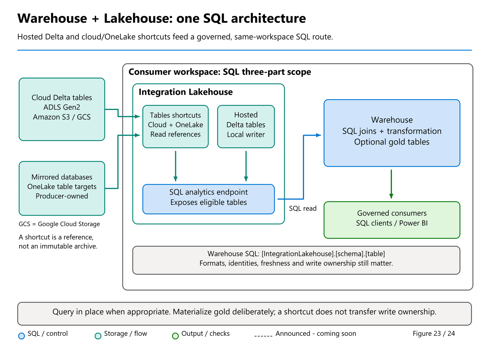
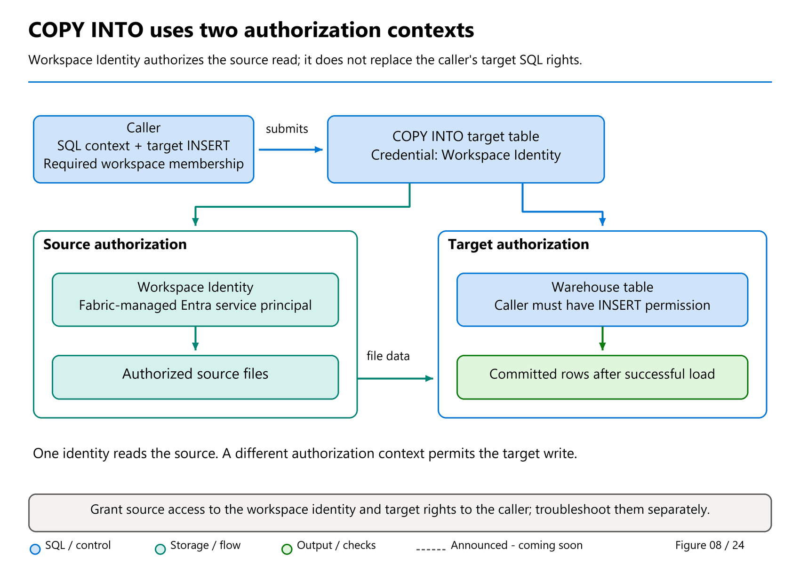

# 09. Building Warehouse Architectures, Loading and Accessing Data

[Book contents](../../index.md) | [Part II contents](README.md) | [Previous: Chapter 8](08-dimensional-modeling.md) | [Next: Chapter 10](10-transformations-and-transactions.md)

**Applies to:** Warehouse-led and hybrid architectures, Warehouse ingestion and Lakehouse SQL analytics endpoint reads. **Level:** Foundation to intermediate. **Feature baseline:** ingestion review 9 October; architecture/shortcut contracts checked 9 November; targeted BCP/Build-roundup review 10 November 2026. Workspace Identity for COPY INTO is GA; BCP API ingestion retains its documented preview scope. Examples are prepared for reader execution, not tenant-tested for this manuscript.

## Start with the destination contract

Loading data is not the same as making it usable. A successful connector can deliver every source row and still produce incorrect analytics because a decimal was rounded, an identifier changed case, or a retry duplicated yesterday's batch. Begin with the table contract, the ownership of the source, and the evidence that will prove the load correct.

For this book, `BookWarehouse.book.FactSales` contains six synthetic sales, quantity 10, and revenue 365.00. Its `SalesKey` is a supplied identifier, not an engine-enforced unique business key. The corresponding `BookLakehouse.book.FactSales` is an independent copy, not an automatically synchronized replica. A pipeline updating one does not update the other.

Warehouse tables accept supported T-SQL writes. The Lakehouse SQL analytics endpoint exposes underlying Delta table data read-only: use Spark or another supported Lakehouse writer to change that data. Read-only table data does **not** mean an endpoint cannot contain SQL views, functions, or stored procedures. Those objects provide a SQL interface without transferring ownership of the Delta files to the SQL engine. The current [T-SQL surface-area reference](https://learn.microsoft.com/en-us/fabric/data-warehouse/tsql-surface-area) makes this distinction explicit.

This distinction prevents a common architectural mistake. A team creates a view over a Lakehouse table, then expects an `INSERT` into that view to become a Spark write. The view is a query definition, not a write adapter. Similarly, a shortcut exposes another location; it is not a promise that the consumer owns, copies, or can modify the source.

## Building architectures with Warehouse

Warehouse belongs in **modern lakehouse architectures**, not outside them. Its SQL-managed tables use Delta and Parquet in OneLake, so medallion layers, dimensional marts and domain-owned data products do not require abandoning familiar Warehouse development. Microsoft's [medallion deployment guidance](https://learn.microsoft.com/en-us/fabric/onelake/onelake-medallion-lakehouse-architecture#deployment-model) explicitly allows lakehouses, a Warehouse, or a combination.

Keep the architectural idea separate from the **Fabric item type**. A Warehouse has a data-lake foundation but is not interchangeable with a Lakehouse item: arbitrary Files storage, Spark writes, SQL DML, transactions and metadata discovery still have their own supported contracts. Shared Delta storage does not authorize an external writer to modify Warehouse-owned files. The useful claim is that these architectural patterns can be built with Warehouse, not that every implementation from another platform runs unchanged.

### Medallion layers are quality contracts, not product icons

**Bronze** preserves the source representation and evidence needed to replay it. **Silver** standardizes, validates and conforms it. **Gold** publishes business-ready structures and measures. A table does not become trustworthy because someone moved it into a schema called `gold`.

| Pattern | Where Warehouse fits | Design responsibility |
| --- | --- | --- |
| SQL-first medallion | Warehouse-owned structured tables provide staging, conformance and curated layers through supported T-SQL. | Preserve source fidelity separately when the raw input is files or unsupported types; validate before publishing gold. |
| Hybrid medallion | Lakehouse handles raw files, shortcuts and engineering; Warehouse reads eligible silver tables and optionally owns physical gold tables. | Name the writer and freshness boundary for each layer; copying every layer is not mandatory. |
| Logical warehouse over shared data | A Lakehouse presents hosted and shortcut-backed Delta tables; Warehouse joins them in place and supplies a SQL consumption contract. | Source availability, permissions, compatible table features and SQL visibility become query dependencies. |
| Dimensional mart or vault-derived presentation | Warehouse owns fact/dimension models or SQL-managed historical/integration structures over the shared foundation. | Define keys, grain, historization and duplicate rules; unenforced constraints and a transport do not supply those semantics. |
| Domain-oriented data products | Producer domains publish governed tables; consumer Lakehouses expose approved references for Warehouse-led integration. | Agree ownership, schema/version contracts, permitted identities and service objectives across domains. |

These patterns combine. A domain can use bronze/silver/gold internally and publish a dimensional gold product for another domain's logical warehouse. The [OneLake architecture-patterns guide](https://learn.microsoft.com/en-us/fabric/onelake/architecture-patterns) distinguishes the pattern from the capabilities used to implement it, including shortcuts, mirroring, governance and open-format interoperability.

For a small solution, schemas can distinguish logical layers within a Warehouse. That is not workspace, capacity or deployment isolation. Production designs may separate layer items/workspaces for ownership and governance, as the medallion guide recommends. The same-workspace SQL pattern below can still consume remote producers through a local integration Lakehouse's shortcuts.



*Documentation image D11. Microsoft, [OneLake medallion architecture](https://learn.microsoft.com/en-us/fabric/onelake/onelake-medallion-lakehouse-architecture); [original image](https://learn.microsoft.com/en-us/fabric/onelake/media/onelake-medallion-lakehouse-architecture/onelake-medallion-lakehouse-architecture-example.png). Unmodified source copy, retrieved 9 November 2026; [CC BY 4.0](https://creativecommons.org/licenses/by/4.0/) under the [Fabric documentation licence](https://github.com/MicrosoftDocs/fabric-docs/blob/aadea08f35c3edaa9c32535c772792f02555c9a4/LICENSE). The source's quality-layer picture complements Figure 23's current Lakehouse/shortcut-to-Warehouse query route.*

### A common hybrid: hosted data plus shortcuts, queried from Warehouse

Place an **integration Lakehouse and the consuming Warehouse in the same Fabric workspace**. The Lakehouse can host some tables while exposing other tables through shortcuts. Sources do not all have to be copied into that Lakehouse, or into the Warehouse, merely to participate in a query.



*Figure 23. A conceptual hybrid architecture, not a measured deployment.* The consumer workspace contains the integration Lakehouse, its SQL analytics endpoint and the Warehouse. Shortcut targets can be external clouds or other permitted OneLake locations. The arrow into Warehouse represents SQL reads, not ownership transfer or automatic copying of every source.

The following are **design names, not objects created by this chapter**:

| Source | Integration Lakehouse representation | Example name visible to Warehouse SQL |
| --- | --- | --- |
| ADLS Gen2 Delta table | External Tables shortcut | `[IntegrationLakehouse].[dbo].[AdlsSales]` |
| Amazon S3 Delta table | External Tables shortcut | `[IntegrationLakehouse].[dbo].[S3Inventory]` |
| Google Cloud Storage Delta table | External Tables shortcut | `[IntegrationLakehouse].[dbo].[GcsProducts]` |
| Supported mirrored database table in OneLake | Internal OneLake Tables shortcut | `[IntegrationLakehouse].[dbo].[MirrorCustomers]` |
| Data owned and written in the integration Lakehouse | Hosted Delta table | `[IntegrationLakehouse].[dbo].[LocalMappings]` |

Use the schema and table names actually exposed by the endpoint. `dbo` above is illustrative; the book's real seed is in `book`. Schema-enabled Lakehouses also support schema shortcuts in the documented scenarios, but their setup is not the same as adding an arbitrary subfolder beneath Tables.

The route is **source table > Lakehouse table/shortcut > Lakehouse SQL analytics endpoint > Warehouse query**. The Warehouse binds a three-part SQL name, not a storage URL or a linked-server login, and it does not invoke Spark to execute that SELECT. An internal shortcut can reach a producer in another workspace while the Lakehouse SQL endpoint and consuming Warehouse used by this query remain together in the consumer workspace.

### Make the data SQL-readable before writing the cross-item query

1. Establish each producer's format, writer, schema, retention and authorization contract. A mirrored database is a replicated copy, not permission to write back to the operational source.
2. Create the required hosted tables or approved shortcuts in the integration Lakehouse's **Tables** experience. Use each connector's documented credentials, connection permissions and network configuration; never put secrets in a query or diagram.
3. Confirm that the target is SQL-readable. This pattern uses **compatible Delta tables**. A shortcut under **Files** to CSV, JSON or loose Parquet does not automatically create a SQL table; use an appropriate supported transformation/materialization route first.
4. Verify table discovery, required columns and committed data through the Lakehouse SQL analytics endpoint. Check Delta features, type mapping and metadata generation using [Chapter 15](../03-sql-analytics-endpoint/15-metadata-sync-v1-v2.md#check-table-features-and-column-representation-separately). Automatic schema propagation is not instantaneous or unconditional reader compatibility.
5. Connect to the Warehouse and reference the endpoint database, schema and table with three-part names. Validate item access, SQL permissions and the effective shortcut/source identity for the chosen endpoint mode.
6. Reconcile results, measure the actual query path, and decide whether an approved Warehouse-owned gold copy adds value. Record every new copy's refresh and recovery owner.

The [cross-database query guide](https://learn.microsoft.com/en-us/fabric/data-warehouse/query-warehouse#write-a-cross-database-query) scopes this three-part route to the **current workspace**. Do not substitute Spark's `workspace.lakehouse.schema.table` namespace, a four-part linked-server name, or a guessed hostname. Cross-workspace producer access through a shortcut is a different boundary from cross-workspace SQL name resolution.

### Runnable cross-item example using the existing book seed

**Prerequisites:** Chapters 4 and 5 completed in the **same workspace**, unchanged seeds, and authorized access to both SQL surfaces. Run in `BookWarehouse`, with supported delegated-mode source access for this exercise. This is read-only and creates no shortcut, view, table or replicated copy.

```sql
SELECT c.CountryCode,
       COUNT_BIG(*) AS SalesLines,
       SUM(f.Quantity) AS Units,
       CAST(SUM(f.Quantity * f.UnitPrice) AS decimal(18,2)) AS Revenue
FROM [BookLakehouse].[book].[FactSales] AS f
JOIN [BookWarehouse].[book].[DimCustomer] AS c
  ON c.CustomerKey = f.CustomerKey
GROUP BY c.CountryCode
ORDER BY c.CountryCode;
```

Expect **DE: two lines, three units, 180.00** and **GB: four lines, seven units, 185.00**. Facts are read through the Lakehouse SQL analytics endpoint; the dimension is read from Warehouse. The initial copies agree by design, not because Fabric synchronizes them. If either legitimately changes later, establish equivalent source states and a shared key contract before expecting those totals.

A shortcut-backed table that has been correctly exposed to the endpoint can be referenced in the same SQL position as the hosted fact table. Its format, permissions, identity mode and freshness prerequisites still apply. The exercise proves the naming/join shape over the known seed, not connectivity to a reader's ADLS, S3, GCS or mirrored database.

### Query in place or materialize a Warehouse-owned gold layer

A Warehouse SELECT or suitable view over the endpoint can avoid an additional **ingested Warehouse copy**. That does not mean no data is read, no cache exists, no cloud egress can occur, or no compute is consumed. The source and SQL-serving path remain dependencies. OneLake shortcut caching is also different from Warehouse data/result caching.

There is a specific performance boundary: the current [result-set cache reference](https://learn.microsoft.com/en-us/fabric/data-warehouse/result-set-caching) excludes **cross-database queries**. The same-workspace Lakehouse/Warehouse join is therefore not a result-cache qualification test, even though managed memory/disk data caches can still matter. A materialized Warehouse-owned result has a different qualification path, still subject to all other cache restrictions.

Materialized lake views can also prepare source-owned Lakehouse Delta data for this architecture. They are authored through the documented **Spark SQL/PySpark** feature, not an unrestricted Warehouse `CREATE MATERIALIZED VIEW` capability. The base feature's GA announcement and the newer **preview** optimal refresh for updates/deletes have separate boundaries; the latter needs source CDF and a correctly declared output key that Fabric does not validate at runtime.

CTAS or `INSERT ... SELECT` into a Warehouse gold table is a deliberate materialization. It can provide SQL-managed transformations, a controlled publication boundary or independence from repeated source reads, but it creates storage, loading and freshness obligations. A read from a Lakehouse does not make that Lakehouse writable through Warehouse SQL. [Chapter 13](13-power-bi-and-clients.md) explains why a SQL view, physical gold table and Direct Lake model can also have different consumption behavior.

Access is not inherited simply because a query spans items. Review caller SQL access, the Lakehouse endpoint's delegated/user mode, external shortcut connections and internal producer permissions together. A view or shortcut must not be used to bypass OneLake row/column policies. [Chapter 12](12-security-and-governance.md) and [16](../03-sql-analytics-endpoint/16-onelake-security.md) provide the route-by-route tests.

A live shortcut or mirrored table is not automatically an **immutable bronze archive**. If replay or audit requires the exact input state, retain the necessary source versions or an approved snapshot/capture record. Likewise, joins across independently changing sources do not create a globally atomic source snapshot. Source commit, mirroring, shortcut/catalog propagation, endpoint visibility and report refresh can have different clocks.

**Roadmap boundary - snapshot 9 November 2026:** the roadmap lists **Shortcuts in Fabric Data Warehouse** as **Planned / Public preview / Q1 2027**. The architecture taught here uses the existing **Lakehouse shortcut plus SQL endpoint** route; it does not depend on that future Warehouse-native feature. See the [dated snapshot](../../appendices/H-roadmap-snapshot.md#snapshot-9-november-2026) before using any target quarter in a design commitment.

For an existing estate, selecting this end-state architecture is separate from moving into it. [Part VII](../07-migration-and-production-design/README.md) covers assessment, source-specific migration, continuing synchronization, reconciliation and cutover.

## Choose the route by what must move

Use a pipeline when the challenge is repeatable movement across systems: scheduling, connection management, retries, dependencies, and operational history. Dataflow Gen2 is useful when Power Query transformations and a low-code authoring experience fit the team. Neither choice removes the need to define keys, reject handling, and reconciliation.

Use `COPY INTO` for staged files when T-SQL orchestration is appropriate. Current documentation supports CSV, Parquet, and JSONL, with Azure storage and OneLake sources. Warehouse also supports `BULK INSERT` compatibility, but new file-loading code should normally start with `COPY INTO`. Direct client-side BCP API ingestion is a separate, documented preview capability; do not confuse its status with established file-based loading. See the [ingestion decision guide](https://learn.microsoft.com/en-us/fabric/data-warehouse/ingest-data).

Use `INSERT ... SELECT` when the destination already exists and you want to preserve its declared contract. Use `CREATE TABLE AS SELECT`, or CTAS, when a new table is the intended product. CTAS is especially convenient for stage tables and transformed copies, but its columns derive from the expressions in the query. Explicit casts and a subsequent schema inspection are more reliable than assuming the destination inherited every source property.

Same-workspace Warehouse and SQL endpoint tables can be read with three-part names. This is not an arbitrary linked-server facility: the source must be supported and accessible, and a cross-database reference does not confer permission. A query against `BookLakehouse.book.FactSales` reaches the Lakehouse's SQL representation; it does not directly run Spark.

## Client bulk copy is not server-side COPY INTO

**BCP API preview, detailed guidance rechecked 10 November 2026.** The [client bulk-copy guide](https://learn.microsoft.com/en-us/fabric/data-warehouse/ingest-data-bulk-copy) documents a SQL-connection route through `bcp.exe`, .NET `Microsoft.Data.SqlClient.SqlBulkCopy`, or Java `SQLServerBulkCopy`. It is useful when an application already holds rows in memory or cannot stage files first. The client streams batches over TDS rather than submitting one SQL INSERT request per row.

With `COPY INTO`, the service reads approved staged files. With BCP, the client uploads the rows, so client memory, upload bandwidth, region, timeouts, encoding and batch boundaries affect the result. The current ingestion guide still recommends **COPY INTO for highest-throughput file-based loading when staging is possible**. BCP's usefulness does not make it the preferred route for every large load or a way to write Lakehouse tables through their SQL endpoint.

Prepare the destination's types and permissions first, use **Microsoft Entra authentication**, and make column mappings explicit when names/order differ. Warehouse does not support a SQL username/password authentication workaround. The guide says `CheckConstraints`, `TableLock`, `KeepNulls` and `FireTriggers` options are ignored in this implementation; setting familiar client flags does not enable source-engine constraint, locking, default or trigger behavior.

The current sizing guidance suggests roughly **150 MB-1 GB per batch**, with **250-500 MB** as a starting point for many larger workloads. These are byte-oriented tuning suggestions, not a mandatory row count, a latency guarantee or a suitable size for every micro-batch. Bound memory and timeout budgets and measure the actual client/network/target combination.

Tino Tereshko's [4 June Build roundup](https://community.fabric.microsoft.com/blog/fbc_fabricupdatesblogs/from-query-acceleration-to-cache-cooldown-everything-new-in-fabric-data-warehous/5191621) reports **5-10 times** the performance of row-by-row INSERT for its bulk-copy comparison. It is not a comparison with staged COPY INTO, and the article supplies no complete reproducible configuration. Do not turn that range into a book benchmark or guaranteed improvement.

Finally, batch transport is not business-level exactly-once publication. Capture failed/rejected rows and errors, establish which batches committed after a timeout or disconnect, and reconcile before replay. Do not assume one client method call or `BatchSize` setting makes a multi-batch import atomic. A stage-and-publish design can separate upload recovery from the final business release described in [Chapter 10](10-transformations-and-transactions.md).

### A Copy job entry point is not a new loading protocol

The same June article announces **Copy Job creation from the SQL editor** inside its preview integration group. This is a more convenient place to configure a movement job, not a promise that a SELECT automatically becomes ingestion or that every connector captures deletes. Review source, destination, mappings, schedule, write mode and identity before starting the job. The current connector-specific movement contract still governs; [Chapter 37](../07-migration-and-production-design/37-migration-planning.md) separates the Assistant's Copy job handoff from definition conversion.

## Lab: stage, inspect, and reconcile

Prerequisites are the Chapter 4 seed, a connection whose database is `BookWarehouse`, and permission to create tables in `book`. Run this only in the book workspace. The destination deliberately fails if it already exists, preventing a rerun from silently resetting previous work.

**Runnable T-SQL - Warehouse query editor or SSMS; creates one disposable table and copies six rows.**

```sql
CREATE TABLE book.Lab07SalesStage
AS
SELECT SalesKey, DateKey, CustomerKey, ProductKey,
       Quantity, UnitPrice, LastModifiedUtc
FROM book.FactSales;

SELECT COUNT_BIG(*) AS SalesRows,
       SUM(Quantity) AS Units,
       SUM(Quantity * UnitPrice) AS Revenue
FROM book.Lab07SalesStage;

SELECT SalesKey, COUNT_BIG(*) AS Copies
FROM book.Lab07SalesStage
GROUP BY SalesKey
HAVING COUNT_BIG(*) > 1;

SELECT s.SalesKey
FROM book.Lab07SalesStage AS s
LEFT JOIN book.DimCustomer AS c
  ON c.CustomerKey = s.CustomerKey
WHERE c.CustomerKey IS NULL;
```

Expect `6`, `10`, and `365.00` from the first result, then no duplicate or orphan rows. These are different tests. A row count can match while a missing sale is replaced by a duplicate. A revenue total can match while a sale belongs to the wrong customer. Production acceptance should also reconcile date ranges, business identifiers, nulls, and source-specific control totals.

If Chapter 5 is complete and both items occupy the same workspace, substitute `BookLakehouse.book.FactSales` as the source when creating a **different** stage table. Do not run that substitution against the existing lab table. First verify the Lakehouse SQL endpoint has discovered the table and presents the expected rows. Data arrival, endpoint metadata synchronization, and downstream model refresh are distinct milestones.

The small lab uses a single statement because it teaches correctness, not throughput. For larger loads, avoid issuing one network round trip per row. Batch movement, sensible file sizes, and narrow projections matter, but six rows cannot establish a useful production performance measurement.

## Files: make parsing and authorization explicit

An external file has two contracts: its format and its accessibility. CSV requires agreed quoting, separators, headers, encoding, and date conventions. Parquet carries types but can still contain inconsistent schemas across files. JSONL can evolve between records. Inspect representative bad records, not just a convenient first sample.

The optional template below assumes an approved CSV containing the book fact columns in exactly their listed order. It creates a separate empty target, so it cannot append the same six rows to the previous stage.

**Template T-SQL - Warehouse; replace the storage URL; creates and loads only `Lab07FileSales`. Requires source read access and appropriate bulk-load/target permissions.**

```sql
CREATE TABLE book.Lab07FileSales
(
    SalesKey bigint NOT NULL,
    DateKey int NOT NULL,
    CustomerKey int NOT NULL,
    ProductKey int NOT NULL,
    Quantity int NOT NULL,
    UnitPrice decimal(12,2) NOT NULL,
    LastModifiedUtc datetime2(6) NOT NULL
);

COPY INTO book.Lab07FileSales
FROM 'https://<account>.dfs.core.windows.net/<container>/book-sales.csv'
WITH
(
    FILE_TYPE = 'CSV',
    FIRSTROW = 2,
    FIELDTERMINATOR = ','
);
```

Do not put a storage key or token into the manuscript, source control, or a troubleshooting screenshot. By default, current `COPY INTO` documentation describes source access using the executing user's Microsoft Entra identity. Its workspace-identity option separates source access from the caller's SQL permissions, but has additional workspace-role and source-authorization requirements. It is not a way to bypass access checks.

Specify rejection policy deliberately. A job that accepts malformed records up to a threshold needs an owner for quarantine inspection and reconciliation. An inaccessible reject location can itself cause failure. Never interpret successful completion as proof that every business record was accepted.

## Workspace Identity for COPY INTO: two authorization checks

**Generally available, announced August 2026; Warehouse only.** A storage administrator may want approved ingestion users to load a curated file without granting each user direct access to the storage account. `COPY INTO` can use a **Fabric workspace identity** for source authorization while retaining the caller's SQL security context at the destination.



*Figure 8 — Conceptual Workspace Identity ingestion boundary.* The caller submits the SQL statement and needs target permissions. The workspace identity reads the approved source. Follow the two authorization paths independently: granting storage access does not grant target `INSERT`, and granting `INSERT` does not grant source-file access.

A workspace identity is a **Fabric-managed Microsoft Entra service principal**, with an accompanying app registration and credentials managed by Fabric. It resembles an Azure managed identity in some use cases but has a different lifecycle and administration model. A workspace administrator provisions it; users should not copy its credentials or modify its application to make a lab work.

For this particular COPY mode, the [Fabric-specific COPY reference](https://learn.microsoft.com/en-us/sql/t-sql/statements/copy-into-transact-sql?view=fabric&preserve-view=true) requires:

| Boundary | Required permission or prerequisite |
| --- | --- |
| Provisioning | A workspace administrator creates the target workspace's identity; My workspace is not supported for identity creation. |
| SQL caller | At least **Viewer membership in the target workspace**, plus `INSERT` on the target table. Item-only sharing is insufficient to use the workspace identity. |
| Bulk-operation permission | `ADMINISTER DATABASE BULK OPERATIONS` is **not required for this Workspace Identity mode**. That exemption is not a rule for every COPY authentication mode. |
| Azure source | Grant the workspace identity **Storage Blob Data Reader** on the approved storage account/container; for ADLS Gen2 directory-level access, configure the required read/traverse ACLs. |
| OneLake source alternative | Grant the workspace identity at least **Contributor** in the source workspace. The caller need not have direct source-workspace access, but still needs target Viewer membership and `INSERT`. |

The SQL caller's permissions and audit attribution remain the caller's. `CREDENTIAL = (IDENTITY = 'Workspace Identity')` authorizes **source access only**; it is not an `EXECUTE AS` switch to a more powerful SQL principal.

### Reviewable template, not a live ingestion service call

Assume an administrator has approved a CSV with the same seven fields and six canonical rows used earlier, plus one header row. The administrator creates this **new**, empty destination and separately grants the approved ingestion identity `INSERT` on it. The caller does not need permission to create arbitrary Warehouse tables.

**Template setup — Warehouse administrator in isolated `BookWarehouse`; writes one empty lab table, no source access. Run only after reviewing the name and confirming it does not exist.**

```sql
CREATE TABLE book.Lab07WorkspaceIdentitySales
AS
SELECT SalesKey, DateKey, CustomerKey, ProductKey,
       Quantity, UnitPrice, LastModifiedUtc
FROM book.FactSales
WHERE 1 = 0;
```

**Template load — Warehouse, GA; approved caller with the permissions above. Replace the source placeholders only after storage approval. Reads the CSV and appends to the isolated target; this manuscript makes no service call.**

```sql
COPY INTO book.Lab07WorkspaceIdentitySales
FROM 'https://<account>.dfs.core.windows.net/<container>/book-sales.csv'
WITH
(
    FILE_TYPE = 'CSV',
    FIRSTROW = 2,
    FIELDTERMINATOR = ',',
    CREDENTIAL = (IDENTITY = 'Workspace Identity')
);
```

No `SECRET` is supplied. Do not run both this and the earlier file template against a shared target. After an approved execution, an authorized reviewer with `SELECT` should apply the stage checks: six rows, ten units, 365.00 revenue, no duplicate keys, and no orphan customers. `INSERT` permission alone does not authorize that reviewer query. A rerun can append the same rows again; identity separation does not provide batch deduplication.

For a OneLake source, the documented URL shape is `https://onelake.dfs.fabric.microsoft.com/<workspace-id>/<lakehouse-id>/Files/book-sales.csv`. Use actual **workspace and item IDs**, not friendly names. Warehouse items are not supported COPY source locations under this contract; a SQL read from another Warehouse is a different route. With caller-Entra authentication instead of Workspace Identity, the current OneLake COPY rules require the caller to be Contributor or higher in both source and target workspaces. Do not mix those requirements with the Workspace Identity row above.

Network permission remains a separate gate. Firewall-protected Azure sources require the documented trusted-workspace/resource-instance configuration as well as identity authorization. The current COPY reference does not support Azure storage accounts whose public network access is disabled, even with Fabric private links; do not infer support from a different connector's network documentation. Likewise, configuring Workspace Identity on a **pipeline connection** has Admin/Member/Contributor requirements, not this SQL caller's Viewer-plus-INSERT rule.

As a paper exercise, diagnose three failures without broadening permissions: a caller has item `Read` but no workspace role; the caller has Viewer and `INSERT` but the workspace identity cannot read the source; or the source is readable but `INSERT` is missing. Each fails at a different boundary. Record which administrator owns the fix before making any approved change.

## Virtualize first, or materialize deliberately?

Jovan Popovic's [external-data materialization article](https://community.fabric.microsoft.com/blog/fbc_fabricupdatesblogs/external-data-materialization-in-fabric-data-warehouse/5172527) compares a view over `OPENROWSET` with CTAS over the same file query. The important difference is not syntax length. The view consults the external source when queried; the table captures an ingested copy that now needs an explicit freshness policy.

Here the same idea is adapted to synthetic book sales, with named columns and bounded types instead of broad schema inference.

**Template T-SQL - Warehouse; adapted concept from Jovan Popovic, article inspected 8 October 2026; substitutes book columns and an absolute source URL. Creates a view and a materialized lab table. Run each `GO`-separated batch separately if the client does not process `GO`.**

```sql
CREATE VIEW book.Lab07ExternalSales
AS
SELECT SalesKey, CustomerKey, Quantity, UnitPrice
FROM OPENROWSET(
    BULK 'https://<account>.dfs.core.windows.net/<container>/sales.parquet'
)
WITH
(
    SalesKey bigint,
    CustomerKey int,
    Quantity int,
    UnitPrice decimal(12,2)
) AS source_rows;
GO

CREATE TABLE book.Lab07MaterializedSales
AS
SELECT SalesKey, CustomerKey, Quantity, UnitPrice
FROM book.Lab07ExternalSales;
```

Prefer virtualization when avoiding another copy and observing source changes are more important than isolating consumers from source availability. Prefer materialization when repeated joins, a controlled release of data, or a stable downstream schema justify ingestion and storage. Test both using representative volume and concurrency; neither a blog example nor the word "cached" guarantees a performance ratio.

This is **external-data materialization**, not a Warehouse materialized view and not a Spark materialized lake view. The CTAS table does not automatically refresh when the file changes. Also, reading loose Parquet files is not equivalent to reading a Delta table: the Delta transaction log determines which files belong to a valid snapshot. Never glob the physical Parquet files inside a transactional table and assume that all are current.

## Make reruns a business operation

`COPY INTO` should not be treated as a business-key deduplicator. Replaying the same batch into an existing append target can duplicate data. For repeatable ingestion, retain an immutable batch identifier, the source boundary, accepted and rejected counts, and the publish outcome. Separate "files arrived" from "batch approved" and "batch published."

An append-only watermark also cannot discover source deletes or updates to older rows unless the source contract explicitly supplies them. Choose CDC, a trustworthy modification marker with overlap and reconciliation, or periodic comparison according to the source's behavior. A timestamp alone does not prove completeness.

Stage first, validate second, publish last. Keep the final target changes and their completion record in one Warehouse transaction where possible; Chapter 10 develops that pattern. External file creation and an orchestrator's checkpoint are not automatically participants in that SQL transaction. After a lost connection, establish whether publication committed before blindly replaying the load.

## Cleanup and takeaways

The following removes only this chapter's optional lab objects. It never drops `book`, the shared dimensions, or `FactSales`.

**Runnable T-SQL - Warehouse; destructive only to named Chapter 9 lab objects.**

```sql
DROP VIEW IF EXISTS book.Lab07ExternalSales;
DROP TABLE IF EXISTS book.Lab07MaterializedSales;
DROP TABLE IF EXISTS book.Lab07FileSales;
DROP TABLE IF EXISTS book.Lab07WorkspaceIdentitySales;
DROP TABLE IF EXISTS book.Lab07SalesStage;
```

- Choose movement, transformation, and access mechanisms separately.
- Reconcile business meaning, not just connector success.
- A materialized copy has a refresh obligation; a virtual view has a source dependency.
- Keep Lakehouse writes, SQL endpoint reads, and Warehouse transactions distinct.
- Workspace Identity changes COPY source authorization, not the caller's target permissions or SQL audit identity.
- Medallion and modern lakehouse patterns can use Warehouse; retain each item's supported write and governance contract.
- A Lakehouse can combine hosted Delta tables and cloud/OneLake shortcuts for same-workspace Warehouse three-part reads.

## References

1. Microsoft Learn, [Ingest data into the Warehouse](https://learn.microsoft.com/en-us/fabric/data-warehouse/ingest-data), current methods and source identity requirements.
2. Microsoft Learn, [Ingest using T-SQL](https://learn.microsoft.com/en-us/fabric/data-warehouse/ingest-data-tsql), CTAS and cross-item sources.
3. Microsoft Learn, [Ingest using COPY](https://learn.microsoft.com/en-us/fabric/data-warehouse/ingest-data-copy), file-load syntax.
4. Microsoft Learn, [Query external data lake files](https://learn.microsoft.com/en-us/fabric/data-warehouse/query-external-data-lake-files), `OPENROWSET` and explicit schemas.
5. Jovan Popovic, [External data materialization in Fabric Data Warehouse](https://community.fabric.microsoft.com/blog/fbc_fabricupdatesblogs/external-data-materialization-in-fabric-data-warehouse/5172527), view-versus-table decision.
6. Microsoft Learn, [T-SQL surface area](https://learn.microsoft.com/en-us/fabric/data-warehouse/tsql-surface-area), endpoint write boundaries and current feature status.
7. Microsoft Learn, [COPY INTO — Fabric contract](https://learn.microsoft.com/en-us/sql/t-sql/statements/copy-into-transact-sql?view=fabric&preserve-view=true), source authorization, caller permissions, source paths, and network limitations; consulted 9 October 2026.
8. Microsoft Learn, [Workspace identity](https://learn.microsoft.com/en-us/fabric/security/workspace-identity), provisioning, lifecycle, and connection-administration roles.
9. Microsoft Fabric, [August 2026 feature summary](https://community.fabric.microsoft.com/blog/fbc_fabricupdatesblogs/fabric-august-2026-feature-summary/5325824), Workspace Identity support for COPY INTO GA.
10. Microsoft Learn, [Medallion architecture deployment models](https://learn.microsoft.com/en-us/fabric/onelake/onelake-medallion-lakehouse-architecture#deployment-model) and [OneLake architecture patterns](https://learn.microsoft.com/en-us/fabric/onelake/architecture-patterns), checked 9 November 2026.
11. Microsoft Learn, [OneLake shortcuts](https://learn.microsoft.com/en-us/fabric/onelake/onelake-shortcuts), updated 8 November 2026; external cloud and internal mirrored-database targets, SQL table discovery, identity and caching boundaries.
12. Microsoft Learn, [Cross-database queries](https://learn.microsoft.com/en-us/fabric/data-warehouse/query-warehouse#write-a-cross-database-query) and [Lakehouse schemas](https://learn.microsoft.com/en-us/fabric/data-engineering/lakehouse-schemas), checked 9 November 2026; SQL three-part same-workspace scope versus Spark four-part namespaces.
13. Microsoft Learn, [Ingest using BCP API (preview)](https://learn.microsoft.com/en-us/fabric/data-warehouse/ingest-data-bulk-copy), detailed client interfaces, ignored options, batch sizing and COPY comparison; checked 10 November 2026.
14. Tino Tereshko, [Build 2026 Warehouse roundup](https://community.fabric.microsoft.com/blog/fbc_fabricupdatesblogs/from-query-acceleration-to-cache-cooldown-everything-new-in-fabric-data-warehous/5191621), 4 June 2026, modified 5 June; historical client-throughput claim and editor Copy job announcement, reviewed 10 November.

---

[Previous: Chapter 8](08-dimensional-modeling.md) | [Book contents](../../index.md) | [Next: Chapter 10](10-transformations-and-transactions.md)
