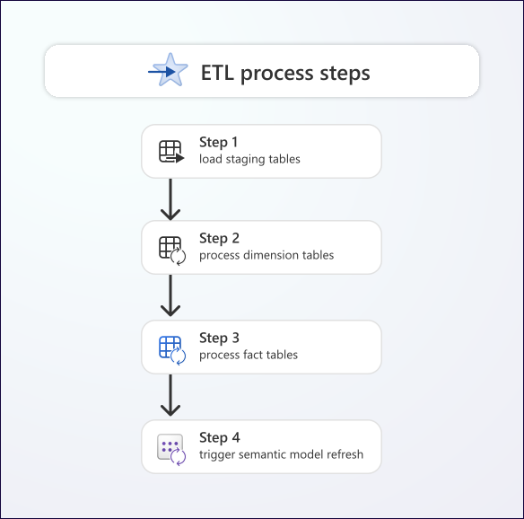

# 10. Transformations and Transactions

[Book contents](../../index.md) | [Part II contents](README.md) | [Previous: Chapter 9](09-loading-and-accessing-data.md) | [Next: Chapter 11](11-tsql-compatibility.md)

**Applies to:** Warehouse transformations and writes; shared read-only SQL patterns also apply to SQL analytics endpoints. **Level:** Intermediate. **Feature baseline:** 8 October 2026; `MERGE` is generally available. Labs are authored examples, not reported tenant executions.

## A transformation is a publication decision

An analytical transformation turns source-shaped rows into a contract consumers can trust. It may assign a dimension key, convert money to a declared precision, remove a superseded version, or aggregate sales. These are business decisions expressed in SQL, not merely opportunities to shorten a pipeline.

Keep the shared `book.FactSales` unchanged. Its six rows provide a stable reference for later chapters. This chapter uses disposable copies to show an update and an insert published together, then explores what happens when execution fails or overlaps another writer.

A Warehouse transaction can make several SQL changes atomic. It cannot make an external API request, a file arrival, a pipeline status update, and a SQL commit one indivisible operation. Put the authoritative completion record beside the data when possible, and make the external orchestrator reconcile against that record.

The preview Warehouse-to-Python function integration in [Chapter 11](11-tsql-compatibility.md) is another example of that boundary. A T-SQL proxy can invoke remote code; rolling back its surrounding Warehouse transaction does not undo an external side effect. Prefer pure transformations, or design explicit idempotency and reconciliation for any external action.

The [transactions reference](https://learn.microsoft.com/en-us/fabric/data-warehouse/transactions) documents snapshot isolation, explicit transactions, supported transactional DDL, and same-workspace cross-Warehouse transactions. It also documents exclusions, including distributed transactions and savepoints. Do not import a SQL Server transaction framework unchanged and assume every control mechanism remains available.



*Documentation image D10. Microsoft, [Dimensional ETL process steps](https://learn.microsoft.com/en-us/fabric/data-warehouse/dimensional-modeling-load-tables); [original image](https://learn.microsoft.com/en-us/fabric/data-warehouse/media/dimensional-modeling-load-tables/etl-process-steps.svg). Unmodified source copy, retrieved 9 November 2026; [CC BY 4.0](https://creativecommons.org/licenses/by/4.0/) under the [Fabric documentation licence](https://github.com/MicrosoftDocs/fabric-docs/blob/aadea08f35c3edaa9c32535c772792f02555c9a4/LICENSE). Use the loading phases as an evidence map; the drawing does not make an external ETL workflow one SQL transaction.*

## Prefer set-based work with explicit semantics

For analytic transformations, start with a query over a batch, not a loop over rows. A single `INSERT ... SELECT` or CTAS gives the engine a relational operation to optimize and avoids thousands of client round trips. This is not a claim that all loops are invalid; a small control loop and a billion-row transformation have different purposes.

Type expressions at the boundary. A `datetime2(6)` modification timestamp here means a UTC value by convention; the type does not carry a timezone. A `decimal(12,2)` unit price is exact to two decimal places, while a derived total can require greater precision. Rounding each source line and rounding the final sum can produce different financial results. Agree which rule the measure represents.

Deduplicate according to a deterministic source contract. If two changes share a sales key and timestamp but disagree on quantity, arbitrarily taking one is not data cleaning. Request an additional sequence, classify the conflict, or reject the batch. `ROW_NUMBER()` without a complete tie-breaking order merely conceals uncertainty.

The optional preview `QUALIFY` examples in [Chapter 7](07-tsql-for-analytics.md) shorten window-result filtering without changing that rule. The canonical seed's modification timestamps all tie; its latest-sale exercise therefore orders by sale date and sales key, not modification timestamp alone. A production change feed needs its own version/tie contract. Do not mechanically transplant the exercise's order into a loader and call the result deduplication.

## Lab: publish a correction and a new sale

Prerequisites are the Chapter 4 seed, a Warehouse connection to `BookWarehouse`, and create/write permissions in `book`. The following setup fails if the lab tables already exist. Run it once, using no concurrent writer against these names.

**Runnable T-SQL - Warehouse; creates three Chapter 10 tables and stages two synthetic changes.**

```sql
CREATE TABLE book.Lab08Sales
AS SELECT SalesKey, DateKey, CustomerKey, ProductKey,
          Quantity, UnitPrice, LastModifiedUtc
FROM book.FactSales;

CREATE TABLE book.Lab08Changes
AS SELECT SalesKey, DateKey, CustomerKey, ProductKey,
          Quantity, UnitPrice, LastModifiedUtc
FROM book.FactSales
WHERE 1 = 0;

CREATE TABLE book.Lab08Batches
(
    BatchId varchar(40) NOT NULL,
    CompletedUtc datetime2(6) NOT NULL
);

INSERT INTO book.Lab08Changes
    (SalesKey, DateKey, CustomerKey, ProductKey,
     Quantity, UnitPrice, LastModifiedUtc)
VALUES
    (1001,20260101,1,10,3,25.00,'2026-01-05T00:00:00'),
    (1007,20260103,1,30,2,10.00,'2026-01-05T00:00:00');
```

The correction adds one 25.00 lamp to sale 1001. The new sale adds two 10.00 notebooks. If publication is correct, the lab target will contain seven rows, quantity 13, and revenue 410.00. The shared fact table must remain at 365.00.

`MERGE` is now supported and generally available, not an item for an obsolete "unsupported Fabric SQL" checklist. Nevertheless, it is not automatic deduplication or conflict resolution. Check the source and target key multiplicity before matching. The example validates both; production validation should also reject missing dimension members and invalid business values.

**Runnable T-SQL - Warehouse; single-writer lab publication. Rerunning this block after success does not reapply its batch.**

```sql
IF EXISTS
(
    SELECT SalesKey FROM book.Lab08Changes
    GROUP BY SalesKey HAVING COUNT_BIG(*) > 1
)
    THROW 50001, 'Duplicate source sales keys.', 1;

IF EXISTS
(
    SELECT SalesKey FROM book.Lab08Sales
    GROUP BY SalesKey HAVING COUNT_BIG(*) > 1
)
    THROW 50002, 'Duplicate target sales keys.', 1;

IF NOT EXISTS
(
    SELECT 1 FROM book.Lab08Batches
    WHERE BatchId = 'Lab08-20260105'
)
BEGIN
    BEGIN TRY
        BEGIN TRANSACTION;

        MERGE book.Lab08Sales AS target
        USING book.Lab08Changes AS source
        ON target.SalesKey = source.SalesKey
        WHEN MATCHED
             AND source.LastModifiedUtc > target.LastModifiedUtc
        THEN UPDATE SET
             DateKey = source.DateKey,
             CustomerKey = source.CustomerKey,
             ProductKey = source.ProductKey,
             Quantity = source.Quantity,
             UnitPrice = source.UnitPrice,
             LastModifiedUtc = source.LastModifiedUtc
        WHEN NOT MATCHED BY TARGET
        THEN INSERT
             (SalesKey, DateKey, CustomerKey, ProductKey,
              Quantity, UnitPrice, LastModifiedUtc)
             VALUES
             (source.SalesKey, source.DateKey,
              source.CustomerKey, source.ProductKey,
              source.Quantity, source.UnitPrice,
              source.LastModifiedUtc);

        INSERT INTO book.Lab08Batches (BatchId, CompletedUtc)
        VALUES ('Lab08-20260105', SYSUTCDATETIME());

        COMMIT TRANSACTION;
    END TRY
    BEGIN CATCH
        IF @@TRANCOUNT > 0 ROLLBACK TRANSACTION;
        THROW;
    END CATCH;
END;

SELECT COUNT_BIG(*) AS SalesRows, SUM(Quantity) AS Units,
       SUM(Quantity * UnitPrice) AS Revenue
FROM book.Lab08Sales;
```

The timestamp predicate implements one specific policy: only a strictly newer source version changes an existing sale. Equal timestamps with different contents require investigation; the code does not resolve them. There is deliberately no `WHEN NOT MATCHED BY SOURCE THEN DELETE`. An incremental batch is not a complete inventory, so absence from that batch does not mean deletion.

The batch ledger and preflight checks do **not** establish a general concurrent exactly-once protocol. Fabric's primary and unique keys are `NOT ENFORCED`; two workers can both observe that a batch is absent. Serialize publishers for this target and batch namespace, or design a coordination mechanism with an actual exclusivity guarantee. A check-before-insert pattern alone is not that guarantee.

## Observe rollback without damaging the seed

Rollback is easiest to understand when a visible intermediate change is followed by its removal. This example intentionally changes only the copy.

**Runnable T-SQL - Warehouse; temporarily changes one lab row, then rolls it back. Execute the whole block in one session.**

```sql
BEGIN TRANSACTION;

UPDATE book.Lab08Sales
SET Quantity = 99
WHERE SalesKey = 1002;

SELECT Quantity AS UncommittedQuantity
FROM book.Lab08Sales
WHERE SalesKey = 1002;

ROLLBACK TRANSACTION;

SELECT Quantity AS RestoredQuantity
FROM book.Lab08Sales
WHERE SalesKey = 1002;
```

Expect 99 followed by 1. The first query sees the transaction's own change; it does not prove another session can see it. The transaction documentation also warns that statistics generated after inserts can survive a rollback with misleading information. That is a performance-maintenance concern, not evidence that rolled-back rows became committed.

Keep transactions short. Reading a large source, waiting for a person to inspect results, and then committing leaves a long-lived unit of work. Build and validate stable staging inputs first, then perform the minimum publication work. If validation must be consistent with mutable target state, include it in the carefully designed publication protocol rather than assuming a preflight query is timeless.

## Snapshot isolation does not eliminate conflicts

Warehouse enforces snapshot isolation. Do not attempt to solve a race by issuing `SET TRANSACTION ISOLATION LEVEL SERIALIZABLE`; that is not a supported Warehouse escape hatch. Snapshot reads and write conflict detection are different mechanisms.

The current documentation describes write-write conflicts at table level. Two updates aimed at different sales can still conflict, and an append-only outcome produced by `MERGE` can still participate in a conflict. DDL adds schema locks: a transactional table alteration can block readers or be blocked by them. "Readers do not block ordinary writers" must not become "nothing ever blocks."

**Roadmap snapshot taken 9 November 2026:** the listing names **File-Level write-write conflict detection**, with a planned GA target of **Q4 2026**. That is planning evidence, not proof the current transaction contract has changed. Keep documented writer coordination and whole-transaction retry logic until current feature guidance establishes the applicable behavior. See [Appendix H](../../appendices/H-roadmap-snapshot.md#snapshot-9-november-2026).

When a documented transient conflict occurs, retry the **whole transaction**, with a bounded attempt count and delay. Retrying only the last insert can separate the ledger from the fact changes. When a connection disappears near commit, first reconnect and inspect the batch outcome. A network exception alone does not reveal whether the server committed.

Do not retry deterministic errors indefinitely. A missing column, an invalid conversion, or duplicate source keys needs correction. Record a batch identifier, attempt, UTC interval, and sanitized error information so the operator can distinguish a transient collision from a consistently bad batch.

Also distinguish transaction completion from cross-engine publication. A SQL consumer of the committed Warehouse can observe the new data before an external Delta reader observes newly published logs. If a business release spans several tables and multiple engines, specify how consumers identify the approved release and when they may advance to it. A committed SQL ledger is useful evidence, but it does not by itself prove that every downstream model or exported representation has refreshed to that release.

## Aggregate descriptions without hiding bad data

Jovan Popovic's [ANY_VALUE article](https://community.fabric.microsoft.com/blog/fbc_fabricupdatesblogs/use-any-value-for-simpler-grouping-of-results-in-fabric-data-warehouse-generally/5172050) demonstrates carrying descriptive attributes through grouping by their key. The following adapts that pattern to the unchanged book dataset.

**Runnable T-SQL - Warehouse or the seeded Lakehouse SQL endpoint; read-only. Adapted concept from Jovan Popovic, inspected 8 October 2026; book schema and explicit duplicate precheck added.**

```sql
SELECT CustomerKey, COUNT_BIG(*) AS Copies
FROM book.DimCustomer
GROUP BY CustomerKey
HAVING COUNT_BIG(*) > 1;

SELECT s.CustomerKey,
       ANY_VALUE(c.CustomerName) AS CustomerName,
       ANY_VALUE(c.CountryCode) AS CountryCode,
       SUM(s.Quantity * s.UnitPrice) AS Revenue
FROM book.FactSales AS s
JOIN book.DimCustomer AS c
  ON c.CustomerKey = s.CustomerKey
GROUP BY s.CustomerKey
ORDER BY s.CustomerKey;
```

Proceed with interpretation only if the precheck returns no duplicates. Expected customer revenues are 80.00, 180.00, and 105.00. `ANY_VALUE` is nondeterministic and returns a non-null value when possible; it does not mean "latest", "first", or "most trustworthy." The name and country must genuinely be constant for the grouping key.

If duplicate dimension rows multiply a join, `ANY_VALUE` can still display a plausible customer name while the revenue is wrong. Likewise, two separate `ANY_VALUE` expressions over inconsistent attributes need not describe one coherent source record. Validate the functional dependency; do not use the function as a substitute for it.

## Cleanup and takeaways

**Runnable T-SQL - Warehouse; removes only Chapter 10 lab tables after all sessions have finished.**

```sql
DROP TABLE IF EXISTS book.Lab08Changes;
DROP TABLE IF EXISTS book.Lab08Batches;
DROP TABLE IF EXISTS book.Lab08Sales;
```

- Transform sets, but define version, precision, and deletion semantics explicitly.
- Publish related SQL changes and their completion record atomically.
- Snapshot isolation still permits write conflicts and schema blocking.
- Retry complete units of work; do not confuse a ledger check with enforced uniqueness.

## References

1. Microsoft Learn, [Transactions in Fabric Data Warehouse](https://learn.microsoft.com/en-us/fabric/data-warehouse/transactions), isolation, locking, retries, and limitations.
2. Microsoft Learn, [T-SQL surface area](https://learn.microsoft.com/en-us/fabric/data-warehouse/tsql-surface-area), current GA `MERGE` support.
3. Microsoft Learn, [Primary, foreign, and unique keys](https://learn.microsoft.com/en-us/fabric/data-warehouse/table-constraints), `NOT ENFORCED` requirements.
4. Microsoft Learn, [Ingest using T-SQL](https://learn.microsoft.com/en-us/fabric/data-warehouse/ingest-data-tsql), set-based materialization.
5. Jovan Popovic, [Use ANY_VALUE for simpler grouping](https://community.fabric.microsoft.com/blog/fbc_fabricupdatesblogs/use-any-value-for-simpler-grouping-of-results-in-fabric-data-warehouse-generally/5172050), analytical grouping pattern.
6. Microsoft Learn, [ANY_VALUE](https://learn.microsoft.com/en-us/sql/t-sql/functions/any-value-transact-sql?view=fabric), nondeterminism and null handling.

---

[Previous: Chapter 9](09-loading-and-accessing-data.md) | [Book contents](../../index.md) | [Next: Chapter 11](11-tsql-compatibility.md)
