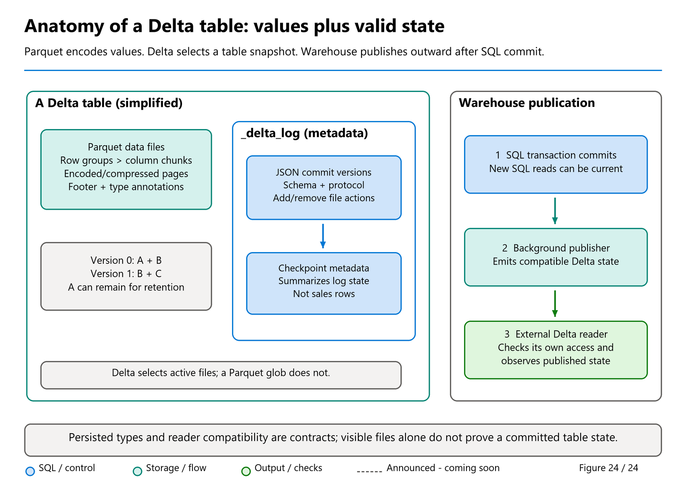

# 11. T-SQL Compatibility

[Book contents](../../index.md) | [Part II contents](README.md) | [Previous: Chapter 10](10-transformations-and-transactions.md) | [Next: Chapter 12](12-security-and-governance.md)

**Applies to:** Warehouse and Lakehouse SQL analytics endpoint, with write differences identified below. **Level:** Intermediate. **Feature baseline:** original engine comparison retained at 8 October 2026; scalar-UDF, string-function and view-refresh additions reviewed 9 November; targeted ALTER COLUMN review 10 November 2026. Native scalar UDFs, Warehouse external UDF integration and ALTER COLUMN remain preview. This is a compatibility investigation, not a claim of tenant validation.

## Familiar language, different contract

T-SQL familiarity is valuable in Fabric, but syntax recognition is not a complete compatibility test. Ask four separate questions: does the statement parse, does this item permit the operation, does its behavior match the source, and can the resulting workload meet its operational requirements?

SQL Server is a general relational database platform with application-oriented features and administrator-controlled physical design. Azure Synapse dedicated SQL pools are distributed warehouses with their own distribution, index, and workload-management concepts. Synapse serverless SQL primarily queries external data and has a different persistence and transaction surface. Fabric Warehouse is not a renamed edition of any one of them. SQL database in Fabric is also a different item from Warehouse.

Consequently, a source migration assessment must identify the actual source engine. A dedicated-pool distribution clause, a serverless external-file recipe, and a SQL Server trigger are not interchangeable examples of "SQL support." Use the Fabric applicability section of each reference rather than trusting a familiar page title.

The Lakehouse SQL endpoint adds another boundary: its underlying table data is read-only, but supported SQL views, functions, procedures, and security objects can exist there. A procedure is not granted special permission to mutate the Delta data merely because it was successfully created.

## Five engines, nine compatibility checks

**Comparison date: 8 October 2026.** The SQL Server column describes conventional disk-based databases on SQL Server 2022/2025, not every edition, deployment, or specialized table type. Synapse dedicated means a dedicated SQL pool in an Azure Synapse workspace. "Supported" below never means every SQL Server variation is supported. The official [Synapse feature comparison](https://learn.microsoft.com/en-us/azure/synapse-analytics/sql/overview-features), [SQL Server table syntax](https://learn.microsoft.com/en-us/sql/t-sql/statements/create-table-transact-sql?view=sql-server-ver17), and Fabric references are the baseline, not a common compatibility level shared by all five engines.

| Capability or behavior | SQL Server | Synapse dedicated SQL pool | Synapse serverless SQL pool | Fabric Warehouse | Lakehouse SQL endpoint |
| --- | --- | --- | --- | --- | --- |
| Persistent-data writes | `INSERT`, `UPDATE`, `DELETE`, `MERGE` | DML supported; check dedicated-specific `MERGE` restrictions/status | No external-data DML; CETAS can write a new external result | DML, `COPY INTO`, CTAS; `MERGE` GA | Underlying table data read-only; write through a supported Lakehouse engine |
| Tables and physical design | Heaps, rowstore/columnstore indexes, partitioning | Hash, round-robin, replicated distribution; heap/index/partition choices | External tables/file queries; not internal user tables or SQL indexes | Managed OneLake tables; do not carry over persistent-table distribution/index clauses | SQL representation of Lakehouse Delta tables; physical changes belong upstream |
| Transaction scope and isolation | Data transactions; cross-database possible; configurable isolation | Pool-local data transactions; default read uncommitted or database-enabled RCSI; restricted DDL | Transactions cover metadata, not external-file data changes | Snapshot isolation; transactions can span same-workspace Warehouses, including endpoint reads | Read participant, not a transactionally writable Lakehouse target |
| Stored or exposed types | Includes `nvarchar`, `tinyint`, `datetimeoffset`; feature/version qualifications | Supports those examples, but not every SQL Server type | External-schema/type mapping; not a full SQL Server storage engine | Persisted subset: UTF-8 `varchar`, `smallint`, `datetime2(6)` alternatives | Types derive from supported Delta-to-SQL mappings |
| Database collation | Can change database default; existing user columns do not automatically change | Chosen at creation; cannot change existing pool database collation | Database default can be changed with `ALTER DATABASE` | Two documented creation collations; existing item collation fixed | Workspace creation default; existing endpoint collation fixed |
| Primary, unique, foreign keys | Enforced PK/unique and enabled FK constraints available | PK/unique require `NOT ENFORCED`; FK unsupported | No enforced keys over external files | PK/unique/FK supported only `NOT ENFORCED`; PK/unique require `NONCLUSTERED` | Documented key metadata on existing tables is `NOT ENFORCED`, not Delta validation |
| `IDENTITY` generation | Seed/increment supported; not gap-free | `int`/`bigint`; distributed, noncontiguous allocation | No identity generation into external tables | `bigint` only; system-managed allocation, no custom seed/increment | No SQL identity-writing facility for underlying Delta rows |
| Procedural SQL | Views, procedures, scalar and table-valued UDFs; feature-specific restrictions | Views/procedures/UDFs within its subset; no triggers | Views/procedures; inline TVFs, not scalar UDFs; no triggers | Views/procedures/inline TVFs; scalar UDF preview; no triggers | Supported SQL objects can be created despite read-only table data; scalar UDF preview |
| Temporary work | Local/global temp tables and table variables, with scope rules | Session temp tables; no table variables | Temp tables for local/system data; cannot mix with external data in one query | Session `#temp`, including distributed variants; no global `##temp` | Do not infer staging support from the Warehouse-only `#temp` reference |

The differences within a row can change a design. Dedicated-pool transactions do not support `CREATE TABLE` inside a user transaction; Fabric supports specified transactional DDL. Serverless metadata transactions do not make CETAS and upstream file changes one data transaction. See the separate [dedicated transaction rules](https://learn.microsoft.com/en-us/azure/synapse-analytics/sql-data-warehouse/sql-data-warehouse-develop-transactions) and [Fabric transaction rules](https://learn.microsoft.com/en-us/fabric/data-warehouse/transactions). SQL Server's [transaction](https://learn.microsoft.com/en-us/sql/t-sql/language-elements/begin-transaction-transact-sql?view=sql-server-ver17) and [isolation](https://learn.microsoft.com/en-us/sql/t-sql/statements/set-transaction-isolation-level-transact-sql?view=sql-server-ver17) controls must not be generalized to either service.

Likewise, [Synapse collation](https://learn.microsoft.com/en-us/azure/synapse-analytics/sql/reference-collation-types), [dedicated constraints](https://learn.microsoft.com/en-us/azure/synapse-analytics/sql-data-warehouse/sql-data-warehouse-table-constraints), and [dedicated identity](https://learn.microsoft.com/en-us/azure/synapse-analytics/sql-data-warehouse/sql-data-warehouse-tables-identity) have their own qualifications. The [Fabric temp-table article](https://learn.microsoft.com/en-us/fabric/data-warehouse/temp-tables) explicitly scopes its guarantees to Warehouse; this matrix makes no unverified promise about endpoint temporary staging. The Synapse feature overview still labels dedicated-pool `MERGE` preview at this comparison date; that label does not override Fabric's GA status.

### Two small translations with larger consequences

First, remove source-specific physical design, not the business columns. This pair follows the [dedicated table-design guide](https://learn.microsoft.com/en-us/azure/synapse-analytics/sql-data-warehouse/sql-data-warehouse-tables-overview). It is not a recommendation to hash-distribute a two-column miniature table in production.

**Illustrative T-SQL pair - first statement belongs to Synapse dedicated, second to Fabric Warehouse. Do not execute together; each would create only `book.Lab09Physical` in its respective database.**

```sql
-- Before: Synapse dedicated SQL pool.
CREATE TABLE book.Lab09Physical
(SalesKey bigint NOT NULL, CustomerKey int NOT NULL)
WITH (DISTRIBUTION = HASH(CustomerKey), CLUSTERED COLUMNSTORE INDEX);

-- After: Fabric Warehouse.
CREATE TABLE book.Lab09Physical
(SalesKey bigint NOT NULL, CustomerKey int NOT NULL);
```

Removing the clause does not preserve the source's distribution plan; it hands layout management to the target. Conversely, Fabric's documented `DISTRIBUTION = ROUND_ROBIN` option for a distributed **temporary** table is not evidence that persistent Warehouse tables accept dedicated-pool distribution syntax.

Second, translate type and key-generation contracts together rather than changing only the connection string.

**Illustrative T-SQL pair - SQL Server before, Fabric Warehouse after. Do not execute together; each would create only `book.Lab09TypeMap` on the indicated engine.**

```sql
-- Before: SQL Server, fresh generated keys.
CREATE TABLE book.Lab09TypeMap
(RowKey int IDENTITY(1,1), Flag tinyint, Label nvarchar(100));

-- After: Fabric Warehouse, fresh generated keys.
CREATE TABLE book.Lab09TypeMap
(RowKey bigint IDENTITY, Flag smallint, Label varchar(400));
```

The 400-byte label allowance is a conservative UTF-8 budget, not a universal sizing formula. Validate real strings and preserve the original flag range through load validation: `smallint` permits values that `tinyint` did not. Existing surrogate keys must be migrated explicitly, not regenerated with this fresh-table example. Neither definition establishes a business-key uniqueness rule; the later `IDENTITY` lab separates generation from `NOT ENFORCED` key metadata.

## Inventory before translating

Mark Pryce-Maher's `tables-columns-datatypes.sql` gist is a useful starting point because it reports actual catalog types instead of guessing from source DDL. This adaptation retains the original catalog joins, narrows the scope to `book`, and adds column order and collation.

**Runnable T-SQL - Warehouse or SQL endpoint; catalog-only, read-only.**

```sql
-- Adapted from Mark Pryce-Maher, 10 March 2026.
-- Canonical: https://gist.github.com/MarkPryceMaherMSFT/32f9e21deb2f784bbb47b2d50f71d412
-- Pinned: https://gist.github.com/MarkPryceMaherMSFT/32f9e21deb2f784bbb47b2d50f71d412/47df0d6920436ac9a85ece3d3fea4fc6d4fe0aaa
-- Author-authorized manuscript use; no explicit public license.
-- Changes: book filter, ordinal and collation; no data-table joins.
SELECT s.name AS SchemaName,
       t.name AS TableName,
       c.column_id AS ColumnOrdinal,
       c.name AS ColumnName,
       ty.name AS DataType,
       c.max_length, c.precision, c.scale,
       c.is_nullable, c.collation_name
FROM sys.tables AS t
JOIN sys.schemas AS s ON t.schema_id = s.schema_id
JOIN sys.columns AS c ON t.object_id = c.object_id
JOIN sys.types AS ty ON c.user_type_id = ty.user_type_id
WHERE s.name = 'book'
ORDER BY s.name, t.name, c.column_id;
```

`max_length` is a byte measure, not a universal character count. Preserve precision, scale, and nullability in the assessment. Record definitions, dependencies, security, and consumers separately; a column inventory is not a migration package. Catalog visibility also depends on permissions, so an empty result does not establish that no objects exist.

Do not join this query directly to business data to calculate profiling metrics. The current surface-area reference lists queries combining system and user tables as unsupported. Run the catalog inspection and data profiling as separate operations.



*Figure 24, reused for compatibility review.* A representation supported by the file format, a SQL in-memory value and a persisted Warehouse column are different acceptance cases. Use the actual product/reader contract, not the format's theoretical capacity alone.

## Types can change business meaning

Warehouse persisted columns support a documented subset of SQL types. Examples include `varchar` with UTF-8 collation rather than persisted `nvarchar`, `smallint` instead of `tinyint`, and `datetime2` rather than persisted `datetimeoffset`. Date/time fractional precision is limited to six digits. These are mappings to design, not blind search-and-replace rules. See [Data types](https://learn.microsoft.com/en-us/fabric/data-warehouse/data-types).

A UTF-8 string's byte width depends on its characters. A migrated `varchar(100)` does not guarantee space for every set of 100 Unicode characters. Validate actual multilingual values, truncation behavior, client encoding, and comparisons. Retain UTC and any required source offset or timezone information explicitly rather than silently discarding temporal meaning.

Expression and parameter support can differ from persisted-column support. A type accepted in a conversion or local variable is not necessarily legal in a stored table. Likewise, `uniqueidentifier` has documented cross-engine representation limitations: Warehouse SQL support does not imply every Delta reader exposes the same logical value.

## Collation is semantics, not cosmetic metadata

The supported Warehouse creation collations include the default case-sensitive `Latin1_General_100_BIN2_UTF8` and case-insensitive `Latin1_General_100_CI_AS_KS_WS_SC_UTF8`. The workspace default affects newly created Warehouses and SQL endpoints, not existing ones. Current documentation says an existing item's collation cannot be changed. Choose deliberately before provisioning ([collation reference](https://learn.microsoft.com/en-us/fabric/data-warehouse/collation)).

Mark's February 2025 collation-view gist and July 2025 Fabric Toolbox `dw-ci-views` script demonstrate generating views with explicit `COLLATE` expressions. Their historical motivation remains useful, but the Toolbox README's claim that endpoints can only be created case-sensitive is no longer current.

The original generators also use unquoted column names, unordered string aggregation, and narrow or implicit string conversions. The Toolbox version can automatically apply every generated view. The bounded adaptation below instead generates one reviewable statement, quotes identifiers, preserves column order, handles both `char` and `varchar`, and uses a supported UTF-8 collation. It does not execute the result.

**Runnable T-SQL - either SQL surface with the seeded customer table; read-only DDL generation. The output, if separately approved and executed, creates only `book.Lab09CustomerCI`.**

```sql
-- Adapted from Mark Pryce-Maher, collation_views.sql, 24 February 2025:
-- Canonical: https://gist.github.com/MarkPryceMaherMSFT/b9f735684b3bc968ab9a95c7682b5e73
-- Pinned: https://gist.github.com/MarkPryceMaherMSFT/b9f735684b3bc968ab9a95c7682b5e73/f70f496c3ca4ac61f110e19a2d5865585d099b23
-- Gist: Author-authorized manuscript use; no explicit public license.
-- And Fabric Toolbox ci_views.sql, Mark Pryce-Maher, 11 July 2025:
-- Canonical: https://github.com/microsoft/fabric-toolbox/blob/main/scripts/dw-ci-views/ci_views.sql
-- Pinned: https://github.com/microsoft/fabric-toolbox/blob/a50e780e744dd847c331d85da56f544cabaaa2af/scripts/dw-ci-views/ci_views.sql
-- Toolbox portion: MIT License; copyright and notice retained below.
-- License: https://github.com/microsoft/fabric-toolbox/blob/a50e780e744dd847c331d85da56f544cabaaa2af/LICENSE
-- Changes: one object, quoted identifiers, max-width ordered aggregation,
-- UTF-8 collation, char support, and no automatic execution.
/*
MIT License

Copyright (c) Microsoft Corporation.

Permission is hereby granted, free of charge, to any person obtaining a copy
of this software and associated documentation files (the "Software"), to deal
in the Software without restriction, including without limitation the rights
to use, copy, modify, merge, publish, distribute, sublicense, and/or sell
copies of the Software, and to permit persons to whom the Software is
furnished to do so, subject to the following conditions:

The above copyright notice and this permission notice shall be included in all
copies or substantial portions of the Software.

THE SOFTWARE IS PROVIDED "AS IS", WITHOUT WARRANTY OF ANY KIND, EXPRESS OR
IMPLIED, INCLUDING BUT NOT LIMITED TO THE WARRANTIES OF MERCHANTABILITY,
FITNESS FOR A PARTICULAR PURPOSE AND NONINFRINGEMENT. IN NO EVENT SHALL THE
AUTHORS OR COPYRIGHT HOLDERS BE LIABLE FOR ANY CLAIM, DAMAGES OR OTHER
LIABILITY, WHETHER IN AN ACTION OF CONTRACT, TORT OR OTHERWISE, ARISING FROM,
OUT OF OR IN CONNECTION WITH THE SOFTWARE OR THE USE OR OTHER DEALINGS IN THE
SOFTWARE
*/
SELECT
    'CREATE VIEW [book].[Lab09CustomerCI] AS SELECT ' +
    STRING_AGG(
        CONVERT(varchar(max), QUOTENAME(c.name)) +
        CASE WHEN ty.name IN ('char', 'varchar')
             THEN ' COLLATE Latin1_General_100_CI_AS_KS_WS_SC_UTF8 AS '
                  + QUOTENAME(c.name)
             ELSE ''
        END,
        ', '
    ) WITHIN GROUP (ORDER BY c.column_id) +
    ' FROM [book].[DimCustomer];' AS ReviewableDDL
FROM sys.tables AS t
JOIN sys.schemas AS s ON s.schema_id = t.schema_id
JOIN sys.columns AS c ON c.object_id = t.object_id
JOIN sys.types AS ty ON ty.user_type_id = c.user_type_id
WHERE s.name = 'book' AND t.name = 'DimCustomer';
```

This changes comparison semantics of projected string expressions, not the item's catalog collation or the source table. A predicate on the generated view can match `aster retail` to `Aster Retail`; object-name case sensitivity remains a separate concern. Accent sensitivity is also deliberate: the selected collation is accent-sensitive, unlike the originals' `CI_AI` expression.

Test joins and business keys before adopting case-insensitivity. If the source treats `AB` and `ab` as different customer identifiers, a case-insensitive join can merge meanings and multiply results. A query that stops throwing a collation error has not necessarily become correct.

## Migrate view definitions, not just text

Mark's `migrate_views.py` gist extracts `sys.views` and `sys.sql_modules`, selects views, and executes revised definitions at a destination. Its useful core is metadata-driven selection. This safer excerpt retains that core while requiring a schema-qualified choice and stopping when a definition is unavailable.

**Template Python - an authorized SQLAlchemy source connection, read-only; supply `source_connection`. Does not connect to Fabric, execute destination DDL, or write files.**

```python
# Adapted from Mark Pryce-Maher, migrate_views.py, 11 August 2025.
# Canonical: https://gist.github.com/MarkPryceMaherMSFT/a834d3043c38ea498029e147d061624b
# Pinned: https://gist.github.com/MarkPryceMaherMSFT/a834d3043c38ea498029e147d061624b/aa59d2d2453a61dbe5b57383cd79bb521f0a5be6
# Author-authorized manuscript use; no explicit public license.
# Changes: schema-qualified parameterization, missing-definition guard,
# and review-only output instead of automatic regex replacement/execution.
from sqlalchemy import text

def read_view(connection, schema_name, view_name):
    rows = connection.execute(
        text("""
            SELECT s.name AS SchemaName, v.name AS ViewName,
                   m.definition AS ViewDefinition
            FROM sys.views AS v
            JOIN sys.schemas AS s ON s.schema_id = v.schema_id
            JOIN sys.sql_modules AS m ON m.object_id = v.object_id
            WHERE s.name = :schema_name AND v.name = :view_name
        """),
        {"schema_name": schema_name, "view_name": view_name},
    ).mappings().all()
    if len(rows) != 1 or not rows[0]["ViewDefinition"]:
        raise ValueError("Exactly one visible view definition is required.")
    return dict(rows[0])

candidate = read_view(source_connection, "book", "Lab09CustomerRevenue")
```

The named source view must already exist for this optional migration exercise. Review its dependencies, three-part names, unsupported functions, and column types before composing a destination definition. Deploy dependency-first and reconcile results with representative data. A SQL dialect conversion library may help, but it cannot decide what an ambiguous business rule should mean.

Several original behaviors are intentionally not copied. A global regular-expression replacement of `CREATE VIEW` can alter comments or literals and misses other header forms. Name-only filtering can confuse identical names in different schemas. Swallowing an execution error inside one encompassing transaction can make subsequent "success" messages misleading.

The original destination connection also omits an explicit database and requests a Power BI resource token. Chapter 13 instead uses a SQL-resource token, an explicit database, and bounded connection lifetime. Do not infer managed-identity provenance merely from obtaining a token in a notebook. The selected authentication flow and execution context determine the identity.

The inspected gists have no explicit license; these adaptations are included under the author's authorization for this book. The Toolbox source is MIT-licensed. Attribution is not a claim that every public gist inherits that license.

## Current support matters: IDENTITY and MERGE

Fabric Warehouse now supports `IDENTITY`; the core book seed avoids it only to keep cross-engine keys identical. Current documentation requires `bigint`, does not permit a custom seed or increment, and does not promise contiguous or insertion-ordered values. Generated uniqueness is distinct from a primary-key constraint's enforcement.

**Runnable T-SQL - Warehouse only; creates a disposable identity table.**

```sql
CREATE TABLE book.Lab09Identity
(
    GeneratedKey bigint IDENTITY NOT NULL,
    Label varchar(20) NOT NULL
);

INSERT INTO book.Lab09Identity (Label)
VALUES ('first'), ('second');

ALTER TABLE book.Lab09Identity
ADD CONSTRAINT PK_Lab09Identity
PRIMARY KEY NONCLUSTERED (GeneratedKey) NOT ENFORCED;

SELECT GeneratedKey, Label
FROM book.Lab09Identity
ORDER BY Label;
```

Expect two generated positive keys, not necessarily 1 and 2. The constraint does not enforce uniqueness. Explicit identity insertion requires the documented reseeding procedure afterward; do not transplant SQL Server reseed syntax with an arbitrary next value. Chapter 10 demonstrates currently GA `MERGE`, including why it still needs duplicate checks and writer coordination.

For the complete explicit-insert sequence, including `SET IDENTITY_INSERT` on/off, an explicit column list, and Fabric's system-managed `DBCC CHECKIDENT(..., RESEED)`, use the separate migration-key lab in [Chapter 8](08-dimensional-modeling.md). Its imported keys do not alter the canonical dimensions.

## ALTER COLUMN: widen the contract without assuming every conversion

**Warehouse preview, reviewed 10 November 2026.** Twinkle Cyril's [5 May announcement](https://community.fabric.microsoft.com/blog/fbc_fabricupdatesblogs/simplify-schema-changes-in-fabric-data-warehouse-with-alter-column-preview/5177593), also summarized in the June Build roundup, explains the benefit: supported changes update metadata without rewriting existing Parquet files. The [Fabric-specific ALTER COLUMN reference](https://learn.microsoft.com/en-us/sql/t-sql/statements/alter-table-transact-sql?view=fabric&preserve-view=true#alter-column), not the surrounding SQL Server examples, defines permitted conversions.

| Family | Examples and limits in the checked contract |
| --- | --- |
| Integer and floating point | `smallint` to `int`/`bigint`, `int` to `bigint`, and specified wider floating-point representations. Float/real interchange is not permission to narrow an eight-byte double to a four-byte real. |
| Decimal | `decimal(p,s)` to `decimal(p+k1,s+k2)` requires `k1 >= k2 >= 0`, within supported precision. Increasing scale without enough extra precision would reduce integer capacity. Decimal/numeric interchange preserves the specified precision/scale. |
| Date/time | Specified time-to-datetime2 and datetime2 precision increases; the persisted Fabric limit remains **six fractional digits**, not seven. |
| Character and binary | Specified char/varchar widening and longer varbinary definitions. Consult the exact pair and length rules rather than assuming every string/binary conversion works. |

There are explicit exclusions: no NULL-to-NOT-NULL change, identity-column alteration, different collation, same-type size reduction, or alteration of a column with manually created statistics or a clustering-index dependency. A source DDL generator must inspect those dependencies and retain a reviewed alternative, not discard statistics or constraints silently.

One subtle migration difference deserves its own acceptance case: the reference says interpreting a supported **time-to-datetime2** change supplies the date **1 January 1970**, unlike SQL Server's **1 January 1900**. That is not an application event date or a timezone conversion. Avoid the conversion when that interpretation does not match the business meaning.

### Small widening lab on a separate Warehouse table

**Optional preview T-SQL - Warehouse only; requires the `book` schema and table-create/ALTER permissions. Creates only `book.Lab11TypeWidening`, and fails if that name already exists. The shared seed is untouched.**

```sql
CREATE TABLE book.Lab11TypeWidening
(
    Label varchar(20) NULL,
    Amount decimal(12,2) NULL
);

INSERT INTO book.Lab11TypeWidening (Label, Amount)
VALUES ('Synthetic label', 12.34);

ALTER TABLE book.Lab11TypeWidening
ALTER COLUMN Label varchar(80) NULL;

ALTER TABLE book.Lab11TypeWidening
ALTER COLUMN Amount decimal(14,4) NULL;

SELECT Label, Amount
FROM book.Lab11TypeWidening;

SELECT name, max_length, precision, scale, is_nullable
FROM sys.columns
WHERE object_id = OBJECT_ID(N'book.Lab11TypeWidening')
ORDER BY column_id;
```

Expect the same label and numeric value, now represented as `decimal(14,4)` (`12.3400`); the varchar metadata reports an 80-byte limit. The decimal example adds two digits of precision and two of scale, preserving its integer capacity. These statements are not one transaction: if a statement fails, stop and inspect the isolated lab instead of assuming earlier changes rolled back. [Chapter 10](10-transformations-and-transactions.md#alter-table-inside-a-transaction-one-schema-release) explains atomic groups.

**Metadata-only is not lock-free.** ALTER COLUMN takes a schema-modification lock and can block or be blocked by concurrent workloads. The announcement's uninterrupted-pipeline wording is not a zero-blocking guarantee. Review dependent views, procedures, loaders and model bindings, including supported [view-metadata refresh](../06-operating-the-platform/36-development-and-automation.md#refresh-dependent-view-metadata-after-schema-changes).

Some supported operations enable **Delta type widening**. External engines reading the same table must understand compatible read-time interpretation; SQL success alone does not establish Spark, Direct Lake or another reader's compatibility. Check the [cross-engine feature matrix](https://learn.microsoft.com/en-us/fabric/fundamentals/delta-lake-interoperability#delta-lake-features-and-fabric-experiences). The documented CTAS alternative can create a new table without the widening history, but that is a separately approved data copy with dependency, permission and cutover work, not an automatic repair of the existing table.

## Three function concepts, three different contracts

The abbreviation "UDF" is not sufficient to assess compatibility. Distinguish a native T-SQL function, the **Fabric User Data Functions** Python service, and the Warehouse proxy integration connecting them.

| Concept | Where the implementation runs | Status and boundary at 9 October 2026 |
| --- | --- | --- |
| Native scalar T-SQL UDF | Warehouse/endpoint SQL execution, subject to current inlining rules | Preview; not made GA by an abbreviated "Fabric UDFs" announcement. |
| Fabric User Data Functions | Published serverless Python functions in a Fabric item, callable by supported Fabric/REST consumers | A separate product; the abbreviated announcement is not independent evidence for a precise Python-product GA date. |
| Warehouse external proxy | T-SQL delegates work to a published Python function | Explicitly preview in the dedicated Warehouse documentation; the proxy is not the Python implementation. |

Current native guidance distinguishes expression-oriented **ExprBlock** inlining from scalar UDF inlining for data-access functions. Definition eligibility and calling-query eligibility are separate. A historical rule that every scalar UDF must fit one older inlineability pattern is no longer a sufficient assessment. Preserve each function's semantics and test its actual call sites.

### Read the inlining mechanism, not just the word inlineable

The [20 October scalar-UDF guidance](https://learn.microsoft.com/en-us/fabric/data-warehouse/how-to-inline-udf) makes this distinction operational. **Expression Block inlining** supports computation-oriented functions and broader calling-query shapes; references to tables, views, inline TVFs, or other scalar UDFs exclude that mechanism. **Scalar UDF inlining** can incorporate data access, but has stricter function-body and calling-query requirements.

Consequently, restrictions involving loops, multiple returns, CTEs, or direct grouping and ordering must be assessed against the applicable mechanism. Do not turn one mechanism's limitation into a blanket rule for every scalar UDF. The current [CREATE FUNCTION reference](https://learn.microsoft.com/en-us/sql/t-sql/statements/create-function-sql-data-warehouse?view=fabric&preserve-view=true) defines the `sys.sql_modules.inline_eligibility_mask` values:

| Mask | Eligible mechanism |
| --- | --- |
| `0` | Neither mechanism. |
| `1` | Scalar UDF inlining. |
| `2` | Expression Block inlining. |
| `3` | Either mechanism. |

**Runnable read-only T-SQL - Warehouse or SQL endpoint with scalar-UDF preview support and catalog visibility.** This inspects visible native SQL scalar-function metadata; it creates no function.

```sql
SELECT SCHEMA_NAME(o.schema_id) AS FunctionSchema,
       o.name AS FunctionName,
       m.is_inlineable, m.inline_eligibility_mask
FROM sys.objects AS o
JOIN sys.sql_modules AS m ON m.object_id = o.object_id
WHERE o.type = 'FN'
ORDER BY FunctionSchema, FunctionName;
```

The untouched seed creates no scalar UDF, so an empty result is expected unless other exercises or users added one. Visibility can also filter the result. A nonzero mask describes eligibility, not a promise that every calling query will inline the function.

`WITH INLINE = AUTO` permits creation of a non-inlineable function. It does **not** make that function usable in distributed `SELECT ... FROM` queries over user tables; standalone evaluation and distributed query use are different acceptance cases. A migration test should include the real fact-table call, not just `SELECT function(constant)`. Both native scalar and external SQL UDFs remain preview after this documentation rewrite.

### FabricFunctions integration: useful Python, explicit remote work

The [Warehouse integration guide](https://learn.microsoft.com/en-us/fabric/data-warehouse/fabric-user-data-functions) documents binding a T-SQL proxy with `AS EXTERNAL FUNCTION`. Consider centrally maintained text normalization using a published Python function. It can be shared across approved consumers, but it introduces an external execution dependency, service limits, and another release lifecycle.

**Template Python — Fabric User Data Functions item, not a notebook or native T-SQL UDF; intended for an approved isolated published item. Pure string transformation, no file/network calls. This manuscript neither publishes nor invokes it.**

```python
import fabric.functions as fn

udf = fn.UserDataFunctions()

@udf.function()
def normalizeName(displayName: str) -> str:
    return displayName.strip().casefold()
```

The parameter uses the documented naming/type-annotation convention. This simple operation deliberately requires no third-party package. Normalizing a display name is not deduplicating customer identities: two customers can have identical names, and case folding can remove distinctions a business key needs.

**Template T-SQL — Warehouse only, external integration preview; creates or alters the named lab proxy after approval, not a data load. Requires a published function, item Read and invocation permissions, and function-creation permission in the target Warehouse. Replace `FunctionSetName` with the approved item name and confirm the isolated proxy name is unused before first deployment. No remote function invocation is included.**

```sql
CREATE OR ALTER FUNCTION book.Lab09NormalizeName
AS EXTERNAL FUNCTION FunctionSetName.normalizeName;
```

The SQL definition infers parameters and return type from the published function; an explicit supported return type can refine the inferred metadata. If the remote signature changes, the current `CREATE FUNCTION` reference requires recreating the proxy to synchronize it. Renaming or deleting the Python function likewise requires dependency review, not merely redeploying SQL text.

Calling this proxy is **remote service execution**, not SQL-local expression evaluation or native scalar-UDF inlining. The integration documents optional preview batch execution, including batches of up to 900 calls when configured and eligible. That reduces request overhead; it does not turn Python into a local relational operator or guarantee every query batches.

Prefer ordinary SQL built-ins for straightforward set-based transformations when they satisfy the requirement. Use the Python integration when the additional capability justifies its latency, limits, permissions, and lifecycle. If a future function calls an API or writes another system, review data transfer and side effects explicitly: a `SELECT` containing a proxy does not make arbitrary remote code harmless, and a Warehouse rollback does not undo an external action.

## A better editor does not change the SQL contract

The September SQL query editor updates make large schemas and result sets easier to work with. GA improvements cover the faster **results grid**, **Object Explorer** and **IntelliSense**, an autosave toggle, bulk query management, and `.sql` import/export. The benefit is less time locating objects and managing exploratory queries—not evidence that a formerly unsupported statement now executes.

For a practical review, import or open a copy of a chapter's SQL, inspect its target database, and compare the saved text with the intended operation before running it. Autosave preserves authoring state; it is not a database commit or a deployment approval. Exported `.sql` preserves source text, not an automatic dependency-complete migration package. Faster Object Explorer browsing is also not a measured performance guarantee for the entire OneLake catalog.

The editor's result display is bounded: current documentation distinguishes up to **10,000 query-result rows** from **1,000 rows in Data preview**. Use count/aggregate queries for completeness checks rather than counting what a grid happened to show. An attractive preview of a table cannot prove that all six million source rows arrived.

Other experiences need their own status labels. **Save as table** uses CTAS and writes data; **Visualize results** is a documented report-creation action, while **Explore this data** is explicitly preview. Do not assign a uniform preview/GA label to all three from proximity in the ribbon. The primary editor article separately marks query/result sharing and Activator integration preview. No-code table-creation, table-deep-dive and new interactive-chart announcements do not yet supply a complete verified operational walkthrough here, so no click path is invented. Review resulting schema, write effects and permissions.

The earlier Build article also names Table Overview, inline Copilot, editor-created Copy jobs and ontology entry points. [Chapter 4](../01-getting-started/04-first-warehouse.md#table-overview-and-inline-copilot-inspect-first-review-generated-sql) records their announced purpose without treating that preview group as blanket GA or equating it with every later UI promise.

## A maintained compatibility test beats a static list

The current surface-area page still lists triggers, synonyms, recursive queries, and materialized views as unsupported. Supported `ALTER TABLE` operations are a subset, with `ALTER COLUMN` documented as preview. Session temporary tables exist; that does not mean every SQL Server temporary-object recipe or distributed-pool option applies everywhere.

The FROM-first, `GROUP BY ALL`, `ORDER BY ALL`, `QUALIFY`, and new analytical-function examples in [Chapter 7](07-tsql-for-analytics.md) are marked preview for Warehouse/SQL endpoints. The 20 October language article explicitly groups the first four; ORDER BY ALL is documented in the Fabric-specific section of the shared SQL reference, not as a universal SQL Server extension. The analytical-SQL REGEX contract also remains preview: five scalar functions are supported, but `REGEXP_MATCHES` and `REGEXP_SPLIT_TO_TABLE` are not. Fuzzy-string functions have their own preview, collation and MAX-input restrictions. Keep product, feature status, and tested behavior separate.

Schema evolution needs a dependency check as well as a syntax check. Current Warehouse table guidance explicitly supports `sys.sp_refreshview` for persistent metadata on non-schema-bound views after relevant underlying changes. It is not endpoint Delta metadata sync, and it cannot repair an invalid definition or supply a missing column. [Chapter 36](../06-operating-the-platform/36-development-and-automation.md#refresh-dependent-view-metadata-after-schema-changes) places that metadata-changing operation in the deployment sequence.

The [roadmap snapshot taken 9 November 2026](../../appendices/H-roadmap-snapshot.md#snapshot-9-november-2026) lists scalar UDF **GA targeted Q4 2026** and **ALTER COLUMN (GA) targeted Q1 2027**. Those planned milestones do not remove current preview/type/calling-query limits or make arbitrary source DDL portable. Recheck the specific released contract before changing a compatibility decision.

For each migrated object, preserve a small acceptance case: expected rows, duplicate behavior, null behavior, string comparisons, precision, and permissions. Add boundary inputs rather than merely proving one happy-path query compiles. Repeat those cases after schema changes and material service updates.

For this lab, inspect the four core tables, review the generated customer view, and verify two identity rows without asserting exact key values. If you chose to create the generated view, check its case-insensitive name comparison separately from base-table behavior.

**Runnable T-SQL - Warehouse; deletes only the created Chapter 11 objects. Drop the view on the SQL endpoint instead if that is where you created it.**

```sql
DROP TABLE IF EXISTS book.Lab11TypeWidening;
DROP VIEW IF EXISTS book.Lab09CustomerCI;
DROP TABLE IF EXISTS book.Lab09Identity;
DROP TABLE IF EXISTS book.Lab09Physical;
DROP TABLE IF EXISTS book.Lab09TypeMap;
```

The last two statements are relevant only if the illustrative pairs were tried. Remove their source-side copies separately on the source engine; never assume Warehouse cleanup affects a SQL Server or Synapse database.

If the separately approved external-function template was deployed, remove only its isolated `book.Lab09NormalizeName` proxy after checking dependencies. Do not delete a shared User Data Functions item as part of SQL lab cleanup.

## Key takeaways

- Compatibility includes semantics, permissions, item type, and execution behavior.
- Current `IDENTITY` and GA `MERGE` support invalidate many early migration checklists.
- Inventory and review generated DDL; never equate text replacement with migration.
- Treat collation, byte width, and unenforced keys as correctness concerns.
- Distinguish native scalar UDFs from remote Python integration; editor GA does not promote preview SQL features to GA.

## References

1. Microsoft Learn, [T-SQL surface area](https://learn.microsoft.com/en-us/fabric/data-warehouse/tsql-surface-area) and [table constraints](https://learn.microsoft.com/en-us/fabric/data-warehouse/table-constraints).
2. Microsoft Learn, [Data types](https://learn.microsoft.com/en-us/fabric/data-warehouse/data-types).
3. Microsoft Learn, [IDENTITY columns](https://learn.microsoft.com/en-us/fabric/data-warehouse/identity).
4. Microsoft Learn, [Warehouse collation](https://learn.microsoft.com/en-us/fabric/data-warehouse/collation).
5. Microsoft Learn, [Create scalar user-defined functions](https://learn.microsoft.com/en-us/fabric/data-warehouse/how-to-inline-udf), substantive rewrite 20 October 2026; reviewed 9 November.
6. Mark Pryce-Maher, pinned [schema inventory](https://gist.github.com/MarkPryceMaherMSFT/32f9e21deb2f784bbb47b2d50f71d412/47df0d6920436ac9a85ece3d3fea4fc6d4fe0aaa) and [view migration](https://gist.github.com/MarkPryceMaherMSFT/a834d3043c38ea498029e147d061624b/aa59d2d2453a61dbe5b57383cd79bb521f0a5be6) gists.
7. Mark Pryce-Maher, pinned [collation-view generator](https://gist.github.com/MarkPryceMaherMSFT/b9f735684b3bc968ab9a95c7682b5e73/f70f496c3ca4ac61f110e19a2d5865585d099b23), 24 February 2025; Microsoft Fabric Toolbox, Mark Pryce-Maher, pinned [case-insensitive view generator](https://github.com/microsoft/fabric-toolbox/blob/a50e780e744dd847c331d85da56f544cabaaa2af/scripts/dw-ci-views/ci_views.sql), substantive commit 11 July 2025.
8. Microsoft Learn, source-engine comparison: [Synapse SQL features](https://learn.microsoft.com/en-us/azure/synapse-analytics/sql/overview-features), [SQL Server CREATE TABLE](https://learn.microsoft.com/en-us/sql/t-sql/statements/create-table-transact-sql?view=sql-server-ver17), [SQL Server UDF forms](https://learn.microsoft.com/en-us/sql/t-sql/statements/create-function-transact-sql?view=sql-server-ver17), and [SQL Server database collation changes](https://learn.microsoft.com/en-us/sql/relational-databases/collations/set-or-change-the-database-collation?view=sql-server-ver17); specific Synapse transaction, collation, key, identity, and design references appear beside the matrix.
9. Microsoft Learn, [Fabric User Data Functions overview](https://learn.microsoft.com/en-us/fabric/data-engineering/user-data-functions/user-data-functions-overview), separate Python product and programming model.
10. Microsoft Learn, [Use User Data Functions in Fabric Data Warehouse (preview)](https://learn.microsoft.com/en-us/fabric/data-warehouse/fabric-user-data-functions) and [CREATE FUNCTION — Fabric](https://learn.microsoft.com/en-us/sql/t-sql/statements/create-function-sql-data-warehouse?view=fabric), proxy syntax, signature lifecycle, native/external preview status, and remote batching.
11. Microsoft Fabric, [Advancing the Microsoft Fabric SQL Query Editor](https://community.fabric.microsoft.com/blog/fbc_fabricupdatesblogs/advancing-the-microsoft-fabric-sql-query-editor/5364033) and [September 2026 feature summary](https://community.fabric.microsoft.com/blog/fbc_fabricupdatesblogs/fabric-september-2026-feature-summary/5325825), authoring improvements.
12. Microsoft Learn, [SQL query editor](https://learn.microsoft.com/en-us/fabric/data-warehouse/sql-query-editor) and [Data preview](https://learn.microsoft.com/en-us/fabric/data-warehouse/data-preview), display limits and separately scoped preview actions.
13. Microsoft Learn, [Regular expressions](https://learn.microsoft.com/en-us/fabric/data-warehouse/regular-expressions) and [String similarity](https://learn.microsoft.com/en-us/fabric/data-warehouse/string-similarity), explicit Warehouse/SQL endpoint applicability and function-specific limits; reviewed 9 November 2026.
14. Microsoft Learn, [Warehouse tables](https://learn.microsoft.com/en-us/fabric/data-warehouse/tables) and [sp_refreshview](https://learn.microsoft.com/en-us/sql/relational-databases/system-stored-procedures/sp-refreshview-transact-sql?view=fabric&preserve-view=true), view-metadata guidance added 13 October 2026.
15. Microsoft Learn, [ALTER TABLE - Fabric ALTER COLUMN](https://learn.microsoft.com/en-us/sql/t-sql/statements/alter-table-transact-sql?view=fabric&preserve-view=true#alter-column), preview conversion matrix, exclusions, epoch interpretation and schema locks; checked 10 November 2026.
16. Twinkle Cyril, [Simplify Schema Changes in Fabric Data Warehouse with ALTER COLUMN (Preview)](https://community.fabric.microsoft.com/blog/fbc_fabricupdatesblogs/simplify-schema-changes-in-fabric-data-warehouse-with-alter-column-preview/5177593), 5 May 2026; actual body and structured date reviewed 10 November.
17. Microsoft Learn, [Delta Lake table format interoperability](https://learn.microsoft.com/en-us/fabric/fundamentals/delta-lake-interoperability#delta-lake-features-and-fabric-experiences), external-reader type-widening compatibility.
18. Tino Tereshko, [Build 2026 Warehouse roundup](https://community.fabric.microsoft.com/blog/fbc_fabricupdatesblogs/from-query-acceleration-to-cache-cooldown-everything-new-in-fabric-data-warehous/5191621), 4 June 2026, modified 5 June; historical preview announcements, not a universal compatibility or zero-blocking contract.

---

[Previous: Chapter 10](10-transformations-and-transactions.md) | [Book contents](../../index.md) | [Next: Chapter 12](12-security-and-governance.md)
