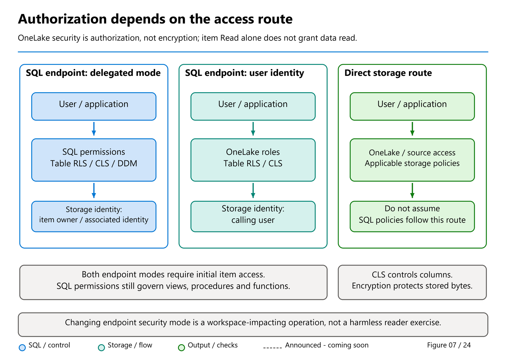

# 12. Security and Governance

[Book contents](../../index.md) | [Part II contents](README.md) | [Previous: Chapter 11](11-tsql-compatibility.md) | [Next: Chapter 13](13-power-bi-and-clients.md)

**Applies to:** Warehouse SQL security and Lakehouse SQL endpoint access modes. **Level:** Intermediate. **Feature baseline:** 9 October 2026; SQL audit predicate filtering is GA. Verify the item's configured access mode. Examples have not been executed against a tenant.

## Secure the route, not merely the table name

An analytical table may be reached through Warehouse SQL, a Lakehouse SQL endpoint, Spark, OneLake files, an export, or a Power BI semantic model. Those routes do not automatically use the same identity or authorization mechanism. A sound design begins by drawing the permitted routes and identifying the enforcement point on each.

For the book dataset, suppose a reader should see only GB sales. A SQL row-level policy can filter SQL queries. It does not, merely by existing, install an equivalent policy in a Spark session reading files directly. An Import model can contain a copied result whose subsequent security is controlled by the model. An exported file becomes another governed artifact. The question is not only "is RLS enabled?" but "which identity reads which representation through which engine?"

Keep production writers and consumers separate where practical. Contributors need broad capabilities to develop and operate an item; report readers normally do not. Giving everyone a development workspace role because it quickly fixes an error trades an explicit access design for accidental broad access.

## Two layers of permission

Warehouse connectivity requires at least Fabric item `Read` access, supplied directly or through a workspace role. SQL permissions then control permitted operations within the SQL surface. A successful authentication does not prove either layer is sufficient. Conversely, a SQL grant cannot make an otherwise inaccessible Fabric item connectable ([granular-permissions reference](https://learn.microsoft.com/en-us/fabric/data-warehouse/sql-granular-permissions)).

Item `ReadData` and `ReadAll` are importantly different. `ReadData` grants broad SQL read access; `ReadAll` concerns access to the underlying data through OneLake/Spark. For a Warehouse consumer restricted to selected SQL objects, share the item with `Read` only and provide targeted SQL grants. Check inherited workspace and group permissions as well: a carefully scoped grant does not erase broader access obtained elsewhere.

Mark Pryce-Maher's public [least-privilege walkthrough](https://medium.com/@sqltidy/least-privilege-on-a-fabric-data-warehouse-sql-analytics-endpoint-255a6e3add00), published 1 September 2026, illustrates sharing selected views without granting the underlying tables or OneLake access. That is a useful pattern when the SQL ownership chain is valid. It is not a universal statement about shortcuts, cross-database references, or every endpoint access mode.

Unlike common SQL Server provisioning scripts, Fabric Warehouse and SQL endpoints do not support explicit `CREATE USER`. The current documentation says `GRANT` or `DENY` automatically creates the database principal as needed. Configure grants against approved, unambiguous Microsoft Entra identities; do not invent local SQL-password accounts.



*Figure 7, reused to locate the enforcement point.* The endpoint mode comparison is not a Warehouse mode switch. The Warehouse lab below uses SQL-engine controls; OneLake role enforcement is developed separately in Chapter 16.

## Know the endpoint's access mode

The current [OneLake security reference](https://learn.microsoft.com/en-us/fabric/onelake/security/sql-analytics-endpoint-onelake-security) describes two SQL endpoint modes. In delegated identity mode, SQL permissions govern access and the endpoint reads OneLake using the delegated item/owner identity. In user identity mode, OneLake roles and policies govern table reads using the caller's identity; SQL permissions remain relevant for nondata objects such as views and procedures.

This means a SQL table grant or SQL-defined RLS policy is not the way to establish authoritative table security in user identity mode. Configure and validate the applicable OneLake controls. Do not layer contradictory assumptions on top of a mode whose purpose is centralized enforcement.

The modes also differ for shortcuts and ownership chaining. Review source and destination authorization together, and verify that the delegated owner can access the source where delegation is used. A shortcut is not a permission laundering mechanism.

Changing modes is operationally significant. Documentation warns that the change temporarily disrupts SQL endpoints across the workspace and cancels running and queued queries. It is not an appropriate troubleshooting experiment in a busy production workspace. This chapter does not change a mode; its lab runs in Warehouse and demonstrates SQL-native controls.

[Chapter 16](../03-sql-analytics-endpoint/16-onelake-security.md) develops the OneLake model in detail, including group-to-user mapping, source/consumer identity matching, and the difference between column authorization and encryption. Read it before generalizing this Warehouse lab to a Lakehouse endpoint in user identity mode.

## Lab: prove a SQL filter on disposable data

Prerequisites are the Chapter 4 seed and a Warehouse development identity authorized to create a table, view, inline table-valued function, and security policy in `book`. Confirm that no objects beginning with the following `Lab10` names exist. No real user information is required for the first part.

**Runnable T-SQL - `BookWarehouse`; creates a disposable sales copy containing country.**

```sql
CREATE TABLE book.Lab10Sales
AS
SELECT s.SalesKey, c.CountryCode,
       s.Quantity, s.UnitPrice
FROM book.FactSales AS s
JOIN book.DimCustomer AS c
  ON c.CustomerKey = s.CustomerKey;

SELECT COUNT_BIG(*) AS SalesRows,
       SUM(Quantity * UnitPrice) AS Revenue
FROM book.Lab10Sales;
```

Expect six rows and 365.00 before applying the policy. If that fails, stop and investigate the seed or dimension multiplicity. Security testing against already incorrect data obscures both problems.

The predicate below deliberately permits GB rows for **every** SQL caller, including the owner. It teaches the enforcement mechanism without pretending a hard-coded country is a complete user-entitlement design.

**Runnable T-SQL - Warehouse; installs SQL RLS on `Lab10Sales` only. Submit `CREATE FUNCTION` as its own batch; `GO` is a client batch separator.**

```sql
CREATE FUNCTION book.Lab10GBPredicate
(
    @CountryCode varchar(2)
)
RETURNS TABLE
WITH SCHEMABINDING
AS
RETURN
    SELECT 1 AS Allowed
    WHERE @CountryCode = 'GB';
GO

CREATE SECURITY POLICY book.Lab10GBPolicy
ADD FILTER PREDICATE book.Lab10GBPredicate(CountryCode)
ON book.Lab10Sales
WITH (STATE = ON);
GO

SELECT COUNT_BIG(*) AS VisibleSales,
       SUM(Quantity * UnitPrice) AS VisibleRevenue
FROM book.Lab10Sales;
```

The expected result is four visible sales and 185.00. The other two rows have not been deleted. The SQL policy filters access, and querying as an owner is not an automatic exemption. Owners can, however, alter or remove policies, which is why administrative privileges and audit evidence matter.

Production predicates can consult approved entitlements or execution identity. That adds lifecycle obligations: group changes, identity renaming, departed users, default-deny behavior, and administrative break-glass access. Test each deliberately. Do not grant a reader permission to modify the entitlement table that decides their own scope.

Filter predicates are not an all-purpose write-validation boundary. Current Warehouse RLS documentation describes their effects on reads, updates, and deletes, and notes that inserts can create rows subsequently hidden from the caller. Restrict write permissions and validate ingestion separately rather than assuming a read filter rejects every impermissible new row.

## Give a consumer a deliberately small interface

A view can expose only the columns needed by a report. Here it also inherits the base table's RLS behavior through SQL access.

**Runnable T-SQL - Warehouse; creates one lab view, without granting anyone access.**

```sql
CREATE VIEW book.Lab10SalesForReaders
AS
SELECT SalesKey, CountryCode, Quantity,
       Quantity * UnitPrice AS Revenue
FROM book.Lab10Sales;
```

An administrator can now share the Warehouse with an approved test reader using only item `Read`, then apply this grant. Use a dedicated test identity without inherited broad workspace or database permissions. The manual sharing step is intentionally not automated by the listing.

**Template T-SQL - Warehouse administrator; replace the bracketed placeholder with the approved Microsoft Entra reader. Grants only the lab view.**

```sql
GRANT SELECT ON OBJECT::book.Lab10SalesForReaders
TO [<approved-reader-UPN>];
```

Sign in through a fresh connection as that reader. The view should return the four GB sales. A direct query of `book.Lab10Sales` should fail for lack of permission, not merely return filtered rows. These are two different security properties. No additional OneLake permission should have been granted by this exercise.

Do not test only as the developer. Record both positive and negative cases: an allowed object, a denied base table, a denied write, and an unapproved direct data path. If the base-table query succeeds, inspect inherited access before adding increasingly complicated SQL denies.

**Runnable T-SQL - the test reader's SQL connection; read-only effective-permission inspection.**

```sql
SELECT *
FROM sys.fn_my_permissions(
    'book.Lab10SalesForReaders', 'OBJECT'
);
```

An administrator can also inspect `sys.database_permissions`, but that catalog does not enumerate all permissions inherited from Fabric workspace roles and item sharing. Review both control planes. Permission propagation and cached authentication can complicate immediate tests; reconnect and follow the documented propagation guidance rather than declaring a policy broken from one stale session.

## SQL-engine column-level security

The view above is a deliberately small interface. **Column-level security (CLS)** is another SQL-engine control: grant SELECT on an explicit set of table columns rather than the whole table. A query requesting a column outside that set fails; CLS does not replace the denied value with a mask.

The [Fabric SQL CLS reference](https://learn.microsoft.com/en-us/fabric/data-warehouse/column-level-security) applies to Warehouse and SQL analytics endpoint SQL access. For the endpoint, use this chapter's SQL-table permission model only where its **delegated identity mode** makes SQL authoritative. In **user identity mode**, OneLake table/RLS/CLS policies are authoritative; [Chapter 16](../03-sql-analytics-endpoint/16-onelake-security.md) covers that separate model.

**Optional template - Warehouse administrator, after the earlier `book.Lab10Sales` RLS fixture exists.** Use a **different approved column-reader identity** from the earlier view-only reader. Give it item `Read` without inherited `ReadData`, `ReadAll` or broad workspace/database grants. Replace the placeholder only after reviewing the exact grant.

```sql
GRANT SELECT ON book.Lab10Sales
    (SalesKey, CountryCode, Quantity)
TO [<approved-column-reader-UPN>];
```

In that reader's fresh SQL session, explicit selection of those three columns should return the **four GB rows**, because the existing SQL RLS policy still filters the table. Selecting `UnitPrice`, or using `SELECT *`, should fail with a column-permission error. The reader cannot calculate revenue from an excluded unit price merely because Quantity is visible.

An allowed-column grant does not remove broader access obtained through another grant or workspace/item role. For maintainability, production designs normally assign approved permissions to SQL roles, then review membership and effective access. Do not mix a narrow demonstration with an inherited full-table grant and expect the narrow grant to behave as a deny.

**Conditional cleanup template - administrator; run only if that exact optional grant was applied.** Remove only the new grant and any item access added specifically for this test; preserve pre-existing access.

```sql
REVOKE SELECT ON book.Lab10Sales
    (SalesKey, CountryCode, Quantity)
FROM [<approved-column-reader-UPN>];
```

SQL CLS, SQL RLS and object/view permissions combine to protect the supported **SQL route**. They do not automatically install the same restrictions on Spark or direct OneLake file reads. Direct Lake on SQL and Direct Lake on OneLake also have different authorization/fallback behavior; use [Chapter 13](13-power-bi-and-clients.md#identity-is-part-of-the-model), not a blanket claim that every Power BI read uses SQL policy.

## Governance beyond the successful query

Column-level security, object-level grants, RLS, and dynamic data masking solve different problems. Masking changes displayed values for particular callers; it is not encryption and should not be treated as protection against all inference by users allowed to run arbitrary queries. Prefer not exposing a sensitive column at all when it is unnecessary.

Sensitivity labels, descriptions, owners, and lineage make a dataset understandable and governable, but do not replace an access policy. Assign responsibility for the dataset's purpose, retention, permitted exports, and reconciliation. When a derived table changes its meaning, update its documentation and downstream contracts rather than only changing the SQL.

## SQL audit predicate filtering: choose what is captured

**Generally available, announced August 2026 — Warehouse and SQL analytics endpoint.** SQL auditing is configurable, including selected action groups, filtering, and retention. Predicate filtering can reduce repetitive activity in the audit stream, but its benefit has a cost: a discarded event cannot later be queried from that audit trail.

Think of the capture path as **enabled action groups/actions → candidate event → predicate → written audit event**. Choose the action groups needed by the audit policy first. A predicate cannot cause an event from a disabled group to appear. In particular, the [SQL audit reference](https://learn.microsoft.com/en-us/fabric/data-warehouse/sql-audit-logs) instructs enabling **Batch Was Completed** (`BATCH_COMPLETED_GROUP`) when filtering statement text for completed SELECT batches.

Filtering happens **at capture time, before writing the event**. It is not equivalent to putting `WHERE` on a later query of existing audit files. The latter leaves the original evidence intact; a capture predicate excludes it from the audit record altogether. Excluded events are not recoverable retrospectively by removing the predicate. Review identity exclusions carefully: an expected automation account can still perform an unexpected action.

SQL audit logging is **off by default**. The item-level **Audit queries (`Audit`)** permission allows configuration and querying, and workspace Admins have it by default. `VIEW DATABASE SECURITY AUDIT` is a narrower SQL permission for querying logs through `sys.fn_get_audit_file_v2`; it does **not** permit configuration changes or direct access to audit files. Query text can contain sensitive literals, so protect the logs rather than treating them as harmless operational metadata. Query Insights is not a substitute for a reviewed compliance audit policy.

The [SQL audit configuration reference](https://learn.microsoft.com/en-us/fabric/data-warehouse/configure-sql-audit-logs) documents both portal and API paths. For this lab, an administrator could enable appropriate auditing in the isolated item and confirm the view grant or a test query is captured. That is a reader verification exercise, not an assertion that this manuscript configured logging.

### A synthetic selection worksheet, not a tenant configuration

For a paper-only example, imagine a disposable item named `BookAuditSandbox`. Its hypothetical audit configuration enables `BATCH_COMPLETED_GROUP`. We want to understand which synthetic marker events a candidate predicate would retain; we are **not** proposing this narrow selection as a production audit policy.

**Illustrative predicate text — applies to Warehouse/endpoint audit configuration, not a query to execute. Uses only a fictional item and harmless marker; changes no tenant setting.**

```text
database_name = 'BookAuditSandbox'
AND statement LIKE 'SELECT 13 AS SyntheticAuditMarker%'
```

| Hypothetical event | Group enabled? | Predicate outcome | Written under this hypothetical policy? |
| --- | --- | --- | --- |
| Completed `SELECT 13 AS SyntheticAuditMarker;` in `BookAuditSandbox` | Yes | Matches | Yes |
| Completed `SELECT 14 AS OtherMarker;` in `BookAuditSandbox` | Yes | Does not match | No; not available for later investigation |
| Started marker batch, with only the completed group enabled | No | Not evaluated | No; a filter cannot enable its group |
| Completed marker batch in a different fictional item | Yes | Item condition does not match | No |

This is selection semantics, not a SQL-text classifier: comments, whitespace, capitalization, and differently shaped statements require their own tests. The literal pattern intentionally avoids real user or service-principal names. It is safer to reason over fabricated events than to suppress a real operational identity merely to watch the log get smaller.

The predicate expression omits the **`WHERE` keyword** and permits documented comparisons, `LIKE`, `NOT`, `AND`, and `OR`. Its maximum length is **3,000 characters**. It uses documented audit-event fields, with important exclusions: **`event_time`, `file_name`, and `audit_file_offset` are not supported predicate columns**. `action_id` and `class_type` require numeric comparisons despite their string representation in results. Do not substitute an arbitrary SQL expression or a column from Query Insights.

The audit scope is also bounded. Lakehouse DML performed through Spark is not SQL endpoint DML and is not captured by this SQL audit stream; neither does it describe every direct OneLake operation. Review OneLake diagnostics and control-plane audit evidence separately. The audit documentation also prioritizes database availability under very high activity or network load, so event completeness must be assessed rather than assumed. Retention, export, and capture configuration are separate responsibilities.

Finally, security changes need rollback planning. Retain the approved prior policy, dependency order, and evidence from the test identities. Removing a policy before deploying its replacement can open a visibility gap. Do not perform broad policy churn or permission resets on production objects while experimenting.

## Cleanup and takeaways

End test sessions, revoke the optional grant, and remove the test identity's manually added item access if it was added solely for this lab. Do not remove pre-existing access.

**Template T-SQL - administrator; run only if the optional grant was applied.**

```sql
REVOKE SELECT ON OBJECT::book.Lab10SalesForReaders
FROM [<approved-reader-UPN>];
```

**Runnable T-SQL - Warehouse; drops only Chapter 12 objects, policy before its dependencies.**

```sql
DROP VIEW IF EXISTS book.Lab10SalesForReaders;
DROP SECURITY POLICY IF EXISTS book.Lab10GBPolicy;
DROP FUNCTION IF EXISTS book.Lab10GBPredicate;
DROP TABLE IF EXISTS book.Lab10Sales;
```

- Check Fabric item access, SQL permissions, and inherited privileges separately.
- SQL RLS is not automatically a policy on direct Spark or OneLake reads.
- Endpoint access mode determines where table authorization belongs.
- Test denied paths and audit evidence, not just one successful query.
- Capture predicates apply only to enabled audit groups/actions; discarded events cannot be recovered by a later query.

## References

1. Microsoft Learn, [Secure your Fabric Data Warehouse](https://learn.microsoft.com/en-us/fabric/data-warehouse/security).
2. Microsoft Learn, [SQL granular permissions](https://learn.microsoft.com/en-us/fabric/data-warehouse/sql-granular-permissions), principal creation and effective permissions.
3. Microsoft Learn, [Share your Warehouse](https://learn.microsoft.com/en-us/fabric/data-warehouse/share-warehouse-manage-permissions), `Read`, `ReadData`, and `ReadAll`.
4. Microsoft Learn, [Row-level security](https://learn.microsoft.com/en-us/fabric/data-warehouse/row-level-security), predicate behavior and requirements.
5. Microsoft Learn, [OneLake security for SQL endpoints](https://learn.microsoft.com/en-us/fabric/onelake/security/sql-analytics-endpoint-onelake-security), user and delegated identity modes.
6. Microsoft Learn, [Configure SQL audit logs](https://learn.microsoft.com/en-us/fabric/data-warehouse/configure-sql-audit-logs).
7. Mark Pryce-Maher, [Least privilege on a Fabric Data Warehouse/SQL analytics endpoint](https://medium.com/@sqltidy/least-privilege-on-a-fabric-data-warehouse-sql-analytics-endpoint-255a6e3add00), 1 September 2026; inspected through the author's public RSS feed.
8. Microsoft Learn, [SQL audit logs](https://learn.microsoft.com/en-us/fabric/data-warehouse/sql-audit-logs), predicate syntax, capture-time behavior, permissions, and endpoint limitations; consulted 9 October 2026.
9. Microsoft Fabric, [August 2026 feature summary](https://community.fabric.microsoft.com/blog/fbc_fabricupdatesblogs/fabric-august-2026-feature-summary/5325824), identity-based SQL audit predicate filtering GA.
10. Microsoft Learn, [Column-level security](https://learn.microsoft.com/en-us/fabric/data-warehouse/column-level-security), explicit column grants, denied-column errors and SQL-route applicability; rechecked 9 November 2026.

---

[Previous: Chapter 11](11-tsql-compatibility.md) | [Book contents](../../index.md) | [Next: Chapter 13](13-power-bi-and-clients.md)
