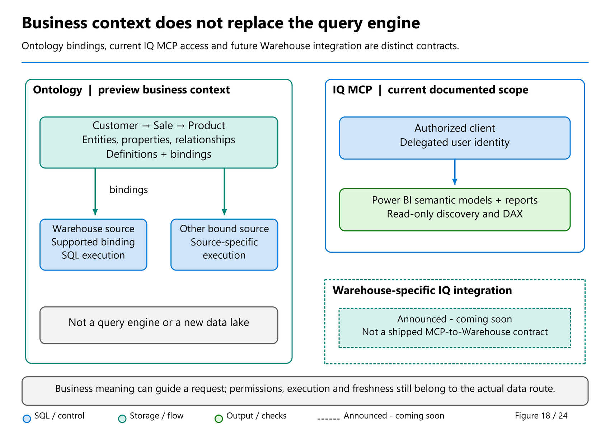

# 13. Power BI, Fabric IQ, and Other Clients

[Book contents](../../index.md) | [Part II contents](README.md) | [Previous: Chapter 12](12-security-and-governance.md) | [Next: Chapter 14](../03-sql-analytics-endpoint/14-sql-analytics-endpoint.md)

**Applies to:** Warehouse and Lakehouse SQL endpoint connections; Power BI semantic models and supported Fabric IQ consumers. **Level:** Foundation to intermediate. **Feature baseline:** original client/IQ review 9 October 2026; Direct Lake identity/deployment guidance and remote SQL MCP reviewed 9 November. Ontology bindings are preview, Fabric IQ MCP is GA, and remote SQL MCP is preview. Forthcoming Warehouse-specific IQ/connectivity announcements remain distinct. No client or report was connected to a tenant while preparing this chapter.

## Start with a semantic contract

A report does not become correct merely because its connector works. The semantic model must describe grain, relationships, measures, filtering, and security consistently with the source. The book model has one fact row per supplied `SalesKey`, customer/product/date dimensions, and a revenue calculation of quantity multiplied by unit price.

Create the model deliberately. Default semantic models are no longer automatically created with new Warehouse or Lakehouse items; current documentation dates that change to September 2025. Existing formerly default models were decoupled into independent items. Do not follow an older tutorial that assumes every new Warehouse already contains a ready-to-use model ([semantic-model reference](https://learn.microsoft.com/en-us/fabric/data-warehouse/semantic-models)).

Build single-direction, one-to-many relationships from each dimension key to the matching fact key. Validate that dimension keys are unique and that fact references exist. A `NOT ENFORCED` SQL foreign key is not proof of either condition. Avoid enabling assumptions such as referential integrity merely because the relationship diagram looks plausible.

## Import, DirectQuery, and Direct Lake

**Import** copies data into the semantic model during refresh. Report queries usually operate against that imported representation, so their freshness is bounded by the last successful refresh. Power Query preparation can be convenient, but model-only transformations may diverge from definitions used by SQL consumers. Centralize shared business rules where possible.

**DirectQuery** sends source queries as the model resolves report requests. It avoids an Import copy, but report performance now depends on generated queries, source concurrency, network behavior, caching, and the model design. It is not a promise that each click bypasses every cache or observes an instantaneous global state. Inspect actual source requests when diagnosing a slow visual.

**Direct Lake** loads required columns from Delta tables in OneLake into the Power BI engine without a traditional full Import refresh. A model refresh establishes metadata references to table versions, commonly called framing; data loading still consumes resources. "No import" does not mean "no memory", "no refresh concept", or "no freshness boundary."

The current [Direct Lake overview](https://learn.microsoft.com/en-us/fabric/fundamentals/direct-lake-overview) distinguishes two implementations:

- **Direct Lake on SQL** uses the SQL surface for discovery and permission checks. SQL views and SQL-based RLS can require DirectQuery fallback, subject to model settings.
- **Direct Lake on OneLake** uses OneLake rather than the SQL endpoint for authorization and does not fall back through that endpoint. SQL RLS is therefore not its table-security mechanism.

This difference matters when reading older statements that "Direct Lake falls back to DirectQuery." They describe particular Direct Lake on SQL scenarios, not every Direct Lake model. If fallback is prohibited, an unsupported direct path can produce a failure instead. Capacity guardrails also have mode-specific consequences.

Choose a mode using measurable requirements: freshness, identity, source load, table volume, model features, and acceptable failure behavior. Direct Lake can be an excellent fit for curated Delta data, while Import remains sensible for a compact, self-contained analytical model. DirectQuery is appropriate when SQL execution and its authorization semantics are intentional parts of the design.

## Lab: reconcile one model before comparing modes

Prerequisites are the Chapter 4 seed, permission to create a model/report in an isolated workspace, and approved source access. Create a model named `Lab11SalesModel` over the four `book` tables, choosing one mode explicitly. In Power BI Desktop, a SQL connection supports Import or DirectQuery; the Fabric semantic-model creation experience supports Direct Lake. Confirm the resulting table storage mode rather than inferring it from the connector name.

Add these measures individually to the model's fact table. They contain no source writes.

**Runnable DAX measure definitions - Power BI model editor; create each measure separately.**

```dax
Revenue =
SUMX ( FactSales, FactSales[Quantity] * FactSales[UnitPrice] )
```

**Runnable DAX measure definition - same model.**

```dax
Units = SUM ( FactSales[Quantity] )
```

**Runnable DAX measure definition - same model.**

```dax
Sales Rows = COUNTROWS ( FactSales )
```

If the model editor uses different table display names, adjust those identifiers before saving. Create cards for all three measures and a matrix with `DimCustomer[CountryCode]`. With an unrestricted synthetic-data test identity, expect revenue 365.00, units 10, and six rows; country revenue must be GB 185.00 and DE 180.00.

Compare those values with an independent SQL query rather than another visual built from the same possibly incorrect relationship. A duplicate dimension row or an unintended bidirectional relationship can change filter propagation while leaving a headline total apparently reasonable.

Record the mode, connection identity, relationship directions, and observed source version. To compare modes, create a separate model rather than changing several properties in place and losing the original baseline. Six rows establish correctness only; meaningful performance comparisons require representative data, concurrent users, cold/warm observations, and source-capacity measurements.

## Identity is part of the model

With SSO, the consuming user's identity participates in source authorization. A fixed-identity cloud connection instead reads using the configured identity when SSO is disabled. The [Direct Lake security reference](https://learn.microsoft.com/en-us/fabric/fundamentals/direct-lake-security-integration) documents the combinations and their permission requirements. Verify the effective identity for both querying and refresh; they need not be configured identically.

| Configuration or actor | Query-time access | Framing / refresh consequence |
| --- | --- | --- |
| SSO enabled with a fixed identity also configured | The current user's identity is checked. | The fixed identity is used for framing/transcoding; configuring it does not switch queries away from SSO. |
| SSO disabled with a fixed identity configured | The fixed identity is used. | The fixed identity is used for refresh as well. |
| Semantic-model owner | Separate from the report viewer and the person initiating refresh. | Still needs the documented source-table access for framing, irrespective of who initiates refresh. |

Direct Lake on SQL checks its effective identity through the endpoint without requiring that identity to have direct OneLake file-read permission. For an internal shortcut, the **data-source owner** then reads the target after authorization. Direct Lake on OneLake instead evaluates the effective identity at the shortcut target. Do not collapse data-source owner, semantic-model owner, connection identity and current viewer into one "owner" field.

An inaccessible source table or column is an authorization failure, not a reason to bypass policy through fallback. Where Direct Lake on SQL supports DirectQuery fallback for views or SQL RLS, that route still has permission and model-setting requirements. The independent OneLake mode does not acquire endpoint RLS merely because one general note in the security article mentions it; use the article's mode-specific permission model.

Import models require particular care. SQL RLS can filter what the refresh identity imports, but it does not automatically create per-viewer model roles. If the refresh identity imports all countries, semantic-model security must enforce the intended viewer restrictions. Sharing a report is not equivalent to sharing the underlying Warehouse, and model `Build` permission has different implications from merely viewing a report.

Likewise, semantic-model RLS does not constrain someone independently authorized to query the raw SQL source. Review SQL access paths from [Chapter 12](12-security-and-governance.md) and OneLake modes and roles from [Chapter 16](../03-sql-analytics-endpoint/16-onelake-security.md). A secure report and an overly broad `ReadAll` grant can coexist; the report's correct result does not make that broader path safe.

Warehouse commits also precede background publication of updated Delta logs. Direct Lake's version framing is another step. These are distinct from Lakehouse-to-SQL metadata synchronization. When SQL and a report disagree, compare these boundaries before assuming data loss or repeatedly rebuilding the model.

The [November Direct Lake development guidance](https://learn.microsoft.com/en-us/fabric/fundamentals/direct-lake-develop#use-m-parameters-with-deployment-pipelines) also clarifies source rebinding during deployment. **Direct Lake on OneLake does not support deployment data-source rules**, but text M parameters plus **parameter rules** can change its OneLake source between stages. Use the Lakehouse/Warehouse item ID, not its SQL endpoint ID. [Chapter 36](../06-operating-the-platform/36-development-and-automation.md#rebind-direct-lake-on-onelake-with-parameter-rules) gives the definition, permissions and post-deployment checks. This is newly documented guidance, not evidence that the feature first launched in November.

## Fabric IQ: business context is not another query engine

An analyst asks, "Which customers drove revenue?" A table catalog can reveal `CustomerKey` and `Quantity`; it cannot alone settle whether revenue means gross sales, net returns, or recognized revenue. Fabric IQ's **ontology** item describes business entities, their properties, relationships, rules, and source bindings so consumers can use shared meaning instead of repeatedly guessing from column names.

**Ontology and its bindings are preview at 9 October 2026.** The [binding documentation](https://learn.microsoft.com/en-us/fabric/iq/ontology/how-to-bind-data) explicitly includes Warehouse among supported source types. That is a real documented capability, but it is not evidence that every separately announced Warehouse-specific IQ integration has shipped.



*Figure 18 — Conceptual separation of context and execution.* Ontology definitions explain what data means and where it is bound. The consuming experience executes against the appropriate source or supported representation. The separate GA IQ MCP route uses Power BI semantic models; this figure does not imply that today's MCP server queries an ontology.

For the book model, a proposed `Customer` entity could bind its key, name, and country properties to `book.DimCustomer`. A `SaleLine` entity could bind to `book.FactSales`, retaining the one-line grain and relationships to customer, product, and date. `CustomerKey` is the relationship key; a repeated customer name is not a safe replacement. These are design mappings over the existing dataset, not a reason to create a second lake or rewrite the seed.

The [ontology overview](https://learn.microsoft.com/en-us/fabric/iq/ontology/overview) explicitly says ontology stores definitions and bindings and is **not itself a general-purpose data-query engine**. Consumers use that context to query bound sources. Some ontology experiences use a materialized graph with its own refresh behavior; do not generalize either "every question uses a graph copy" or "every answer reads the latest live source" to all consumers.

Where an ontology incorporates a Power BI measure as a metric, the source semantic model remains the owner of its DAX expression. Our `Revenue` measure should retain its governed definition, not become a newly invented formula merely because an agent sees an entity called Sale. Descriptions and natural-language rules help interpretation; they do not replace reconciliation or authorization.

Creating an ontology also has prerequisites: the applicable tenant settings, a supported Fabric capacity/workspace, an ontology item, and prepared supported data. Binding a semantic model requires the documented Read and Build permissions. Source-type and binding limitations still matter, including restrictions on managed Lakehouse tables, column mapping, and static bindings. Check the concrete binding page rather than treating a broad conceptual diagram as a promise for every object.

## Fabric IQ MCP: the GA semantic-model route

**Fabric IQ MCP is generally available.** The current [MCP guide](https://learn.microsoft.com/en-us/fabric/iq/connectors/fabric-iq-mcp) describes a read-only server for discovering Power BI reports and semantic models, reading their metadata, finding values, and executing DAX against a semantic model. The calling agent composes and explains the query; the server is not itself a natural-language answering endpoint.

This route uses delegated Microsoft Entra authentication and the signed-in user's existing Power BI permissions. The current guide does not support service-principal or application-only authentication, and it does not currently expose Fabric ontologies or data agents through this toolset. Do not transfer an authentication assumption from a Warehouse SQL connection or another MCP server.

Read-only describes this server's supported consumption operations, not every agent or tool an application might also connect. Model RLS and object-level security continue to apply. A successful connection grants no additional model access, and a user's answer can legitimately differ from an administrator's answer. Results also inherit the semantic model's data and freshness boundaries.

**Decision example:** when a finance team already owns a certified revenue measure, use that semantic-model contract for a question about revenue. When the task is designing cross-domain entities and relationships, ontology preview may add useful context. They are related investments, not two spellings of the same execution path.

### Safe exercise: specify the answer before adding an agent

Using the existing `Lab11SalesModel`, write a review sheet for the question "show revenue and units by customer country." Identify the model, the approved `Revenue` and `Units` measures, `DimCustomer[CountryCode]`, and the caller. An unrestricted synthetic-data identity should obtain GB 185.00/seven units and DE 180.00/three units. A properly restricted reader may receive a narrower answer.

Then propose the Customer and SaleLine ontology bindings on paper. Record their source columns, relationship key, measure owner, effective identity, and refresh assumptions. No ontology, MCP connection, or cloud agent is created by this exercise. Its purpose is to catch a changed definition of revenue before a conversational interface makes that mistake sound persuasive.

### The forthcoming Warehouse-specific integration

Bogdan Crivat's [29 September announcement](https://community.fabric.microsoft.com/blog/fbc_fabricupdatesblogs/bringing-governed-analytics-into-the-flow-of-work-fabric-analytics-at-fabcon-eur/5368918) places **Fabric IQ integration for Data Warehouse** in its looking-ahead section. Keep that roadmap statement separate from both the available preview Warehouse ontology binding and the GA semantic-model MCP server. Neither establishes an available general-purpose IQ tool that directly runs arbitrary Warehouse SQL.

The same article offers an **early look at semantic views in OneLake** as reusable business meaning near the data. That is not ordinary SQL `CREATE VIEW`, a materialized lake view, or a published replacement for Power BI semantic models. The inspected sources did not establish its complete authoring, calculation, security or execution contract, so no current syntax or rollout date is invented here.

This IQ-specific roadmap statement does **not** mean all direct SQL agent integration is future work. The separate [remote Warehouse/SQL analytics endpoint MCP service](https://learn.microsoft.com/en-us/fabric/data-warehouse/data-warehouse-mcp-server) already has an official **preview** contract, corroborated by Salil Kanade's August article. It executes SQL under the signed-in user's permissions rather than DAX through a Power BI model. [Chapter 36](../06-operating-the-platform/36-development-and-automation.md#remote-sql-mcp-execution-is-not-automatically-read-only) explains its endpoints, the documented tool-name disagreement and why SQL execution must not be advertised as automatically read-only.

## SQL clients: familiar protocol, explicit authentication

SSMS, the MSSQL extension for Visual Studio Code, and supported ODBC/JDBC clients use the SQL endpoint over TDS. Fabric requires Microsoft Entra authentication, not SQL-password authentication. Current connectivity guidance uses TCP 1433 and warns that protocol-aware firewalls must treat the traffic as SQL/TDS, not HTTPS on that port.

Specify the database explicitly. Since May 2026, omitted `Initial Catalog` connects to `master` rather than implicitly selecting a user Warehouse. `BookWarehouse` is a deliberate target, not a cosmetic label. Multiple Active Result Sets and SQL Server linked-server connections are not supported according to the current [connectivity reference](https://learn.microsoft.com/en-us/fabric/data-warehouse/connectivity).

### Direct Connectivity and friendly names: do not guess an endpoint

The 29 September announcements describe **Direct Connectivity public preview as coming soon**. The October review did not establish an available activation procedure, driver requirements or routing contract. The roadmap observed **9 November** still lists TDS Redirect and Workspace-Friendly Connections as **planned public previews in Q4 2026**. Being inside that quarter is not evidence that they are available. Direct Connectivity is not another name for the established TDS connection below, and this chapter invents no switch or measured latency improvement.

**Friendly workspace names** were also announced, but the exact connection-string meaning, release status, and hostname format remain unverified. A display name is not sufficient evidence for constructing a DNS name. Do not replace opaque identifiers inside an endpoint with `MyWorkspace`, infer a new suffix, or assume a rename leaves every client connection unchanged.

For today's connection, copy the item's actual **SQL connection string** from Fabric, use supported authentication, and explicitly specify `Initial Catalog`/`Database`. Record the supplied endpoint as configuration rather than deriving it from a naming convention. Revisit driver, firewall, and rollout guidance when a Direct Connectivity contract is published. Friendly-name announcements also do not override Chapter 9's documented requirement to use IDs in OneLake COPY source URLs.

Mark Pryce-Maher's July 2026 `ConnectToDW.py` gist demonstrates the correct SQL token audience and ODBC token packing. This adaptation keeps that useful mechanism, removes embedded client-secret fields, removes token-prefix printing and unverified JWT decoding, uses explicit configuration, and closes resources.

**Template Python - a fresh local Python process with `azure-identity`, `pyodbc`, ODBC Driver 18, and an already authenticated approved Azure CLI session. Set nonsecret `FABRIC_TENANT_ID` and `FABRIC_SQL_HOST` configuration first. Performs one read-only synthetic aggregate; no tokens or credentials are printed or saved.**

```python
# Adapted from Mark Pryce-Maher, ConnectToDW.py, 6 July 2026.
# Canonical: https://gist.github.com/MarkPryceMaherMSFT/f584f1fea298976ec97a9dd3235f1529
# Pinned: https://gist.github.com/MarkPryceMaherMSFT/f584f1fea298976ec97a9dd3235f1529/e63042e87d328488372fe60e2ee17c26e5b0825a
# Author-authorized manuscript use; no explicit public license.
# Changes: approved CLI identity, no secret/token logging, explicit catalog,
# timeouts, no pooled stale-token reuse, and deterministic resource cleanup.
import os
import struct
from contextlib import closing

import pyodbc
from azure.identity import AzureCliCredential

pyodbc.pooling = False
host = os.environ["FABRIC_SQL_HOST"]
if any(character in host for character in ";{}"):
    raise ValueError("Supply only the trusted Fabric SQL hostname.")

credential = AzureCliCredential(
    tenant_id=os.environ["FABRIC_TENANT_ID"]
)
try:
    token = credential.get_token(
        "https://database.windows.net/.default"
    )
    token_bytes = token.token.encode("UTF-16-LE")
    token_struct = struct.pack(
        f"<I{len(token_bytes)}s", len(token_bytes), token_bytes
    )
    connection_string = (
        "Driver={ODBC Driver 18 for SQL Server};"
        f"Server=tcp:{host},1433;"
        "Database=BookWarehouse;"
        "Encrypt=yes;TrustServerCertificate=no;"
        "APP=FabricWarehouseBook-Lab11;"
    )
    with closing(pyodbc.connect(
        connection_string,
        attrs_before={1256: token_struct},
        autocommit=True,
        timeout=30,
    )) as connection:
        connection.timeout = 60
        with closing(connection.cursor()) as cursor:
            cursor.execute("""
                SELECT COUNT_BIG(*),
                       SUM(Quantity * UnitPrice)
                FROM book.FactSales
            """)
            result = cursor.fetchone()
            print(f"Rows={result[0]}; Revenue={result[1]}")
finally:
    credential.close()
```

The token audience is SQL, not Microsoft Graph or the Fabric control-plane API. When supplying an access-token attribute, do not also specify `UID`, `PWD`, `Authentication`, or `Trusted_Connection`; the [ODBC reference](https://learn.microsoft.com/en-us/sql/connect/odbc/using-azure-active-directory?view=sql-server-ver17) documents that conflict.

This is an interactive-developer authentication choice, not an unattended service design. For automation, select a supported service-principal or managed/workload-identity arrangement and grant its permissions explicitly. Acquire a current token when establishing a new physical connection. Add bounded retries for transient failures, but never replay a write whose commit outcome is unknown without reconciliation.

## Large extracts need a different question

Mark's [Speeding up slow extracts](https://medium.com/@sqltidy/speeding-up-slow-extracts-from-fabric-data-warehouse-a2316a57fe98), published 23 August 2026, compares streaming many rows over TDS with materializing a result and consuming its files. His reported crossover around six million rows on an F4 is an experiment, not a sizing rule. Row width, compression, client decoding, networking, and concurrent load change the result.

The transferable idea is to measure the entire delivery path rather than only server query duration. TDS is useful for interactive results and many application exchanges. A large analytical handoff may benefit from a staged, columnar representation that avoids serializing every result row through one client.

**Runnable T-SQL - Warehouse; creates a six-row disposable export snapshot, not a performance benchmark.**

```sql
CREATE TABLE book.Lab11Extract
AS
SELECT SalesKey, DateKey, CustomerKey, ProductKey,
       Quantity, UnitPrice
FROM book.FactSales;

SELECT COUNT_BIG(*) AS RowsToDeliver,
       SUM(Quantity * UnitPrice) AS RevenueToDeliver
FROM book.Lab11Extract;
```

For a real extract, wait for the materialized table's Delta publication and use a supported Delta-aware reader or export process. Do not blindly download every Parquet file: obsolete files can remain, and the log identifies the active snapshot. Never write directly into Warehouse storage. Current [Delta-log documentation](https://learn.microsoft.com/en-us/fabric/data-warehouse/query-delta-lake-logs) makes external access read-only.

The alternative path needs its own access review, retention, reconciliation, and cleanup. Broad OneLake access must not be granted merely to accelerate an otherwise filtered SQL query. Measure CTAS time, publication delay, transfer, destination ingestion, and cleanup alongside TDS delivery. A faster transport is not a complete export contract.

## Cleanup and takeaways

**Runnable T-SQL - Warehouse; removes only the optional lab extract.**

```sql
DROP TABLE IF EXISTS book.Lab11Extract;
```

Delete the separately created lab report/model if no longer needed, without deleting the shared book tables. Close client sessions and remove only access grants added specifically for this exercise.

- Choose model storage mode and effective identity together.
- Direct Lake on SQL and on OneLake have different security and fallback behavior.
- Use explicit databases, SQL-scoped tokens, encrypted connections, and safe token handling.
- Benchmark complete data delivery, not just a query timer.
- Ontology preview supplies context; GA IQ MCP queries governed semantic models. Forthcoming Warehouse integration is a separate scope.
- Remote SQL MCP is a separate preview execution channel, not the GA IQ semantic-model server or a blanket read-only guarantee.

## References

1. Microsoft Learn, [Power BI semantic models](https://learn.microsoft.com/en-us/fabric/data-warehouse/semantic-models), independent models and creation changes.
2. Microsoft Learn, [Direct Lake overview](https://learn.microsoft.com/en-us/fabric/fundamentals/direct-lake-overview), modes and guardrails.
3. Microsoft Learn, [Integrate Direct Lake security](https://learn.microsoft.com/en-us/fabric/fundamentals/direct-lake-security-integration), SSO and fixed identities.
4. Microsoft Learn, [Warehouse connectivity](https://learn.microsoft.com/en-us/fabric/data-warehouse/connectivity).
5. Microsoft Learn, [Microsoft Entra ID with ODBC](https://learn.microsoft.com/en-us/sql/connect/odbc/using-azure-active-directory?view=sql-server-ver17), access-token attributes.
6. Mark Pryce-Maher, pinned [ConnectToDW.py](https://gist.github.com/MarkPryceMaherMSFT/f584f1fea298976ec97a9dd3235f1529/e63042e87d328488372fe60e2ee17c26e5b0825a), substantive revision 6 July 2026; author-authorized adaptation, no explicit gist license.
7. Mark Pryce-Maher, [Speeding up slow extracts from Fabric Data Warehouse](https://medium.com/@sqltidy/speeding-up-slow-extracts-from-fabric-data-warehouse-a2316a57fe98), 23 August 2026; inspected through the author's public RSS feed.
8. Microsoft Learn, [Delta Lake logs in Warehouse](https://learn.microsoft.com/en-us/fabric/data-warehouse/query-delta-lake-logs), publication and read-only interoperability.
9. Microsoft Learn, [Ontology overview (preview)](https://learn.microsoft.com/en-us/fabric/iq/ontology/overview) and [Bind data (preview)](https://learn.microsoft.com/en-us/fabric/iq/ontology/how-to-bind-data), definitions, source-owned measures, Warehouse bindings, and limitations; consulted 9 October 2026.
10. Microsoft Learn, [Fabric IQ MCP](https://learn.microsoft.com/en-us/fabric/iq/connectors/fabric-iq-mcp), GA, delegated identity, read-only Power BI scope, and unsupported ontology/data-agent access.
11. Bogdan Crivat, [Bringing governed analytics into the flow of work](https://community.fabric.microsoft.com/blog/fbc_fabricupdatesblogs/bringing-governed-analytics-into-the-flow-of-work-fabric-analytics-at-fabcon-eur/5368918), 29 September 2026, updated 30 September; Warehouse-specific IQ integration described as looking ahead.
12. Tino Tereshko, [Fabric Data Warehouse announcement roundup](https://www.linkedin.com/posts/valentinotereshko_speed-run-of-fabric-data-warehouse-announcements-activity-7510726240522293248-r4tC), 29 September 2026; Direct Connectivity coming-soon preview and friendly-name announcement, not a verified hostname contract.
13. Microsoft Learn, [Fabric Data Warehouse remote MCP server](https://learn.microsoft.com/en-us/fabric/data-warehouse/data-warehouse-mcp-server), preview direct SQL scope; reviewed 9 November 2026, separately from Fabric IQ MCP.
14. Microsoft Learn, [Direct Lake development and deployment parameters](https://learn.microsoft.com/en-us/fabric/fundamentals/direct-lake-develop#use-m-parameters-with-deployment-pipelines), substantive addition 2 November, clarified through 4 November 2026; parameter rules versus data-source rules and source-item identifiers.

---

[Previous: Chapter 12](12-security-and-governance.md) | [Book contents](../../index.md) | [Next: Chapter 14](../03-sql-analytics-endpoint/14-sql-analytics-endpoint.md)
