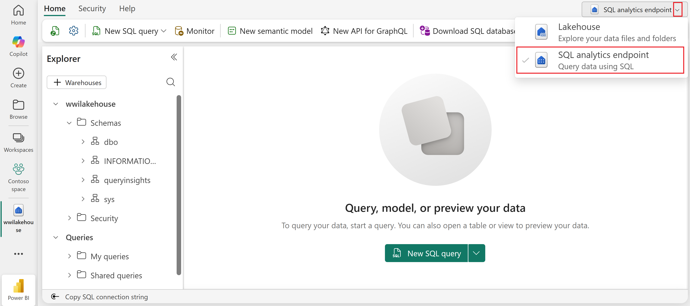
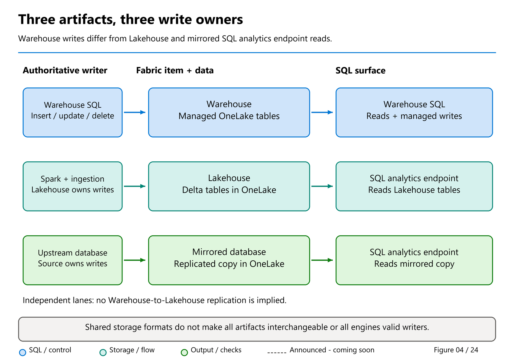
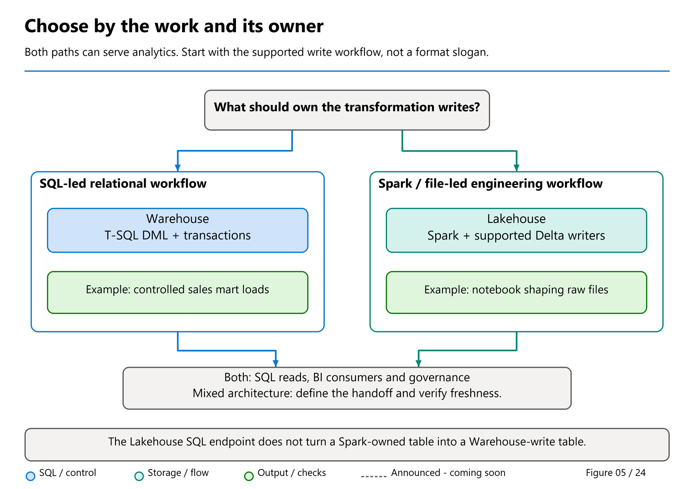

# 14. The SQL analytics endpoint: shared engine, different contract

[Book contents](../../index.md) | [Part III contents](README.md) | [Previous: Chapter 13](../02-building-analytical-solutions/13-power-bi-and-clients.md) | [Next: Chapter 15](15-metadata-sync-v1-v2.md)

**Applies to:** Lakehouse SQL analytics endpoints, with Warehouse and mirrored readers compared explicitly. **Level:** 100-200. **Review:** 9 November 2026. The former item-overview and comparison chapters are consolidated here; their explanations and exercises are retained rather than dropped.

A familiar SQL engine does not make every Fabric item a writable Warehouse. This part separates table ownership, SQL-serving metadata, supported objects, permissions and freshness. Chapter 15 develops synchronization; Chapter 16 develops OneLake access control, RLS and CLS. SQL-engine grants, RLS and CLS are covered separately in Chapter 12.

## Updating the historical sqltidy comparison

Mark's [21 March 2025 comparison](https://medium.com/@sqltidy/understanding-the-differences-between-a-fabric-warehouse-and-a-sql-analytics-endpoint-bc0e00263923) emphasizes the shared SQL engine and the different table-creation/update paths. Those are the right starting questions. The book makes the **different supported contracts** explicit rather than interpreting "same engine" as interchangeable items.

Some limits in that historical post have changed. Current creation guidance supports the documented case-sensitive or case-insensitive workspace default for **new endpoints**, and extended strings require the new metadata-sync generation; legacy 8-KB truncation still matters. Warehouse MAX storage is not unlimited. Use [Chapter 15](15-metadata-sync-v1-v2.md#large-strings-a-correctness-requirement-not-just-a-faster-refresh) and the [current type/collation references](../02-building-analytical-solutions/11-tsql-compatibility.md#collation-is-semantics-not-cosmetic-metadata), not the post's older case-sensitive-only/width wording, for a new deployment.

The full article body, original Medium link and date were checked through the author's [pinned public archive](https://github.com/MarkPryceMaherMSFT/MarkPryceMaherMSFT.github.io/tree/6fbe0f311b5de5c0d0d18eeb17053170c79a5164) on 9 November 2026. Shared engine, source-owned tables, current type mapping and effective security must be understood together.



*Documentation image D12. Microsoft, [Lakehouse SQL analytics endpoint](https://learn.microsoft.com/en-us/fabric/data-engineering/lakehouse-sql-analytics-endpoint); [original image](https://learn.microsoft.com/en-us/fabric/data-engineering/media/lakehouse-sql-analytics-endpoint/lakehouse-sql-analytics-endpoint.png). Unmodified source copy, retrieved 9 November 2026; [CC BY 4.0](https://creativecommons.org/licenses/by/4.0/) under the [Fabric documentation licence](https://github.com/MicrosoftDocs/fabric-docs/blob/aadea08f35c3edaa9c32535c772792f02555c9a4/LICENSE). This public query window helps identify the access surface; it does not make the underlying Lakehouse table writable.*

## Three query windows, one important question

A colleague opens three SQL editors. Each displays tables, accepts a `SELECT`, and returns a sales total. "They look the same," she says. "Can I use any of them to correct an order?"

Not safely. A familiar query editor tells you how to submit a request, not who owns the rows behind it. One window may reach a Warehouse that supports SQL table writes. Another may read a Lakehouse whose tables are written by Spark. The third may read a mirrored copy whose authoritative orders still belong to an operational source database.

The useful question is therefore not simply "Does it support SQL?" It is **"Which system is authorized to create and change this data, and what does this particular connection allow?"** Answering it prevents accidental design errors long before performance tuning begins.

## An item is not its access surface

The **item** is the Fabric artifact being managed. An **endpoint** is a surface through which you access it. A Lakehouse and its automatically provisioned SQL analytics endpoint are related, but not interchangeable: the endpoint does not turn the Lakehouse into a SQL-writable Warehouse.

Fabric terminology can be confusing because "SQL endpoint" is also used informally for a SQL connection. In this book, **Warehouse SQL** means the supported writable SQL surface of the Warehouse item. **Lakehouse SQL analytics endpoint** and **mirrored-database SQL analytics endpoint** mean analytical reader surfaces over data written elsewhere.

A matching display name can reinforce the confusion. The Lakehouse endpoint normally shares its Lakehouse's name. Inspect the item type and connection context, not just the title above the editor.



*Figure 4. Follow the writer before following the SQL reader; arrows show conceptual responsibility, not internal network topology.*

The Warehouse lane starts with an authorized Warehouse writer. The Lakehouse lane separates the engineering writer from the SQL reader. The mirrored-database lane starts outside the analytical copy: changes originate upstream and replication brings them into OneLake. The SQL interfaces converge in familiarity, not in write ownership.

## Warehouse: SQL owns the curated tables

A Warehouse is the natural starting point when the team wants to define and maintain analytical tables through T-SQL. Its supported surface includes table creation, inserts, updates, deletes, and multi-table transactions. It can also receive data through other documented ingestion integrations, but those integrations do not authorize arbitrary file edits underneath the Warehouse.

Consider our retailer's curated sales model. A SQL-oriented team wants to validate new customer rows and sales rows, then publish a coherent set of changes. Warehouse gives that team a SQL-controlled transaction boundary. A pipeline might orchestrate the work; the Warehouse still enforces its supported table and transaction behavior.

This is not a promise of complete SQL Server compatibility. Warehouse is an analytical service with its own supported types, syntax, and operational behavior. Nor should its writable SQL surface be mistaken for a recommendation to put every checkout application's transactions there. Fabric SQL database is a separate operational database product, not another name for Warehouse.

In [Chapter 4](../01-getting-started/04-first-warehouse.md), the seed creates `BookWarehouse.book.FactSales` and three dimensions. We will inspect the target before executing the write, then verify persisted results independently.

## Lakehouse: engineering writes, SQL reads

A Lakehouse provides a home for files and tables with engineering tools such as Spark notebooks. In our example, Spark creates the Delta tables and writes their rows. Its automatically provisioned SQL analytics endpoint lets an analyst query those supported tables with T-SQL.

The endpoint is **read-only for the underlying table data**. That wording matters. Supported SQL views, functions, and stored procedures can persist at the endpoint; creating one of those objects is not the same as changing the Delta rows. A stored procedure does not bypass the endpoint's table-write restriction.

For the retailer, this is useful when Python-based preparation already owns the curated sales table. Analysts can query the resulting Delta data without maintaining another copy merely to obtain SQL access. A missing table, however, may require investigation of registration, supported types, or metadata synchronization—not another `CREATE TABLE` issued from the reader.

[Chapter 5](../01-getting-started/05-first-lakehouse-and-sql-endpoint.md) deliberately writes a separate `BookLakehouse` seed. Its matching six sales rows are **not** shared automatically with `BookWarehouse`, and the two items do not synchronize themselves. Equal results prove that our initial values agree, not that both editors read one physical table.

## Mirrored database: the source remains authoritative

Now imagine the retailer already records orders in a supported operational database. It wants analytical access in Fabric without rebuilding an entire ingestion pipeline. **Database mirroring** continuously replicates supported source data into OneLake in an analytics-ready form. The mirrored database has a SQL analytics endpoint for querying that analytical copy.

The upstream application and source database still own business writes. If an order quantity is wrong, correct it through the approved source workflow; do not attempt to update the mirrored table through its SQL reader. The replica is a consequence of the source's state, not a second operational system accepting independent corrections.

For this replicated-database scenario, mirroring is **not query federation**. An analytical `SELECT` does not mean Fabric sends the whole query back to the live source database for execution. It queries the replicated analytical data.

There is an important naming qualification. Fabric also documents **metadata mirroring**, which synchronizes catalog metadata and uses shortcuts to reference data in place, and **open mirroring**, which accepts changes through a supported landing contract. Those are different mechanisms. This chapter's source-to-replica explanation describes database mirroring, not every feature containing the word "mirroring."

### Fresh is not instantaneous, and a replica is not a backup

"Near real time" expresses the intended replication experience, not a universal latency guarantee. Initial loading, source change volume, network conditions, source-specific mechanisms, and service state can affect when a change becomes queryable. Define freshness in terms of a business event and an observable analytical result, then measure that path.

Suppose a customer correction commits upstream at 10:00. A report still showing the old value at 10:00 is not enough evidence to declare the source update failed. Inspect replication and downstream visibility before attempting the correction again.

Mirroring also is **not a backup strategy**. A replicated copy aims to follow supported source changes, including changes you might later regret. That is different from an independently retained recovery history with tested restore procedures. Keep source backup, retention, and recovery responsibilities explicit. Do not stop and restart replication as a casual troubleshooting experiment: reseeding behavior is source-specific and can be disruptive.

### Replicating rows does not replicate every permission

Four identities or responsibilities can be involved: the source application writer, the connection or identity enabling replication, the Fabric item owner, and the analytical reader. They need not be the same person or principal.

For a concrete source-specific warning, Microsoft's Azure SQL Database mirroring limitations state that source row-level security, object and column permissions, and dynamic data masking settings are not propagated to the replicated OneLake data. A masked source column must not be assumed masked in the replica. Establish and test the Fabric access model before sharing the mirrored item.

This is not a claim that every mirroring connector has identical restrictions. It is a reason to consult the connector's own contract rather than treating replication as automatic security inheritance. [Chapter 12](../02-building-analytical-solutions/12-security-and-governance.md) and [16](16-onelake-security.md) examine the reader paths in detail.

## A short decision table

| Your immediate requirement | Starting point | Responsibility that remains |
|---|---|---|
| Maintain curated analytical tables with SQL transformations and transactions | Warehouse | SQL load correctness and target permissions |
| Prepare files with Spark and let analysts query the resulting tables | Lakehouse plus SQL analytics endpoint | Engineering publication and SQL visibility |
| Analyze supported operational data while its application remains the writer | Database mirroring plus SQL analytics endpoint | Source ownership, replication health, and replica security |

These choices can coexist. A mirrored source may feed a Warehouse's curated model; a Lakehouse may prepare another source. But every additional materialization creates a refresh and reconciliation responsibility. Adding a Warehouse should solve a named requirement, not merely make the diagram look more complete.

## Safe exercise: route three requests

**Prerequisites:** none; optionally, the completed seeds from Chapters 4 and 5 for the read-only check. **Effect:** classify responsibilities and, if desired, read data. Do not create a mirror or test restrictions with attempted writes.

First, route these requests: correct an operational order; publish SQL-managed dimensions and facts together; inspect a Spark-created Delta sales table using T-SQL. The answers are the approved upstream workflow, a supported Warehouse transaction, and the Lakehouse SQL analytics endpoint respectively.

Second, if both book items already exist, run the following separately in their SQL editors.

**Applies to:** `BookWarehouse` or the `BookLakehouse` SQL analytics endpoint after seeding. **Preview prerequisites:** none. **Effect:** read-only; no objects or data are changed.

```sql
SELECT DB_NAME() AS CurrentDatabase;

SELECT COUNT_BIG(*) AS FactRows,
       CAST(SUM(Quantity * UnitPrice) AS decimal(18,2)) AS Revenue
FROM book.FactSales;
```

Each should return six facts and revenue 365.00. Keep the database-name result with the total. Without it, a screenshot of the right number might still document the wrong item.

Finally, explain why the same check cannot be pasted blindly into a new mirror. That source may have different schemas, table names, or business meaning. Fabric does not create the book's sample model merely because an item supports SQL.

## The wrong comparison starts with a slogan

"SQL versus files" is not a useful description of this choice. Both Warehouse and Lakehouse participate in OneLake and open Delta storage, and both provide a route to the Fabric SQL engine. "Structured versus unstructured" is a useful first question, but it does not decide who operates a dimensional model, how changes become visible, or how a failed load is recovered.

A better starting question is: **which team owns the authoritative write path, and what guarantees must that write path provide?** A team that already expresses its transformation rules as SQL procedures and needs multi-table transactions has a strong reason to choose Warehouse. A team preparing diverse files with Python and Spark can publish curated Delta tables in a Lakehouse and serve SQL readers through its endpoint.

The [Microsoft decision guide](https://learn.microsoft.com/en-us/fabric/fundamentals/decision-guide-lakehouse-warehouse) presents both services as enterprise-scale choices, not successive maturity levels. A Lakehouse is not merely a temporary staging area before a "real" warehouse, and a Warehouse is not a failure to adopt open storage.



*Figure 5. Choose the responsibility model before choosing the icon; this is a conceptual decision aid, not a performance ranking.*

Start with the question at the top, then follow the two branches. SQL-controlled transformations and multi-table publication point toward Warehouse; Spark-controlled preparation with SQL readers points toward Lakehouse plus its endpoint. The shared consumption box reminds us that both can serve analytics. A hybrid is a deliberate handoff between owners, not the automatic answer whenever both icons are available.

If an operational database must remain the authoritative writer, revisit [Chapter 14's mirrored-database discussion](14-sql-analytics-endpoint.md) first. Replicating that source for analytics is a different decision from selecting the owner of a new curated model. A mirror can subsequently supply either design without transferring upstream business-write ownership.

## Compare capabilities at the correct boundary

The following table distinguishes the Lakehouse item from its SQL endpoint. Confusing those two is a common source of contradictory claims.

| Design question | Warehouse | Lakehouse and its SQL endpoint |
|---|---|---|
| Who defines and changes table data in our examples? | T-SQL writer | Spark writer in the Lakehouse |
| Can this SQL connection insert into its managed business tables? | Yes, through supported Warehouse DML | No, not through the Lakehouse SQL endpoint |
| Can SQL readers use views and reusable query objects? | Yes, within supported T-SQL | Yes, within endpoint support boundaries |
| Who defines persisted table types? | Warehouse DDL | Delta schema, then SQL type mapping |
| Can several table changes be committed together with T-SQL? | Supported multi-table transactions | Not a write facility of the endpoint |
| Where do arbitrary files fit naturally? | Source inputs to supported access/load paths | Lakehouse Files, with engineering to produce tables |
| What makes a new Lakehouse table available to SQL? | Not applicable to Warehouse-owned DDL | Registration, compatible types, and metadata sync |
| Does SQL row security secure every direct storage reader? | Access paths still require governance | Endpoint SQL policy alone does not secure Spark reads |

The phrase "supported T-SQL" is important. Warehouse has a broad surface, not complete SQL Server equivalence. Similarly, Spark's ability to create a sophisticated Delta table does not establish that every column or Delta feature is consumable through the endpoint. Check the [type mappings](https://learn.microsoft.com/en-us/fabric/data-warehouse/data-types) and current compatibility documentation before choosing features that become difficult to remove.

## Development style becomes an operating model

Consider a nightly retail load that updates customers, products, and sales. In Warehouse, one team might stage source rows, validate keys, and commit a coherent set of table changes in SQL. Its operational evidence includes the batch identity, input counts, transaction outcome, and reconciliation results.

In a Lakehouse, the same team might use notebooks to standardize files and write curated Delta tables. Each table has transactional behavior, but that statement does not make our four independent `saveAsTable` calls a single transaction. If a later step fails, the team needs a publication design: for example, consumers must know which batch is complete before reading a coordinated set of outputs. Merely putting four writes in one notebook cell does not supply that guarantee.

Neither approach removes engineering. Warehouse transactions do not deduplicate a source automatically. Lakehouse schema enforcement does not decide whether a changing customer should overwrite history. These are business and ingestion contracts that sit above the storage format.

Team skills also include support coverage. A notebook solution that only one engineer can debug has a different operational risk from a SQL solution understood by the on-call team. Conversely, forcing complex file parsing into SQL to avoid learning Spark can make a simple task unnecessarily brittle.

## Freshness has more than one clock

Write completion, SQL visibility, and report visibility are separate observations. After Spark commits a Delta table, its SQL endpoint must discover the relevant metadata and changes. After a Warehouse commit, SQL readers can see the committed Warehouse state while publication for other engines is a separate concern. A Power BI model introduces its own consumption behavior.

Do not define an end-to-end freshness objective as "the notebook finished in five minutes." Define it as a business-observable event: for example, a sale accepted by the source before a cutoff must be included in a specific report by the reporting deadline. Measure each boundary that can delay that result.

The new endpoint metadata-sync preview introduces faster and query-triggered data-refresh behavior, but it does not remove the need to distinguish discovery from data refresh. The [sync documentation](https://learn.microsoft.com/en-us/fabric/data-engineering/sql-analytics-endpoint-metadata-sync) also states that opting in affects new endpoints, not every endpoint already in a workspace. A design relying on preview-specific behavior needs an explicit eligibility and fallback plan.

## A hybrid is a contract, not an extra copy by default

A sensible mixed architecture might retain source files in a Lakehouse, transform them with Spark, and expose selected curated results directly to SQL readers. Another might load a Warehouse for a SQL-managed presentation layer. Choose the second copy only when it has a purpose: an independent refresh schedule, a SQL transformation boundary, a transactional publication requirement, or a governed consumption contract.

A common variation needs no additional ingested Warehouse copy: a Lakehouse combines hosted Delta tables with Tables shortcuts to cloud storage or mirrored-database tables, and a Warehouse in the same workspace queries that Lakehouse's SQL analytics endpoint using three-part names. Warehouse's open OneLake foundation also lets it participate in medallion layers and other modern data architectures without turning it into an interchangeable Lakehouse item. [Part II's architecture section](../02-building-analytical-solutions/09-loading-and-accessing-data.md#building-architectures-with-warehouse) develops this pattern, its diagram and its write/security/freshness boundaries.

Jovan Popovic's [external data materialization discussion](https://community.fabric.microsoft.com/blog/fbc_fabricupdatesblogs/external-data-materialization-in-fabric-data-warehouse/5172527) frames a closely related choice: query external data where it lives, or materialize it into Warehouse tables. The useful lesson is the trade-off, not an unconditional speed claim. Materialization introduces a maintained copy and a refresh obligation; virtualization leaves more responsibility with the source's layout, availability, and current contents. His article also distinguishes this materialization from materialized lake views. They are not synonyms.

For a small reference dataset, a copy may cost little storage but still create ownership confusion. For a large fact table, repeated loading can add substantial compute, orchestration, and validation work. On the other hand, insisting on no copies under any circumstances can make consumers dependent on an unstable source contract. Count operational dependencies, not just bytes.

Do not let both a notebook and a Warehouse loader act as uncoordinated owners of the same managed table. Use supported interfaces and one explicit authority for mutations.

## Lab: compare results before comparing speed

**Prerequisites:** complete [Chapter 4](../01-getting-started/04-first-warehouse.md) and [Chapter 5](../01-getting-started/05-first-lakehouse-and-sql-endpoint.md), using the [Warehouse seed](../../scripts/04-create-book-warehouse.sql) and [Lakehouse seed](../../scripts/05-create-book-lakehouse.py). Both copies must still contain their initial six facts.

Run this query once in `BookWarehouse` and once in the SQL analytics endpoint of `BookLakehouse`.

**Runnable, read-only T-SQL; execute independently in each item's SQL editor.** It performs no cross-item writes and needs no substituted connection names.

```sql
SELECT d.CalendarDate,
       COUNT_BIG(*) AS SalesLines,
       SUM(f.Quantity) AS Units,
       CAST(SUM(f.Quantity * f.UnitPrice) AS decimal(18,2)) AS Revenue
FROM book.FactSales AS f
JOIN book.DimDate AS d ON d.DateKey = f.DateKey
GROUP BY d.CalendarDate
ORDER BY d.CalendarDate;
```

Both results should be:

| Date | Lines | Units | Revenue |
|---|---:|---:|---:|
| 2026-01-01 | 2 | 3 | 130.00 |
| 2026-01-02 | 2 | 4 | 55.00 |
| 2026-01-03 | 2 | 3 | 180.00 |

Next, compare the catalog output from the previous chapters. The values are equivalent, but string widths can differ because one schema was declared in T-SQL and the other was derived from Delta types. Record this as a mapping observation, not as a failed revenue reconciliation.

Finally, answer three operational questions without changing data. Which tool would correct an incorrect quantity in each copy? Which component would you inspect if Spark saw six rows but SQL did not? Which seed can roll back its four-table load as a unit, and which can leave partial table creation? The expected answers are Warehouse T-SQL versus Lakehouse Spark, endpoint registration/synchronization, and the Warehouse load transaction versus separate Spark saves.

No cleanup is needed because the exercise is read-only. Do not "test" the write boundary by issuing a speculative update against the core sample.

## Why this is not a performance contest

Six rows cannot tell you which design will serve a billion-row model more economically. Startup, connection establishment, query compilation, caches, metadata work, and concurrent capacity activity can dominate tiny measurements. Even if one editor reports a lower duration, you have learned almost nothing about a production workload's throughput.

A meaningful evaluation needs representative volume and distribution, realistic joins and filters, expected concurrent users, repeatable load conditions, and a freshness objective. It also needs total operating cost, not just one query's fastest run. Later chapters explain query plans, resource consumption, and capacity behavior; do not import those conclusions into this correctness exercise prematurely.

## Make an explicit recommendation

For our retailer, recommend Warehouse if the curated model's owning team wants SQL transformation and multi-table publication. Recommend Lakehouse plus endpoint if Spark is already the authoritative transformation platform and SQL is primarily a serving interface. Recommend a hybrid only after naming the boundary that justifies it.

Write the recommendation as a falsifiable decision: "We choose Warehouse because these three tables must publish together through our SQL-controlled load, and the support team owns that SQL." This is stronger than "Warehouse is faster." If the requirement changes, the decision can be revisited without pretending the original platform was wrong.

Also document what the choice does not solve: source-data quality, natural-key policy, historical interpretation, permission design, and report semantics. Those responsibilities remain whatever icon appears in the workspace.

## Key takeaways

- Choose a write and support model, not a product slogan.
- Shared SQL execution does not mean shared ingestion or freshness behavior.
- A second copy needs a refresh owner and a clear purpose.
- Validate equivalent results before running a representative performance evaluation.

## References

### Item and ownership references

Public sources consulted 9 October 2026:

1. Microsoft Learn, [What is Fabric Data Warehouse?](https://learn.microsoft.com/en-us/fabric/data-warehouse/data-warehousing).
2. Microsoft Learn, [Lakehouse SQL analytics endpoint](https://learn.microsoft.com/en-us/fabric/data-engineering/lakehouse-sql-analytics-endpoint).
3. Microsoft Learn, [Mirroring overview](https://learn.microsoft.com/en-us/fabric/mirroring/overview), including database, metadata, and open mirroring.
4. Microsoft Learn, [Azure SQL Database mirroring limitations](https://learn.microsoft.com/en-us/fabric/mirroring/azure-sql-database-limitations), especially source permissions and SQL endpoint behavior.
5. Microsoft Learn, [SQL query editor](https://learn.microsoft.com/en-us/fabric/data-warehouse/sql-query-editor), whose shared interface does not override item-specific capabilities.

### Architecture and comparison references

1. Microsoft Learn, [Warehouse and Lakehouse decision guide](https://learn.microsoft.com/en-us/fabric/fundamentals/decision-guide-lakehouse-warehouse).
2. Microsoft Learn, [Choose a data store](https://learn.microsoft.com/en-us/fabric/fundamentals/decision-guide-data-store).
3. Microsoft Learn, [Transactions in Fabric Data Warehouse](https://learn.microsoft.com/en-us/fabric/data-warehouse/transactions).
4. Microsoft Learn, [Lakehouse SQL analytics endpoint](https://learn.microsoft.com/en-us/fabric/data-engineering/lakehouse-sql-analytics-endpoint).
5. Microsoft Learn, [SQL analytics endpoint metadata sync](https://learn.microsoft.com/en-us/fabric/data-engineering/sql-analytics-endpoint-metadata-sync).
6. Microsoft Learn, [Data types](https://learn.microsoft.com/en-us/fabric/data-warehouse/data-types).
7. Jovan Popovic, [External data materialization in Fabric Data Warehouse](https://community.fabric.microsoft.com/blog/fbc_fabricupdatesblogs/external-data-materialization-in-fabric-data-warehouse/5172527), public product-team article, consulted 8 October 2026.

---

[Previous: Chapter 13](../02-building-analytical-solutions/13-power-bi-and-clients.md) | [Book contents](../../index.md) | [Next: Chapter 15](15-metadata-sync-v1-v2.md)
