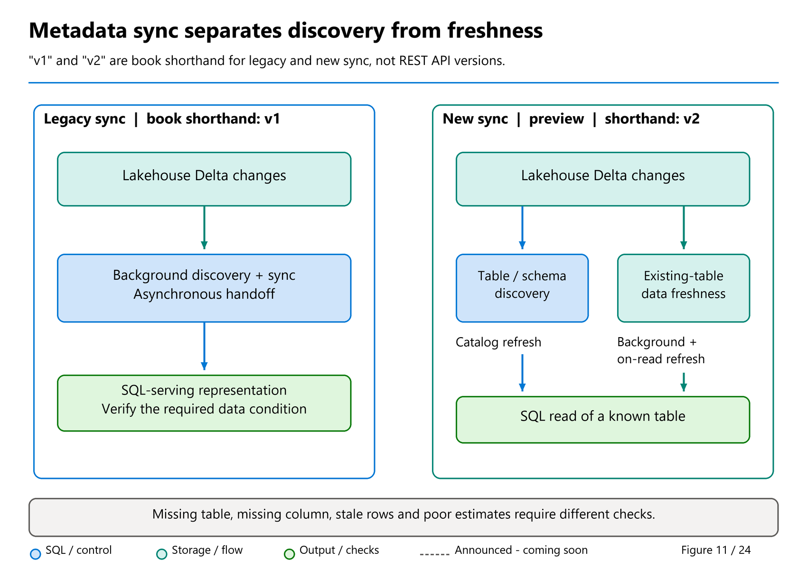

# 15. Metadata Sync: Legacy and New Architectures

[Book contents](../../index.md) | [Part III contents](README.md) | [Previous: Chapter 14](14-sql-analytics-endpoint.md) | [Next: Chapter 16](16-onelake-security.md)

**Applies to:** Lakehouse SQL analytics endpoints; related endpoints only where their documentation explicitly applies. **Level:** intermediate to advanced. **Scope:** synchronization, compatibility and REST identity contracts rechecked 9 November 2026. The core sync references are unchanged from the October baseline: new metadata sync remains **preview**, with no verified upgrade of existing endpoints. "MD Sync v1" and "v2" are book shorthand, not official API version numbers.

## Define what needs to become fresh

A Spark job successfully writes a Delta table. SQL still cannot find the new column, or an existing SQL query returns an older result. "Refresh the endpoint" is an understandable response, but it conceals three different responsibilities.

**Table discovery** determines whether the SQL catalog knows that a table exists. **Schema discovery** determines the supported columns and types exposed for that table. **Data freshness** determines which committed Delta state is available to a SQL read of an already known table. A fourth concern, SQL query optimization statistics, affects plan quality rather than defining the committed rows. Chapter 26 covers that separately.

The current [metadata-sync documentation](https://learn.microsoft.com/en-us/fabric/data-engineering/sql-analytics-endpoint-metadata-sync) explicitly separates discovery, schema changes, and data freshness. A successful statistics update does not discover a missing Lakehouse table. A semantic-model refresh is not a substitute for SQL catalog synchronization. Refreshing a browser tree can also mean something different from invoking the endpoint's documented metadata-refresh action.

Remember the direction: Lakehouse Delta changes become accessible through SQL metadata and reads. Warehouse SQL changes becoming visible to external Delta readers are the publication problem from Chapter 23.

## Legacy sync: useful automation with an asynchronous boundary

The legacy process scans Lakehouse changes and keeps the endpoint's representation current. The [performance guidance](https://learn.microsoft.com/en-us/fabric/data-engineering/sql-analytics-endpoint-performance) describes automatic metadata discovery as a workspace-level process and says it runs while the endpoint is active, stopping after 15 minutes without query activity. Under normal operating conditions it describes lag as less than one minute, while explicitly allowing seconds-to-minutes variation.

That description is guidance, not a freshness SLA. A large number of Lakehouses, extensive changes, file organization, or incompatible Delta features can affect discovery and refresh. An idle endpoint waking up is also not the same experiment as a continuously queried endpoint.

Operators should resist turning one observed delay into a polling constant. Sleeping for sixty seconds after every Spark write might work in a demonstration and fail during the first large load. A safer handoff verifies the required data condition, records failures, and has an explicit timeout policy.

Legacy sync also explains why a table can be visible in Lakehouse Explorer before it is ready through SQL. The underlying data exists, but the SQL-serving representation has additional work to complete. Rewriting the entire table because the SQL name has not appeared is an unnecessarily invasive response.

## New sync: decoupled responsibilities, not universal synchronous discovery

The new architecture, announced in May 2026 and still marked preview in current Learn, uses an external-tables-based approach to Delta-log parsing and catalog creation. It decouples schema and data refresh. It includes periodic background data refresh and an on-demand data refresh when an incoming read detects that data is not fresh.

**Rakesh Krishnan's 21 May 2026 announcement**, [New metadata sync and more in SQL Analytics Endpoint (Preview)](https://community.fabric.microsoft.com/blog/fbc_fabricupdatesblogs/new-metadata-sync-and-more-in-sql-analytics-endpoint-preview/5183137), explains the product-team motivation: shorten the delay between landing data and querying it. Separating data changes from schema changes matters because another batch of sales usually changes rows, not the table definition. The on-query path can address that existing-table freshness gap without treating every read as a complete catalog-discovery exercise. The announcement's seconds-rather-than-minutes ambition is not a contractual SLA, and its preview designation remains consistent with current Learn. Neither the announcement nor the architecture makes all schema changes synchronous.

The important word is **data**. Query-triggered freshness does not imply that every newly created table, renamed column, or type change is synchronously discovered during arbitrary SQL compilation. A query against an unknown column cannot be treated as proof that all catalog-discovery work has already completed.



*Figure 11 — Conceptual comparison of synchronization generations.* Trace a new column along the schema path and another batch of rows along the data path. Only the latter has the documented incoming-query freshness path; the diagram does not promise synchronous discovery of every new object.

Enablement is also specific. The workspace setting applies to **new SQL analytics endpoints** created after opt-in. Existing endpoints remain on legacy metadata sync according to the current documentation. Turning on the workspace switch and retesting an old Lakehouse therefore does not constitute a v1/v2 comparison.

For a controlled evaluation, create a new isolated schema-enabled Lakehouse after enabling the setting and record its endpoint ID and creation context. Do not drop and recreate a production endpoint merely to chase the preview. Preserve dependencies, permissions, views, connection settings, and rollback requirements before planning any migration.

Mark's [22 July 2026 generation-discovery article](https://medium.com/@sqltidy/what-version-of-md-sync-am-i-running-7d11e6caa0ab) shows the item properties displaying **Metadata sync: Legacy** or **New**. Record that read-only property where the current interface exposes it, alongside creation/enablement history. An API route containing `/v1`, a similar item name or a successful refresh is not a substitute for identifying the endpoint's generation.

The documented limitations include unsupported multipart Delta checkpoints and inability to enable new metadata sync with workspace private link at the checked date. Eligibility is a product and tenant question; an announcement is not proof that a given workspace can enable the feature.

### The differences that affect a deployment

| Question | Legacy sync ("v1") | New metadata sync ("v2", preview) |
| --- | --- | --- |
| What drives normal freshness? | Asynchronous background discovery and synchronization. | Background processing plus query-triggered data refresh for an existing table when needed. |
| Are schema and data changes treated alike? | Follow the legacy background synchronization path. | Separate responsibilities; an on-query data refresh is not a promise of synchronous schema discovery. |
| Does changing the workspace setting upgrade an existing endpoint? | Existing endpoints remain on the legacy implementation. | The documented opt-in applies to newly created endpoints. |
| Which additional SQL controls are available? | Do not assume the new procedure or DMV exists. | Table-data refresh through `sys.sp_dw_refresh_ext_table` and log-status diagnostics through `sys.dm_db_external_tables_log_status`. |
| What about large strings? | The endpoint overview documents the legacy 8 KB truncation limitation. | `varchar(max)` support requires new metadata sync, subject to the applicable type limits. |
| What about SQL endpoint time travel? | Do not assume Warehouse time-travel syntax is available here. | Current endpoint time-travel support requires new sync and remains subject to preview, Delta retention, and compatibility rules. |

The last two rows are consumer-facing reasons to identify the generation rather than treating it as an invisible performance upgrade. Use the current [endpoint limitations](https://learn.microsoft.com/en-us/fabric/data-engineering/lakehouse-sql-analytics-endpoint) and [time-travel reference](https://learn.microsoft.com/en-us/fabric/data-warehouse/time-travel) when designing those dependencies. A workspace setting alone is not evidence that an older endpoint has acquired them.

## Large strings: a correctness requirement, not just a faster refresh

Imagine a Lakehouse contains a customer-service narrative longer than 8 KB. A short name and a row count look correct through SQL, so a team concludes the handoff is complete. That test misses the important requirement: did SQL expose the whole narrative? The [endpoint overview updated 7 October 2026](https://learn.microsoft.com/en-us/fabric/data-engineering/lakehouse-sql-analytics-endpoint#limitations) explicitly says `varchar(max)` requires **new metadata sync**. It also preserves **8 KB truncation for legacy-sync Lakehouse endpoints**, including shortcuts to mirrored items. An upstream mirrored column supporting large values does not by itself remove the receiving Lakehouse endpoint's restriction.

The current [data-type reference](https://learn.microsoft.com/en-us/fabric/data-warehouse/data-types) gives a **16 MB** storage limit for `varchar(max)` in SQL analytics endpoints and Warehouse, not SQL Server's familiar maximum-size assumption and not an unlimited text field. These are byte-oriented limits; UTF-8 characters need not occupy one byte each. Source format, expressions, downstream connectors, and clients can impose additional restrictions. The older type-mapping table still describes Lakehouse `STRING` as `varchar(8000)`; read that alongside the newer endpoint-specific prerequisite rather than concluding every endpoint has the same generation and mapping.

First inspect the actual catalog. **Runnable, read-only T-SQL; applies to the connected Lakehouse SQL analytics endpoint, with ordinary metadata visibility. It changes neither source data nor metadata-sync configuration.**

```sql
SELECT s.name AS SchemaName, t.name AS TableName,
       c.name AS ColumnName, TYPE_NAME(c.user_type_id) AS SqlType,
       c.max_length
FROM sys.tables AS t
JOIN sys.schemas AS s ON s.schema_id = t.schema_id
JOIN sys.columns AS c ON c.object_id = t.object_id
WHERE TYPE_NAME(c.user_type_id) = 'varchar'
  AND c.max_length = -1
ORDER BY s.name, t.name, c.column_id;
```

`max_length = -1` identifies a MAX declaration; it does not mean unlimited capacity or prove that an end-to-end transfer preserved every byte. The canonical six-row book seed has no long narrative and may return no rows here. Do not enlarge its columns merely to manufacture a LOB demonstration.

For a separate, approved compatibility test, specify synthetic payloads below and above the legacy boundary, include multibyte characters, and compare source byte lengths with SQL `DATALENGTH` and the final client's received value. Check content as well as length. Casting an already truncated SQL value to `varchar(max)` cannot recover the missing content. If long text is a release requirement, ask: **which endpoint generation will serve it, is the preview dependency acceptable, and which consumer proves completeness?** Neither a metadata refresh nor an existing workspace's opt-in switch upgrades a legacy endpoint.

## Check table features and column representation separately

There are two compatibility tests, not one. First, can this SQL reader interpret the table's **Delta features**? Second, can it expose every required **column type**? A table appearing in Object Explorer does not prove that both tests passed for the complete source contract.

The [current interoperability matrix](https://learn.microsoft.com/en-us/fabric/fundamentals/delta-lake-interoperability) and [endpoint overview](https://learn.microsoft.com/en-us/fabric/data-engineering/lakehouse-sql-analytics-endpoint) establish these distinctions, rechecked 9 November:

| Feature | SQL analytics endpoint boundary |
| --- | --- |
| Deletion vectors, liquid clustering and type widening | Listed as supported in the matrix; still verify the writer/reader combination and actual schema. |
| Name-based Delta column mapping | Supported **in preview**; a plain "Yes" in a capability matrix is not a GA announcement. |
| ID-based Delta column mapping | Not supported by this endpoint, even where another reader such as Direct Lake has different support. |
| `TIMESTAMP_NTZ` | Not supported; do not equate it with ordinary Delta `TIMESTAMP`. |
| Multipart checkpoints with new metadata sync | Remain a documented new-sync limitation; enabling a feature in the writer does not make it compatible. |

Separately, the [autogenerated SQL type mapping](https://learn.microsoft.com/en-us/fabric/data-warehouse/data-types#autogenerated-data-types-in-the-sql-analytics-endpoint) says unlisted Delta types do not appear as SQL table columns. Nested values are not automatically flattened. Delta `BYTE`/`TINYINT`/`SHORT`/`SMALLINT` map to SQL `smallint`; ordinary `TIMESTAMP` maps to `datetime2`. Compare the expected column list, types and values with `sys.columns`, not just table names and row counts. Retain the generation-specific large-string qualification above.

Also inspect **discovery and schema-evolution blockers**. External Delta data should use the documented Tables-shortcut route rather than relying on an external Spark registration. An endpoint foreign-key constraint can prevent later schema changes from appearing. Schemas conflicting with system schemas or database security principals can fail synchronization. OneLake policy references to renamed or removed columns are a separate security-metadata dependency. These conditions require an owned change decision, not a longer sleep or an automatic `recreateTables=true`.

### Historical SQL reads need retained Delta history

Endpoint time travel remains **preview and new-sync-only**. Its statement-level `OPTION (FOR TIMESTAMP AS OF ...)` hint uses UTC with at most three fractional-second digits; it is not Spark's table-level time-travel syntax. Historical reads use the latest schema and require the underlying files to remain available under the Lakehouse table's **VACUUM retention**, not Warehouse retention.

The [time-travel reference](https://learn.microsoft.com/en-us/fabric/data-warehouse/time-travel) excludes this syntax in Power BI Desktop DirectQuery and **Explore this data**. Proving a historical read in a SQL editor is therefore not proof that every client can issue it. [Chapter 28](../05-statistics-and-performance/28-layout-caching-and-maintenance.md#reconciling-guidance-that-appears-inconsistent) connects retained history to source-owned maintenance; [Chapter 35](../06-operating-the-platform/35-recovery-and-retention.md) separates historical reads from recovery.

## Four meanings of version

Keep these four names separate:

| Name | What it identifies | What it does not establish |
|---|---|---|
| MD Sync v1/v2 in this book | Legacy/new synchronization architecture | REST protocol version |
| `/v1/` in the REST URL | Fabric REST route version | Endpoint sync generation |
| Delta log version | A table's ordered transaction-log state | Global cross-table batch number |
| Delta V2 checkpoint | A checkpoint protocol feature | SQL endpoint compatibility or new-sync enablement |

A notebook that successfully creates V2 checkpoints proves that its writer can create that feature. It does not prove that every Fabric reader supports it. Conversely, `latest_checkpoint_version` in a DMV is a numeric processed-checkpoint position, not the label "v2." Match reader capabilities to the current [interoperability matrix](https://learn.microsoft.com/en-us/fabric/fundamentals/delta-lake-interoperability), rather than extrapolating from similar names.

## Choose the narrowest documented refresh

For a new-sync endpoint with data-only changes in an existing table, Learn recommends `sys.sp_dw_refresh_ext_table`. For schema changes and item-level discovery, use the documented metadata-refresh API or portal action. The REST reference now also supports selected tables, so a targeted schema refresh need not always sweep the whole item.

There is a documentation granularity difference worth preserving. The overview still describes using the API for an entire item, whereas the current REST contract explicitly documents selected-table requests. Follow the specific REST contract for request shape and selection limits; do not conclude that the REST `/v1` route is obsolete or that selected refresh somehow enables the new sync architecture.

**Runnable T-SQL for a new-sync endpoint only; execute against BookLakehouse's SQL analytics endpoint.** This refreshes the data representation for one table and propagates a reported failure. It does not write Lakehouse rows.

```sql
DECLARE @ReturnCode int;
EXEC @ReturnCode = sys.sp_dw_refresh_ext_table
    @tablename = N'book.FactSales';
IF @ReturnCode <> 0
    THROW 51014, 'FactSales data refresh failed.', 1;
```

The [procedure reference](https://learn.microsoft.com/en-us/sql/relational-databases/system-stored-procedures/sp-dw-refresh-ext-table-transact-sql?view=fabric) documents return values of zero for success and one for failure, and Contributor-or-higher workspace permissions. Catching an error and printing "refresh attempted" is not a successful pipeline contract.

## Selected-table REST refresh that really fails on failure

Mark Pryce-Maher's [selected-table MD Sync gist](https://gist.github.com/MarkPryceMaherMSFT/190fa079d89a2f301af2847583d5d757), [pinned substantive revision](https://gist.github.com/MarkPryceMaherMSFT/190fa079d89a2f301af2847583d5d757/ae4988bf8c833ca581cd1fe8071855bdddebfb47) of 16 August 2026, demonstrates endpoint discovery and the modern selected-table payload. The book's [corrected runnable template](../../scripts/15-refresh-selected-tables.py) retains that concise pattern but removes the duplicate discovery GET, the deliberately nonexistent table, and exception swallowing. It also checks the complete per-table outcome.

Run the template in a Fabric Spark notebook with schema-enabled `BookLakehouse` attached as the default Lakehouse. It uses `sempy.fabric.FabricRestClient`, obtains workspace and Lakehouse IDs from notebook context, and resolves the actual SQL endpoint ID through the Lakehouse item response. A Lakehouse ID and its SQL endpoint ID are not interchangeable.

### Endpoint discovery has its own identity contract

The current [List SQL Endpoints](https://learn.microsoft.com/en-us/rest/api/fabric/sqlendpoint/items/list-sql-endpoints), [Get Lakehouse](https://learn.microsoft.com/en-us/rest/api/fabric/lakehouse/items/get-lakehouse), and [Refresh Metadata](https://learn.microsoft.com/en-us/rest/api/fabric/sqlendpoint/items/refresh-sql-endpoint-metadata) references do **not** have identical identity support:

| Operation | Service principal / managed identity support |
| --- | --- |
| List SQL Endpoints | Not supported. |
| Get Lakehouse | Supported, subject to that operation's permissions. |
| Refresh SQL Endpoint Metadata | Supported, subject to refresh permissions. |

The book template follows the suitable parent-item discovery pattern. When automation knows the Lakehouse ID, obtain `properties.sqlEndpointProperties.id` from **Get Lakehouse**. The template now requires the documented provisioning status **`Success`** before submitting a refresh. `InProgress`, `Failed`, a missing status or an unrecognized future value stops visibly without POST; it does not silently poll or assume readiness. The successful spelling is not `Succeeded`.

Do not assume an unattended identity can first enumerate `/sqlEndpoints` merely because it can refresh an endpoint. Conversely, REST identity support does not resolve Chapter 16's separate service-principal-**owner** security-sync restriction.

The November update dates on generated REST pages are not proof that these identity rules launched in November: comparison of the public specifications found them already present before the October baseline. The [Fabric Toolbox notebook](https://github.com/microsoft/fabric-toolbox/blob/6a0a0dfa51566e356316ccaa6607a11a93f41529/samples/notebook-refresh-tables-in-sql-endpoint/MDSyncNewRESTAPI.ipynb) illustrates parent-item discovery and client-managed LRO waiting. Its [companion SPN example's](https://github.com/microsoft/fabric-toolbox/blob/6a0a0dfa51566e356316ccaa6607a11a93f41529/samples/notebook-refresh-tables-in-sql-endpoint/RefreshTableinSQLEndpoint.py) endpoint enumeration is not authority to override the current List-operation restriction. Those examples are discussed, not newly copied or executed.

**Illustrative request body; the script supplies this to the discovered endpoint.** This is a metadata operation, not a source-data write:

```json
{
  "tables": [
    {"schema": "book", "tableNames": ["DimCustomer", "FactSales"]}
  ],
  "recreateTables": false,
  "timeout": {"timeUnit": "Minutes", "value": 10}
}
```

The [REST reference](https://learn.microsoft.com/en-us/rest/api/fabric/sqlendpoint/items/refresh-sql-endpoint-metadata), updated 15 September 2026 and rechecked 9 November, documents a maximum of 25 selected tables. Batch a larger explicit selection into requests of at most 25 and retain each request's outcome; omission is not batching. Omitting `tables`, or supplying an empty list, refreshes all tables. The script deliberately rejects an empty selection to prevent an accidental broad operation.

The API timeout defaults to **15 minutes**, with a **24-hour maximum**; this template deliberately supplies ten minutes. That service-operation timeout is not the same as a client's connection timeout or an orchestrator's task deadline. A client timeout can leave the operation's outcome uncertain, so inspect its operation state before replaying the POST.

The REST contract requires Contributor-or-higher workspace access and, for delegated authorization, `Item.ReadWrite.All`. It lists user, service-principal, and managed-identity support. That API capability does not mean every notebook execution context automatically supplies every identity type: validate the actual calling identity and its permissions. The sample uses the notebook's existing Fabric client authentication and never prints a token.

It requires a schema-enabled Lakehouse because the sample uses `book`. For non-schema-enabled items, table resolution follows the API's default-schema behavior; a nondefault target can be reported as `DeltaTableNotFound`. Changing the supplied schema does not manufacture a schema-enabled source.

HTTP success is only one layer. A request can return `200` with a result list containing `Success`, `Failure`, or `NotRun`. The template requires a success result for **every expected schema-qualified table**. Missing entries, duplicates, unexpected entries, malformed payloads, unknown states, and explicit failures all raise an exception. This stricter contract is intentional: a green notebook must mean that its requested refresh completed, not merely that an HTTP request reached the service.

`NotRun` needs particular care: it means the refresh did not run, and can occur when no new work is required. It is not automatically evidence of damaged or stale data. This teaching template deliberately stops rather than treating that ambiguous outcome as completed work. In an orchestrator, distinguish an actual failure from an acceptable no-op using the operation details and an independently verified source/consumer batch condition. Do not repeatedly submit refreshes simply to turn a benign no-op into a `Success` label.

The API supports long-running operations. The template asks the existing Fabric client to wait and then checks the final response; it does not invent a second polling mechanism. If the installed client cannot return the documented final payload, the script fails visibly. A caller should investigate the operation rather than issue an immediate duplicate POST. Respect `Retry-After` for throttling, and retry selectively under a bounded policy.

`recreateTables=true` resets sync state and drops/recreates endpoint table representations, with selected-table scoping where supplied. It is a repair option, not routine refresh hygiene. The book script keeps it false. Before considering reset, evaluate SQL dependencies and obtain evidence that a normal refresh is insufficient.

## Observe progress without overclaiming

On a new-sync endpoint, `sys.dm_db_external_tables_log_status` exposes the latest processed log and checkpoint versions, last update time, and blocked status. Its reference requires Contributor-or-higher workspace access. It is not a generic Warehouse physical-table diagnostic.

**Runnable read-only T-SQL; execute against a new-sync BookLakehouse endpoint.** The projection uses only documented columns:

```sql
SELECT
    object_id,
    latest_log_version,
    latest_checkpoint_version,
    last_update_time_utc,
    is_blocked
FROM sys.dm_db_external_tables_log_status;
```

The [DMV reference](https://learn.microsoft.com/en-us/sql/relational-databases/system-dynamic-management-objects/sys-dm-db-external-tables-log-status-transact-sql?view=fabric) describes per-table log state but labels `object_id` ambiguously as the current endpoint's object ID. This listing avoids inventing an object-name join contract. Confirm mapping behavior in your endpoint before building a table-named dashboard around it.

A high version is not inherently better than another table's lower version: log numbers are local to each table. A recent update timestamp does not prove that a specific business batch is complete. `is_blocked = 1` is a diagnostic signal about the last attempt, not a license to kill unrelated SQL requests.

## Lab: validate the handoff

**Prerequisites:** the Chapter 5 Lakehouse seed, the two selected tables, a notebook running as an authorized identity, and its SQL endpoint connection. Determine legacy versus new-sync status from creation and enablement history. The REST exercise does not require you to pretend a legacy endpoint is new.

First, run a read-only SQL baseline for the core sample. Then execute `15-refresh-selected-tables.py` in the notebook, with its default selection. Finally, rerun the SQL baseline.

**Runnable read-only T-SQL; execute on BookLakehouse's SQL endpoint:**

```sql
SELECT COUNT_BIG(*) AS FactRows,
       SUM(Quantity) AS TotalQuantity,
       SUM(Quantity * UnitPrice) AS Revenue
FROM book.FactSales;
```

The initial seeded results should be six rows, quantity ten, and revenue `365.00`. When both selected tables are processed, the notebook returns two explicit successful table results, not a whole-item refresh. If an unchanged table returns `NotRun`, the strict template stops as described above; record that outcome and verify the unchanged data rather than assuming the source write failed. These totals verify the sample; they do not demonstrate a measured freshness improvement because no new data was written in this exercise.

To investigate a real handoff, use a controlled upstream batch marker and compare its source commit with its SQL observation. If testing schema discovery, create a separately named lab table through Spark and request schema discovery; do not confuse that test with refreshing data in an existing table. New-sync users can separately compare the DMV before and after a data refresh.

No cleanup is required for the supplied exercise: it creates no tables or rows. Metadata refresh and diagnostic reads still consume resources. The examples were checked against public contracts and the Python validation logic was tested offline; no Fabric tenant was queried.

## A disciplined failure sequence

When freshness fails, check the source Delta commit first, then the correct item and endpoint, then feature compatibility and permissions. Distinguish a missing table from a missing column and from stale existing-table data. Choose a schema refresh or data refresh accordingly. Preserve REST operation identifiers, table-level statuses, source versions, and UTC observations for support.

Repeated resets, aggressive polling, and table rewrites can turn a narrow freshness problem into a larger operational incident. A bounded, observable handoff is more reliable than hiding uncertainty behind a long sleep.

## Key takeaways

- Discovery, schema, data freshness, and statistics are different responsibilities.
- New sync is preview and opt-in for new endpoints; existing endpoints are not automatically upgraded.
- REST `/v1`, MD Sync generations, and Delta checkpoints are unrelated version axes.
- Require per-table success; never equate HTTP `200` with complete refresh success.
- Verify the discovery operation's identity support and the table's feature/type compatibility before retrying.

## References

1. Microsoft Learn, [SQL analytics endpoint metadata sync](https://learn.microsoft.com/en-us/fabric/data-engineering/sql-analytics-endpoint-metadata-sync), dated 29 May 2026; checked 8 October 2026.
2. Microsoft Learn, [SQL analytics endpoint performance considerations](https://learn.microsoft.com/en-us/fabric/data-engineering/sql-analytics-endpoint-performance), dated 7 August 2026.
3. Microsoft REST reference, [Refresh SQL endpoint metadata](https://learn.microsoft.com/en-us/rest/api/fabric/sqlendpoint/items/refresh-sql-endpoint-metadata), updated 15 September 2026.
4. Microsoft Learn, [sys.sp_dw_refresh_ext_table](https://learn.microsoft.com/en-us/sql/relational-databases/system-stored-procedures/sp-dw-refresh-ext-table-transact-sql?view=fabric), dated 18 May 2026.
5. Microsoft Learn, [sys.dm_db_external_tables_log_status](https://learn.microsoft.com/en-us/sql/relational-databases/system-dynamic-management-objects/sys-dm-db-external-tables-log-status-transact-sql?view=fabric), checked 8 October 2026.
6. Microsoft Learn, [Delta interoperability](https://learn.microsoft.com/en-us/fabric/fundamentals/delta-lake-interoperability), dated 21 September 2026.
7. Mark Pryce-Maher, [selected-table refresh, pinned revision](https://gist.github.com/MarkPryceMaherMSFT/190fa079d89a2f301af2847583d5d757/ae4988bf8c833ca581cd1fe8071855bdddebfb47), 16 August 2026; adapted with permission.
8. Rakesh Krishnan (`rakrish75`), [New metadata sync and more in SQL Analytics Endpoint (Preview)](https://community.fabric.microsoft.com/blog/fbc_fabricupdatesblogs/new-metadata-sync-and-more-in-sql-analytics-endpoint-preview/5183137), 21 May 2026; checked 8 October 2026.
9. Microsoft Learn, [List SQL Endpoints](https://learn.microsoft.com/en-us/rest/api/fabric/sqlendpoint/items/list-sql-endpoints) and [Get Lakehouse](https://learn.microsoft.com/en-us/rest/api/fabric/lakehouse/items/get-lakehouse), operation-specific identity support and `sqlEndpointProperties`; rechecked 9 November 2026.
10. Microsoft Learn, [SQL endpoint overview and limitations](https://learn.microsoft.com/en-us/fabric/data-engineering/lakehouse-sql-analytics-endpoint), [type mapping](https://learn.microsoft.com/en-us/fabric/data-warehouse/data-types#autogenerated-data-types-in-the-sql-analytics-endpoint) and [time travel](https://learn.microsoft.com/en-us/fabric/data-warehouse/time-travel), unchanged existing contracts rechecked 9 November 2026.
11. Microsoft Fabric Toolbox, [parent-item discovery and refresh notebook](https://github.com/microsoft/fabric-toolbox/blob/6a0a0dfa51566e356316ccaa6607a11a93f41529/samples/notebook-refresh-tables-in-sql-endpoint/MDSyncNewRESTAPI.ipynb), substantive revision 5 August 2025; reference-only, not a newly adopted implementation.

---

[Previous: Chapter 14](14-sql-analytics-endpoint.md) | [Book contents](../../index.md) | [Next: Chapter 16](16-onelake-security.md)
