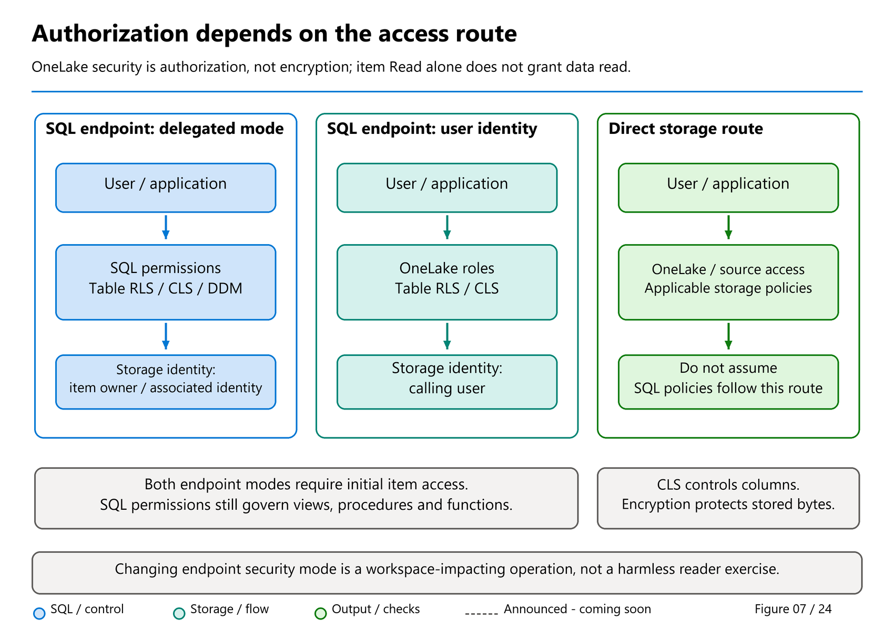
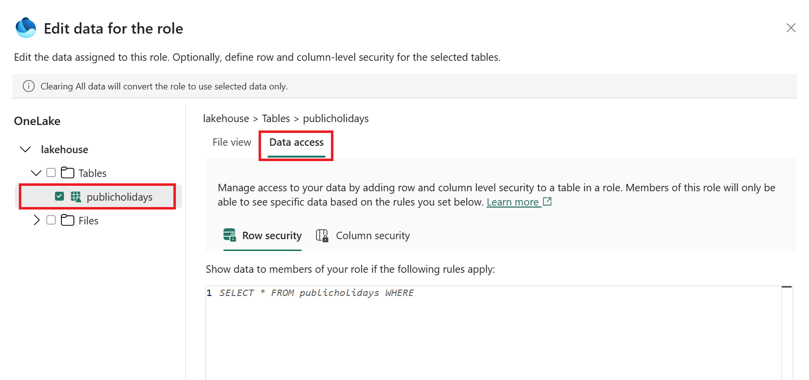
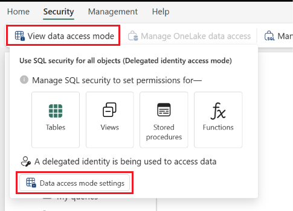
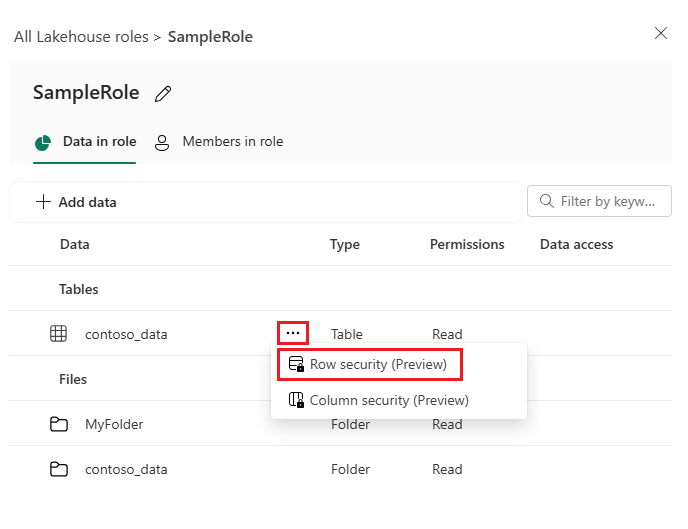
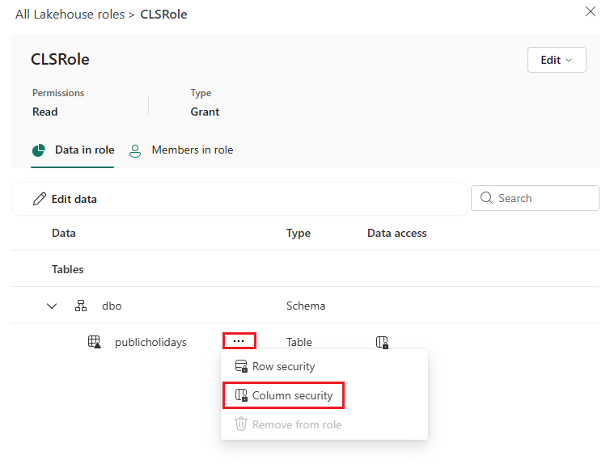

# 16. OneLake security: follow the identity to the data

[Book contents](../../index.md) | [Part III contents](README.md) | [Previous: Chapter 15](15-metadata-sync-v1-v2.md) | [Next: Chapter 17](../04-how-the-engine-works/17-warehouse-architecture.md)

**Applies to:** OneLake data access, especially Lakehouse SQL analytics endpoints and shortcut consumers; Warehouse SQL security remains covered in Chapter 12. **Level:** 100-200. **Evidence review:** endpoint-specific restrictions and mode-change effects rechecked 9 November 2026 against unchanged September guidance. August GA announcements do not resolve the conflicts identified below. This chapter changes no permissions, identities, or endpoint modes.

## One dataset, more than one door

Imagine that Aster Retail's analyst should read GB sales but not German sales, and should not receive unit prices. The analyst uses SQL today and a notebook tomorrow. A policy that works only in the SQL editor is incomplete if the notebook can read unrestricted data through another route. Equally, blocking every other route is not automatically the right design when cross-engine analysis is a business requirement.

**OneLake security** is the data-access policy system for supported OneLake routes. It scopes access through roles, including tables, folders, schemas, rows, and columns. It is not a new copy of the data and does not remove the need to examine identities, workspace roles, and individual workload support.

Spell the term out. **OLS is ambiguous**: it is sometimes shorthand for OneLake security, but in SQL, Power BI, and security discussions it also means **object-level security**. Neither meaning means encryption. A requirement that says only "enable OLS" is not yet precise enough to implement.



*Figure 7 — Conceptual security routes, not an observed tenant topology.* Start at a consumer, follow its effective identity, and locate each authorization check. Delegated SQL permissions, caller-based OneLake policies, and direct storage access are separate routes even when they reach the same business data. Chapter 13 adds the distinct semantic-model authorization layer.

## First open the item, then authorize its data

The **control plane** governs capabilities such as discovering, opening, configuring, and sharing an item. Workspace roles and item permissions participate here. The **data plane** governs the actual data someone can read or write. A SQL endpoint connection requires item `Read` access even if SQL permissions or OneLake roles already exist.

`Read` alone is not permission to read table data. `ReadData` supplies broad SQL reading in **delegated identity mode**. `ReadAll` participates in OneLake data access through the **DefaultReader** role. Review that role's actual definition rather than assuming its name proves precisely which data is exposed.

Permissions can arrive through several routes. A narrow custom role does not erase broader inherited access. OneLake roles are grant roles, not a general role-based `DENY` mechanism. Admins, Members, and Contributors already have broad data capabilities; scoped-reader tests should use Viewer or read-only shared identities without those elevated grants.

Elevated access is not a universal exemption in every scenario either. A Contributor in a consumer workspace does not automatically become a Contributor at a shortcut's producer. Current troubleshooting guidance also identifies user-mode RLS cases affecting elevated identities. Inspect the complete route instead of reasoning from one role label.



*Documentation image D13. Microsoft, [Selecting data access in a OneLake role](https://learn.microsoft.com/en-us/fabric/onelake/security/create-manage-roles); [original image](https://learn.microsoft.com/en-us/fabric/onelake/security/media/create-manage-roles/data-access.png). Unmodified source copy, retrieved 9 November 2026; [CC BY 4.0](https://creativecommons.org/licenses/by/4.0/) under the [Fabric documentation licence](https://github.com/MicrosoftDocs/fabric-docs/blob/aadea08f35c3edaa9c32535c772792f02555c9a4/LICENSE). A role's data selection, its members and the endpoint's mode are separate checks; the screenshot is not an applied book policy.*

## What OneLake security offers

OneLake security controls **data access** through supported engines and access paths, while item/workspace permissions control opening and managing the item. These are complementary layers, not two names for one grant.

| Control | Purpose | Important boundary |
| --- | --- | --- |
| Table, folder and schema access | Grant a role access to selected data objects rather than the complete item. | A narrower role cannot revoke a broader grant from another role or permission model. |
| Row-level security | Filter a supported table to approved rows for role members. | Rules use a documented static SQL subset; dynamic and multitable queries are not supported. |
| Column-level security | Allow selected columns rather than expose the complete table. | This is read authorization, not encryption or guaranteed concealment of column names. |
| Supported-engine integration | Apply table/row/column policy through compatible Fabric and authorized external readers. | An unsupported reader can be blocked from the table; "open Parquet" does not mean policy-free access. |
| Central role membership | Associate approved Microsoft Entra users/groups with a reusable data scope. | Inherited grants, exact shortcut principal mapping and endpoint mode still affect effective access. |

The [table/column/row security guide](https://learn.microsoft.com/en-us/fabric/onelake/security/table-column-row-security) describes a grant model. It generally excludes elevated Admin/Member/Contributor users from its reader restrictions; the **endpoint-specific** reference separately documents user-mode RLS exceptions for those roles. Do not turn either statement into a universal bypass/enforcement claim. Test the actual route with a minimally privileged reader, not only the owner.

The [current role-management guide](https://learn.microsoft.com/en-us/fabric/onelake/security/create-manage-roles) distinguishes **Read** roles from **ReadWrite** where supported, including Lakehouse. RLS and CLS are available for **Read-only roles**, not roles granting ReadWrite. A Warehouse/endpoint's writer contract and workspace capabilities are not reduced by choosing a reader-filtering feature.



*Documentation image D14. Microsoft, [SQL endpoint data access mode setting](https://learn.microsoft.com/en-us/fabric/onelake/security/sql-analytics-endpoint-onelake-security); [original image](https://learn.microsoft.com/en-us/fabric/onelake/security/media/sql-analytics-endpoint-onelake-security/data-access-mode-settings.png). Unmodified source copy, retrieved 9 November 2026; [CC BY 4.0](https://creativecommons.org/licenses/by/4.0/) under the [Fabric documentation licence](https://github.com/MicrosoftDocs/fabric-docs/blob/aadea08f35c3edaa9c32535c772792f02555c9a4/LICENSE). Changing this setting is disruptive across workspace SQL endpoints; this illustration is not an instruction to switch a live item.*

## The endpoint's mode decides who enforces table access

New SQL analytics endpoints start in **delegated identity mode**. The [endpoint security reference](https://learn.microsoft.com/en-us/fabric/onelake/security/sql-analytics-endpoint-onelake-security) distinguishes it from **user identity mode**:

| Question | Delegated identity mode | User identity mode |
| --- | --- | --- |
| Who is checked for the SQL request? | The SQL caller needs item access and SQL permissions. | The caller needs item access; OneLake policies govern table reads. |
| Which identity accesses OneLake? | The item's delegated owner/associated identity, according to the supported configuration. | The signed-in user's identity is passed through for authorization. |
| Where is table access defined? | SQL grants and roles. | OneLake security roles; SQL table grants are not the authority. |
| Where are row and column restrictions defined? | SQL RLS and column-level grants. | OneLake RLS and column-level security. |
| What about views, procedures, and functions? | SQL permissions govern their use. | SQL permissions still govern these nondata objects; they do not override source policies. |
| Is dynamic data masking available here? | SQL DDM is supported. | OneLake DDM is not supported. |

**Decision example: a SQL-only reporting interface.** A team already manages reviewed views and SQL RLS, and consumers must not read files independently. Delegated mode may fit that contract. Its owner must have adequate underlying access, and the team must govern other routes separately. The SQL abstraction does not install its policy in Spark.

**Decision example: cross-engine consumer access.** A team wants the same source-defined row/column entitlements for a supported notebook path and a SQL endpoint. User identity mode places table rules in OneLake. A SQL view can still provide convenient names, but cannot launder a reader into permissions denied at the source. Verify each consuming engine's documented integration.

Do not apply this endpoint mode switch indiscriminately to Warehouse items. Warehouse SQL objects, read-only Lakehouse table exposure, and direct OneLake consumption have different ownership and permission contracts.

## Groups, user mapping, and the producer-consumer boundary

The **August 2026 GA announcement** describes improvements for nested Microsoft Entra groups, group-based column-level security, shortcut-backed tables, and service-principal-owned Lakehouses. These are meaningful enterprise scenarios: central groups reduce individual grants, while source policy should remain meaningful when a consumer reaches the data through a shortcut.

There is, however, a distinction between an announced improvement and a fully reconciled implementation contract. The endpoint Learn page, updated in September, still specifies **exact one-to-one principal mapping across a producer-consumer shortcut boundary**. If a producer OneLake role references a group, that same group's Object ID must receive item `Read` at the consumer. Sharing the consumer only with an individual group member does not satisfy that stated requirement. If the producer references an individual, map that same individual.

For example, a synthetic `Book-GB-Readers` group might belong to a broader `Book-Analysts` hierarchy. Granting `Book-Analysts` on the consumer is not documented as a substitute for directly mapping `Book-GB-Readers` when the producer role names the latter. The current guidance explicitly says nested/effective membership is not resolved **across that boundary**. This does not erase the announced nested-group improvement; it prevents turning it into an unsupported promise about every mapping scenario.

**Service-principal ownership is another explicit documentation conflict.** August announces support including service-principal-owned Lakehouses. The current troubleshooting article still says security sync does not work with a service-principal owner. Do not silently present either as a universal rule. For an automated deployment design, record the item type, owner identity, endpoint mode, and shortcut route; obtain current product guidance and prove that exact combination in an approved isolated environment before relying on it.

A service principal used as an owner is also not the same role as a service principal reading data, or a workspace identity used for COPY source authentication in Chapter 9. Resolve each identity's purpose separately.

For delegated-mode shortcuts, current Learn requires unrestricted owner access and documents blocking when the source has OneLake data-level policies. User identity mode is the documented route for consuming source-filtered shortcuts. Do not remove a source policy merely to make a test pass.

## Column-level security is not column-level encryption

**Column-level encryption** sounds similar to column-level security, but it answers a different requirement. The August feature evidence establishes **column-level security (CLS)** improvements, not a new Warehouse/OneLake per-column cryptographic or Always Encrypted contract. No reviewed public reference establishes that new encryption capability at this edition's cutoff.

| Control | What it does | What it does not establish |
| --- | --- | --- |
| Column-level security | Authorizes which columns a reader may access. OneLake CLS uses a column allow list. | Cryptographic isolation of individual column values. |
| Dynamic data masking | Alters returned values for applicable SQL callers. | Encryption, or complete protection from inference through arbitrary queries. |
| Encryption at rest | Protects stored data; OneLake uses Microsoft-managed keys by default. | Different row/column visibility for different readers. |
| Customer-managed keys | Adds supported customer control over at-rest key management. | An interchangeable replacement for CLS, RLS, or application-side column encryption. |

TLS protects data in transit, another separate concern. If the real requirement is "even a privileged data reader must not receive plaintext," document the threat model and seek a supported cryptographic design. Hiding a column from a Viewer does not satisfy that requirement merely because underlying storage is encrypted.

OneLake CLS restricts **reading column data**, not necessarily discovering the column's name. Restricted columns can remain visible in Object Explorer or `sys.columns`. Test denied data access explicitly; do not claim metadata confidentiality merely because selecting the column fails.

The behavior of `SELECT *` is engine-specific. The current guide says Spark returns only allowed columns, while the SQL analytics endpoint and semantic-model routes fail when the projection includes a denied column. Do not diagnose those different outcomes as evidence that the underlying CLS policy is inconsistent.

## Define OneLake RLS and CLS together, then test the SQL route

The following extends the existing **paper-only** `Lab14SalesScope` design; it does not create that fixture, switch a mode or grant a role. The stable `Lab14` name is retained even though this chapter has moved.

1. Establish an authorized, source-owned Delta fixture with `SalesKey`, `CountryCode`, `Quantity` and `UnitPrice`. Confirm its rows/schema before testing security. Because OneLake RLS does not perform multitable lookups, filtering a customer dimension is not automatically a policy on the fact table.
2. Plan an approved reader role in the Lakehouse's OneLake security experience, with the intended Microsoft Entra group and table scope. Provide the required item `Read` separately, and inspect inherited `ReadAll`/DefaultReader access rather than assuming a narrow new role removes it.
3. Define the row rule with the actual schema/table/Delta column names and the documented syntax. Static, strongly typed comparisons are easier to audit than an invented entitlement join.
4. Put the **column allow list and row rule in the same OneLake role**. The current guide does not support splitting RLS into one role and CLS into another for the same combined access; unsupported combinations can produce query errors.
5. After a separately approved user-mode configuration and propagation window, test explicit allowed columns, denied columns, disallowed rows and each supported non-SQL route using the intended reader identity. Retain the source/consumer and mode/principal evidence.



*Documentation image D15. Microsoft, [OneLake row security entry point](https://learn.microsoft.com/en-us/fabric/onelake/security/create-manage-roles); [original image](https://learn.microsoft.com/en-us/fabric/onelake/security/media/row-level-security/select-row-security.png). Unmodified source copy, retrieved 9 November 2026; [CC BY 4.0](https://creativecommons.org/licenses/by/4.0/) under the [Fabric documentation licence](https://github.com/MicrosoftDocs/fabric-docs/blob/aadea08f35c3edaa9c32535c772792f02555c9a4/LICENSE). Author the approved static rule for the actual table; this is OneLake role configuration, not SQL CREATE SECURITY POLICY.*

**Illustrative OneLake role-rule text - not a query to run at the SQL endpoint and not a SQL security-policy DDL statement.** The proposed schema-enabled fixture must exist before a later administrator can author this rule:

```sql
SELECT *
FROM book.Lab14SalesScope
WHERE CountryCode = 'GB'
```

The accompanying CLS allow list is **SalesKey, CountryCode, Quantity**; `UnitPrice` is excluded. The intended SQL test returns four GB rows totaling seven units when those columns are explicitly selected. A request for UnitPrice or an unrestricted `SELECT *` must fail through the endpoint. No fixed result should be inferred from a missing/unprovisioned table.

The [OneLake RLS syntax reference](https://learn.microsoft.com/en-us/fabric/onelake/security/row-level-security-syntax) limits a rule to **1,000 characters**, requires the correct schema for schema-enabled items, and supports a defined subset of operators over static values. It evaluates strings with its documented case-insensitive collation; that is separate from the SQL database's collation. Normalize business codes deliberately and test case/Unicode semantics rather than assuming the two layers compare every string identically.

An invalid rule or a renamed/missing referenced column can block access or produce errors. A failed security sync is not an invitation to remove policy, grant broad access or run a data reset. Update the authoritative role/schema through an approved sequence.



*Documentation image D16. Microsoft, [OneLake column security entry point](https://learn.microsoft.com/en-us/fabric/onelake/security/create-manage-roles); [original image](https://learn.microsoft.com/en-us/fabric/onelake/security/media/column-level-security/select-column-security.png). Unmodified source copy, retrieved 9 November 2026; [CC BY 4.0](https://creativecommons.org/licenses/by/4.0/) under the [Fabric documentation licence](https://github.com/MicrosoftDocs/fabric-docs/blob/aadea08f35c3edaa9c32535c772792f02555c9a4/LICENSE). Column hiding in this role is read authorization, not encryption; another broad grant can change effective access.*

### OneLake policy is not SQL-engine policy

[Chapter 12](../02-building-analytical-solutions/12-security-and-governance.md) separately covers SQL item/object access, SQL RLS predicates, explicit SQL column grants and masking. Its Warehouse lab creates SQL objects; this chapter's role design creates no SQL grant or predicate function.

For endpoint **delegated mode**, use the supported SQL security contract while governing the delegated owner's source access. For **user mode**, define authoritative table/RLS/CLS access in OneLake and retain SQL permissions for relevant nondata objects. A SQL view does not override source policy, and a OneLake role does not create permission to alter a Warehouse table.

Use the [dedicated endpoint introduction](14-sql-analytics-endpoint.md) to choose the route, [Chapter 15](15-metadata-sync-v1-v2.md) for table freshness, and the two security chapters for authorization. Treating all three as "refresh permissions" hides the boundary that needs investigation.

## Security changes are operational changes

An Admin or Member changes endpoint access mode. That action temporarily affects **all SQL analytics endpoints in the workspace**, canceling their running and queued queries, not just the query tab being used. Switching modes removes inline function metadata, including TVFs and scalar functions. Switching to **user identity mode deletes existing SQL roles**, described as unrecoverable in the reference. Save the relevant definitions and permission model, review dependencies and plan reconstruction before an approved maintenance window; switching back is not a promised undo operation.

OneLake role changes can take **up to five minutes** to synchronize to the SQL endpoint. Generated roles prefixed `OLS_` are synchronization artifacts, not an invitation to maintain OneLake policy with manual SQL edits. Change the authoritative OneLake role instead.

A renamed or removed column can invalidate a CLS allow list or RLS reference and block security-metadata synchronization. Plan policy changes with schema deployment. This is different from Delta data freshness and Chapter 15's table refresh. Also distinguish it from cached delegated-owner source tokens: the troubleshooting guide describes some shortcut permission changes taking 30–60 minutes until token refresh. Repeatedly granting more access is not a propagation strategy.

## Safe exercise: write the permission worksheet first

This is a **paper-only design exercise**, with no mode change or permission grant. Propose a separate, six-row Lakehouse fixture named `Lab14SalesScope`, containing `SalesKey`, `CountryCode`, `Quantity`, and `UnitPrice`. An authorized Lakehouse writer would derive it from the canonical fact/customer join. It is **not created here**, and neither canonical item is modified.

The proposed fixture has four GB rows, seven GB units, and GB revenue 185.00; DE has two rows, three units, and 180.00. Define a synthetic reader group `Book-GB-Readers` with table access, a GB row rule, and an allow list of `SalesKey`, `CountryCode`, and `Quantity`. It must not inherit `ReadAll` or an elevated workspace role that invalidates the intended scoped-reader setup.

| Case to validate after separate approval/provisioning | Expected outcome | Evidence to record |
| --- | --- | --- |
| Group-mapped reader opens the consumer with item `Read` | Connection succeeds. | Item, endpoint mode, principal/group Object IDs. |
| Same reader selects the allowed columns in user identity mode | Four GB rows; quantities total seven. | Visible keys 1001, 1003, 1004, 1006. |
| Same reader explicitly requests `UnitPrice` | Column access fails; it is not merely masked. | Denied column and effective role membership. |
| Same reader requests DE rows using allowed columns | No DE rows returned. | Empty result, not missing-table or connection failure. |
| Reader has item `Read` but no applicable data role | Can reach the item but cannot read the table. | Separate connection and data-authorization outcomes. |
| Producer names the group, consumer maps only its individual member | Does not satisfy the documented exact principal mapping. | Compare actual Object IDs; do not infer nested expansion. |
| Restricted reader uses a supported OneLake-aware notebook route | The approved row/column policy remains enforced. | Reader identity, supported route, and denied-column test. |
| Reader attempts a Lakehouse-table SQL write | Not permitted by the read-only endpoint. | Distinguish engine capability from reader authorization. |

Do not test the desired restrictions only as the owner. Do not interpret "table not found" on an unprovisioned fixture as successful authorization enforcement. A future execution must establish the fixture exists before testing denied access.

Finally, the reader cannot compute revenue from `Quantity * UnitPrice` when `UnitPrice` is excluded. If GB revenue is required, design an approved aggregate interface rather than quietly granting the hidden column. Also, filtering `DimCustomer` alone would not automatically create a matching OneLake policy on `FactSales`; each exposed table needs a deliberate contract.

The exercise is complete when every route has an effective identity, an authorization owner, an expected positive result, and an expected denial. [Chapter 13](../02-building-analytical-solutions/13-power-bi-and-clients.md) adds semantic-model identities and copied data, where source and consumer security must again be distinguished.

## References

1. Microsoft Learn, [OneLake data security overview](https://learn.microsoft.com/en-us/fabric/onelake/security/get-started-security), control/data planes, DefaultReader, and encryption.
2. Microsoft Learn, [OneLake security for SQL analytics endpoints](https://learn.microsoft.com/en-us/fabric/onelake/security/sql-analytics-endpoint-onelake-security), modes, exact principal mapping, shortcuts, and mode-change impact.
3. Microsoft Learn, [Troubleshoot OneLake security for SQL analytics endpoints](https://learn.microsoft.com/en-us/fabric/onelake/security/troubleshoot-onelake-security-for-sql-analytics-endpoints), propagation, elevated roles, mapping, and unresolved service-principal ownership guidance.
4. Microsoft Fabric, [August 2026 feature summary](https://community.fabric.microsoft.com/blog/fbc_fabricupdatesblogs/fabric-august-2026-feature-summary/5325824), announced OneLake security improvements; contrasted with current Learn restrictions, not substituted for them.
5. Microsoft Learn, [Customer-managed keys for Fabric workspaces](https://learn.microsoft.com/en-us/fabric/security/workspace-customer-managed-keys), at-rest encryption scope and prerequisites.
6. Microsoft Learn, [OneLake table, column and row security](https://learn.microsoft.com/en-us/fabric/onelake/security/table-column-row-security), grant combinations, engine-specific CLS behavior and unsupported-role combinations; rechecked 9 November 2026.
7. Microsoft Learn, [OneLake RLS syntax](https://learn.microsoft.com/en-us/fabric/onelake/security/row-level-security-syntax), static SQL subset, 1,000-character limit, schema naming and string collation; rechecked 9 November 2026.

---

[Previous: Chapter 15](15-metadata-sync-v1-v2.md) | [Book contents](../../index.md) | [Next: Chapter 17](../04-how-the-engine-works/17-warehouse-architecture.md)
