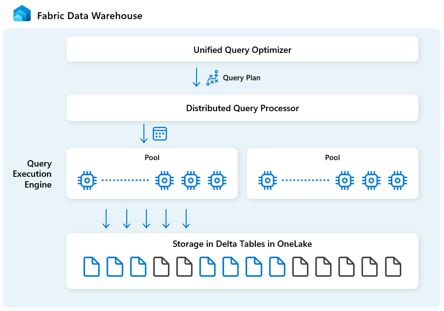

# 17. Warehouse architecture: six building blocks, one analytical service

[Book contents](../../index.md) | [Part IV contents](README.md) | [Previous: Chapter 16](../03-sql-analytics-endpoint/16-onelake-security.md) | [Next: Chapter 18](18-polaris.md)

**Applies to:** Fabric Warehouse; shared SQL-engine concepts also help explain the Lakehouse SQL analytics endpoint. **Level:** 200. **Evidence review:** 10 October 2026. This chapter follows the public Microsoft architecture, not a private service topology.

## Put the pieces together before opening them

The first two parts established what to build and who owns its data. Now ask what must happen between submitting a query and receiving a trustworthy result. Someone must resolve the objects and access rights, choose a strategy, coordinate distributed work, execute operators, and select the correct committed data. Those responsibilities are connected, but they are not interchangeable.

Microsoft's [Warehouse architecture article](https://learn.microsoft.com/en-us/fabric/data-warehouse/architecture) names six building blocks. Treat them as a map of responsibilities rather than six customer-deployed servers. Fabric manages their implementation. You do not configure a machine count from the number of boxes or receive an independent service-level guarantee for each arrow.

*Documentation image D01. Microsoft, [Architecture of Fabric Data Warehouse](https://learn.microsoft.com/en-us/fabric/data-warehouse/architecture); [original image](https://learn.microsoft.com/en-us/fabric/data-warehouse/media/architecture/architecture-diagram.png). Reproduced unmodified, retrieved 10 October 2026, under [CC BY 4.0](https://creativecommons.org/licenses/by/4.0/) from the [Fabric documentation repository](https://github.com/MicrosoftDocs/fabric-docs/blob/main/LICENSE). This is Microsoft's explanatory diagram, not a capture of the book's environment.*

## The six building blocks

| Building block | Responsibility | Dedicated chapter |
| --- | --- | --- |
| Unified query optimizer | Choose a costed physical strategy, considering relational alternatives and distributed movement together. | [19. Unified query optimizer](19-unified-query-optimizer.md) |
| Distributed query processing | Coordinate dependencies and schedule executable work across available compute resources. | [20. Distributed query processing](20-distributed-query-processing.md) |
| Query execution engine | Perform assigned scans, filters, joins and aggregates using local execution resources. | [21. Query execution engine](21-query-execution-engine.md) |
| Metadata and transaction management | Describe objects and physical state, coordinate committed visibility, and enforce transaction semantics. | [22. Metadata and transaction management](22-metadata-and-transaction-management.md) |
| Storage in OneLake | Persist managed table data in open formats and support the documented storage and reader contracts. | [23. Storage in OneLake and Delta-log publication](23-storage-onelake-and-delta-log-publishing.md) |
| Fabric Platform | Provide identity, permissions, monitoring, auditing and integration with other Fabric experiences. | [24. Fabric Platform integration](24-fabric-platform-integration.md) |

The optimizer chooses; distributed processing coordinates; execution engines do the work. Metadata and storage provide the consistent data on which that work depends. Platform services establish who may do it, how it connects to other experiences, and which evidence is available afterwards.

These descriptions intentionally qualify promotional shorthand. Cost-based optimization is a bounded search, not proof of a globally optimal plan for every SQL statement. Automatic scaling is not unlimited instantaneous compute. Separate workload pools do not eliminate shared capacity, transaction or storage constraints.

## Follow one read

Consider the familiar country-revenue query over `book.FactSales` and `book.DimCustomer`. Before reading a file, the service must establish the caller, item and relevant object permissions. Resolving `book.FactSales` in the wrong database can return plausible rows, so identity and binding belong in the architecture discussion, not only in an administrator's checklist.

The optimizer considers how to read and join the inputs and combine revenue. A filtered input's size, not just the unfiltered table name, matters. The distributed layer schedules work with the necessary dependencies and resources. Local execution reads the required data, uses applicable caches, performs operators and produces rows for downstream work or the client.

The engine must read a transactionally valid state throughout. It cannot replace the table's snapshot with "every Parquet file I can find." Nor can it skip an authorization check because the data was already cached. The final small result still needs to reach the client; network and report-rendering time remain outside many engine measurements.

This is a conceptual trace. Some activities overlap, and internal work can be pipelined or retried. Do not turn the paragraph into six additive latency buckets or infer private process boundaries from it.

## Follow one write

A supported Warehouse write uses SQL semantics and transaction management as well as distributed execution. File creation alone is not a commit decision. Once a transaction commits, a new Warehouse SQL reader can observe the appropriate committed state. A separate background publication responsibility exposes updated Delta logs for external readers.

That last transition matters to a Spark notebook reading the Warehouse's OneLake representation. Its observation can lag SQL visibility without disproving the SQL commit. Conversely, a Spark-written Lakehouse table follows the Lakehouse-to-SQL metadata-sync path. [Chapter 15](../03-sql-analytics-endpoint/15-metadata-sync-v1-v2.md) explains that different boundary.

Shared SQL technology therefore does not give all item types the same write contract. Warehouse owns its SQL-managed table writes. A Lakehouse SQL analytics endpoint does not become a Warehouse merely because it shares execution technology or displays a similar SQL editor.

## Separate durable data from replaceable compute

OneLake stores durable table data; execution resources process it. Local memory and SSD caches shorten some reads but do not become the sole authoritative copy of the warehouse. Losing useful cached data can make later work colder without implying that committed business data was lost.

[Polaris](18-polaris.md) adds historical depth to this idea by separating compute from essential state, not only from files. The public papers explain motivations and design evolution. They do not expose supported commands for manipulating cells, internal manifests or task schedulers.

The same discipline applies to GPUs. An eligible fragment can use a specialized execution path while the surrounding SQL and distributed responsibilities remain. Hardware acceleration belongs inside this architecture; it is not a second database that bypasses governance, fixes stale data or makes an incorrect join correct.

## Place the symptom at the right boundary

| Observation | First architectural question |
| --- | --- |
| The same SQL returns different totals in two items | Are these the same data contract, writer and committed state? |
| A query plan moves a large intermediate result | Which estimates, join choices and distribution requirements created that movement? |
| A good isolated query slows under concurrency | What scheduling, workload, capacity or shared-resource pressure changed? |
| Warehouse SQL is current but an external Delta reader is not | Has publication occurred, and has that consumer observed it? |
| A second run is faster | Did compilation, statistics, data caches or result reuse change? |
| A report is slow despite fast SQL | How much time is outside warehouse execution? |

A symptom suggests an investigation; it does not prove which component failed. Keep an explicit boundary between a public architectural explanation and an observation from your workload.

## Safe exercise: annotate the journey

**Prerequisites:** familiarity with the Chapter 4 model; no additional permissions or live execution are required. On paper, trace a sales row from a Warehouse load to a SQL aggregate and then to a report. Label the writer, the SQL commit boundary, the consumer access route and the identities involved.

Next annotate the six building blocks beside the transitions they support. Mark which observations would establish freshness and which would establish performance. Finally replace the Warehouse writer with a Lakehouse notebook. Identify which responsibilities remain shared and which write and synchronization contracts change.

The outcome is a responsibility map, not a claim about node placement. Nothing is created or changed, so no cleanup is required. The rest of Part IV opens each box, then [Chapter 25](25-query-processing.md) reunites them around a complete query.

## References

1. Microsoft Learn, [Architecture of Fabric Data Warehouse](https://learn.microsoft.com/en-us/fabric/data-warehouse/architecture), article dated 14 January 2026; reviewed 10 October 2026.
2. Microsoft Learn, [Transactions](https://learn.microsoft.com/en-us/fabric/data-warehouse/transactions), current supported transaction boundaries.
3. Microsoft Learn, [Delta Lake logs in Warehouse](https://learn.microsoft.com/en-us/fabric/data-warehouse/query-delta-lake-logs), SQL commit and external publication.
4. Microsoft Learn, [In-memory and disk caching](https://learn.microsoft.com/en-us/fabric/data-warehouse/caching), reconstructible caches and consistency.
5. Microsoft Learn, [Secure your Fabric Data Warehouse](https://learn.microsoft.com/en-us/fabric/data-warehouse/security), platform and SQL authorization.

---

[Previous: Chapter 16](../03-sql-analytics-endpoint/16-onelake-security.md) | [Book contents](../../index.md) | [Next: Chapter 18](18-polaris.md)
