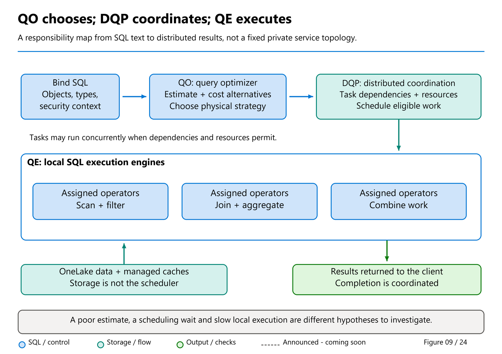

# 18. Polaris: Understanding the Distributed Engine

[Book contents](../../index.md) | [Part IV contents](README.md) | [Previous: Chapter 17](17-warehouse-architecture.md) | [Next: Chapter 19](19-unified-query-optimizer.md)

**Applies to:** Fabric Warehouse; architectural context for the Lakehouse SQL analytics endpoint. **Level:** intermediate to advanced. **Scope:** public architecture and research, checked 8 October 2026. The 2020 Polaris paper describes architectural lineage, not a complete specification of today's Fabric service.

## Why an engine chapter belongs in an operator's book

An analyst submits one SQL statement and receives one result set. Between those events, a distributed engine may read many files, execute work on multiple compute nodes, move intermediate rows, and combine partial results. The analyst does not provision those nodes or choose their membership. Nevertheless, the shape of the work matters. A query that eliminates most rows before a join asks a different question of the system from a query that redistributes a large intermediate result.

Polaris provides a useful vocabulary for understanding that difference. Josep Aguilar-Saborit, Raghu Ramakrishnan, Krish Srinivasan, and their coauthors describe cells, tasks, distributed optimization, and resilient orchestration in their [2020 paper](https://www.vldb.org/pvldb/vol13/p3204-saborit.pdf). This chapter draws on the full paper, particularly sections 2 through 9. Where it discusses current product behavior, it instead uses the [Fabric Warehouse architecture documentation](https://learn.microsoft.com/en-us/fabric/data-warehouse/architecture).

Do not translate the paper into a list of customer configuration switches. A research system can expose an architectural concept without exposing that concept as a supported DDL option. In particular, cells do not imply that a Fabric Warehouse developer should port Synapse dedicated pool distribution declarations or manually assign tables to nodes.

## Separate storage from compute, then separate state

Moving table files to remote storage is only the first step toward elastic computation. A compute node can still own indispensable transaction or metadata state. If losing that node destroys the only record of work in progress, remote table storage alone has not solved recovery.

The Polaris paper therefore distinguishes **compute/storage separation** from **compute/state separation**. Its definition of state includes data, metadata, transaction state, and caches. Essential state must survive independently of replaceable execution resources. Caches are different: they can be rebuilt from durable information, so a local cache does not invalidate a stateless-compute design.

This distinction explains two apparently contradictory observations. An engine can replace compute without losing committed business data, yet the next query can become slower because useful cached data was lost. Durability and warmth are separate properties. Restoring the first does not guarantee the second.

Current Fabric documentation describes metadata distributed across frontend and backend components, local SSD caches, and remote OneLake storage. It also describes transaction management and ACID support. That is enough to explain the separation of responsibilities. It is not permission to infer every replication protocol, recovery timeout, service boundary, or placement policy inside today's managed service.

For an operator, the practical rule is simple: measure the externally visible symptom before diagnosing a hidden component. An intermittently slow query is not proof that a node restarted. A successful retry is not proof of a specific internal recovery mechanism.

## Cells: a unit of data reasoning

In the 2020 design, a dataset is represented as a collection of **cells**. A cell combines two dimensions: a distribution dimension that supports parallel work and a partition dimension that supports data elimination. The distributed processing framework can reason about cells without knowing every detail of the physical format behind them. A local execution engine handles the actual data access.

Consider a hypothetical large version of `book.FactSales`. A date predicate identifies a relevant portion of the data, while a join on `CustomerKey` determines which matching rows must meet during processing. These are different concerns. Pruning reduces what is read; distribution alignment determines where work can happen correctly.

The paper's cell abstraction makes that separation explicit. It also allows the mapping between data and compute to change. A cell is not permanently owned by a particular machine simply because that machine processed it yesterday. Fine-grained data units create more scheduling opportunities than a small, fixed set of indivisible partitions.

This is a conceptual explanation, not a claim that `DateKey` and `CustomerKey` are the physical partitioning and distribution keys of the book's Warehouse table. Current Fabric manages its physical organization. Its architecture documentation describes automatically managed micro-partitioned cells, not a requirement to select those keys in application DDL.

The distinction also prevents a common troubleshooting error: treating a OneLake directory, a Parquet file, a Parquet row group, a cell, and a compute task as interchangeable. They describe different layers. A directory listing alone cannot reveal the complete distributed execution topology.

## Distribution is about correctness before speed

Suppose two large inputs are joined on `CustomerKey`. A worker cannot produce all correct matches using only its local subset if matching rows are scattered elsewhere. The engine needs a distribution arrangement that makes the required matches available.

The Polaris paper describes data-movement operators that enforce such arrangements. A hash redistribution routes rows according to a key. A broadcast makes an input available at multiple locations. These operations cost resources, but they are not automatically mistakes: sometimes movement is necessary to compute the answer correctly.

For the book dataset, `DimCustomer` has only three rows. At meaningful warehouse scale, a genuinely small dimension can be attractive to broadcast, avoiding movement of a much larger fact input. But "dimension" is a modeling label, not a size guarantee. A customer dimension with wide strings and hundreds of millions of rows cannot be assumed cheap merely because its name begins with `Dim`.

There is a second subtlety. The cheapest intermediate result in isolation may not be cheapest for the whole query. A somewhat more expensive subplan that produces a useful distribution can save a large movement later. The paper connects this to the optimizer concept of **interesting properties**: retain useful alternatives rather than discarding everything except the locally cheapest one.

Current Fabric's unified optimizer similarly considers joins, distribution, movement, CPU, memory, and network costs together. This explains why rewriting joins in a preferred textual order is rarely a substitute for a sound model and useful statistics. SQL describes the requested relation; the optimizer chooses a physical strategy.



*Figure 9, reused as a responsibility map.* This original book illustration helps connect the research vocabulary to current component roles; it is not a reproduced Polaris-paper figure, a fixed worker topology or an observed execution.

## Tasks: combining scale-out and scale-up

A distributed system need not turn every relational operator into a separate remote service call. Polaris defines tasks with inputs, executable work, and outputs. Its 2020 design deliberately packages substantial relational work together so that the mature local SQL execution engine can optimize and execute that work efficiently.

The resulting plan is a directed acyclic graph, or DAG. Some tasks can run independently; others must wait for their inputs. The paper describes movement boundaries and materialized intermediate data as important aspects of its task model. Those details explain the published architecture, not a universal promise about every exchange implementation in the current product.

This combination of scale-out and scale-up matters. Scale-out spreads work across resources. Scale-up makes good use of each resource through efficient joins, aggregation, vectorized processing, and local parallelism. Adding machines does not excuse inefficient local execution; excellent local execution does not eliminate distributed movement.

Fabric's current execution engine is documented as using SQL Server and Azure SQL Database engine technology, batch execution, columnar formats, and memory/SSD caching. It reads the appropriate Delta Parquet data from OneLake and can eliminate unneeded columns and row groups. These are complementary benefits, not competing explanations for performance.

For example, projecting only `DateKey`, `CustomerKey`, `Quantity`, and `UnitPrice` avoids asking a wide fact table to deliver unrelated payload columns. Filtering a date range can reduce relevant data further. Aggregating before an avoidable explosion in row count can reduce downstream work. No specific speedup follows from the six-row sample, but the work avoided is real.

## Resilience does not eliminate failure

The paper models orchestration using hierarchical state machines. Completion and failure of lower-level work affect the state of its parent. Recoverable failures can cause work to be retried at an appropriate granularity rather than forcing every successful part of a query to restart.

This is an architectural answer to a statistical problem. As a job uses more machines for longer, the opportunity for some component to fail increases. Large-scale analytics needs a recovery strategy more nuanced than "start everything again."

Do not interpret that strategy as a guarantee that clients never see errors. Permission failures, unsupported operations, capacity pressure, cancellation, conflicting writes, and nonrecoverable errors still exist. Application retry policy also has a different responsibility from task recovery. Retrying a business write after an ambiguous connection failure requires an idempotency design; an internal task abstraction does not create an application-level exactly-once contract.

Current [transaction documentation](https://learn.microsoft.com/en-us/fabric/data-warehouse/transactions) specifies snapshot isolation and possible table-level write conflicts. Those are the rules an application should follow. A mental picture of hundreds of files does not justify assuming that two updates to different business rows can never conflict.

## Scheduling a workload, not just one query

The 2020 paper extends a query DAG into a workload graph spanning active queries. It describes scheduling work against multiple resource dimensions, including CPU, memory, and local storage. This is more expressive than treating every query as one equally sized slot.

The operational lesson survives even without access to the scheduler: concurrency is a workload property. Ten selective lookups and ten large aggregations are not equivalent demands. Neither query count nor average duration fully describes pressure. A long-running client that slowly consumes a large result is also different from an engine-bound aggregation returning twelve rows.

Current Fabric separates SELECT and non-SELECT compute pools and scales resources automatically, according to its architecture documentation. That separation helps isolate execution classes. It is not an assertion that loading and reporting can never affect each other: they still participate in a broader capacity, storage, metadata, and transactional environment. Chapters [32](../06-operating-the-platform/32-capacity-management.md) and [33](../06-operating-the-platform/33-workload-management-and-sql-pools.md) turn those distinctions into operational controls.

Carry three responsibilities into the next chapters: the query optimizer (QO) chooses a physical strategy, the Distributed Query Processor (DQP) coordinates and schedules its tasks, and the local query execution engine (QE) performs assigned operators. [Chapter 25's illustrated query lifecycle](25-query-processing.md#runtime-coordination-the-distributed-query-processor) connects those responsibilities. A better strategy, less data movement, and better scheduling can each help, but they are not three names for the same improvement.

## Worked investigation: follow one answer

**Prerequisites:** the seeded `BookWarehouse` from Chapter 4, permission to query its `book` schema, and a SQL editor connected to that Warehouse. This exercise is read-only, although execution and automatic statistics work can consume capacity. No tenant execution is claimed here.

**Runnable T-SQL; execute against BookWarehouse.** It returns revenue by customer country without changing user data.

```sql
SELECT
    c.CountryCode,
    SUM(f.Quantity * f.UnitPrice) AS Revenue
FROM book.FactSales AS f
JOIN book.DimCustomer AS c
    ON c.CustomerKey = f.CustomerKey
WHERE f.DateKey >= 20260101
  AND f.DateKey < 20260201
GROUP BY c.CountryCode
ORDER BY c.CountryCode;
```

The expected initial answer is DE `180.00` and GB `185.00`. Now reason about the work, without pretending to have observed its physical plan.

First, name the semantic requirements: select January facts, match customers, calculate row revenue, combine by country, and order the small result. Second, identify the minimum needed columns. Third, identify the matching requirement: the fact and dimension rows for a customer must become available to the join. Fourth, distinguish local partial aggregation from the final aggregation necessary to combine results.

Then change one assumption on paper. Imagine that `CustomerKey = 1` accounts for most rows in a billion-row fact table. More total compute does not necessarily remove the concentration of work associated with that key. Imagine instead that `DimCustomer` accidentally contains duplicates. The join now multiplies revenue; no amount of optimizer intelligence can infer an unenforced uniqueness rule that the data violates.

The expected outcome is a dependency sketch and two separate diagnoses: skew can affect performance, while duplicate dimension keys affect correctness. Cleanup is unnecessary because the exercise creates no objects. The next step, in Chapter 27, is to compare this reasoning with an actual supported query-plan surface.

## Reading research without fossilizing the product

The full Polaris paper is valuable precisely because it explains design motivations. Its performance section explicitly says that its petabyte-scale TPC-H exercise was not a validated TPC-H benchmark. Reusing those measurements as a current Fabric sizing promise would erase both the experimental context and six years of product evolution.

The [2024 unified optimization publication](https://www.microsoft.com/en-us/research/publication/unified-query-optimization-in-the-fabric-data-warehouse/) documents an evolution beyond earlier PDW optimization approaches. Its public abstract establishes that lineage; this chapter does not claim access to inaccessible full-text details. When research and current documentation describe different generations, preserve the chronology rather than forcing them into one supposedly timeless topology.

The full public January 2024 preprint [Extending Polaris to Support Transactions](https://arxiv.org/pdf/2401.11162v1), by Aguilar-Saborit, Ramakrishnan, and coauthors, supplies a second architectural milestone. It explains how immutable data files and transaction metadata allow writes to use the distributed task framework while commit decisions remain coordinated through transaction management. Its section 3.3 explicitly describes replacing the earlier two-phase optimization arrangement with unified compilation. This is stronger historical evidence than extrapolating from a product diagram.

The same paper discusses possible finer-grained conflicts and additional isolation modes. Those discussions are not current customer contracts: current Learn specifies table-level write conflicts and snapshot isolation. Read proposals and generalizations as such, especially when the supported product documentation is more restrictive.

## Key takeaways

- Cells, tasks, and data movement explain distributed work; they are not customer-facing placement controls.
- Durable state, compute resources, and reconstructible caches have different responsibilities.
- Use research to understand design and current documentation to establish supported behavior.
- Correct data and business semantics remain prerequisites for correct analytics.

## References

1. Aguilar-Saborit, Ramakrishnan, Srinivasan, et al., [POLARIS: The Distributed SQL Engine in Azure Synapse](https://www.vldb.org/pvldb/vol13/p3204-saborit.pdf), PVLDB 13(12), 2020, pp. 3204-3216; full text read.
2. Microsoft Learn, [Architecture of Fabric Data Warehouse](https://learn.microsoft.com/en-us/fabric/data-warehouse/architecture), article dated 14 January 2026; checked 8 October 2026.
3. Microsoft Learn, [Transactions in Fabric Data Warehouse](https://learn.microsoft.com/en-us/fabric/data-warehouse/transactions), dated 3 June 2026.
4. Nicolas Bruno and coauthors, [Unified Query Optimization in the Fabric Data Warehouse](https://www.microsoft.com/en-us/research/publication/unified-query-optimization-in-the-fabric-data-warehouse/), June 2024; public abstract.
5. Aguilar-Saborit, Ramakrishnan, and coauthors, [Extending Polaris to Support Transactions](https://arxiv.org/pdf/2401.11162v1), public preprint v1, 20 January 2024; full text read.

---

[Previous: Chapter 17](17-warehouse-architecture.md) | [Book contents](../../index.md) | [Next: Chapter 19](19-unified-query-optimizer.md)
