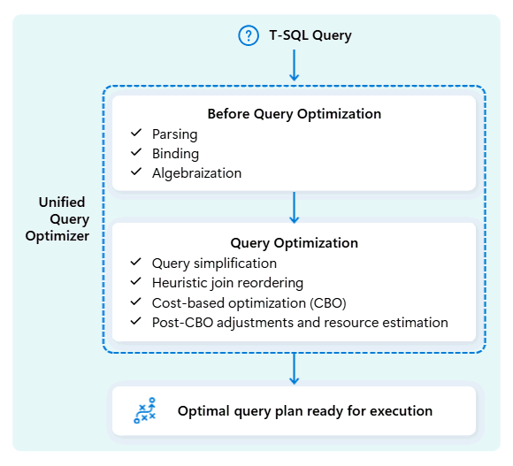

# 19. Unified query optimizer: choose the work before scheduling it

[Book contents](../../index.md) | [Part IV contents](README.md) | [Previous: Chapter 18](18-polaris.md) | [Next: Chapter 20](20-distributed-query-processing.md)

**Applies to:** Fabric Warehouse; shared optimization concepts for SQL analytics endpoint queries. **Level:** 200-300. **Evidence review:** 10 October 2026. Plan examples are explanatory, not captured customer plans.

## SQL states the result, not the itinerary

A country-revenue query specifies matching rows and an aggregation. It normally does not prescribe the physical join order, which side builds a hash table, where intermediate rows move, or how much local work precedes a distributed combine. Those choices belong to optimization.

Microsoft describes the **unified query optimizer** as considering relational shape, data distribution and execution cost together. CPU, memory and network work all matter. Choosing a locally inexpensive join that causes a very large redistribution later can be worse than retaining a slightly more expensive alternative with a useful output distribution.

*Documentation image D02. Microsoft, [Unified query optimizer engine](https://learn.microsoft.com/en-us/fabric/data-warehouse/architecture#unified-query-optimizer-engine); [original image](https://learn.microsoft.com/en-us/fabric/data-warehouse/media/architecture/unified-query-optimizer.png). Unmodified; retrieved 10 October 2026; [CC BY 4.0](https://creativecommons.org/licenses/by/4.0/) under the [Fabric documentation licence](https://github.com/MicrosoftDocs/fabric-docs/blob/main/LICENSE).*

## What unified means

The architectural point is integration of decisions that affect each other, not a promise that one simple algorithm finds the cheapest possible answer. Join order influences intermediate cardinality. Cardinality and width affect memory and transfer cost. Distribution determines whether matching rows already meet locally or need movement.

The 2020 Polaris paper describes the earlier compilation arrangement. The 2024 publication [Unified Query Optimization in the Fabric Data Warehouse](https://www.microsoft.com/en-us/research/publication/unified-query-optimization-in-the-fabric-data-warehouse/) describes its evolution; the book's evidence for that paper remains its public abstract. The full public [Extending Polaris to Support Transactions](https://arxiv.org/pdf/2401.11162v1), section 3.3, separately describes consolidation of compilation in the SQL frontend and delivery of an optimized distributed plan.

Read these as architectural history. They do not document every rule, search heuristic or feedback mechanism in the current service. Likewise, the Learn article's statement that optimization improves with experience is not a contract that every individual query receives a particular self-learning plan correction after a fixed number of runs.

## Estimates describe expected work

The optimizer needs estimates before it can execute most of the work it is costing. Statistics help characterize value distributions; types, predicates and model declarations add context. An estimate is not a count of the rows actually produced during the next run.

For the book seed, January contains all six facts. In a five-year warehouse, one January may be a small fraction. Identical SQL text can therefore imply different useful strategies. Correlations between columns can also challenge a compact model: product key and category are not independent, and neither are calendar year and date key.

[Chapter 26](../05-statistics-and-performance/26-statistics.md) explains supported statistics inspection and maintenance. Updating every statistic indiscriminately is not a substitute for identifying which estimate is material to the plan. Accurate estimates also cannot remove the inherent cost of a legitimately large result.

## Distribution is a property of the intermediate result

Consider a large fact input joined to a small filtered customer input. A **broadcast** makes the smaller input available where fact work executes. A **shuffle** redistributes rows so the matching keys can meet. Neither strategy is inherently wrong.

| Change in the inputs | Why the choice may change |
| --- | --- |
| A customer filter becomes much more selective | The filtered dimension may become cheap to broadcast. |
| Many wide columns are projected | Fewer rows can still represent a large transfer and memory footprint. |
| One key dominates the surviving facts | Work may be uneven even if total row count is estimated well. |
| A preceding operation already produces useful distribution | Preserving that arrangement may avoid a later exchange. |

The relevant input is often an intermediate after filters and projection, not the whole base table. A name beginning with `Dim` does not establish that the object is small. A file count does not reveal the optimizer's complete distribution requirements.

## Optimization cannot choose different business semantics

Equivalent rewrites must preserve null behaviour, duplicates, outer joins, ordering requirements and numeric meaning. Moving a filter from `ON` to `WHERE` in an outer join can remove unmatched rows. Summing group averages can produce the wrong overall average. Eliminating duplicates can change an intentionally repeated sales event.

An unenforced key declaration also needs a real data-quality contract. The optimizer cannot repair duplicate dimension keys by assuming the duplicates should not exist. [Chapter 8](../02-building-analytical-solutions/08-dimensional-modeling.md) separates declarations from proof.

Make the answer correct first. Then reduce unnecessary rows, columns and repeated work. A supported hint can be an experiment, but it should not become permanent folklore copied into every statement.

## Keep optimization separate from execution evidence

An estimated plan explains a proposed strategy. It is not a measurement of actual GPU use, queueing time, every cache hit or the invoice. A plan can be reasonable and still encounter resource pressure. A quicker second execution can follow cache warming without a better plan.

Use [Chapter 27](../05-statistics-and-performance/27-query-plans-and-tuning.md) for supported plan inspection and controlled tuning, and [Chapter 29](../06-operating-the-platform/29-monitoring.md) for the scope of runtime evidence. Compare the same semantics, data state and workload conditions before attributing a change to optimization.

## Safe exercise: compare two possible strategies

**Prerequisites:** know the seeded sales model; no live execution is required. Imagine a filtered dimension of 1,000 customers joined to one billion sales rows. Write down the columns needed by the final answer, and reason about broadcasting the dimension versus moving the fact input.

Now change only one assumption: the customer filter admits nearly every customer and the dimension includes several wide text columns. Record why the first recommendation no longer follows. Then remove columns the report never uses. Explain how projection can affect scan, memory and transfer work without changing the business result.

The exercise produces two hypotheses and their assumptions, not an observed plan or a numerical cost estimate. There is no cleanup. The next chapter asks how the chosen work becomes scheduled work.

## References

1. Microsoft Learn, [Architecture: unified query optimizer](https://learn.microsoft.com/en-us/fabric/data-warehouse/architecture#unified-query-optimizer-engine), reviewed 10 October 2026.
2. Nicolas Bruno and coauthors, [Unified Query Optimization in the Fabric Data Warehouse](https://www.microsoft.com/en-us/research/publication/unified-query-optimization-in-the-fabric-data-warehouse/), SIGMOD 2024; public abstract.
3. Josep Aguilar-Saborit and coauthors, [Extending Polaris to Support Transactions](https://arxiv.org/pdf/2401.11162v1), January 2024 preprint, section 3.3.
4. Microsoft Learn, [Statistics](https://learn.microsoft.com/en-us/fabric/data-warehouse/statistics) and [performance guidelines](https://learn.microsoft.com/en-us/fabric/data-warehouse/guidelines-warehouse-performance).

---

[Previous: Chapter 18](18-polaris.md) | [Book contents](../../index.md) | [Next: Chapter 20](20-distributed-query-processing.md)
