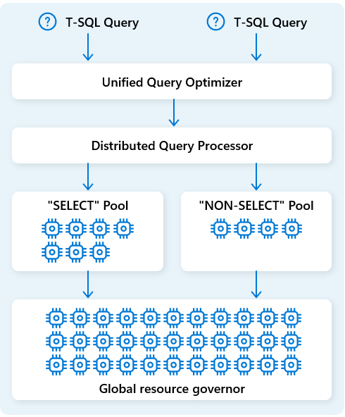

# 20. Distributed query processing: turn a plan into coordinated work

[Book contents](../../index.md) | [Part IV contents](README.md) | [Previous: Chapter 19](19-unified-query-optimizer.md) | [Next: Chapter 21](21-query-execution-engine.md)

**Applies to:** Fabric Warehouse distributed execution; shared concepts for SQL analytics endpoint reads. **Level:** 200-300. **Evidence review:** 10 October 2026. No private scheduler algorithm or fixed resource allocation is assumed.

## A plan is not a schedule

The optimizer may decide that a small input should be broadcast and a large input scanned in parallel. A different responsibility must make that strategy happen: identify executable work, respect its input dependencies, obtain resources and track completion.

Microsoft's architecture calls this **distributed query processing**. The engine assigns compute resources to tasks and schedules those tasks across nodes. The local execution engine on each node then performs its assigned operators. Choosing a hash join, scheduling its partitions and executing the hash probes are three connected decisions, not one operation.

*Documentation image D03. Microsoft, [Distributed query processing engine](https://learn.microsoft.com/en-us/fabric/data-warehouse/architecture#distributed-query-processing-engine); [original image](https://learn.microsoft.com/en-us/fabric/data-warehouse/media/architecture/distributed-query-processing.png). Unmodified; retrieved 10 October 2026; [CC BY 4.0](https://creativecommons.org/licenses/by/4.0/) under the [Fabric documentation licence](https://github.com/MicrosoftDocs/fabric-docs/blob/main/LICENSE).*

## Dependencies determine what can run

The Polaris research represents a query as dependent tasks in a directed acyclic graph. A task has input, executable work and output. Some tasks can proceed together; others need upstream results. The graph is useful historical vocabulary even though the customer does not directly administer its nodes.

Imagine regional workers each producing a partial country-revenue aggregate. A final combine needs the relevant partial results before it can complete the answer. More idle resources elsewhere do not remove an unmet dependency. Similarly, a skewed partition can hold up completion even when most workers finish quickly.

This model does not imply that every modern exchange waits for a fully materialized upstream result. Pipelining, staging and recovery details depend on the implementation. The enduring point is to distinguish readiness from resource availability: a task can lack either its inputs or somewhere suitable to execute.

## Scale-out and scale-up cooperate

**Scale-out** spreads suitable work across resources. **Scale-up** uses each resource efficiently through local parallelism, batch processing, caching and good operators. Distributed execution needs both.

A useful task normally contains enough work to justify its setup and coordination. Splitting a tiny query into many pieces can increase overhead. A large query can expose many tasks while retaining a costly final sort or combine. Neither additional nodes nor a faster GPU makes every dependency parallel.

Data movement also consumes time and resources. Broadcasting an input, redistributing join keys and returning rows to a client have different purposes and costs. The bytes scanned from OneLake are not a complete measure of intermediate shuffle traffic.

## Separate compute pools, but inspect the wider service

The public architecture describes distinct compute resources for `SELECT` and `NON-SELECT` workloads. This helps separate analytical reads from ingestion and modification work. Automatic scaling responds to workload conditions without requiring customers to maintain a fixed fleet of SQL servers.

Do not translate this into "ETL can never affect dashboards." Reads and writes still share a surrounding platform with capacity policies, storage, metadata, security and transaction interactions. A schema change can block a reader even when their execution resources are separated.

The workload-management chapter also discusses supported custom-pool configuration and routing. Those settings are the appropriate customer surface, not an invitation to edit an inferred internal scheduler. See [Chapter 33](../06-operating-the-platform/33-workload-management-and-sql-pools.md) for configuration semantics and [Chapter 32](../06-operating-the-platform/32-capacity-management.md) for broader capacity behaviour.

## Concurrency is a shape, not just a count

Ten selective queries and ten wide aggregations can impose radically different demands. The dimensions include CPU work, memory, scan volume, movement, result size and how long each remains active. Arrival rate matters too: 100 requests over an hour is not 100 simultaneous submissions.

A tuning exercise should therefore preserve or explicitly vary workload shape. Record successful throughput and tail latency as well as average duration. A lower average can coexist with an unacceptable slow tail. A larger request count can reflect a healthier service completing more useful work rather than an overloaded system.

Automatic resource management does not remove limits, guarantee immediate admission or create a permanent worker count for a purchased SKU. A consumption-derived vNode equivalent is an accounting model, not a reconstruction of DQP's instantaneous allocation.

## Recovery has an internal and an application boundary

The Polaris papers explain how task state and dependency tracking support recovery from some failures without repeating every successful part of a distributed query. That is a design motivation, not a published promise of a particular number of retries in the current service.

Clients can still receive cancellations, permission errors, write conflicts and other failures. If a write loses its connection near commit, the application must resolve whether the business change took effect before replaying it blindly. Internal task recovery does not create application-level exactly-once processing.

Preserve request identifiers, timestamps and the original error. Treat an apparent stall as a symptom to investigate using supported monitoring, not proof that the distributed coordinator has failed. [Chapter 30](../06-operating-the-platform/30-troubleshooting.md) develops that evidence-led sequence.

## Safe exercise: find the limiting dependency

**Prerequisites:** the conceptual country-revenue query from Chapter 18; no live load generation or administrative access is needed. Draw four scan-and-aggregate tasks feeding one final combine. Assign illustrative durations of 2, 2, 2 and 9 seconds to the four upstream tasks.

Ask why the final answer cannot complete after two seconds. Then distinguish three hypotheses for the slow task: more input, a more expensive local expression, or delayed resource availability. State which observation would help discriminate them. Do not claim the invented durations represent the book seed or a Fabric scheduling guarantee.

Finally imagine doubling the number of client submissions without changing the task graph. Record why an isolated-query improvement does not establish the same improvement under concurrency. The outcome is a dependency sketch and an evidence plan. No artifacts or cleanup are required.

## References

1. Microsoft Learn, [Architecture: distributed query processing](https://learn.microsoft.com/en-us/fabric/data-warehouse/architecture#distributed-query-processing-engine), reviewed 10 October 2026.
2. Josep Aguilar-Saborit and coauthors, [Polaris: The Distributed SQL Engine in Azure Synapse](https://www.vldb.org/pvldb/vol13/p3204-saborit.pdf), 2020, sections 5-9; historical tasks, scheduling and recovery.
3. Microsoft Learn, [Monitoring overview](https://learn.microsoft.com/en-us/fabric/data-warehouse/monitoring-overview).
4. Microsoft Learn, [Transactions](https://learn.microsoft.com/en-us/fabric/data-warehouse/transactions), schema locks and write conflicts that compute-pool separation does not erase.

---

[Previous: Chapter 19](19-unified-query-optimizer.md) | [Book contents](../../index.md) | [Next: Chapter 21](21-query-execution-engine.md)
