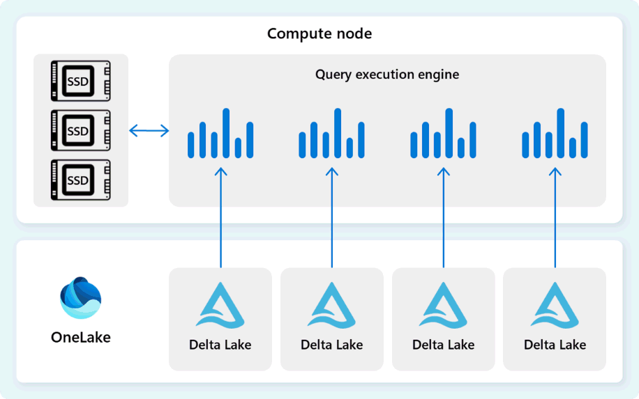

# 21. Query execution engine: do useful work close to the data

[Book contents](../../index.md) | [Part IV contents](README.md) | [Previous: Chapter 20](20-distributed-query-processing.md) | [Next: Chapter 22](22-metadata-and-transaction-management.md)

**Applies to:** Fabric Warehouse and shared SQL analytics endpoint execution concepts. **Level:** 200-300. **Evidence review:** 10 October 2026. CPU/GPU hardware and query eligibility are not inferred from a conceptual diagram.

## The worker inside the distributed service

A distributed plan eventually needs a process that reads values and performs comparisons, joins, calculations and aggregation. Microsoft describes Fabric's local query execution engine as based on SQL Server and Azure SQL Database engine technology, using batch execution and columnar data representations for analytical work.

That lineage is valuable, but the managed distributed service is not a customer-administered SQL Server instance. Familiar operators do not imply identical instance settings, file management, privileges or physical tuning controls. The execution engine works within the plan, storage and transaction contracts established by the other building blocks.



*Documentation image D04. Microsoft, [Query execution engine](https://learn.microsoft.com/en-us/fabric/data-warehouse/architecture#query-execution-engine); [original image](https://learn.microsoft.com/en-us/fabric/data-warehouse/media/architecture/query-execution-engine.png). Unmodified; retrieved 10 October 2026; [CC BY 4.0](https://creativecommons.org/licenses/by/4.0/) under the [Fabric documentation licence](https://github.com/MicrosoftDocs/fabric-docs/blob/main/LICENSE).*

## Columnar data and batch execution solve different problems

Columnar organization puts values of the same attribute together. A revenue query needs quantity, price and its join or grouping keys, not every descriptive column in the source. Reading fewer columns can reduce IO and decoding work, while similar values often compress efficiently.

Batch execution processes groups of values through suitable operators rather than paying the same per-row interpretation overhead repeatedly. It exploits modern CPU capabilities as well as efficient data structures. CPU execution is already highly optimized; a GPU comparison should not portray it as one thread processing one row at a time.

Storage format and in-memory format need not be identical. The [cache documentation](https://learn.microsoft.com/en-us/fabric/data-warehouse/caching) describes transcoding file-based data into compressed columnar structures suitable for execution. A Parquet file, a memory batch and a distributed task are different units even when they participate in the same query.

## Avoid work before making it faster

Column elimination avoids attributes the query does not need. Row-group elimination can skip regions whose metadata establishes they cannot satisfy a predicate. Row filtering then evaluates surviving candidates. Each reduces work at a different layer.

A selective predicate is not proof of effective physical pruning. If each row group contains the entire date range, a one-day filter can still require examining many groups. Conversely, suitable organization can help a supported reader avoid irrelevant groups. [Chapter 28](../05-statistics-and-performance/28-layout-caching-and-maintenance.md) connects those decisions to maintenance and ownership.

Joins and aggregations must also respect semantics. A compact partial aggregate is useful when the final calculation can combine it correctly. A sum can be added across disjoint groups; an unweighted average of averages generally cannot. Hardware efficiency does not justify changing the mathematical question.

## Read through memory, SSD and OneLake

Fabric manages memory and SSD caching transparently. Data not available in the relevant local caches must be retrieved through the storage path. The caches shorten repeated access but are not an alternative authoritative database.

| Layer or mechanism | What is reused | What it does not establish |
| --- | --- | --- |
| In-memory cache | Data in execution-friendly structures | A permanent allocation or a separate copy the user must manage |
| SSD cache | A larger local cache tier supporting later reads | That all future work will run on the same warm resources |
| OneLake | Durable managed table data | That every query reads all bytes remotely |
| Result-set cache | A previously computed answer when eligible | That a warm data cache means the entire query was skipped |

The documented data caches preserve transactional consistency. A later read must use the appropriate table state even when data is cached. Do not diagnose a stale Lakehouse endpoint as ordinary cache reuse before checking its separate metadata-sync and source-publication boundaries.

These caches are managed, not a customer cache-flush experiment surface. Preserve first-run and repeated-run observations; do not invent an undocumented command to manufacture a cold comparison.

## Where GPU acceleration fits

The documented acceleration path uses GPUs as coprocessors alongside CPUs for eligible portions of a query plan. The wider SQL service still provides compilation, coordination, transaction rules and result delivery. Some operators can remain on CPU.

The public research makes the integration problem more concrete. TQP investigated expressing relational work through tensor runtimes. TQP++ explored more efficient generated kernels and fusion. CoddSpeed's public award article describes coprocessor and data abstractions that integrate accelerated fragments while addressing movement and fallback. These are related stages, not identical implementations.

TQP++'s productization section explicitly describes later CUDA rewrites and the decision not to adopt its just-in-time fusion approach in the product. Do not turn a research compiler diagram into a claim that every current Fabric query invokes that compiler. [Chapter 34](../06-operating-the-platform/34-gpu-acceleration.md) provides the paper summaries, verified awards, experiments and evidence limits.

An accelerated fragment is useful only in the context of the complete request. Transfers, unsupported expressions, small inputs or a slow client can limit the benefit. A visible Query Acceleration operator and runtime evidence are more meaningful than assuming that an enabled workspace moved every operation to a GPU.

## Safe exercise: identify the work in one answer

**Prerequisites:** the unchanged Chapter 4 Warehouse seed and read permission. **Effect:** read-only query compute; no acceleration or cache setting is changed.

```sql
SELECT f.DateKey,
       SUM(f.Quantity * f.UnitPrice) AS Revenue
FROM book.FactSales AS f
GROUP BY f.DateKey
ORDER BY f.DateKey;
```

The seed returns daily revenues of `130.00`, `55.00` and `180.00` for 1-3 January 2026, totalling `365.00`. Identify the three source columns needed and the small result the client receives. Explain why unrelated descriptive columns are unnecessary.

If you execute twice, record both durations without naming the cause of a difference from the stopwatch alone. A useful follow-up requires evidence about compilation, statistics, caching and execution. Six facts cannot establish a meaningful batch-mode or GPU speedup.

No objects are created, so there is no cleanup. The exercise separates business correctness, work reduction and hardware execution: three things that must be understood together but measured differently.

## References

1. Microsoft Learn, [Architecture: query execution engine](https://learn.microsoft.com/en-us/fabric/data-warehouse/architecture#query-execution-engine), reviewed 10 October 2026.
2. Microsoft Learn, [In-memory and disk caching](https://learn.microsoft.com/en-us/fabric/data-warehouse/caching).
3. Microsoft Learn, [Query acceleration](https://learn.microsoft.com/en-us/fabric/data-warehouse/query-acceleration), product execution and eligibility scope.
4. Wei Cui and coauthors, [TQP++: Bridging ML Compilers and Analytical Query Processing on GPUs](https://www.vldb.org/pvldb/vol19/p4116-cui.pdf), 2026, section 10, pp. 4126-4127; productization boundary.
5. Matteo Interlandi, [From research to product: CoddSpeed's SIGMOD 2026 award](https://community.fabric.microsoft.com/blog/fbc_fabricupdatesblogs/from-research-to-product-microsoft-fabric-wins-best-industry-paper-at-sigmod-202/5191608), June 2026; public architecture summary, not a complete paper review.

---

[Previous: Chapter 20](20-distributed-query-processing.md) | [Book contents](../../index.md) | [Next: Chapter 22](22-metadata-and-transaction-management.md)
