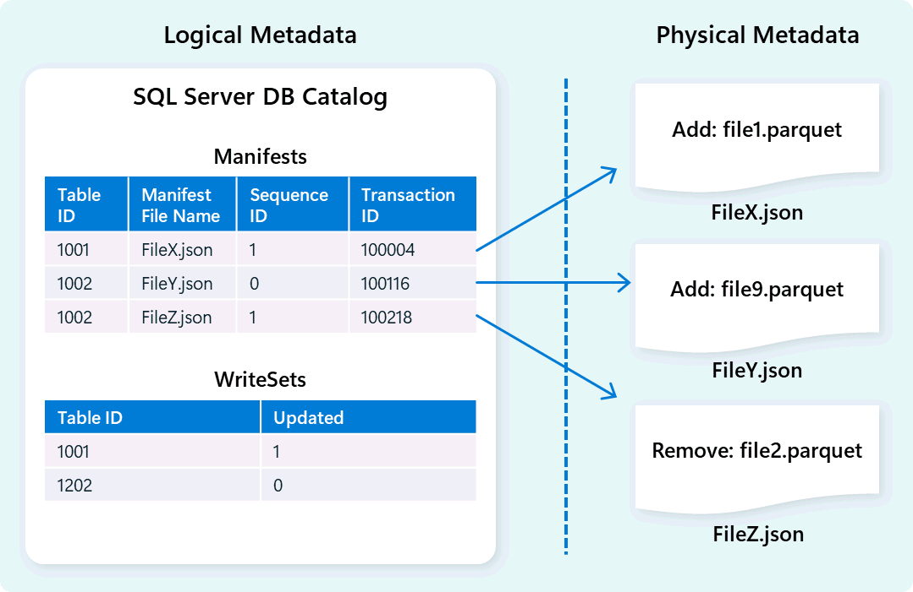

# 22. Metadata and transaction management: decide which state is real

[Book contents](../../index.md) | [Part IV contents](README.md) | [Previous: Chapter 21](21-query-execution-engine.md) | [Next: Chapter 23](23-storage-onelake-and-delta-log-publishing.md)

**Applies to:** Warehouse metadata and transactions; endpoint and external-reader boundaries are distinguished. **Level:** 200-300. **Evidence review:** 10 October 2026. Internal formats discussed in research are not supported customer interfaces.

## Files cannot make a transaction decision by themselves

An ingestion operation can create files before its business transaction is committed. A reader must know which objects exist, how their columns are interpreted and which physical data belongs to its valid table state. Seeing a file in storage answers none of those questions by itself.

Metadata and transaction management supply the missing context. Microsoft's architecture identifies schema, file organization, version history and transaction states, with metadata present in frontend and backend components and across local caching and remote storage. That description is a responsibility map, not a catalogue of private service tables readers should query.



*Documentation image D05. Microsoft, [Metadata and transaction management](https://learn.microsoft.com/en-us/fabric/data-warehouse/architecture#metadata-and-transaction-management); [original image](https://learn.microsoft.com/en-us/fabric/data-warehouse/media/architecture/metadata-transaction-management.png). Unmodified; retrieved 10 October 2026; [CC BY 4.0](https://creativecommons.org/licenses/by/4.0/) under the [Fabric documentation licence](https://github.com/MicrosoftDocs/fabric-docs/blob/main/LICENSE).*

## Four kinds of context

| Context | Question it answers |
| --- | --- |
| Logical metadata | What are the object, schema, columns, types and supported declarations? |
| Physical metadata | Which managed files and versions represent the table state to be read? |
| Transaction state | Which changes committed, which are private to an active transaction, and which failed? |
| Published external metadata | What Delta representation is available to a compatible reader outside Warehouse SQL? |

The 2024 [transaction-extension paper](https://arxiv.org/pdf/2401.11162v1), particularly sections 2-5, explains a design using logical catalog state, physical manifests and immutable data files. Its commit and publication discussions help explain why creating bytes, committing SQL and publishing external metadata are distinct events.

This does not mean the public `_delta_log` is the complete internal transaction manager. Nor does it mean that a manifest name in the paper is a stable API. The book uses the paper to explain causality and the current documentation to establish supported application behaviour.

## ACID still needs an application contract

Warehouse supports ACID-compliant transactions. Atomicity groups supported changes into one commit or rollback decision. Isolation governs the state a transaction observes. Durability concerns successfully committed data, not whether a particular report has refreshed.

An application must still define the transaction's scope. Updating two related Warehouse tables together can preserve a business invariant; running two independent jobs and calling them one batch does not create the same guarantee. Validate the supported statements and scope before moving an existing SQL Server transaction unchanged.

Current documentation supports transactions across Warehouses in the same Fabric workspace, including reads through a Lakehouse SQL analytics endpoint. This is not general distributed-transaction support across an external source database, Spark job and report service. `BEGIN DISTRIBUTED TRANSACTION`, savepoints and named or marked transactions are not supported by the reviewed Warehouse contract.

## Snapshot isolation and write conflicts

The reviewed [transaction documentation](https://learn.microsoft.com/en-us/fabric/data-warehouse/transactions) states that Fabric Warehouse applies snapshot isolation. Requesting another isolation level does not establish that it will be used at execution time.

Snapshot isolation is not a promise that every concurrent operation succeeds without waiting. Updates, deletes and merges can conflict at the table level, including operations intended to affect different business rows. DDL has schema-lock requirements; a schema modification can block readers or be blocked by them.

Separate three cases: a reader working against a consistent snapshot, a transaction waiting for a conflicting schema lock, and a writer whose optimistic conflict check fails. Their remedies differ. Adding more execution resources does not remove a schema-lock incompatibility or make conflicting writes logically compatible.

The [9 November 2026 roadmap snapshot](../../appendices/H-roadmap-snapshot.md#snapshot-9-november-2026) records a planned file-level conflict-detection milestone. Like the research paper's finer-grained proposals, a target is not the supported current isolation/conflict specification. Chapter 10 states the dated operational boundary explicitly.

On a retryable write conflict, retry the appropriate failed transaction with a bounded policy and delay. Do not independently replay its final statement when earlier work belongs to the same business unit. After an ambiguous connection failure, establish the business operation's outcome rather than assuming that no commit occurred.

## Three meanings of snapshot

A transaction snapshot is the consistent state observed under isolation rules. A historical time-travel query requests a supported past state within retention and schema constraints. A separately created Warehouse snapshot or clone is another managed object with its own scope.

These mechanisms share an interest in versions but are not substitutes. A consistent transaction does not create a backup. Retaining data files does not prove a recovery objective. A clone is not permission to delete files that another state still references. [Chapter 35](../06-operating-the-platform/35-recovery-and-retention.md) develops those operational choices.

## Commit is not every consumer's freshness signal

After a Warehouse commit, updated Delta metadata is published asynchronously for external readers. Consumers then have their own discovery, caching and refresh behaviour. The relevant chain can include source extraction, Warehouse SQL commit, Delta publication, semantic-model refresh and final client display.

Mark those boundaries separately in an incident timeline. A delay measured between the first and last observation is an end-to-end delay; it does not isolate a hidden component. The next chapter provides a bounded publication experiment without confusing external-reader readiness with SQL durability.

Lakehouse-to-SQL metadata sync is another mechanism. It discovers or refreshes the SQL view of source Delta tables and is covered in [Chapter 15](../03-sql-analytics-endpoint/15-metadata-sync-v1-v2.md). Triggering that refresh is not a repair for a Warehouse with paused outward Delta publication.

## Safe exercise: inspect logical metadata

**Prerequisites:** the seeded `BookWarehouse` and permission to view the relevant catalog metadata. **Effect:** read-only catalog query; visibility depends on your permissions.

```sql
SELECT s.name AS SchemaName,
       t.name AS TableName,
       c.column_id,
       c.name AS ColumnName,
       ty.name AS TypeName,
       c.max_length,
       c.precision,
       c.scale,
       c.is_nullable
FROM sys.tables AS t
JOIN sys.schemas AS s ON s.schema_id = t.schema_id
JOIN sys.columns AS c ON c.object_id = t.object_id
JOIN sys.types AS ty ON ty.user_type_id = c.user_type_id
WHERE s.name = 'book'
  AND t.name = 'FactSales'
ORDER BY c.column_id;
```

Compare the returned schema with the seed definition. This inspects logical metadata, not the current internal manifest graph or every retained file. A missing row can reflect object context or metadata visibility, so record the connection and permissions before diagnosing lost data.

Then write three separate acceptance questions: did the intended SQL transaction commit, can a new SQL reader see the business marker, and can the intended external reader see it? No writes or objects are created, so no cleanup is required. The result is an explicit distinction between definitions, state and observation.

## References

1. Microsoft Learn, [Architecture: metadata and transaction management](https://learn.microsoft.com/en-us/fabric/data-warehouse/architecture#metadata-and-transaction-management), reviewed 10 October 2026.
2. Microsoft Learn, [Transactions in Fabric Data Warehouse](https://learn.microsoft.com/en-us/fabric/data-warehouse/transactions), reviewed 10 October 2026.
3. Josep Aguilar-Saborit and coauthors, [Extending Polaris to Support Transactions](https://arxiv.org/pdf/2401.11162v1), 2024 preprint, sections 2-5.
4. Microsoft Learn, [Delta Lake logs in Warehouse](https://learn.microsoft.com/en-us/fabric/data-warehouse/query-delta-lake-logs).
5. Microsoft Learn, [Time travel](https://learn.microsoft.com/en-us/fabric/data-warehouse/time-travel) and [T-SQL surface area](https://learn.microsoft.com/en-us/fabric/data-warehouse/tsql-surface-area).

---

[Previous: Chapter 21](21-query-execution-engine.md) | [Book contents](../../index.md) | [Next: Chapter 23](23-storage-onelake-and-delta-log-publishing.md)
