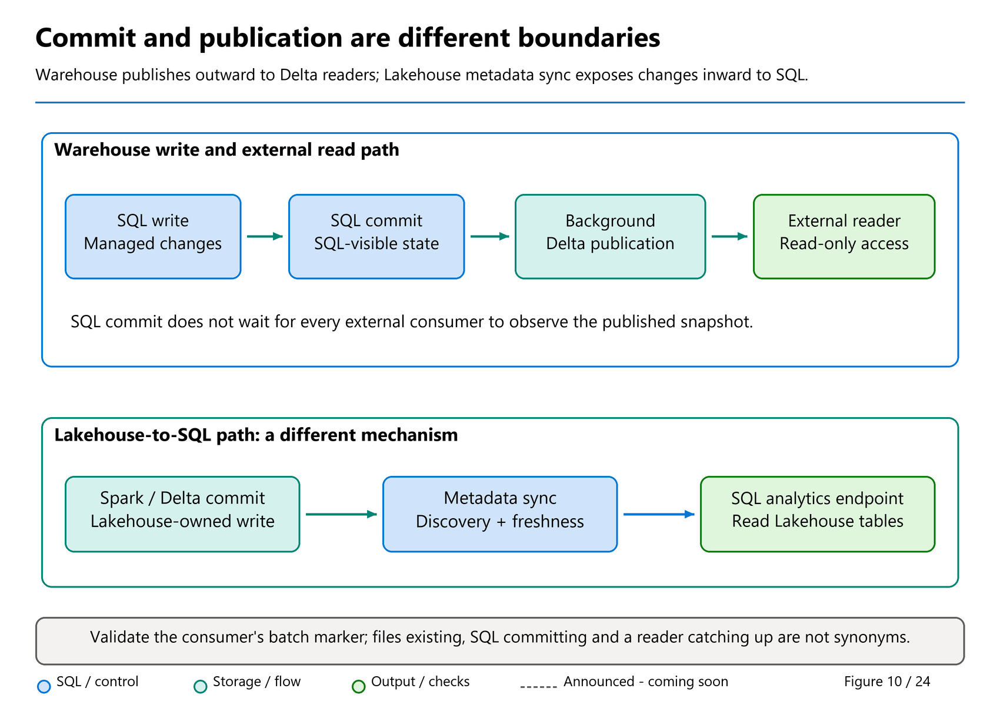
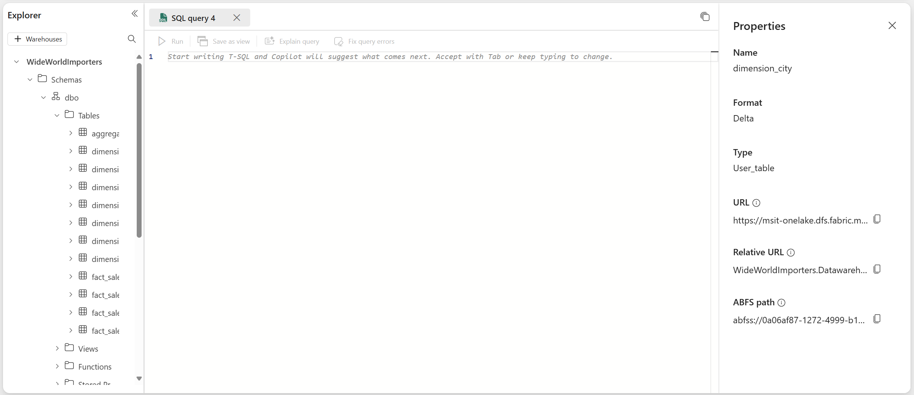

# 23. Storage in OneLake and Delta Log Publication

[Book contents](../../index.md) | [Part IV contents](README.md) | [Previous: Chapter 22](22-metadata-and-transaction-management.md) | [Next: Chapter 24](24-fabric-platform-integration.md)

**Applies to:** Fabric Warehouse storage and external Delta readers; comparison with Lakehouse metadata sync. **Level:** intermediate to advanced. **Scope:** storage architecture reviewed 10 October 2026; existing publication exercises retain their dated source references. Publication controls are Warehouse-wide, not per-query or per-table controls.

## OneLake is the storage building block, not another execution engine

Microsoft's [Warehouse architecture](https://learn.microsoft.com/en-us/fabric/data-warehouse/architecture) names storage in OneLake as one of its six building blocks. The Warehouse persists managed table data using the open Delta table format and Parquet data files. SQL execution resources process that data; OneLake is not a separate optimizer choosing the query's join order.

This is a useful division of responsibility. A table remains meaningful independently of the temporary compute resources executing one request, while the engine maintains the metadata and transaction rules needed to select its valid state. The preceding [metadata and transaction management chapter](22-metadata-and-transaction-management.md) explains those decisions. This chapter follows their durable representation and the handoff to external readers.

Open storage also does not mean unmanaged storage. Warehouse controls its supported table writes and physical maintenance. Readers should not reorganize its files, edit logs or run another engine's maintenance against the Warehouse path simply because those objects are visible through OneLake.

## Log-structured data and managed physical organization

The public architecture describes log-structured tables and automatically managed micro-partitioned cells. The research behind Polaris explains why fine-grained data units help separate data organization from assignment to compute. Neither description creates a customer-facing requirement to select a hash-distribution key or reproduce Synapse dedicated-pool physical DDL.

Parquet organizes columnar values; Delta describes table state over data files. A cell, a file, a row group and a scheduled task are related layers, not four names for the same object. Avoid deriving node counts from folder contents or assuming that one file always corresponds to one execution task.

Managed compaction consolidates fragmented active data to improve physical layout. Historical retention serves a different purpose: preserving states needed by supported readers and recovery features. Compacting active files and deleting obsolete retained files are not interchangeable maintenance operations. The detailed layout discussion remains in [Chapter 28](../05-statistics-and-performance/28-layout-caching-and-maintenance.md); recovery requirements belong with [Chapter 35](../06-operating-the-platform/35-recovery-and-retention.md).

For a design review, record the data's authoritative writer, expected write pattern, downstream readers and retention needs. "It is Delta" does not by itself answer any of those questions. Reader compatibility depends on supported table features, while permission and publication state determine whether a particular consumer can use the intended version.

## Ingestion chooses how data reaches the managed writer

The [ingestion overview](https://learn.microsoft.com/en-us/fabric/data-warehouse/ingest-data), reviewed 10 October 2026, separates file-based loading, orchestrated integration and SQL-based transformations. The entry point changes; the destination remains a Warehouse with its own schema, type, security and transaction contract.

| Route | Design question |
| --- | --- |
| `COPY INTO` over supported staged files | Are format, parsing, source access and destination authorization explicit? |
| Data Factory pipelines or dataflows | How are dependencies, transformations, failures and reruns controlled? |
| `INSERT...SELECT`, CTAS or other supported T-SQL ingestion | Does the source query preserve the intended grain, types and duplicate semantics? |
| Direct client bulk-copy APIs | Is the current preview support appropriate, and why is staged file loading unsuitable? |
| Read in place rather than ingest | Does the supported access route meet security, freshness and repeated-query requirements without materialization? |

This is a route-selection map, not a new connector compatibility matrix. Follow the linked current ingestion reference for supported sources, formats and preview qualifications. A path supported by one loading method is not automatically accepted by every other method.

In particular, workspace identity used for source access does not replace the executing caller's destination SQL authorization. A successful source read is not a successful Warehouse commit. [Chapter 9](../02-building-analytical-solutions/09-loading-and-accessing-data.md) supplies the loading and reconciliation patterns; the next sections explain why even a successful commit is not the final freshness boundary for every consumer.

## One table, different visibility boundaries

Suppose an ingestion job commits a sale into `book.FactSales`. A new Warehouse SQL query sees it, but a Spark notebook reading the Warehouse table's OneLake path does not. The tempting diagnosis is "the transaction did not commit." That diagnosis confuses two boundaries.

The first boundary is the Warehouse transaction commit. The second is publication of updated Delta Lake logs for readers outside the Warehouse. Microsoft documents that, after a transaction commits, a **background process** publishes updated Delta logs for affected tables. External access to Warehouse tables is read-only; all inserts, updates, and deletes must go through the Warehouse. See [Delta Lake logs in Warehouse](https://learn.microsoft.com/en-us/fabric/data-warehouse/query-delta-lake-logs), checked 8 October 2026.

Thus a successful SQL commit does not mean every external Delta reader has already observed that commit. Nor does external lag mean that SQL durability depends on the external reader catching up. This distinction is central to diagnosing fresh-data incidents.

Mark's [Delta Log Publishing](https://medium.com/@sqltidy/fabric-warehouse-delta-log-publishing-477c1508d060) and [Part 2](https://medium.com/@sqltidy/fabric-warehouse-delta-log-publishing-part-2-0730cc6fba06), dated 2 and 5 September 2025 in his verified author archive, make this handoff tangible. The first describes a handful of file/log timing observations; the second automates a read-after-write check. Retain the asynchronous-publication lesson, not a universal 3-12-second SLA or an assumption that file CreatedOn/client completion timestamps isolate pure publisher latency.

The new [Delta anatomy chapter](../01-getting-started/03-anatomy-of-a-delta-table.md#how-warehouse-publishes-its-delta-representation) introduces the concept before setup. This chapter keeps the advanced marker-based experiment: row-count equality alone cannot prove the intended batch or every changed value is visible.

The reverse direction has a different name and mechanism. When Spark commits to a Lakehouse table, its SQL analytics endpoint must discover or refresh the metadata needed to expose those Delta changes through SQL. That is **metadata sync**, covered in Chapter 15. It is not the Warehouse publication process running backward.



*Figure 10 — Conceptual storage-publication boundaries, not an observed service topology.* Follow the committed Warehouse state and the externally published Delta state separately. The space between them represents asynchronous work, not a measured delay or a failed commit. An external reader must also observe the new publication before its own result can be called fresh.



*Documentation image D26. Microsoft, [Warehouse table properties and OneLake path](https://learn.microsoft.com/en-us/fabric/data-warehouse/query-delta-lake-logs); [original image](https://learn.microsoft.com/en-us/fabric/data-warehouse/media/query-delta-lake-logs/properties-details.png). Unmodified source copy, retrieved 9 November 2026; [CC BY 4.0](https://creativecommons.org/licenses/by/4.0/) under the [Fabric documentation licence](https://github.com/MicrosoftDocs/fabric-docs/blob/aadea08f35c3edaa9c32535c772792f02555c9a4/LICENSE). Copy the approved table's own URI rather than derive it from a display name; a path is not a permission or a publication SLA.*

## What the files and logs contribute

Parquet stores columnar data. A Delta table adds a transaction-log interpretation of that data: which files belong to a table snapshot and what table metadata and features apply. A reader should interpret the table through Delta, not collect every Parquet file found beneath a directory.

This difference becomes obvious after updates or maintenance. Older files can remain for retention or history even though the current snapshot no longer references them. A recursive Parquet scan can double count, include superseded data, or ignore deletion information. File presence is not equivalent to current-table membership.

Current [Fabric architecture documentation](https://learn.microsoft.com/en-us/fabric/data-warehouse/architecture) also describes Warehouse metadata concerning schema, file organization, version history, and transaction states. That internal transaction and metadata machinery must not be identified with the asynchronously published public `_delta_log`. The public sources establish the responsibilities; they do not document every internal record layout or publication algorithm.

The full [2024 transaction-extension preprint](https://arxiv.org/pdf/2401.11162v1) gives a useful historical explanation. It separates SQL-catalog logical metadata, physical transaction manifests, and immutable data files. In that design, a transaction produces private changes; commit makes the appropriate manifest references visible through transactionally managed catalog state. A different background responsibility publishes the external Delta representation. Section 5.4 explicitly describes asynchronous metadata publication without copying the underlying business data.

This explains why "the files have arrived" is not a sufficient SQL commit test and why "SQL committed" is not a sufficient external-reader readiness test. It also explains how an aborted attempt can leave physical artifacts without making them committed rows. Do not manually remove such files: retention, concurrent transactions, clones, and managed garbage collection affect whether they are still needed.

These are explanations of the January 2024 preprint, not supported interfaces to hidden catalog tables. The paper itself marks internal formats as evolvable. It mentions additional publication formats as architectural possibilities while stating that its implementation publishes Delta; that is not evidence that current Warehouse offers every format discussed.

A Delta checkpoint is another distinct concept. It summarizes log state so a reader need not reconstruct a snapshot by replaying an indefinitely growing sequence of log actions. A checkpoint version is not a business watermark, and the presence of a checkpoint does not certify that a particular consumer has refreshed. "V2 checkpoint" refers to a Delta protocol feature, not the new metadata-sync generation.

In the product-team post [Announcing: Automatic Log Checkpointing for Fabric Warehouse](https://community.fabric.microsoft.com/blog/fbc_fabricupdatesblogs/announcing-automatic-log-checkpointing-for-fabric-warehouse/5172079), **KevinConanMSFT**, 11 December 2023, distinguishes internal file-tracking logs from externally published Delta logs. The post describes automatic asynchronous checkpointing after ten transactions **at the time of publication**. Its enduring lesson is reduced metadata-reconstruction work, not a ten-transaction visibility contract. Do not turn that historical threshold into a current guarantee, a SQL commit barrier, or a reason to manufacture dummy transactions. Checkpoint creation, SQL commit, and a consumer observing a published marker remain separate events.

## Open does not mean unrestricted

OneLake makes a common storage representation available to multiple engines. It does not mean every engine is a valid writer for every item. Directly updating Warehouse-managed files with Spark would bypass the supported Warehouse write path and threaten transaction consistency. Neither a shortcut nor a copied ABFS path grants permission to rewrite the source.

Interoperability also depends on table features. The [Fabric interoperability matrix](https://learn.microsoft.com/en-us/fabric/fundamentals/delta-lake-interoperability), dated 21 September 2026 and updated 7 October, distinguishes readers, writers, deletion vectors, column mapping, type widening, and other capabilities. A Python notebook using a particular Delta library is not automatically equivalent to Fabric Spark. Successful reads from one engine do not prove compatibility with all other engines.

These are deployment requirements, not edge-case trivia. Record the intended consumers before changing table features. Test each consumer's supported reader behavior, authentication, and freshness expectations. SQL-level row security also does not automatically apply to a separate engine reading OneLake directly; access governance must cover that route independently.

## Publication is a dependency in a pipeline

A production workflow might have three checkpoints: source data extracted, Warehouse transaction committed, and downstream consumer ready. They answer different questions. Collapsing them into one green pipeline box can produce a report that is technically successful but operationally stale.

Use an explicit business batch identifier or other verifiable marker when a downstream step must consume a particular load. A count alone is weak evidence. Two snapshots can have the same count but different values, and an insert combined with a delete can leave the count unchanged. Even a unique marker proves only its own visibility, not the correctness of all other rows in the batch.

For multi-table publication, do not invent an atomic external handoff contract beyond the published documentation. Warehouse SQL transactions can group changes, but independently observing external tables is not itself proof of a single cross-table snapshot. If the business requires a coherent external release, design a release protocol and validate every participating table. A status row visible in one table should not be assumed to certify all other tables without evidence.

The most useful timestamps therefore include the business batch completion, SQL commit observation, and downstream marker observation. Their difference can include publication, consumer discovery, caching, scheduling, and polling time. Call that difference **observed end-to-end visibility delay**, not a pure measurement of an undocumented background component.

## Lab: observe one unique marker

This experiment adapts Mark Pryce-Maher's [delta_publishing_test.py](https://gist.github.com/MarkPryceMaherMSFT/4f9c825c9622f2a2d3a8687fb2ac7905), [pinned substantive revision](https://gist.github.com/MarkPryceMaherMSFT/4f9c825c9622f2a2d3a8687fb2ac7905/7c2b133bb2ad70831bfacf6e49ca376edb073189) of 1 September 2025. The gist's metadata was updated on 5 September, but the inspected code history's latest substantive commit is 1 September. The adaptation replaces count equality with a UUID marker, removes hard-coded personal workspace paths, limits writes to a named lab table, bounds polling, and raises on timeout. The user authorized adaptation; no blanket open-source license is assumed.

**Prerequisites:** create a separate, disposable Warehouse named `BookPublicationLab`, with no reports, shortcuts, pipelines, or other users depending on it. Use a Spark notebook with permission to read that Warehouse's OneLake files. Provide a dedicated authenticated `pyodbc` connection named `warehouse_connection` to the lab Warehouse, using the connection guidance in Chapter 13. Do not reuse a connection with unrelated uncommitted work. No passwords or tokens belong in the notebook output.

**Runnable T-SQL setup; execute only in the new BookPublicationLab Warehouse.** It creates new objects and intentionally fails if they already exist.

```sql
CREATE SCHEMA book;
GO
CREATE TABLE book.Lab13Publication
(
    Marker varchar(36) NOT NULL,
    WrittenUtc datetime2(6) NOT NULL
);
```

Copy the table's ABFS URI from its Warehouse **Properties**, rather than guessing a path from display names. First verify that Spark can open the table as Delta; initial publication and permissions must work before timing an inserted marker.

**Python template; execute in the Spark notebook after supplying the connection and ABFS URI.** It commits one marker through SQL and repeatedly performs a Delta read. Spark never writes the Warehouse path.

```python
import time
import uuid
from pyspark.sql import functions as F

table_path = "<ABFS URI copied from book.Lab13Publication Properties>"
if table_path.startswith("<"):
    raise ValueError("Supply the lab table's actual ABFS URI.")

cursor = warehouse_connection.cursor()
database_name = cursor.execute("SELECT DB_NAME();").fetchone()[0]
if database_name != "BookPublicationLab":
    raise RuntimeError("Refusing to write outside BookPublicationLab.")

# Establish that the external table is readable before the measured write.
spark.read.format("delta").load(table_path).limit(1).collect()
marker = str(uuid.uuid4())
try:
    cursor.execute(
        "INSERT INTO book.Lab13Publication (Marker, WrittenUtc) "
        "VALUES (?, SYSUTCDATETIME());",
        marker,
    )
    warehouse_connection.commit()
except Exception:
    warehouse_connection.rollback()
    raise

commit_observed = time.monotonic()
sql_matches = cursor.execute(
    "SELECT COUNT_BIG(*) FROM book.Lab13Publication WHERE Marker = ?;",
    marker,
).fetchone()[0]
warehouse_connection.commit()
if sql_matches != 1:
    raise RuntimeError("The unique SQL marker was not verified.")

deadline = commit_observed + 120
while time.monotonic() < deadline:
    matches = (
        spark.read.format("delta").load(table_path)
        .where(F.col("Marker") == F.lit(marker))
        .limit(2).count()
    )
    if matches == 1:
        print({
            "marker": marker,
            "seconds_after_commit_acknowledgment":
                round(time.monotonic() - commit_observed, 3),
        })
        break
    if matches > 1:
        raise RuntimeError("Unexpected duplicate marker.")
    time.sleep(2)
else:
    raise TimeoutError(f"Marker not observed within polling budget: {marker}")
```

The expected outcome is exactly one matching row in both readers, with a measured observation interval. There is no expected universal number of seconds. The deadline bounds scheduling of new poll attempts, not the duration of an individual Spark action; a slow read can run beyond it. Configure notebook or job execution timeouts separately when automating.

The timer starts after the client receives commit acknowledgment. Publication might already have progressed before that moment, so this is neither the exact commit instant nor a precise component-level latency. Recreating a DataFrame avoids deliberately reusing a cached result, but it does not bypass every internal engine cache. Keep the experiment modest: repeated reads consume capacity.

If the notebook stops after committing, the marker remains. Preserve its value for diagnosis rather than blindly rerunning writes. Authentication failures, wrong paths, reader incompatibility, and timeouts should remain visible failures, not be converted into "still waiting" forever.

## Optional experiment: pause, then always resume

The documented `DATA_LAKE_LOG_PUBLISHING` setting applies to the entire Warehouse. A lab table inside a shared production Warehouse does **not** make this setting safe. Use only `BookPublicationLab`, with no external dependencies, and keep the resume command ready in a separate SQL editor before pausing.

**Runnable read-only T-SQL; execute in the lab Warehouse** to record the current setting:

```sql
SELECT name, DATA_LAKE_LOG_PUBLISHING_DESC
FROM sys.databases
WHERE name = DB_NAME();
```

Start only if the lab is in `AUTO`. If it is already paused unexpectedly, investigate and resolve that condition before continuing.

**Runnable T-SQL, isolated lab only; changes database-wide publication behavior.** Run this as a separate deliberate action, never inside an unattended general-purpose maintenance script:

```sql
ALTER DATABASE CURRENT SET DATA_LAKE_LOG_PUBLISHING = PAUSED;
```

Run the marker experiment once. Warehouse SQL should see the committed marker, while the external Delta reader should remain at the previously published state and can time out. That failure is expected in this optional phase. It does not indicate a rolled-back SQL insert.

**Mandatory runnable recovery T-SQL; execute even if the notebook fails, is cancelled, or disconnects:**

```sql
ALTER DATABASE CURRENT SET DATA_LAKE_LOG_PUBLISHING = AUTO;
```

Recheck the setting and read for the *same* marker again. Do not require another insert to make the recovery test succeed. Returning to `AUTO` resumes publication of recent changes; it does not promise that the next external read immediately sees them.

Pausing in a real environment would hold external readers on older published data. That includes affected Delta-based consumers, which might continue producing apparently healthy but stale results. Conversely, a reader querying Warehouse SQL is not testing the same boundary. The documentation mentions publication pausing as a way to control external visibility and potentially avoid unnecessary publication work, but no general cost-saving recommendation overrides downstream freshness commitments.

## Cleanup and operational interpretation

First verify `AUTO` and downstream observation. Only then close the dedicated connection and remove the disposable item through the Fabric experience, or explicitly drop the lab table if retaining the Warehouse. Do not delete its Parquet files or `_delta_log` manually. Do not run cleanup against the core `BookWarehouse` data.

For an incident, follow the same reasoning without experimental writes: confirm the SQL item and table, verify a known committed business marker, inspect publication state, then verify the external path and consumer behavior. If SQL is current and external Delta is not, that narrows the investigation; it does not prove a particular internal service failed.

For a Lakehouse-originated change missing from SQL, use [Chapter 15's metadata-sync workflow](../03-sql-analytics-endpoint/15-metadata-sync-v1-v2.md) instead. Refreshing a Lakehouse endpoint is not a repair for a Warehouse whose publication has deliberately been paused.

## Key takeaways

- SQL commit and public Delta-log publication are separate visibility boundaries.
- Read Warehouse files through a compatible Delta reader; write them only through Warehouse.
- Measure unique-marker visibility, not count equality or an invented publication SLA.
- Publication pausing requires isolation, explicit recovery, and awareness of external consumers.

## References

1. Microsoft Learn, [Delta Lake logs in Warehouse](https://learn.microsoft.com/en-us/fabric/data-warehouse/query-delta-lake-logs), dated 6 April 2025; checked 8 October 2026.
2. Microsoft Learn, [Architecture of Fabric Data Warehouse](https://learn.microsoft.com/en-us/fabric/data-warehouse/architecture), dated 14 January 2026.
3. Microsoft Learn, [Delta Lake table format interoperability](https://learn.microsoft.com/en-us/fabric/fundamentals/delta-lake-interoperability), dated 21 September 2026; updated 7 October 2026.
4. Mark Pryce-Maher, [delta_publishing_test.py, pinned revision](https://gist.github.com/MarkPryceMaherMSFT/4f9c825c9622f2a2d3a8687fb2ac7905/7c2b133bb2ad70831bfacf6e49ca376edb073189), 1 September 2025; adapted above with safety changes.
5. Aguilar-Saborit, Ramakrishnan, and coauthors, [Extending Polaris to Support Transactions](https://arxiv.org/pdf/2401.11162v1), 20 January 2024, especially sections 2-5; full public preprint read.
6. KevinConanMSFT, [Announcing: Automatic Log Checkpointing for Fabric Warehouse](https://community.fabric.microsoft.com/blog/fbc_fabricupdatesblogs/announcing-automatic-log-checkpointing-for-fabric-warehouse/5172079), 11 December 2023; historical implementation description, checked 8 October 2026.
7. Microsoft Learn, [Ingest data into the Warehouse](https://learn.microsoft.com/en-us/fabric/data-warehouse/ingest-data), reviewed 10 October 2026; loading-route and authorization distinctions.

---

[Previous: Chapter 22](22-metadata-and-transaction-management.md) | [Book contents](../../index.md) | [Next: Chapter 24](24-fabric-platform-integration.md)
