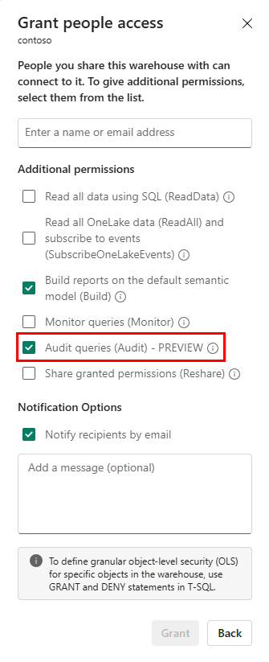

# 24. Fabric Platform integration: govern, observe and connect the Warehouse

[Book contents](../../index.md) | [Part IV contents](README.md) | [Previous: Chapter 23](23-storage-onelake-and-delta-log-publishing.md) | [Next: Chapter 25](25-query-processing.md)

**Applies to:** Fabric Warehouse platform integration; endpoint differences are identified. **Level:** 200. **Evidence review:** 10 October 2026. This chapter explains boundaries rather than granting access or enabling tenant settings.

## The engine is part of a service

The Warehouse architecture includes **Fabric Platform** as a building block because SQL execution alone is not a complete analytical service. A user must authenticate, discover an item and be authorized to use its data. Jobs and reports need supported connections. Operators need evidence, and governance teams need controls over sensitive information.

These responsibilities connect the Warehouse to OneLake, workspaces, capacity, Microsoft Entra identity, monitoring, auditing and other Fabric experiences. Integration reduces the need to assemble separate infrastructure, but it does not make every feature automatic or erase the permissions and data contracts between items.

The useful architectural question is therefore not just "Can Fabric connect these two boxes?" It is "Which identity uses which interface, to read which state, under which policy, and where can we observe the result?"

## Authentication and authorization have different jobs

Authentication establishes the caller. Authorization determines what that caller may do. The [Warehouse security guidance](https://learn.microsoft.com/en-us/fabric/data-warehouse/security) separates Fabric access from granular SQL permissions. Warehouse connectivity requires at least the relevant Fabric Read permission; that does not automatically authorize every table operation.

Workspace roles apply broadly across a collaboration area. Item permissions target an individual item. SQL permissions can provide a deliberately narrower interface through selected objects. Use the least privilege appropriate to the caller's real responsibility, not an administrator role simply because it makes a test succeed.

The Lakehouse SQL analytics endpoint introduces its own documented OneLake security modes. Do not assume that every Warehouse or endpoint uses an identical enforcement path. [Chapter 12](../02-building-analytical-solutions/12-security-and-governance.md) covers SQL governance and [Chapter 16](../03-sql-analytics-endpoint/16-onelake-security.md) follows identity through OneLake access.

## An integration has both a writer and a reader

| Integration | Architectural responsibility to make explicit |
| --- | --- |
| Data Factory loading a Warehouse | Source access, destination SQL authorization, transformation semantics and a restartable batch contract |
| Spark reading Warehouse data through OneLake | Compatible Delta reads, direct-storage permissions and external-publication visibility; not a new write path |
| Power BI consuming analytical data | Storage mode, semantic model, consumer identity and refresh or query behaviour |
| SQL clients and applications | Correct item/database, supported authentication, bounded result sizes and application retry semantics |
| Other Fabric services consuming shared data | Supported access route and data contract; common platform membership is not blanket compatibility |

Workspace identity is a useful example of why the distinction matters. For the documented `COPY INTO` path, it can authorize source access while the statement retains the caller's SQL context for destination permissions and attribution. One successful identity check does not imply that the other succeeded.

Likewise, a SQL row filter is not automatically applied to a different engine opening OneLake files. A shared storage foundation makes reuse possible; security must still cover every intended route.

## Monitoring is several instruments, not one universal log

The [monitoring overview](https://learn.microsoft.com/en-us/fabric/data-warehouse/monitoring-overview) distinguishes tools with different scopes. Live DMVs describe currently visible connections or requests. Query Insights records completed-query history and aggregates. Warehouse Monitor supplies an interactive view. Workspace monitoring supports cross-item investigation, including the documented `WarehouseExecutions` table. Capacity Metrics describes consumption at its own accounting boundaries.

Choose the instrument that answers the question. A historical view is not a live scheduler trace. CPU activity is not identical to elapsed time or exact per-query billing. Missing history immediately after a request does not prove that it never ran.

Observability also has privacy consequences. SQL text, user identities and query literals can contain sensitive information. Limit collection, destination access and retention. A read-only diagnostic is neither resource-free nor automatically safe to paste into a public issue.

[Chapter 29](../06-operating-the-platform/29-monitoring.md) gives the operational workflows; this chapter locates them in the architecture.

## Auditing is deliberate configuration

SQL auditing is not simply another name for query performance history. It records configured database activities for security and compliance purposes. The reviewed [SQL audit guidance](https://learn.microsoft.com/en-us/fabric/data-warehouse/sql-audit-logs) states that auditing is **off by default** and needs the appropriate permission and configuration.

*Documentation image D07. Microsoft, [SQL audit logs: permissions](https://learn.microsoft.com/en-us/fabric/data-warehouse/sql-audit-logs#permissions); [original image](https://learn.microsoft.com/en-us/fabric/data-warehouse/media/sql-audit-logs/grant-access-audit-queries.png). Unmodified; retrieved 10 October 2026; [CC BY 4.0](https://creativecommons.org/licenses/by/4.0/) under the [Fabric documentation licence](https://github.com/MicrosoftDocs/fabric-docs/blob/main/LICENSE). This is a public documentation example, not a recommendation to grant the displayed permissions indiscriminately.*

The documentation distinguishes configuring auditing, querying audit information through SQL, and accessing the stored `.XEL` files. A permission to query audit data does not automatically grant configuration authority or file access.

The published screenshot retains a Preview badge. It illustrates where the permission is presented, not a separately verified release-status statement; use the current feature guidance and your tenant's interface for implementation decisions.

Choose required events and retention deliberately. Predicate filtering excludes events before they are written, so excluded activity cannot later be recovered from that audit stream. The documentation also qualifies completeness under very high activity or network load: auditing prioritizes availability and can allow transactions to proceed without recording every configured event. Do not promise an infallible complete history without evaluating the documented limits and compliance requirements.

## Capacity is a shared operational boundary

A workspace's capacity association matters even when compute pools isolate some classes of SQL work. Platform-level accounting, admission and administrative changes can affect the solution. A schema deployment, a paused capacity or a workspace-wide acceleration change is not merely one developer's local preference.

Separate ownership of the model, load pipeline, permissions, semantic model, monitoring and capacity policy. A successful deployment of a SQL definition does not prove that all dependent identities, schedules and reader permissions have been reproduced in the destination.

The [automation chapter](../06-operating-the-platform/36-development-and-automation.md) turns those dependencies into a reviewed release process. The [capstone](../07-migration-and-production-design/42-production-capstone.md) combines them into an explicit production responsibility model.

## Safe exercise: complete an integration contract

**Prerequisites:** knowledge of the book's isolated Warehouse, Lakehouse and intended report consumer. No live permission or audit change is required.

Choose one path, such as a pipeline loading Warehouse data that a Power BI model consumes. Write down the source writer, load identity, destination permission, committed-batch marker, consumer identity, freshness observation, monitoring source and owner of a failed handoff.

Now add a notebook reading the same Warehouse through OneLake. Identify which permission and publication questions must be answered again rather than inherited from the successful SQL query. Finally state whether SQL audit is required and who may configure, read and retain its output.

The outcome is a small integration contract with explicit owners. No artifact is changed, so no cleanup is required. Platform integration becomes useful when these obligations are understood, not merely when the objects appear in the same workspace.

## References

1. Microsoft Learn, [Architecture of Fabric Data Warehouse](https://learn.microsoft.com/en-us/fabric/data-warehouse/architecture), Fabric Platform building block.
2. Microsoft Learn, [Secure your Fabric Data Warehouse](https://learn.microsoft.com/en-us/fabric/data-warehouse/security), reviewed 10 October 2026.
3. Microsoft Learn, [Ingest data into the Warehouse](https://learn.microsoft.com/en-us/fabric/data-warehouse/ingest-data), supported integration paths and workspace identity.
4. Microsoft Learn, [Monitoring overview](https://learn.microsoft.com/en-us/fabric/data-warehouse/monitoring-overview), reviewed 10 October 2026.
5. Microsoft Learn, [SQL audit logs](https://learn.microsoft.com/en-us/fabric/data-warehouse/sql-audit-logs) and [configure SQL audit logs](https://learn.microsoft.com/en-us/fabric/data-warehouse/configure-sql-audit-logs).

---

[Previous: Chapter 23](23-storage-onelake-and-delta-log-publishing.md) | [Book contents](../../index.md) | [Next: Chapter 25](25-query-processing.md)
