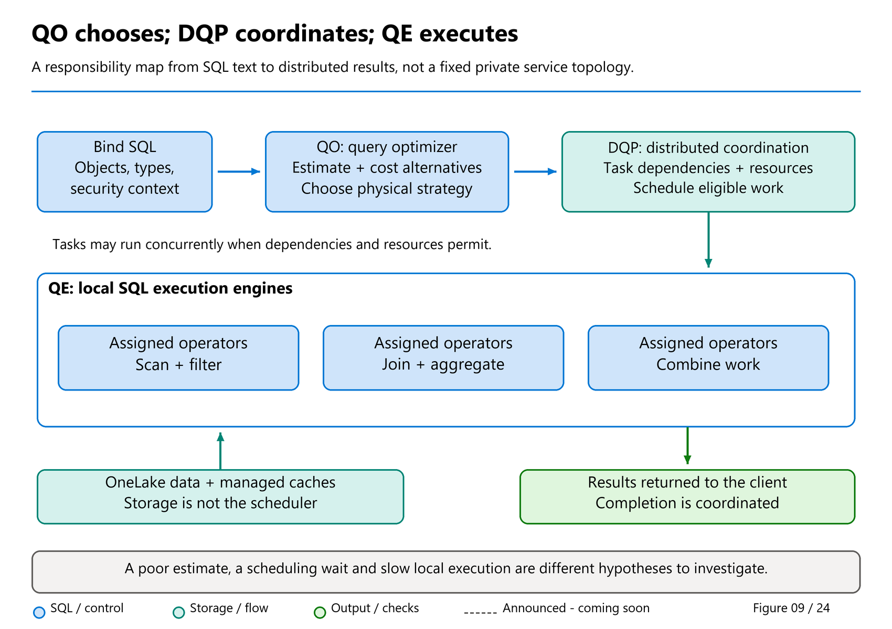

# 25. From SQL Text to Distributed Results

[Book contents](../../index.md) | [Part IV contents](README.md) | [Previous: Chapter 24](24-fabric-platform-integration.md) | [Next: Chapter 26](../05-statistics-and-performance/26-statistics.md)

**Applies to:** Fabric Warehouse and Lakehouse SQL analytics endpoint reads; Warehouse-specific write behavior is identified separately. **Level:** intermediate to advanced. **Scope:** public architecture and release evidence checked 9 October 2026. Example plan alternatives are explanatory, not captured tenant plans.

## A query has more than one kind of work

"The query took twelve seconds" is an observation, not a diagnosis. The interval can include connection setup, metadata work, compilation, statistics maintenance, resource scheduling, data access, relational processing, and result transfer. Some work overlaps; the stages are not necessarily a set of independent stopwatch intervals that can be added together.

This chapter follows those responsibilities without inventing a fixed private service topology. The current [architecture documentation](https://learn.microsoft.com/en-us/fabric/data-warehouse/architecture) describes a unified optimizer, distributed processing, SQL-based local execution, transaction and metadata management, and OneLake storage. Chapter 18 supplied the Polaris vocabulary; here we use it to reason about the SQL an application submits.

Read this as the synthesis of the preceding building-block chapters: the [architecture overview](17-warehouse-architecture.md), [unified optimizer](19-unified-query-optimizer.md), [distributed processing](20-distributed-query-processing.md), [local execution](21-query-execution-engine.md), [metadata and transactions](22-metadata-and-transaction-management.md), and [Fabric Platform integration](24-fabric-platform-integration.md). They explain individual responsibilities; this walkthrough follows their cooperation around one result. Storage publication and endpoint metadata sync remain separate freshness paths rather than two steps that every query must traverse.

The first goal is correctness. The second is to reduce unnecessary work. Only then should the discussion turn to hints or additional capacity. Faster execution of the wrong join is not optimization.

## Binding: find the objects and their meaning

Before choosing a join algorithm, the system must understand the statement: the referenced objects, columns, types, expressions, and security context. `book.FactSales` in `BookWarehouse` and the independently seeded `book.FactSales` in `BookLakehouse` are different objects, even when they initially contain the same six rows.

Always record the connection's database context. An endpoint ID, a Lakehouse item ID, a display name, and a SQL database context are not interchangeable identifiers. A query that resolves a similarly named table in the wrong item can succeed and return a plausible but incorrect result.

For a Lakehouse endpoint, binding depends on discovered SQL metadata. Query-triggered data refresh in the new metadata-sync preview does not remove every schema-discovery boundary. For a Warehouse query, internal transaction metadata determines the appropriate SQL view of managed data; asynchronous external Delta publication is not the mechanism through which the Warehouse waits to see its own committed writes.

Type choices also enter here. Comparing an integer key to a character expression can introduce conversion work and complicate estimation. Matching business-key types across related tables avoids unnecessary ambiguity. The core schema deliberately uses `int` for related dimension keys and `decimal(12,2)` for prices. That is a modeling decision supporting predictable semantics, not a promise that every expression remains at exactly that precision.

## Logical alternatives and a bounded search

SQL does not prescribe a loop order. A query joining three tables can often be evaluated through several logically equivalent join orders. Predicates can sometimes move closer to data access, and aggregations can sometimes be decomposed. Equivalence is constrained by semantics: nulls, duplicates, outer joins, data types, and nondeterministic expressions matter.

For example, placing a predicate on the nullable side of a left join in `WHERE` can eliminate the rows that the outer join was meant to preserve. Moving it into `ON` can change the answer. Similarly, replacing `UNION ALL` with `UNION` removes duplicate rows and adds duplicate-elimination work. A tuning change must preserve the intended relation before its runtime is compared.

The optimizer explores alternatives within practical time limits. Current Learn explicitly describes choosing a costed plan within the available optimization time, rather than proving a global mathematical optimum for every possible SQL statement. Costs depend on estimates of data volume and distribution and on the work each candidate requires.

Nicolas Bruno and coauthors' [Unified Query Optimization in the Fabric Data Warehouse](https://www.microsoft.com/en-us/research/publication/unified-query-optimization-in-the-fabric-data-warehouse/), June 2024, describes in its public abstract why optimization evolved beyond the earlier PDW approach. That chronology matters: the 2020 Polaris paper's compilation phases are historical architectural evidence, not a complete description of the current unified optimizer. This chapter does not infer unpublished rule sets or search heuristics from the abstract.

The full January 2024 [transaction-extension preprint](https://arxiv.org/pdf/2401.11162v1), section 3.3, provides additional published detail: it describes consolidating compilation in the SQL frontend and passing an optimized distributed plan to the distributed computation framework. The stated motivations include avoiding search-space serialization overhead and eliminating a separate backend compilation stage. This explains the direction of the architecture without asserting that the book can enumerate the current optimizer's transformations. A research description of compilation boundaries is not a client-visible guarantee about exactly where every future optimization will run.

## Physical alternatives: location, algorithm, and scale

Once a candidate has a relational shape, physical decisions remain. Where should its work execute? Which input builds a hash structure? Which data must move? Can a local aggregation reduce the volume before a global combine?

Consider a very large fact table and a small product dimension. Broadcasting the small input may cost less than redistributing the large fact input. But if a filter makes the fact side tiny, the trade-off can change. The relevant size is often the intermediate result *after applicable filters and projections*, not merely the base table's row count.

Projection affects this calculation. A million rows containing one integer are not the same payload as a million rows carrying several large strings. Selecting only necessary columns can reduce scan, memory, movement, and client-transfer work. Declaring every string `varchar(8000)` also conveys a different shape from a carefully chosen business length. Current [performance guidance](https://learn.microsoft.com/en-us/fabric/data-warehouse/guidelines-warehouse-performance) recommends appropriately sized strings and compatible comparison types.

Parallelism is not free. Coordination and movement have overhead, and certain result semantics require a final combine or ordering step. A small query may sensibly execute with limited parallelism. A global sort over an enormous result can concentrate work even when earlier scans run in parallel. "Distributed" does not mean every stage has unlimited scalability.

Therefore, a plan warning about a non-scalable operation is a starting point for investigation, not an instruction to attach a force-distributed hint to every statement. Check whether the query genuinely needs the large global operation and whether it can return a smaller result. Chapter 27 addresses supported plan inspection and deliberate hint testing.

## Cardinality connects SQL meaning to resource demand

Cardinality is the number of rows at a point in the plan. Estimating six output rows instead of six million can change the preferred join strategy and the expected memory demand. Estimating millions where only a few rows survive can also discourage a useful plan.

For the book's January facts, all six rows pass the date filter. In a five-year table, January 2026 may be a small subset. A plan choice for one case cannot be extrapolated to the other from identical SQL text alone.

Correlation makes estimation harder. Product category and product key are related, as are calendar year and date key. Independent single-column summaries do not fully encode every relationship between columns. That does not imply the optimizer is "ignoring the data"; it means a compact statistical model has limits. Chapter 26 explains supported histogram statistics and why blanket maintenance is not a cure for every estimation problem.

Declared constraints need equal care. The book assumes no enforced primary or foreign keys. If `DimProduct` contains duplicate keys, joining it to the fact table can multiply revenue. Do not add an unenforced uniqueness declaration simply to encourage a faster plan unless the data pipeline actually maintains that invariant.

## Runtime coordination: the Distributed Query Processor

The **query optimizer (QO)** chooses a physical strategy; the **Distributed Query Processor (DQP)** coordinates its distributed execution. Current [Fabric architecture documentation](https://learn.microsoft.com/en-us/fabric/data-warehouse/architecture), checked 8 October 2026, describes the distributed query processing engine assigning compute resources to plan tasks and scheduling work across nodes. The **local query execution engine (QE)** then performs the assigned scans, joins, filters, and aggregates using the SQL execution technology described earlier. Choosing a broadcast strategy, scheduling its work, and executing its local operators are related but different responsibilities.



*Figure 9 — Conceptual query lifecycle: QO chooses, DQP coordinates, QE executes.* The responsibilities can overlap in time; these boxes are not measured latency buckets or a private service-call map. When an execution slows, ask which responsibility the available evidence actually describes before changing SQL or capacity.

[Chapter 18's Polaris discussion](18-polaris.md) supplies the cells/tasks/DAG lineage. Cells describe input data units; tasks package executable work; the directed acyclic graph expresses dependencies between that work. A task requiring an upstream intermediate result cannot proceed merely because another node is idle. Conversely, independent work can become eligible concurrently. DQP coordination must account for both dependencies and available resources, not just traverse SQL clauses in textual order.

**Conceptual submission-to-results sequence, not a private service-call topology:**

1. Bind the submitted SQL and let QO select a costed distributed plan.
2. Represent executable work and its input/output dependencies through the task-graph model.
3. Assign resources and schedule eligible work; downstream work awaits the inputs its execution requires.
4. Execute assigned operators locally, producing intermediate data or result rows for their consumers.
5. Track completion and failures, release dependent work when appropriate, and assemble the result delivered to the client.

The public Polaris papers explain completion propagation and recoverable task failures; they do not establish a fixed current retry policy or scheduler algorithm. Nor does automatic scaling guarantee a particular node count, immediate admission, or zero coordination overhead. Operationally, a good plan can still experience runtime resource pressure. That is why comparing estimated relational work with observed scheduling and execution conditions is more useful than attributing every slow request to QO.

## Better shuffle and scheduling: separate the announcement from the mechanism

Tino Tereshko's [29 September roundup](https://www.linkedin.com/posts/valentinotereshko_speed-run-of-fabric-data-warehouse-announcements-activity-7510726240522293248-r4tC) describes better performance from better shuffle and scheduling. This is a qualitative announcement, not a published scheduler algorithm or a universal speedup. **Shuffle** concerns moving intermediate data to the places needed for distributed processing. **Scheduling** concerns when eligible work receives execution resources. Improving one does not remove the need for the other, and neither replaces QO's choice of a suitable plan.

There is a more specific, documented September improvement: **Distributed Bitmap Filters (GA)**. The [September feature summary](https://community.fabric.microsoft.com/blog/fbc_fabricupdatesblogs/fabric-september-2026-feature-summary/5325825) explains that selective fact/dimension joins can filter irrelevant rows before the join, reducing unnecessary data movement and resource requests. Picture a large sales fact table joined to a product dimension filtered to one category: eliminating nonmatching candidates before redistribution can leave less work for the exchange and join. The filter is an execution optimization, not a replacement for the join's correctness checks.

Distributed Bitmap Filters are one evidenced way to reduce pre-join movement; the sources do **not** establish that they explain every shuffle improvement in the roundup or constitute a complete shuffle rewrite. The summary's customer performance examples are vendor observations under particular conditions, not measurements of the book seed. A filter retaining nearly every row offers a different opportunity from one retaining a small subset.

A useful evaluation therefore asks two questions. **Did the query reduce rows or width before movement?** Examine the supported plan and representative execution evidence, remembering that storage-scan MB are not shuffle MB. **Did the same workload improve under contention?** Compare throughput, tail latency, pool pressure, and concurrency under matched conditions. A faster isolated run does not prove a scheduling improvement, and neither kind of engine improvement fixes a slow client downloading an unnecessarily large result.

## Runtime: avoid reading and moving what is not needed

Current Fabric documentation describes columnar batch execution and elimination of unnecessary columns and row groups. These mechanisms reduce work at different levels. Column elimination avoids fetching irrelevant attributes. Row-group elimination uses available metadata to skip groups that cannot satisfy a predicate. A residual filter still evaluates rows that reach an operator.

A selective predicate does not guarantee perfect skipping. If every row group contains the full range of dates, a date filter can match a few rows in every group while requiring many groups to be examined. Physical organization and predicate selectivity are related but distinct. Chapter 28 develops that storage-layout discussion.

Caching introduces another distinction. [Memory and disk caching](https://learn.microsoft.com/en-us/fabric/data-warehouse/caching) are transparent, managed features. Data can be served from memory, local SSD, or remote OneLake. A second execution can therefore do less remote work without a different SQL statement or relational plan. Result-set caching is a separate feature; a warm data cache is not proof that a complete prior answer was reused.

Caching also does not authorize stale business results. The documented cache design preserves transactional consistency. If an endpoint misses a newly written Lakehouse batch, investigate the freshness boundary rather than assuming "SQL caches stale rows."

## Worked lab: aggregate at the business grain

**Prerequisites:** the Chapter 4 Warehouse seed, read access, and a SQL editor connected to `BookWarehouse`. The same read-only exercise can be repeated against the independently seeded Lakehouse endpoint once metadata sync is complete. It creates no persistent objects and requires no cleanup. Queries still consume capacity and can trigger automatic statistics.

**Runnable T-SQL; execute against the seeded item.** This version expresses the business result directly:

```sql
SELECT
    p.Category,
    SUM(f.Quantity * f.UnitPrice) AS Revenue
FROM book.FactSales AS f
JOIN book.DimProduct AS p
    ON p.ProductKey = f.ProductKey
JOIN book.DimDate AS d
    ON d.DateKey = f.DateKey
WHERE d.CalendarYear = 2026
  AND d.CalendarMonth = 1
GROUP BY p.Category
ORDER BY p.Category;
```

Expected category revenue is Electronics `100.00`, Home `75.00`, Stationery `30.00`, and Travel `160.00`, totaling `365.00`. Now express an alternative that first summarizes each product's January sales.

**Runnable T-SQL; same connection and read-only effects:**

```sql
WITH ProductRevenue AS
(
    SELECT
        f.ProductKey,
        SUM(f.Quantity * f.UnitPrice) AS Revenue
    FROM book.FactSales AS f
    JOIN book.DimDate AS d
        ON d.DateKey = f.DateKey
    WHERE d.CalendarYear = 2026
      AND d.CalendarMonth = 1
    GROUP BY f.ProductKey
)
SELECT
    p.Category,
    SUM(r.Revenue) AS Revenue
FROM ProductRevenue AS r
JOIN book.DimProduct AS p
    ON p.ProductKey = r.ProductKey
GROUP BY p.Category
ORDER BY p.Category;
```

The expected answer is identical for the seed. The common table expression is not a command to materialize a temporary table. The optimizer can transform the expression, so different-looking SQL can produce similar physical work. Do not label the second version faster without observing a representative workload.

The useful exercise is to identify why reaggregation is valid here. Revenue is additive at the chosen product grain. By contrast, averaging product averages would not generally produce the overall average unit price: differently sized groups require weighting. Likewise, distinct customer counts cannot generally be added across overlapping product groups.

Now reason about a realistic scale-up on paper. If millions of fact rows collapse to thousands of product totals before a later operation, reducing the intermediate width and row count could matter. If almost every fact has a distinct product, the reduction is smaller. If category assignment changes historically, a simple current-product join may be the wrong business model altogether.

The lab therefore produces three artifacts: verified results, an explanation of the aggregation grain, and a hypothesis about intermediate data volume. It does not produce a benchmark.

## From a hypothesis to evidence

For a real performance comparison, keep the input snapshot, SQL semantics, security context, client behavior, and concurrency conditions as similar as practical. Record multiple executions, including the first execution, instead of deleting inconvenient slow results.

Separate cold and warm behavior. The first query can include statistics creation and remote reads; later runs may benefit from already created statistics and populated caches. These are legitimate workload effects. Whether they should dominate a decision depends on whether production queries run frequently or after long idle periods.

[Query Insights](https://learn.microsoft.com/en-us/fabric/data-warehouse/query-insights) supplies completed-request history, CPU and scan information, and other diagnostics. It retains thirty days, excludes system queries, and can take up to fifteen minutes to expose completed queries depending on workload. A missing row immediately after execution is therefore not proof that the query never ran.

Scan figures do not fully measure intermediate data movement. A query can scan modest source data and still create a large join intermediate. Likewise, allocated CPU time is not a direct statement of end-to-end latency or exact capacity billing. Chapters 29 and 31 handle those measurements in their proper context.

Result transfer deserves its own check. A client requesting every fact row, sorting them, and then calculating twelve monthly totals has designed a different workload from a server-side monthly aggregate. Faster networking may hide the inefficiency for a while, but moving the aggregation to SQL usually addresses the actual requirement more directly.

## A practical decision order

When a query is slow, first confirm its answer and grain. Next identify avoidable rows and columns, compatible types, and accidental row multiplication. Check statistics and freshness separately. Inspect the supported plan and runtime evidence, then investigate storage layout, cache effects, and concurrent pressure. Only after those steps should hints or capacity changes be evaluated against explicit success criteria.

This order is not a claim that capacity never matters. It prevents using a larger capacity to mask a semantic or data-shape error that will grow with the business.

## Key takeaways

- SQL text describes an answer; the engine selects distributed physical work.
- Estimates, intermediate row width, and data movement matter alongside scan volume.
- Equivalent SQL can produce similar plans; changed semantics can produce misleading speedups.
- Measure representative behavior before declaring an optimization successful.

## References

1. Microsoft Learn, [Architecture of Fabric Data Warehouse](https://learn.microsoft.com/en-us/fabric/data-warehouse/architecture), dated 14 January 2026; checked 8 October 2026.
2. Nicolas Bruno and coauthors, [Unified Query Optimization in the Fabric Data Warehouse](https://www.microsoft.com/en-us/research/publication/unified-query-optimization-in-the-fabric-data-warehouse/), June 2024; public abstract.
3. Microsoft Learn, [Performance guidelines](https://learn.microsoft.com/en-us/fabric/data-warehouse/guidelines-warehouse-performance), dated 15 June 2026; updated 2 September 2026.
4. Microsoft Learn, [Memory and disk caching](https://learn.microsoft.com/en-us/fabric/data-warehouse/caching), dated 11 June 2025.
5. Microsoft Learn, [Query Insights](https://learn.microsoft.com/en-us/fabric/data-warehouse/query-insights), dated 24 August 2026.
6. Aguilar-Saborit, Ramakrishnan, and coauthors, [Extending Polaris to Support Transactions](https://arxiv.org/pdf/2401.11162v1), 20 January 2024, section 3.3; full preprint read.

---

[Previous: Chapter 24](24-fabric-platform-integration.md) | [Book contents](../../index.md) | [Next: Chapter 26](../05-statistics-and-performance/26-statistics.md)
