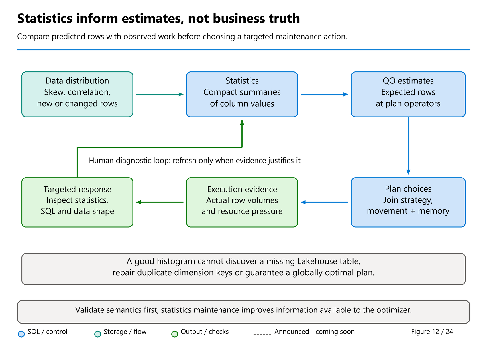

# 26. Statistics: Estimates, Maintenance, and Safe Inspection

[Book contents](../../index.md) | [Part V contents](README.md) | [Previous: Chapter 25](../04-how-the-engine-works/25-query-processing.md) | [Next: Chapter 27](27-query-plans-and-tuning.md)

**Applies to:** Fabric Warehouse and SQL analytics endpoint statistics; the write-based lab uses Warehouse only. **Level:** intermediate to advanced. **Scope:** original exercises checked 8 October 2026; automatic-statistics guidance rechecked 9 November, including the 29 October cardinality clarification. Manual histogram statistics are single-column; automatic, proactive, and incremental behavior is managed by the service.

## Statistics predict work, not truth

The optimizer needs a practical model of the data before it executes the full query. How many rows are likely to survive `CountryCode = 'GB'`? How many facts match a date range? How wide is an intermediate result? Statistics provide compact information used to estimate those costs.

They do not define the committed contents of a table. A statistic cannot make an uncommitted row visible or repair a stale SQL endpoint catalog. Conversely, a perfectly fresh query result can be produced through a poor plan because estimates were inaccurate. Keep freshness, correctness, and efficiency as separate diagnostic questions.



*Figure 12 — Conceptual statistics investigation loop.* Compare estimates and observed behavior, then decide whether statistics work addresses the cause. This is an operator's evidence loop, not a claim that every query automatically trains a new optimizer model or that every data change requires manual maintenance.

The current [statistics documentation](https://learn.microsoft.com/en-us/fabric/data-warehouse/statistics) supports manually created, updated, and dropped **single-column histogram statistics**, along with automatic statistics created or refreshed at query time. It explicitly does not support manually creating multicolumn statistics. Familiar SQL Server maintenance scripts therefore need review, not merely a changed connection string.

## What a histogram can tell the optimizer

A histogram summarizes the distribution of values in one column. It helps distinguish a common value from an uncommon one and estimate the number of rows falling within a range. The summary is not a row-by-row copy of the column, and a sampled statistic is not a perfect census.

In the core sample, `DimCustomer.CountryCode` has two GB customers and one DE customer. That does not imply two thirds of all fact revenue belongs to GB. Customers can have different numbers of sales and different prices. A histogram on a customer attribute and a histogram on a fact key are pieces of an estimation problem, not a complete model of business correlation.

At production scale, skew makes these distinctions more important. A newly onboarded customer might account for a large share of recent facts. A date column might grow continually beyond the previous observed range. A table with a stable row count might undergo substantial value redistribution through updates. Row count alone is therefore insufficient for deciding whether a statistic still describes the workload.

Nor does age alone prove a problem. A year-old statistic on a truly unchanged reference table may be appropriate. A statistic created this morning can become unrepresentative after a major load. Maintenance should respond to consequential data changes and query evidence, not an arbitrary birthday.

## Automatic statistics and the first-query effect

Fabric can create needed statistics when the optimizer requests them and refresh relevant statistics when they no longer adequately represent changed data. Learn states that these automatic operations occur synchronously: the triggering query's duration includes that work.

That means a read-only business query can cause managed statistics work. "We only issued SELECT" does not imply zero metadata maintenance or negligible resource consumption. It also explains why a first execution and an immediate repeat are not necessarily comparable experiments.

Automatic statistics are not limited to histograms. The documented categories include `_WA_Sys_` histogram statistics, `ACE-AverageColumnLength_` statistics for qualifying variable-character columns, and `ACE-Cardinality` table row-count estimates. The latter two are not user-actionable histogram objects, and their contents cannot be inspected through `DBCC SHOW_STATISTICS` in the same way.

The 29 October documentation clarification says `ACE-Cardinality` is created **only when other row-count metadata is unavailable**. It is not an obligatory catalog object for every table. Its absence alone therefore does not establish missing statistics or justify manufacturing a replacement.

The existence of a row in `sys.stats` is therefore not enough to justify an `UPDATE STATISTICS` command for it. Identify the type and supported operation. Learn also notes that other objects can appear in the catalog without being used for query optimization. Treat names as documented clues combined with catalog flags, not a universal rule that every object must be rebuilt.

## Proactive and incremental are different optimizations

**Proactive refresh** attempts to perform automatic histogram refresh work after data changes, before a later SELECT needs it during plan generation. It is enabled by default according to current Learn and targets system-generated `_WA_Sys_` histograms. It does not promise that every statistic is already fresh when every query arrives.

**Incremental refresh** reduces work when eligible automatic column-statistics updates can sample newly added rows and combine the information with an existing histogram. Learn identifies larger, mostly insert-oriented tables as typical beneficiaries. The engine decides whether the faster method is applicable.

These features solve different problems: proactive refresh changes *when* work may happen; incremental refresh changes *how much* work may be required. Neither abolishes synchronous query-time updates. Neither means a manual user-created statistic is automatically covered by every proactive optimization.

The product-team account by **emily_msft**, [Proactive and incremental statistics refresh for Fabric Data Warehouse and SQL Analytics Endpoint](https://community.fabric.microsoft.com/blog/fbc_fabricupdatesblogs/proactive-and-incremental-statistics-refresh-for-fabric-data-warehouse-and-sql-a/5172204), **19 March 2026**, describes optimizations released the preceding December, not a new preview. Its practical scenario is the load-to-report transition: detect staleness after ingestion, then reduce the sampling work where incremental refresh is eligible. That combination can shorten the report's critical path without asking the author to schedule a blanket full scan.

The post reports that, as of March 2026, 90% of workspaces had halved statistics updates during query compilation. That is a dated vendor observation about maintenance during compilation, **not** a claim that all queries run twice as fast or consume half the capacity. Its own workload-dependence caveat supports measuring your ingestion pattern and report latency rather than budgeting from that percentage. Current Learn still allows synchronous refresh when needed.

They also do not expose the familiar SQL Server partition-statistics maintenance contract by implication. Do not import `INCREMENTAL = ON` recipes simply because the Fabric documentation uses the word incremental. Supported Fabric syntax and current service behavior are the authority.

## Inspect before changing

Begin with the actual table and workload columns. For `book.FactSales`, date and join keys are reasonable investigation targets. `SalesKey` may matter for a lookup or reconciliation workload but is not automatically the priority for a monthly revenue aggregate. A wide unused description column is less compelling than a frequently filtered date.

**Runnable read-only T-SQL; execute against the seeded Warehouse or Lakehouse endpoint.** This reports catalog information without updating statistics:

```sql
SELECT
    s.name AS StatisticName,
    c.name AS ColumnName,
    s.auto_created,
    s.user_created,
    STATS_DATE(s.object_id, s.stats_id) AS LastUpdatedUtc
FROM sys.stats AS s
LEFT JOIN sys.stats_columns AS sc
    ON sc.object_id = s.object_id
   AND sc.stats_id = s.stats_id
LEFT JOIN sys.columns AS c
    ON c.object_id = sc.object_id
   AND c.column_id = sc.column_id
WHERE s.object_id = OBJECT_ID(N'book.FactSales')
ORDER BY s.name, sc.stats_column_id;
```

This adapts the catalog-inspection pattern in [Microsoft Learn's statistics article](https://learn.microsoft.com/en-us/fabric/data-warehouse/statistics), dated 10 December 2025, with exact object scoping and a smaller projection. A missing timestamp can reflect metadata visibility or absent information; it is not a numerical "age zero" value. A missing row does not prove a future query cannot run: automatic statistics may be created when needed.

Next, identify an actionable histogram and inspect it with `DBCC SHOW_STATISTICS`. Compare its update time and distribution information with the load history and the query's predicate. The goal is to establish a plausible estimation problem before selecting a maintenance action.

## From broad gist to reviewable DDL

Mark Pryce-Maher's [createstats.sql](https://gist.github.com/MarkPryceMaherMSFT/169461e2d381d99983f75e4980aca381), [pinned revision](https://gist.github.com/MarkPryceMaherMSFT/169461e2d381d99983f75e4980aca381/63180821e31cb7252a58ebf0c37230ee15e3ced8) of 29 May 2025, demonstrates catalog-driven DDL generation. His [update_indexes.sql](https://gist.github.com/MarkPryceMaherMSFT/5ab531c2964243bac287bb91a52c09ad), [pinned revision](https://gist.github.com/MarkPryceMaherMSFT/5ab531c2964243bac287bb91a52c09ad/0af570a203d55cbf139cefa63794175346ed5dae) of 18 March 2026, updates statistics despite its filename. It is not index maintenance.

These are useful teaching sources, not safe unchanged defaults. The create script iterates by `column_id`, which can have gaps and repeats across tables, while keeping a statement variable whose previous value can survive a nonmatching iteration. It also uses positional inserts with schema/table ordering problems. The update script broadly executes `FULLSCAN` and prints caught failures instead of propagating them to an orchestrator.

The book's [26-statistics-preview.sql](../../scripts/26-statistics-preview.sql) replaces that execution behavior with a set-based, **read-only DDL preview**. It targets exactly `book.FactSales` and three selected workload columns, quotes identifiers, chooses at most one actionable single-column histogram per column, excludes nonactionable system categories, and returns candidate statements as data.

The preview does not automatically execute its output. It does not include `FULLSCAN`. A row recommending review of an existing histogram does not mean that histogram is stale. A proposed CREATE does not mean automatic creation would be insufficient. If a generated name collides with an existing statistic outside the selected actionable set, the candidate DDL is null rather than silently targeting something else.

This design turns a maintenance script into an engineering decision aid. Before applying any candidate, confirm the object, column, expected benefit, permissions, workload window, and validation query. Catalog state can change between preview and execution; the preview is not a lock or a deployment transaction.

## Lab: one controlled histogram

**Prerequisites:** the Chapter 4 `BookWarehouse`, permission to create a lab table and manage its statistics, and no existing `book.Lab16Statistics`. This lab copies only the six synthetic fact rows. It must run on Warehouse, not against read-only Lakehouse source tables.

**Runnable T-SQL; execute in BookWarehouse.** It creates a distinctly named lab table and intentionally fails rather than overwriting an existing object:

```sql
CREATE TABLE book.Lab16Statistics
AS
SELECT SalesKey, DateKey, CustomerKey, ProductKey,
       Quantity, UnitPrice, LastModifiedUtc
FROM book.FactSales;

CREATE STATISTICS Lab16_DateKey
ON book.Lab16Statistics (DateKey)
WITH FULLSCAN;

DBCC SHOW_STATISTICS ('book.Lab16Statistics', 'Lab16_DateKey');
```

The `FULLSCAN` here is deliberate and safe only because the isolated table contains six synthetic rows. It makes the teaching example easy to inspect; it is not the production recommendation embedded in the preview script.

Expected outcomes are a new lab table and an inspectable histogram over three date values. There are two seed rows on each date. Inspect the statistics header and histogram rather than expecting the catalog to contain exactly one statistics object: automatic work may create additional objects.

Now append two synthetic rows to the lab table only. They intentionally reuse the sample's descriptive keys without relying on enforced constraints.

**Runnable T-SQL; writes only book.Lab16Statistics, then explicitly refreshes its named histogram:**

```sql
INSERT INTO book.Lab16Statistics
    (SalesKey, DateKey, CustomerKey, ProductKey,
     Quantity, UnitPrice, LastModifiedUtc)
VALUES
    (16001, 20260201, 1, 10, 1, 25.00, '2026-02-02T00:00:00'),
    (16002, 20260201, 1, 10, 2, 25.00, '2026-02-02T00:00:00');

UPDATE STATISTICS book.Lab16Statistics (Lab16_DateKey)
WITH FULLSCAN;

DBCC SHOW_STATISTICS ('book.Lab16Statistics', 'Lab16_DateKey')
WITH HISTOGRAM;
```

The expected data count is eight, with two rows at the new date key. The lab intentionally lacks a date-dimension join; adding a foreign business key to this isolated copy does not extend the core `DimDate`. Inspecting the revised histogram demonstrates manual refresh, not the threshold at which automatic or proactive work would have fired.

For read-only confirmation, run:

```sql
SELECT DateKey, COUNT_BIG(*) AS RowsPerDate
FROM book.Lab16Statistics
GROUP BY DateKey
ORDER BY DateKey;
```

**Runnable cleanup T-SQL; removes only the isolated lab table and its statistics.** Verify the name before execution:

```sql
DROP TABLE book.Lab16Statistics;
```

The six-row core data remains unchanged. These statements were reviewed against the public syntax and intended outcomes, not executed against a Fabric tenant.

## Choosing a production intervention

Start with a concrete symptom: a known query regressed after a substantial distribution change, and plan evidence suggests an estimation problem. Identify the relevant columns and inspect existing statistics. A targeted update during the gap between loading and reporting can move necessary work out of the report's critical path.

A full scan reads more than a sampled update and can compete with business work. It should be justified by the data distribution, observed estimation quality, and maintenance budget, not chosen because it sounds more complete. More exact statistics do not guarantee a better plan, particularly where correlations, skewed execution, or incorrect SQL dominate.

After intervention, compare correctness, plan shape, and several representative executions. Preserve workload and cache context. A faster second run may reflect warmer data, not the statistics change. A large nightly sweep that merely shifts cost into a different time window should be evaluated against its total consumption and operational benefit.

There is also a documented transaction caveat. If data is inserted into an empty Warehouse table, selected, and then rolled back, automatically generated statistics can retain information reflecting the rolled-back data. The [transaction documentation](https://learn.microsoft.com/en-us/fabric/data-warehouse/transactions) recommends updating statistics for columns used by those SELECTs after a large rolled-back insert. That is a targeted recovery case, not a reason to refresh every table after every transaction.

Finally, statistics are only one layer of metadata. Parquet row-group summaries, Delta-log file statistics, SQL optimizer histograms, and endpoint synchronization positions are related to data but serve different purposes. An endpoint refresh is not a statistics-maintenance policy; a statistics update is not a storage compaction command.

## Key takeaways

- Statistics estimate work; they do not establish transactional or endpoint freshness.
- Automatic maintenance can contribute to query latency despite proactive and incremental optimizations.
- Inspect and target supported single-column histograms; do not update every catalog object.
- Preview DDL, justify expensive scans, and validate the actual workload afterward.

## References

1. Microsoft Learn, [Statistics in Fabric Data Warehouse](https://learn.microsoft.com/en-us/fabric/data-warehouse/statistics), dated 10 December 2025; checked 8 October 2026.
2. Microsoft Learn, [Performance guidelines](https://learn.microsoft.com/en-us/fabric/data-warehouse/guidelines-warehouse-performance), dated 15 June 2026.
3. Microsoft Learn, [Transactions in Fabric Data Warehouse](https://learn.microsoft.com/en-us/fabric/data-warehouse/transactions), dated 3 June 2026.
4. Mark Pryce-Maher, [createstats.sql, pinned revision](https://gist.github.com/MarkPryceMaherMSFT/169461e2d381d99983f75e4980aca381/63180821e31cb7252a58ebf0c37230ee15e3ced8), 29 May 2025; adaptation authorized by the user.
5. Mark Pryce-Maher, [update_indexes.sql, pinned revision](https://gist.github.com/MarkPryceMaherMSFT/5ab531c2964243bac287bb91a52c09ad/0af570a203d55cbf139cefa63794175346ed5dae), 18 March 2026; adaptation authorized by the user.
6. emily_msft, [Proactive and incremental statistics refresh for Fabric Data Warehouse and SQL Analytics Endpoint](https://community.fabric.microsoft.com/blog/fbc_fabricupdatesblogs/proactive-and-incremental-statistics-refresh-for-fabric-data-warehouse-and-sql-a/5172204), 19 March 2026; checked 8 October 2026.

---

[Previous: Chapter 25](../04-how-the-engine-works/25-query-processing.md) | [Book contents](../../index.md) | [Next: Chapter 27](27-query-plans-and-tuning.md)
