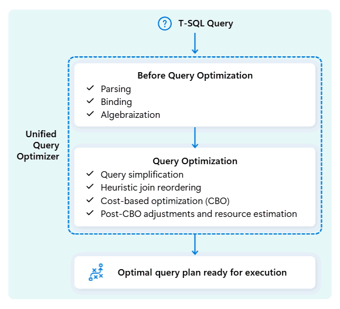

# 27. Query Plans and Evidence-Led Tuning

[Book contents](../../index.md) | [Part V contents](README.md) | [Previous: Chapter 26](26-statistics.md) | [Next: Chapter 28](28-layout-caching-and-maintenance.md)

**Applies to:** Fabric Warehouse and Lakehouse SQL analytics endpoint, except where stated. **Level:** Intermediate to advanced. **Feature baseline:** original estimated-plan/history exercises 8 October 2026; the blog-grounded AI-review extension checked 9 November. AI functions remain optional **preview** and are not required for the core tuning lab.

## Start with a question, not a hint

A slow query is an observation, not a diagnosis. A report might wait while its SQL statement compiles, while distributed work runs, while another transaction holds an incompatible lock, or while millions of result rows travel to a client. These cases can present the same spinning indicator. Changing a join hint before distinguishing them is an experiment without a hypothesis.

Begin with the outcome the workload needs. An interactive report values predictable response time and a small result. An overnight reconciliation might accept a longer individual execution if it improves throughput across the entire batch. An export is not finished when the server produces its first row: delivery, serialization, network transfer, client decoding, and the destination write are part of its useful completion time. Record these boundaries separately where the client exposes them.

Fabric's [performance guidance][1] recommends investigating statistics, data types, result sizes, caching, and physical layout before reaching for hints. The order matters. A hint can change the plan while leaving the actual problem untouched. A faster count query, for example, does not prove that a full-detail export is faster.



*Documentation image D02, reused. Microsoft, [Unified query optimizer](https://learn.microsoft.com/en-us/fabric/data-warehouse/architecture#unified-query-optimizer-engine); [original image](https://learn.microsoft.com/en-us/fabric/data-warehouse/media/architecture/unified-query-optimizer.png). Original bytes retained from 10 October 2026 under [CC BY 4.0](https://creativecommons.org/licenses/by/4.0/) and the [Fabric documentation licence](https://github.com/MicrosoftDocs/fabric-docs/blob/027f3393ea91f32358258cb058fd466141f79db8/LICENSE). This is an architectural illustration, not the actual estimated or executed plan for a book query.*

## What an estimated plan can tell you

An estimated plan describes the optimizer's proposed way to answer a statement. It can reveal join order, filtering, aggregation, estimated row counts, and operations that consolidate parallel work. It is not a stopwatch recording the eventual run. Its relative costs are optimizer estimates, not capacity charges or guaranteed percentages of elapsed time.

Use `SHOWPLAN_XML` to obtain a plan without executing the target statement. Microsoft documents this for both Fabric SQL surfaces [2]. The account needs permission for the underlying statement and the required SHOWPLAN permissions. Tool support also matters: the following uses SSMS batch separators, not a single string to send unchanged through a database driver.

**Runnable listing.** Execute in SSMS connected to `BookWarehouse`, after Chapter 4's seed exists. This changes only the session's SHOWPLAN setting and returns estimated-plan XML; it does not execute the SELECT or modify data. Keep the same connection and execute the final OFF batch even if inspection fails.

```sql
SET SHOWPLAN_XML ON;
GO
SELECT c.CountryCode,
       SUM(f.Quantity * f.UnitPrice) AS Revenue
FROM book.FactSales AS f
JOIN book.DimCustomer AS c
  ON c.CustomerKey = f.CustomerKey
WHERE f.DateKey >= 20260101
  AND f.DateKey < 20260201
GROUP BY c.CountryCode;
GO
SET SHOWPLAN_XML OFF;
GO
```

Read the plan from its inputs toward the final result. Ask where rows are removed, where their width increases, and where results must meet. Do not assume every familiar SQL Server operator has identical distributed implementation details in Fabric. Nor should a missing SQL Server DMV be replaced with an invented Fabric equivalent. The supported estimated plan and observed request history already answer useful questions.

Keep the plan format separate from its viewing tool. The [September 2026 feature summary](https://community.fabric.microsoft.com/blog/fbc_fabricupdatesblogs/fabric-september-2026-feature-summary/5325825), checked for this revision on 9 October, places the Fabric editor's **Estimated Graphical Query Plan** under **Coming Soon**. Existing `SHOWPLAN_XML` and inspection through a supported client do not depend on that future portal experience. A friendlier diagram will make estimates easier to explore; it will not turn them into actual row counts, elapsed timings, or CU charges.

An unexpectedly large join output is especially important. Before blaming estimation, check the data. This book's keys are not enforced uniqueness guarantees. Two customer rows with the same key can multiply fact rows and revenue. Adding `DISTINCT` might hide the symptom while introducing additional work and changing the business result. The right correction is to establish the intended relationship and repair or deliberately model duplicates.

## Reduce work while preserving meaning

Columnar storage makes column selection a physical decision as well as a style preference. Returning eight useful fields instead of eighty can reduce scan work, intermediate row width, and result-transfer volume. Applying a selective predicate inside SQL avoids sending rows that the client immediately discards. Aggregating before transfer can turn a large fact scan into a small, useful answer.

Avoid wrapping a filter column in a function merely to express a range that its native type already represents. For a valid integer `YYYYMMDD` key, a January range can be expressed with integer bounds rather than string conversion. This gives the optimizer a more direct predicate. It is an opportunity, not a promise of a particular plan: simplification, statistics, selectivity, and data layout still determine the outcome.

**Runnable listing.** Execute in either seeded book item, with SELECT permission. Both statements read data only. The first is the comparison baseline; the second is the candidate. Equivalence depends on the documented `DateKey` convention, not on arbitrary integers.

```sql
SELECT SUM(Quantity * UnitPrice) AS Revenue
FROM book.FactSales
WHERE CONVERT(varchar(8), DateKey) LIKE '202601%'
OPTION (LABEL = 'book17_conversion');

SELECT SUM(Quantity * UnitPrice) AS Revenue
FROM book.FactSales
WHERE DateKey >= 20260101
  AND DateKey < 20260201
OPTION (LABEL = 'book17_range');
```

Both should return `365.00` for the untouched seed. That establishes correctness, not speed. With six rows, fixed request overhead and measurement noise can dominate. The example does not prove that removing one conversion materially improves a production workload.

For joins, examine both type compatibility and cardinality. Casting a fact-side key on every row can add work and complicate estimation. Correctly aligning types upstream may be better than repeatedly converting them at query time. Conversely, narrowing a type without validating its domain can truncate or reject data. A performance change that corrupts the answer is not an optimization.

## A worked investigation: the daily sales report

Suppose a synthetic reporting team says its country summary slowed after a new extract was scheduled. There are at least three plausible explanations: the report's plan became worse, the workload became busier, or the report now returns substantially more data. Do not assume the newest SQL edit caused the regression.

First identify the exact report execution, its connected item, UTC window, label, status, and query hash. The same SQL submitted through another database connection has history in that connected item's context. Use the live-request query from Chapter 29 while it runs, then its completed history after the collection delay.

Next compare like with like. A query hash groups similar statement shapes, but different date ranges can process radically different volumes. Compare January with another January-sized range before comparing it with five years. Split successful and canceled executions. Include result-cache status: a result-cache hit and a full execution are not interchangeable observations.

Third inspect the plan for unnecessary projection, late filtering, and cardinality mistakes. Check statistics using Chapter 26 rather than immediately issuing blanket `FULLSCAN` maintenance. On a Lakehouse endpoint, include the source file layout in the investigation; the endpoint cannot rewrite those files through ordinary T-SQL.

Finally vary one thing. If the candidate predicate reduces scan volume under comparable conditions, that supports the hypothesis that it enables less work. If scans and CPU are similar but elapsed time rises only during the extract, inspect concurrency and pool-pressure observations. If the server finishes acceptably but the application continues downloading, investigate output size and the client's consumption path.

The [history comparison script](../../scripts/29-query-history.sql) uses the explicit-column approach in Mark Pryce-Maher's March 2026 `exec_requests_history.sql` gist [4]. Its important improvement is restraint: bounded time and row limits, documented columns, and no assumption that every field seen in a demonstration is a stable contract. The gist's `error_severity` and `error_state` are deliberately not required by the book's queries.

## Interpret runtime evidence carefully

`total_elapsed_time_ms` and `allocated_cpu_time_ms` measure different things [3]. Distributed CPU allocation can accumulate across parallel work and therefore need not equal wall-clock duration. CPU is useful for comparing work; it is not a monetary bill. Capacity allocation, background work, and billing rules are treated separately in Chapters 31 and 32.

Remote, memory, and disk scan counters distinguish where recorded reads came from. They do not provide a full ledger of every byte shuffled between intermediate operators. A plan that repeatedly moves a wide intermediate result can be expensive without an equally dramatic increase in the recorded input scan. Zero remote reads is not proof of zero work.

Result transfer deserves its own experiment. Compare the real client's time to first row and last row, returned row count, projected width, and destination write time. Keep compression, connection path, and fetch behavior consistent. Replacing an export with `COUNT_BIG(*)` can help isolate server-side scanning, but it changes the workload and cannot serve as the export's acceptance test. Likewise, wrapping the query in CTAS replaces transfer with a distributed write and introduces another variable.

Mark's history analytics repository ranks both total CPU and total query time [5]. These answer different prioritization questions. A moderately expensive query repeated thousands of times may offer more overall benefit than one spectacularly slow but rarely used query. Grouping by shape should therefore accompany, not replace, individual-execution inspection.

## AI-assisted review is a hypothesis generator

Mark Pryce-Maher's **21 August 2026** [Need a hand tuning your Fabric DW/SQL analytics endpoint?](https://medium.com/@sqltidy/need-a-hand-tuning-your-fabric-dw-sql-analytics-endpoint-45eac88885b9) proposes using `AI_GENERATE_RESPONSE` to review query text and `AI_EXTRACT` to identify referenced tables/predicates. The article explicitly thanks **Jovan Popovic for the scripts**. Preserve that contribution distinction: Mark supplies the practical explanation, and the original scripts are credited to Jovan.

The [current analytical-SQL AI guide](https://learn.microsoft.com/en-us/fabric/data-warehouse/ai-functions) confirms **preview** support for Warehouse and SQL analytics endpoint. It requires the Copilot/Azure OpenAI tenant setting, supported-region and applicable cross-geo configuration, and paid F2-or-higher or qualifying P capacity. These functions call an AI service: a SELECT can transfer supplied text and incur processing costs without writing a fact table.

Do not begin by sending every command from a production history window to a model. Query text can contain customer data, literals and sensitive object names. Select a bounded approved sample, minimize or remove sensitive content, record the source execution separately, and obtain the appropriate data-processing approval. An AI-extracted table list is not a SQL parser/binder or proof of complete dependency discovery.

**Optional illustrative preview T-SQL - Warehouse or SQL endpoint, only after those prerequisites are approved.** This sends one short **synthetic query string**, not actual history or business rows, to the built-in AI service. The quoted business SELECT is not executed by this listing. No table is created or modified.

```sql
SELECT AI_GENERATE_RESPONSE(
    'Review this synthetic analytical query. Return diagnostic questions '
    + 'and a testable hypothesis, not a claim of optimal performance.',
    'SELECT SUM(Quantity * UnitPrice) FROM book.FactSales '
    + 'WHERE DateKey >= 20260101 AND DateKey < 20260201;'
    ERROR ON ERROR
) AS ReviewSuggestion;
```

The [function reference](https://learn.microsoft.com/en-us/sql/t-sql/functions/ai-generate-response-transact-sql?view=fabric&preserve-view=true) documents `ERROR ON ERROR`, which fails processing rather than silently accepting a null suggestion. The default is best-effort `NULL ON ERROR`; a successful query with missing AI output is not completed analysis. Published input-size guidance differs between the overview and specific reference, so this example stays deliberately small rather than asserting a universal bulk-input limit.

There is **no fixed expected generated answer**. A plausible rewrite can change duplicates, null handling, precision, security or result ordering, and a model can suggest unsupported syntax. Treat it as a candidate: compare results, inspect the supported plan, measure representative executions and retain human approval before deployment. Do not execute SQL merely because it appears inside a generated response. The article's convenience does not turn the warehouse into an autonomous tuner.

## Design the test around the workload

For a meaningful performance lab, use an approved synthetic or non-sensitive test dataset with enough rows and files to exercise distributed scans. Preserve the important characteristics: selective and broad predicates, key skew, string widths, join multiplicity, update cadence, and representative concurrency. Repeating one identical row millions of times often creates unrealistic compression and cardinality.

Record a baseline over several executions, including the first-access experience if that matters to users. Alternate baseline and candidate runs rather than running all baseline tests before all candidate tests. Record cache evidence, result size, parameter range, application identity, capacity configuration, and competing jobs. Compare distributions and tail latency, not only the fastest execution.

Where result caching is enabled, the documented `DISABLE_RESULT_SET_CACHE` query hint can isolate non-result-cache behavior [6]. It does not clear memory or disk caches, disable statistics maintenance, or manufacture a perfectly cold environment. Use it for a stated experiment, then also measure the actual production setting.

The acceptance criterion should include correctness and workload impact. A read improvement may impose additional ingestion or maintenance cost. A report improvement that causes the load to miss its freshness target is a tradeoff, not an unconditional win. Keep the previous query version and a clear rollback decision.

## Lab completion and safety

Prerequisites are the seeded book tables, a supported SQL client, appropriate SELECT and SHOWPLAN permissions, and Query Insights access for history inspection. Capture both estimated plans, run the two revenue statements, and confirm equal results. Then document which additional data distribution and concurrency would be needed to test the performance hypothesis.

The expected outcome is a defensible experiment record: the hypothesis, preserved semantics, observed identifiers, and evidence that would support or reject the change. No particular speedup is promised. This chapter's examples were not executed against a tenant. They create no objects; cleanup consists of restoring `SHOWPLAN_XML OFF` and removing local exported plans or query text when their approved retention period ends.

## Key takeaways

- Use the plan to form a hypothesis and runtime evidence to test it.
- Preserve business semantics, including duplicate behavior.
- Separate engine work, cache effects, concurrency, and result delivery.
- The six-row seed proves answers, not performance.
- AI suggestions require approved input handling, explicit failure treatment and independent semantic/performance checks.

## References

1. [Microsoft Learn, Performance guidelines][1], reviewed for this edition on 8 October 2026.
2. [Microsoft Learn, SET SHOWPLAN_XML][2], Fabric applicability and batch/permission requirements.
3. [Microsoft Learn, Query Insights request-history schema][3], reference dated 24 August 2026.
4. [Mark Pryce-Maher, explicit request-history projection][4], substantive gist revision `e73c87d29741d25f25233ce1dc87cb4924d0d292`, 10 March 2026; authorized user source, no license inferred.
5. [Mark Pryce-Maher, history analytics samples][5], repository revision `805b43d2d07ce951f47ad9c23c17f0a53f0e2091`, 21 August 2026.
6. [Microsoft Learn, Result set caching][6], reference dated 22 September 2026.
7. Mark Pryce-Maher, [Need a hand tuning your Fabric DW/SQL analytics endpoint?](https://medium.com/@sqltidy/need-a-hand-tuning-your-fabric-dw-sql-analytics-endpoint-45eac88885b9), 21 August 2026; full body re-read from the public RSS feed 9 November, including Jovan Popovic's script credit.
8. Microsoft Learn, [AI functions](https://learn.microsoft.com/en-us/fabric/data-warehouse/ai-functions) and [AI_GENERATE_RESPONSE](https://learn.microsoft.com/en-us/sql/t-sql/functions/ai-generate-response-transact-sql?view=fabric&preserve-view=true), preview, prerequisites, service calls, errors and nonuniform size guidance; reviewed 9 November 2026.

[1]: https://learn.microsoft.com/en-us/fabric/data-warehouse/guidelines-warehouse-performance
[2]: https://learn.microsoft.com/en-us/sql/t-sql/statements/set-showplan-xml-transact-sql?view=fabric
[3]: https://learn.microsoft.com/en-us/sql/relational-databases/system-views/queryinsights-exec-requests-history-transact-sql?view=fabric
[4]: https://gist.github.com/MarkPryceMaherMSFT/8ac86364824b208fe97085e112052d16/e73c87d29741d25f25233ce1dc87cb4924d0d292
[5]: https://github.com/MarkPryceMaherMSFT/fabric-warehouse-demo/blob/805b43d2d07ce951f47ad9c23c17f0a53f0e2091/sample_queries_exec_requests_history.sql
[6]: https://learn.microsoft.com/en-us/fabric/data-warehouse/result-set-caching

---

[Previous: Chapter 26](26-statistics.md) | [Book contents](../../index.md) | [Next: Chapter 28](28-layout-caching-and-maintenance.md)
