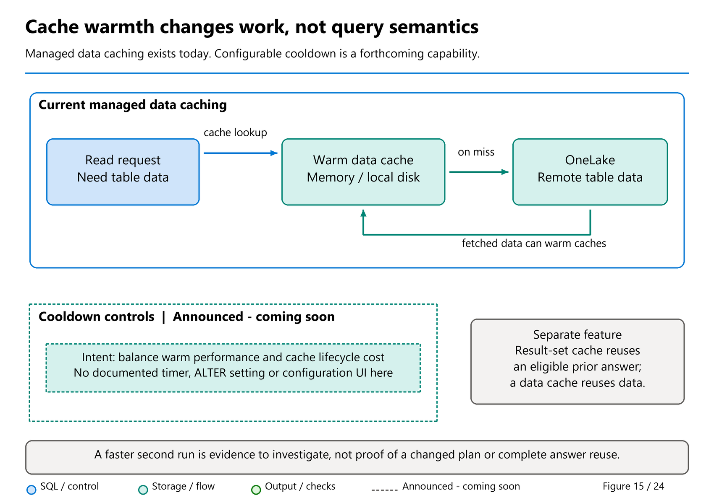

# 28. Physical Layout, Caching, and Maintenance

[Book contents](../../index.md) | [Part V contents](README.md) | [Previous: Chapter 27](27-query-plans-and-tuning.md) | [Next: Chapter 29](../06-operating-the-platform/29-monitoring.md)

**Applies to:** Warehouse-managed tables and Lakehouse tables read through the SQL analytics endpoint; maintenance ownership differs. **Level:** Intermediate to advanced. **Feature baseline:** original revision checked 9 October 2026; health-result and retained-history boundaries rechecked 9 November; announced cooldown scope reviewed 10 November. Warehouse data clustering is labeled preview in the cited Learn reference. Cache cooldown remains forward-looking, not an available control assumed by the labs.

## Start with the owner of the files

Two queries can use the same SQL engine and still require different maintenance decisions. Warehouse owns its table writes and manages physical maintenance. A Lakehouse SQL analytics endpoint reads Delta tables whose layout was produced by Spark, a pipeline, or another supported writer. Similar query syntax does not give the endpoint permission to reorganize the underlying data.

The current [cross-workload maintenance guidance][1] makes this ownership boundary explicit. For Warehouse, work through supported Warehouse controls and its automatic maintenance. Do not point Spark `OPTIMIZE` or an external writer at Warehouse-owned files. For a Spark-managed Lakehouse table, the owner can choose compatible write and maintenance settings. A shortcut does not silently transfer ownership of the source table.

This boundary prevents a common troubleshooting mistake: finding a command that improves one Delta table and treating it as a universal repair tool. The operational question is not merely "Is this Delta?" It is "Which service owns this table, which readers depend on it, and which mutations are supported?"

## File layout is a workload decision

Many tiny files create metadata and file-open overhead. Too few enormous files can limit available scan parallelism. The useful middle depends on table size, row width, write cadence, and the consuming engines. A fixed number of rows per file cannot account for the difference between a narrow transaction record and a wide record containing long strings.

Current guidance for Spark-written tables favors Fabric Spark runtime 2.0 or later defaults, including adaptive file targets ranging from 128 MB to 1 GB [1,2]. Those are adaptive targets, not a demand to enlarge every small table. Earlier runtime versions have different opt-in behavior. Pipeline and Dataflow writers should not be assumed to inherit Spark's settings.

Partitioning is also not a free index. Partitioning a small table by a near-unique key can replace a modest amount of data with a huge collection of tiny directories and files. Choose it for a justified access or write-isolation requirement, not simply because a column appears in a filter. For recurring selective predicates, consider the supported clustering strategy for the actual table owner.

Warehouse `CLUSTER BY` organizes similar values to support file skipping. The cited reference describes a maximum of four clustering columns, selection at table creation, and additional ingestion cost [3]. It is not a clustered B-tree index, nor a declaration that output rows are sorted. Equality joins alone are not a reason to cluster on a key. Investigate repeated selective filters over a sufficiently large table.

Suppose a sales fact table is frequently filtered by a short date range and customer. That is a plausible clustering experiment. If most queries instead aggregate every date and every customer, the ingest cost may buy little. Compare the complete read/write workload, not a single carefully chosen filter. Changing clustering columns requires the supported new-table approach, with migration and rollback planning, rather than an imagined in-place switch.

**Roadmap snapshot taken 9 November 2026:** Data Clustering is listed with a planned **GA / Q4 2026** milestone. Keep that target separate from the preview guidance and operation limits used here; being within the quarter is not evidence of rollout. The [snapshot](../../appendices/H-roadmap-snapshot.md#snapshot-9-november-2026) preserves the observed label.

## Three meanings of "the cache is warm"

Fabric's memory cache contains analytical representations of accessed data, while disk cache provides another local layer before a remote OneLake read [4]. These caches reduce retrieval work but do not mean a join or aggregation has already been calculated. They are automatically managed; there is no supported manual cache-clear command to turn this chapter into a controlled cold-cache benchmark.

Result set caching is different. It can reuse a previously produced final answer for an eligible SELECT [5]. As documented in September 2026, it is enabled by default for Warehouse and Lakehouse SQL analytics endpoints, but use remains opportunistic. Permission checks, data changes, query shape, and eligibility restrictions matter. It is not a promise that a second execution always hits.

Finally, a report or client can cache outside SQL. A fast screen repaint might involve no new warehouse request. Distinguish that behavior from both SQL data caching and SQL result caching. Record whether the application actually submitted the expected statement before interpreting server measurements.



*Figure 15 — Warmth is a lifecycle, not a correctness or freshness setting.* A warm data cache can avoid remote reads while the query still executes its joins and aggregates. Result caching can avoid eligible repeated computation instead. The lifecycle arrows imply no configurable timer, expiry guarantee, or currently available cooldown switch.

**Runnable listing.** Execute in either book SQL item. This reads configuration and recent request history; it changes no cache setting or data. Query Insights requires the relevant access.

```sql
SELECT name, is_result_set_caching_on
FROM sys.databases
WHERE database_id = DB_ID();

SELECT TOP (50)
       distributed_statement_id, start_time, status,
       result_cache_hit, total_elapsed_time_ms,
       data_scanned_remote_storage_mb,
       data_scanned_memory_mb, data_scanned_disk_mb
FROM queryinsights.exec_requests_history
WHERE start_time >= DATEADD(hour, -1, SYSUTCDATETIME())
ORDER BY start_time DESC, distributed_statement_id;
```

The documented `result_cache_hit` values are `2` for a hit, `1` for creation, and `0` when not applicable. Do not interpret it as a Boolean. A memory-heavy execution with value zero is perfectly consistent: data cache and result cache are different mechanisms.

The tiny book seed is particularly useful for learning this distinction. The current result-cache qualifications require a referenced table with at least 100,000 rows, among other conditions [5]. Six facts do not satisfy that condition. Failure to obtain a result-cache hit in the introductory lab is therefore not evidence of a broken service. Qualification rules can evolve; verify them rather than coding operational promises around the threshold.

## Cache cooldown: plan the trade-off, not an invented setting

**Forward-looking; source follow-up 10 November 2026.** Tino Tereshko's [4 June Build roundup](https://community.fabric.microsoft.com/blog/fbc_fabricupdatesblogs/from-query-acceleration-to-cache-cooldown-everything-new-in-fabric-data-warehous/5191621) explicitly announces a **SQL-pool-level cooldown duration** and describes cache nodes scaling with demand. The intended choice is to retain warm data longer for latency-sensitive arrivals or shorten its resource lifetime when that trade-off fits the workload. This establishes the announced pool scope, not a verified current activation or charging contract.

His [29 September announcement](https://www.linkedin.com/posts/valentinotereshko_speed-run-of-fabric-data-warehouse-announcements-activity-7510726240522293248-r4tC) still calls public preview coming soon. Bogdan Crivat's [FabCon Europe article](https://community.fabric.microsoft.com/blog/fbc_fabricupdatesblogs/bringing-governed-analytics-into-the-flow-of-work-fabric-analytics-at-fabcon-eur/5368918) connects cooldown with flexibility in consumption and isolation. The reviewed sources do not establish a currently supported timer range, default, configuration syntax, exact cache-layer behavior or billing formula. This book therefore supplies no cache-TTL API or `ALTER DATABASE` cooldown command, and does not adopt the June headline's elimination of cold latency as an operational guarantee.

The operational choice is still worth learning. A dashboard used every few minutes may benefit from retaining a warm working set between visits. A weekly analysis with a long quiet interval may favor a different resource-lifetime trade-off, accepting a slower first query. The correct objective is not "make every query warm"; it is "meet the service objective for the whole arrival pattern at acceptable consumption."

Sowmya Sivaraman's [9 November SQL-pool advance notice](https://community.fabric.microsoft.com/blog/fbc_fabricupdatesblogs/unifying-sql-pools-upcoming-changes-to-ui-and-apis/5397390) still makes cooldown adjustment conditional on **configurability becoming available**. Its example of shortening a five-minute cooldown to one minute is a future illustration, not a current supported setting or a universal recommendation. The same article's future new-workspace read-optimization default is discussed in [Chapter 33](../06-operating-the-platform/33-workload-management-and-sql-pools.md#upcoming-unification-prepare-clients-without-changing-todays-payload).

Before a future pilot, answer these questions:

- How often does the same working set return, and how long are the quiet gaps?
- Is first-query latency part of the business commitment, or can the application tolerate a cold start?
- Do measured improvements come from memory/disk reads, result-cache hits, or no SQL request because the client cached the answer?
- Which cache layers will the documented pool-level control affect, and what does that mean for neighboring workloads sharing that pool?

Design the comparison now without changing a tenant: record cold-first and warm-repeat latency, scanned data by tier, result-cache state, arrival times, and whole-window consumption. Include any deliberate warm-up work rather than hiding it. When the feature becomes available, validate its actual contract before assigning a timer or predicting savings. Current automatic memory/disk caching and the separately documented result-set cache remain today's mechanisms; a roadmap lifecycle control is not permission to flush caches or serve stale data.

## Table health without pretending to repair it

`sys.sp_get_table_health_metrics` returns file-level metrics, histograms, and a potential anomaly for a Lakehouse table through its SQL analytics endpoint [6]. It is not documented as a general Warehouse-table health procedure. It examines file metadata, not row groups, and reports one **highest-severity** anomaly per call, not an exhaustive issue list. After a separately approved repair, inspect again rather than assuming every other concern disappeared.

`PhysicalRowCount` includes logically deleted rows. It is not a substitute for the logical `COUNT_BIG(*)` used to verify six book facts. An empty table returns zero histograms and anomaly type zero; that does not prove ingestion completed or the expected business rows arrived. A zero anomaly also does not certify efficient queries.

**Runnable listing.** Execute in `BookLakehouse`'s SQL analytics endpoint, after Chapter 5's seed. The caller needs at least VIEW DEFINITION on the target. This inspects metadata only and consumes diagnostic resources; it does not run maintenance.

```sql
EXEC sys.sp_get_table_health_metrics
     @table_name = N'book.FactSales';
```

Mark Pryce-Maher's [table-health collector][7], pinned to its substantive 29 July 2026 commit, demonstrates collecting these results across tables and preserving per-table errors. Its PowerShell synopsis also mentions Warehouse. That wording is broader than the procedure's current documented applicability; this book does not adopt that claim.

His [30 July article, Are my Fabric tables healthy?](https://medium.com/@sqltidy/are-my-fabric-tables-healthy-af75771cb6e1), explains the practical reason for a collector: the native procedure reports one table per invocation. The book retains that workflow while keeping maintenance conditional and source-owned. An anomaly suggesting OPTIMIZE is not permission to run it through the SQL endpoint or rewrite Warehouse files.

The companion [bounded health collection script](../../scripts/28-table-health.sql) retains the useful per-table diagnostic pattern but limits it to the four seeded Lakehouse tables. It emits the table identity before each native result, preserves errors, creates no objects, and performs no automatic repair. It avoids assuming that a delimiter-split export with exactly 36 fields will forever match the procedure's result shape.

A production collector should capture source item, table identity, collection UTC time, procedure result, and collection failure separately. Use driver-provided column metadata when exporting structured results. A permission failure must not become an empty, apparently healthy row. Restrict and retain collected metadata appropriately, and set a finite table allowlist and collection budget.

## Reconciling guidance that appears inconsistent

The health procedure reference discusses approximate two-million-row and 1.2-GB file targets, while newer cross-workload guidance recommends adaptive targets rather than forcing static sizes [1,6]. Treat the procedure's histograms as evidence about the distribution, not an instruction to rewrite every table to one exact size. A six-row dimension is not pathological simply because its file is smaller than a large-table target.

The same restraint applies to V-Order. Current guidance says it primarily benefits Power BI Direct Lake and is not a default requirement solely for SQL endpoint performance [2]. Warehouse has its own default V-Order behavior. Disabling Warehouse V-Order is documented as a warehouse-level irreversible operation [1]; it is not a casual tuning toggle. Measure the downstream readers as well as the loader before considering that decision.

`OPTIMIZE` and `VACUUM` also solve different problems. Compatible optimization rewrites the active layout. Vacuum removes unreferenced files after retention conditions permit it; it does not compact the current active file set. Shortening retention can destroy versions needed by time travel, recovery, or concurrent readers. Some writer modes impose additional maintenance restrictions, including the documented Dataflow Gen2 incremental-refresh Lakehouse restrictions [1].

This matters to **new-sync SQL endpoint time travel**, not just Spark notebooks. Those preview historical reads depend on retained Lakehouse files; Warehouse's retention default does not protect them. The [Lakehouse maintenance guide](https://learn.microsoft.com/en-us/fabric/data-engineering/lakehouse-table-maintenance) documents a seven-day default retention and safeguards against shorter UI/API requests. Decide the required historical window with the source owner before changing it, and verify an actual retained version rather than assuming any configured period recreates files already removed.

## Worked investigation: the slow Monday scan

Imagine a synthetic Lakehouse receives small append batches throughout a weekend. Monday's report is slow on its first execution and remains slower than its previous baseline. The team proposes "clear the cache, vacuum, and try again." None of those words yet establishes a cause.

Begin by confirming the same table version and query shape are being compared. Then collect the health result and recent execution history. A heavy remote scan on the first execution supports a cold-data explanation for some delay. If subsequent executions still scan the same large working set locally, the remaining work has not disappeared. Inspect predicates, projected width, and file distribution before choosing a maintenance action.

If the health result and writer history indicate accumulated small files, review whether the writer's auto-compaction behavior is enabled and compatible with its latency objective. A strict ingestion SLA might favor a separately scheduled optimization job instead. Test that change on an isolated, representative Lakehouse copy, with source-owner authorization. Do not execute it on Warehouse-owned files or on an unrelated shortcut target.

After approved maintenance, compare both correctness and physical evidence: current rows, required aggregates, file counts and histogram movement, query scans, and ingestion duration. Run repeated report queries under comparable concurrency. An apparent improvement from first-run remote reads to second-run local reads cannot by itself be attributed to compaction.

If the health result instead reports a checkpoint concern, investigate metadata processing and supported Delta features. A checkpoint is not a cache flush. New-sync terminology in Chapter 15 and Delta checkpoint protocol versions describe different things. Rewriting data without understanding the metadata path can consume resources without fixing the actual compatibility problem.

## Practical lab and operating decision

Prerequisites are the independent seeded Lakehouse, endpoint access, VIEW DEFINITION, and permission to inspect Query Insights. Run the health command and cache-history listing, then record which conclusions the small dataset permits. It should permit identifying fields and understanding result-cache eligibility; it should not permit a compaction, clustering, or capacity-sizing benchmark.

For a later scale test, define the representative ingestion cadence, table size, predicate mix, and readers before producing data. Compare maintenance cost and read benefit over a full cycle. Set acceptance criteria for freshness as well as latency, and preserve the prior layout or a recoverable test copy.

All supplied diagnostics are read-only and were not tenant-tested. No cleanup of database objects is necessary. Delete local exports only according to their approved retention policy. Any actual maintenance exercise requires its own isolated objects, capacity budget, and recovery plan.

## Key takeaways

- File ownership determines which maintenance actions are supported.
- Data caching, result caching, and client caching are separate.
- Table-health diagnostics are documented for Lakehouse SQL endpoints.
- Measure the entire write/read cycle; do not impose one file-size recipe on every table.

## References

1. [Microsoft Learn, Cross-workload table maintenance][1], updated September 2026.
2. [Microsoft Learn, SQL analytics endpoint performance][2], updated September 2026.
3. [Microsoft Learn, Warehouse data clustering][3], preview label in the inspected reference.
4. [Microsoft Learn, In-memory and disk caching][4].
5. [Microsoft Learn, Result set caching][5], dated 22 September 2026.
6. [Microsoft Learn, sys.sp_get_table_health_metrics][6], endpoint applicability and result schema.
7. [Mark Pryce-Maher, table-health collector][7], commit `605889dd4dee7119299ee0192ee6bd386d6c1ab2`, 29 July 2026; user-authorized source, no license inferred.
8. Tino Tereshko, [Build 2026 Warehouse roundup](https://community.fabric.microsoft.com/blog/fbc_fabricupdatesblogs/from-query-acceleration-to-cache-cooldown-everything-new-in-fabric-data-warehous/5191621), 4 June 2026, modified 5 June; announced pool-level cache lifecycle and Lakehouse-health scope, reviewed 10 November.

[1]: https://learn.microsoft.com/en-us/fabric/fundamentals/table-maintenance-optimization
[2]: https://learn.microsoft.com/en-us/fabric/data-engineering/sql-analytics-endpoint-performance
[3]: https://learn.microsoft.com/en-us/fabric/data-warehouse/data-clustering
[4]: https://learn.microsoft.com/en-us/fabric/data-warehouse/caching
[5]: https://learn.microsoft.com/en-us/fabric/data-warehouse/result-set-caching
[6]: https://learn.microsoft.com/en-us/sql/relational-databases/system-stored-procedures/sp-get-table-health-metrics-transact-sql?view=fabric
[7]: https://github.com/MarkPryceMaherMSFT/fabric-table-health-metrics/blob/605889dd4dee7119299ee0192ee6bd386d6c1ab2/Get-TableHealthMetrics.ps1

---

[Previous: Chapter 27](27-query-plans-and-tuning.md) | [Book contents](../../index.md) | [Next: Chapter 29](../06-operating-the-platform/29-monitoring.md)
