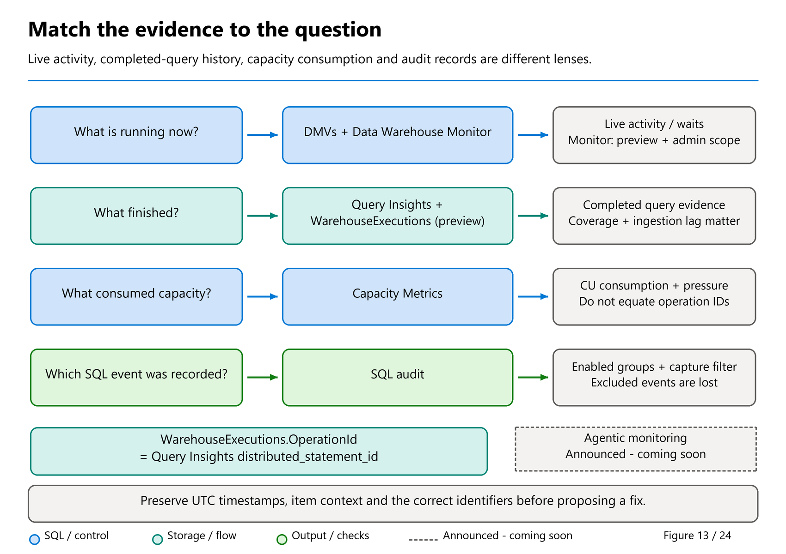

# 29. Monitoring Without Confusing the Signals

[Book contents](../../index.md) | [Part VI contents](README.md) | [Previous: Chapter 28](../05-statistics-and-performance/28-layout-caching-and-maintenance.md) | [Next: Chapter 30](30-troubleshooting.md)

**Applies to:** Warehouse and SQL analytics endpoint; individual monitoring surfaces have different scope and permissions. **Level:** Intermediate to advanced. **Feature baseline:** original revision checked 9 October 2026; Capacity Metrics navigation reviewed against 4 November documentation and its specific **GA announcement**. The broader Monitor guide and `WarehouseExecutions` retain preview scope; the operations skill is GA, while the separately announced agentic monitoring experience remains coming soon.

## Match the instrument to the question

Monitoring becomes useful when every measurement has a declared scope. A request DMV answers what is visible now. Query Insights describes completed user queries in the connected item. Workspace monitoring provides a cross-item view of qualifying completed distributed executions. Capacity Metrics addresses capacity consumption. None is a complete substitute for the others.

The [current monitoring overview][1] includes all these surfaces, as well as the visual Data Warehouse Monitor. Begin with the narrowest tool that can answer the question. For "Is my query still running?", use the live monitor or DMVs. For "Which query shapes regressed yesterday?", use history. For "Which items have failing distributed workloads?", start with workspace monitoring. For "What capacity consumption was recorded?", use the capacity tools, not a query CPU total renamed as cost.

A useful operating record includes item identity, UTC timestamps, application identity, execution identifier, status, and the observation source. Human-readable names alone are weak identifiers: they can change, and the current workspace-monitoring schema does not support its name fields for Warehouse events.



*Figure 13 — Conceptual evidence map, not one universal telemetry stream.* Follow the question to the right instrument. The diagram identifies the actual `WarehouseExecutions.OperationId` column: it can identify an exact Query Insights execution. Capacity Metrics requires item/time-window correlation instead. Neither completed-history path substitutes for observing work that is running now.

## Observe live work

The lifecycle DMVs separate connections, sessions, and requests [2]. A connection is a transport relationship; a session contains state; a request is work currently submitted in that session. A sleeping session is not an actively executing query, but it can still matter to a transaction investigation.

Workspace Admins have broader visibility. The documented role rules allow Member, Contributor, and Viewer users to see only their own sessions and requests, and reserve `sys.dm_exec_connections` for Admins [2]. An empty result therefore does not prove a quiet workspace. Record the observer's visibility before interpreting it.

The [live-request script](../../scripts/29-live-requests.sql) adapts the public fabric-toolbox `dw-active-requests` query [3]. The original joins sessions, requests, connections, and database names, and extracts the active statement from its parent batch. The book's smaller version removes the connection-DMV dependency, explicitly scopes the current database, retains request and distributed identifiers, and labels returned SQL as the whole batch. It does not misrepresent batch text as the exact statement. The October repository pin fixes the inspected content; it is not a claim that these older scripts were newly authored in October.

**Runnable listing.** Execute in the affected Warehouse or endpoint. It is read-only, excludes this diagnostic session, and shows at most 100 visible requests. Broader visibility requires the role described above.

```sql
SELECT TOP (100)
       r.session_id, r.request_id, r.dist_statement_id,
       r.start_time, r.status, r.total_elapsed_time,
       r.blocking_session_id, r.wait_type,
       s.login_name, s.program_name
FROM sys.dm_exec_requests AS r
JOIN sys.dm_exec_sessions AS s
  ON s.session_id = r.session_id
WHERE r.database_id = DB_ID()
  AND r.session_id <> @@SPID
ORDER BY r.total_elapsed_time DESC, r.session_id;
```

Notice the live field name `dist_statement_id`. The corresponding history field is `distributed_statement_id`. A session identifier is not an adequate long-term query identifier: sessions host multiple requests and identifiers may be reused. Capture the distributed identifier while it is available.

Frequent polling has its own cost. Choose an incident-appropriate interval and stop when the question is answered. A permanent high-frequency "read-only" loop can still consume capacity and produce sensitive diagnostic exports.

### The visual Monitor is useful, but not a read-only permission boundary

[Data Warehouse Monitor](https://learn.microsoft.com/en-us/fabric/data-warehouse/monitor) is an available **preview** portal experience for running and historical T-SQL work. Its current contract requires **workspace Admin**; a Contributor's ability to read Query Insights does not grant access to this particular screen. Compare similar query runs, filters, and distributed statement IDs rather than inferring a regression from an unfiltered request-count chart.

The screen also offers cancellation. Its documented action can cancel unselected queries in the **same selected SQL sessions**, so a checkbox is not a guarantee of single-statement blast radius. Inspect the owner and transaction context before any separately approved intervention. This chapter's lab observes only; it does not use Cancel.

History can take up to 15 minutes to appear, and Monitor shows at most 10,000 rows for the selected filters. Narrow a busy interval instead of treating the grid as a complete archive. A currently running request belongs in live observation; a completed event belongs in the history path once it has arrived.

### Open Monitor from Capacity Metrics without inventing an ID join

The [4 November Monitor guidance](https://learn.microsoft.com/en-us/fabric/data-warehouse/monitor#open-monitor-from-the-capacity-metrics-app) documents **Monitor in warehouse** navigation from the Capacity Metrics app. For Warehouse scope, the supported operation categories include **Warehouse Query**, **Warehouse Query (Accelerated)**, and **Warehouse Snapshot Query**. The action opens the associated item and a relevant time range; it does not resolve a Capacity Metrics operation to one unique SQL statement.

Mariya Ali's **4 November** Fabric Updates post, [Find expensive queries from Capacity Metrics (Generally Available)](https://community.fabric.microsoft.com/blog/fbc_fabricupdatesblogs/find-expensive-queries-from-capacity-metrics-generally-available/5393588), explicitly announces this **navigation action as GA**. The broader Monitor guide still labels its experience preview; a GA entry action does not promote every destination feature.

The article's practical route is **Compute > selected timepoint > Explore > TimePoint Detail**, then a supported entry under **Background operations for time range > Monitor in warehouse**. Inspect the chosen operation's Start/End interval, then Query history. Sort candidates by allocated CPU and review scan tiers, result-cache values, labels and similar runs together. The article explicitly distinguishes CPU from elapsed time and per-query billed CUs; a convenient UI path does not turn a diagnostic ranking into invoice attribution.

The investigator needs **both Capacity Metrics access and workspace Admin access** for Monitor. Permission to view a capacity chart does not grant administrative query visibility or cancellation rights in the associated workspace. No additional access is granted by following the link.

This shortcut saves navigation, not reasoning. Capacity Metrics **Operation ID is not** Query Insights `distributed_statement_id`. Its smoothed timepoint can include consumption from operations executed earlier, so retain the contributing operation's actual execution interval rather than inspecting only queries that started at the displayed timepoint. Narrow by item, UTC interval and workload, then inspect candidate executions.

Contrast the independently documented **`WarehouseExecutions.OperationId`** below: that identifier *does* match Query Insights `distributed_statement_id`. The two similarly named Operation ID fields belong to different contracts. Monitor's preview status, historical ingestion delay and result limit still apply after entering from Capacity Metrics.

## Read completed history deliberately

Query Insights retains 30 days of user-query history and excludes system queries [4]. Completed executions can take up to 15 minutes to appear, depending on workload. A request that just disappeared from a DMV may therefore be temporarily absent from history. This is an observation gap, not proof that the execution never existed.

Mark Pryce-Maher's March 2026 [explicit-projection gist][5] is a useful starting point because named columns communicate the intended diagnostic contract. The book's [history script](../../scripts/29-query-history.sql) narrows the window, limits the output, and uses the current public schema. It omits undocumented error-detail columns present in that gist and avoids exporting command text by default.

Query shape, literal values, and execution identity serve different purposes. Use a query hash to find related statements, then inspect particular executions and parameters before claiming a regression. Keep canceled and failed executions visible rather than letting a successful-only average conceal reliability problems. For latency objectives, examine a distribution, not merely the mean.

The [history-analysis script](../../scripts/29-history-analysis.sql) adapts the prioritization ideas in Mark's `fabric-warehouse-demo` samples [6]. It groups by query shape, client, status, and result-cache state. It casts elapsed values before aggregation to avoid small integer accumulation problems and does not require a permanent collector installation.

The repository's collector is informative but not an archival policy by itself. In its pinned version, Warehouse collection clears and refreshes a physical snapshot table; endpoint collection returns results rather than creating a permanent endpoint table. Repeated snapshots of the same 30-day window would duplicate executions if blindly appended. A durable archive needs a source-item plus execution-identifier key, an overlap window for late arrivals, explicit collection errors, and a retention policy for query text.

## Reconstruct overlap, not imaginary causation

An incident often begins with a timepoint from another system: a report stalled at 09:12 UTC, or a pipeline retry started at 14:07 UTC. Looking only for statements that started during that minute misses a long-running request that began earlier.

The toolbox's `dw-queries-running-at-timepoint` example tests whether an execution interval includes a timestamp [3]. The [book adaptation](../../scripts/29-overlapping-requests.sql) uses an explicit UTC parameter, a bounded result, and a half-open interval: start inclusive, end exclusive. A query ending exactly at the timepoint is not also counted as active immediately afterward.

**Runnable listing.** Execute in the relevant item with Query Insights access. It reads completed history only; the point defaults to thirty minutes before collection to avoid relying on immediate history availability.

```sql
DECLARE @AtUtc datetime2(6) =
    DATEADD(minute, -30, SYSUTCDATETIME());

SELECT TOP (200)
       distributed_statement_id, start_time, end_time,
       query_hash, program_name, status, total_elapsed_time_ms
FROM queryinsights.exec_requests_history
WHERE start_time <= @AtUtc
  AND end_time > @AtUtc
ORDER BY start_time, distributed_statement_id;
```

This is an execution-overlap reconstruction, not a complete queue reconstruction. A submitted request that had not started is a different lifecycle interval. It also excludes currently running requests not yet in completed history, expired records, hidden records, and system work. Use live evidence during the incident and history afterward.

Overlap establishes coexistence. It does not prove that query A slowed query B, nor that either consumed the capacity charge visible in another report. Test causal explanations with workload scheduling, plans, scan evidence, locks, and controlled comparisons.

## Workspace monitoring is now part of the toolkit

The public `WarehouseExecutions` schema is documented, so this edition can use real KQL fields rather than inventing them [7]. Workspace monitoring must be enabled by a workspace Admin; querying the monitoring database requires at least Contributor. It emits one event on completion for qualifying user-initiated distributed queries across Warehouses, SQL analytics endpoints, and Warehouse snapshots.

Running queries, system-generated work, and front-end-only operations are outside that event set. Cross-database activity is attributed to the connected item. The documented default retention is 30 days, and the monitoring storage and queries incur the applicable Eventhouse/KQL charges. Enabling monitoring is therefore an operational decision, not a free substitute for all other diagnostics.

**Runnable listing.** Execute in the KQL editor of an already enabled workspace-monitoring database. This reads `WarehouseExecutions` and creates no dashboard or alert. It groups events recorded in the last day.

```kusto
WarehouseExecutions
| where Timestamp >= ago(24h)
| summarize
    Executions = count(),
    Failed = countif(Status == "Failed"),
    Canceled = countif(Status == "Canceled"),
    P50Ms = percentile(DurationMs, 50),
    P95Ms = percentile(DurationMs, 95),
    DistributedCpuMs = sum(CpuTimeMs)
    by ItemId, ItemKind
| order by P95Ms desc
```

`Timestamp` is the record-generation time; `OperationStartTime` and `OperationEndTime` describe execution. State which clock defines a dashboard window. An event completed after midnight can belong to a different reporting bucket than the query's start. Do not add its entire CPU value to every time bucket it overlaps.

There is a particularly important identifier distinction. **`WarehouseExecutions.OperationId` is documented to match Query Insights `distributed_statement_id`** [7]. That supports an exact drill-down after selecting the correct item. **Capacity Metrics Operation ID is a different context and must not be assumed to offer that join.** Similar column names are not a data contract.

`CpuTimeMs` supports workload comparison, not invoice reconciliation. Keep any modeled per-query charge allocation explicitly labeled as a model. Query Insights and workspace monitoring both omit categories of work that may matter to capacity consumption.

## Agent-assisted diagnosis: available skill, forthcoming experience

There are two release stories here, not one. Tino's [29 September roundup](https://www.linkedin.com/posts/valentinotereshko_speed-run-of-fabric-data-warehouse-announcements-activity-7510726240522293248-r4tC) marks **agentic monitoring and diagnostics coming soon**. The [September summary](https://community.fabric.microsoft.com/blog/fbc_fabricupdatesblogs/fabric-september-2026-feature-summary/5325825) describes forthcoming AI Insights in DW Monitor: condition-driven insights and an evidence-grounded conversational investigation. That is not proof that every Admin currently has an AI investigation control.

Separately, Mariya Ali's [14 September announcement](https://community.fabric.microsoft.com/blog/fbc_fabricupdatesblogs/diagnose-fabric-data-warehouse-workloads-with-the-sql-dw-operations-skill-genera/5366102) makes the **SQL DW operations skill GA**. The current [Learn guide](https://learn.microsoft.com/en-us/fabric/data-warehouse/skills-for-data-warehouse-operations) describes the `sqldw-cli` operations capability: bounded, read-only investigation of failures versus cancellations, resource consumers, capacity spikes, SQL pool pressure, and Lakehouse table health. Its useful output separates diagnosis, evidence, ruled-out explanations, recommendations, and follow-ups.

The word **operations** is essential. The [pinned public skill definition](https://github.com/microsoft/skills-for-fabric/blob/bc42aaf734771bf752c1d7082dd91e5a6ca72b9f/skills/sqldw-cli/SKILL.md) also contains an **authoring mode that can write**. Do not advertise the entire skill or every agent using it as read-only. Query Insights investigation needs Contributor-or-higher workspace access; capacity analysis needs the relevant Capacity Metrics access; endpoint table-health analysis needs `VIEW DEFINITION`. An assistant inherits these evidence boundaries rather than bypassing them.

A safe offline exercise is to draft an investigation request naming the item, UTC interval, question, and no-change boundary. Then decide which evidence would support or contradict each hypothesis. Ask a prospective agent: **does this finding describe live or completed work, what source supports each number, what is missing, and does the recommended next step change state?** The forthcoming interface may reduce navigation; it cannot turn event gaps into evidence or make two unrelated operation IDs joinable. No skill is installed, no authentication is initiated, and no cloud diagnostic is executed for this book revision.

## Pool-pressure events are not evenly spaced samples

`queryinsights.sql_pool_insights` records configuration, capacity, and sustained pressure-state changes [8]. Logging pauses when the warehouse is inactive. The rows are therefore event/observation data, not evenly spaced samples covering every minute.

If four of ten rows show pressure, the safe statement is "four of these ten observations report pressure." It is not "the pool was pressured 40 percent of the day." Treat gaps and time outside observed coverage as unknown unless a documented state model justifies another interpretation. Any duration reconstruction must state its carry-forward, gap, and boundary assumptions.

Use pressure evidence to contextualize an incident and identify a test. Do not automatically downsize a capacity because few pressure rows appear, or declare a pool healthy because its last event is old. Capacity decisions require representative demand, deadlines, ingestion, concurrency, and the wider consumption picture.

The [roadmap snapshot taken 9 November 2026](../../appendices/H-roadmap-snapshot.md#snapshot-9-november-2026) lists **Vnode utilization in Query Insights SQL pool insights**, planned **GA / Q4 2026**. It points to an observability improvement, not a current column contract. Do not invent a utilization field or infer instantaneous allocated nodes from a CU equivalent because a feature is planned.

## Worked incident review and lab

Prerequisites are the book item, Query Insights access, and optionally an already configured workspace-monitoring database. No new monitoring service is provisioned by this lab.

Run the country-revenue query from Chapter 27 and record its label, UTC time, and returned answer. Inspect your live requests from another session if the query lasts long enough; a six-row query may finish before inspection, which is expected. After history appears, find its exact execution and inspect status, duration, result-cache value, and scans. Do not continuously rerun the business query merely to keep it visible.

Next choose an historical timepoint from an approved test window and list overlapping executions. Explain what the list cannot show. If workspace monitoring is already available, locate a qualifying event and follow its `OperationId` to the connected item's Query Insights. A very lightweight query may not generate a distributed event; that is an important scope lesson, not a failed lab.

The expected deliverable is an evidence chain with identifiers and clock definitions, not an invented performance result. All supplied SQL and KQL is read-only and has not been tenant-tested. No database objects require cleanup. Remove local exports according to policy, and stop ad hoc polling after the exercise.

## Key takeaways

- Live requests, completed history, workspace events, and capacity usage answer different questions.
- Preserve item context, UTC windows, and execution identifiers.
- Workspace-monitoring OperationId has a documented history join; Capacity Metrics must not be conflated with it.
- Event-row percentages are not wall-clock pressure percentages.

## References

1. [Microsoft Learn, Monitoring overview][1], updated 5 October 2026.
2. [Microsoft Learn, Monitor using DMVs][2], live lifecycle and role visibility.
3. [Microsoft fabric-toolbox scripts][3], pinned revision `b0183fb1841367fd0eaa4aae28949f7911ff4f05`, 7 October 2026; MIT; active-request and timepoint patterns adapted.
4. [Microsoft Learn, Query Insights][4], retention, scope, and arrival delay.
5. [Mark Pryce-Maher, explicit request projection][5], substantive revision `e73c87d29741d25f25233ce1dc87cb4924d0d292`, 10 March 2026.
6. [Mark Pryce-Maher, workspace history collector and analytics][6], revision `805b43d2d07ce951f47ad9c23c17f0a53f0e2091`, 21 August 2026; authorized source, no license inferred.
7. [Microsoft Learn, Warehouse workspace monitoring][7], preview schema dated 28 September 2026, updated 5 October.
8. [Microsoft Learn, SQL pool insights][8], event-based reporting semantics.

[1]: https://learn.microsoft.com/en-us/fabric/data-warehouse/monitoring-overview
[2]: https://learn.microsoft.com/en-us/fabric/data-warehouse/monitor-using-dmv
[3]: https://github.com/microsoft/fabric-toolbox/tree/b0183fb1841367fd0eaa4aae28949f7911ff4f05/scripts
[4]: https://learn.microsoft.com/en-us/fabric/data-warehouse/query-insights
[5]: https://gist.github.com/MarkPryceMaherMSFT/8ac86364824b208fe97085e112052d16/e73c87d29741d25f25233ce1dc87cb4924d0d292
[6]: https://github.com/MarkPryceMaherMSFT/fabric-warehouse-demo/tree/805b43d2d07ce951f47ad9c23c17f0a53f0e2091
[7]: https://learn.microsoft.com/en-us/fabric/data-warehouse/warehouse-workspace-monitoring
[8]: https://learn.microsoft.com/en-us/sql/relational-databases/system-views/queryinsights-sql-pool-insights-transact-sql?view=fabric

---

[Previous: Chapter 28](../05-statistics-and-performance/28-layout-caching-and-maintenance.md) | [Book contents](../../index.md) | [Next: Chapter 30](30-troubleshooting.md)
