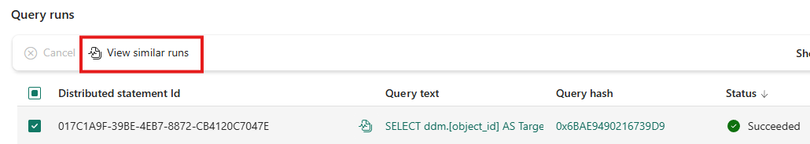

# 30. Troubleshooting by Following the Evidence

[Book contents](../../index.md) | [Part VI contents](README.md) | [Previous: Chapter 29](29-monitoring.md) | [Next: Chapter 31](31-billing-and-consumption.md)

**Applies to:** Warehouse and Lakehouse SQL analytics endpoint; publication and metadata-sync investigations are deliberately separate. **Level:** Intermediate to advanced. **Feature baseline:** original revision checked 9 October 2026; Monitor navigation, endpoint discovery and security/type blockers rechecked 9 November. New metadata sync remains preview where explicitly enabled.

## Preserve the symptom before changing the system

The first useful incident question is "What failed, for whom, and at which boundary?" A sign-in failure, missing table, stale result, slow execution, interrupted download, and canceled transaction are different problems. Capture the exact client error, UTC time, connected endpoint and item, application version, and any execution identifier before retrying or editing anything.

Do not put access tokens or connection secrets in the incident record. Query text can also contain sensitive literals. Preserve only what the investigation needs, with access restrictions and retention appropriate to the environment. A support bundle should make a problem reproducible without becoming an ungoverned copy of business data.

Separate observation from interpretation. "The client stopped after approximately ten minutes" is an observation. "Fabric has a universal ten-minute query limit" is an unsupported explanation. "Spark sees a different result" does not yet say whether the cause is publication, metadata synchronization, a different object, or a cached report.

## Establish the boundary with a small read

Confirm the connection's current database and run a known, bounded query under the same identity as the failing application. A successful administrator query does not prove that the application has the same permissions. Conversely, a permission-filtered catalog can look like a missing table.

**Runnable listing.** Execute in the affected seeded book SQL item, under the investigating identity. It reads context and seed aggregates; it creates and changes nothing.

```sql
SELECT DB_NAME() AS ConnectedDatabase;

SELECT COUNT_BIG(*) AS FactRows,
       SUM(CAST(Quantity AS bigint)) AS Quantity,
       SUM(Quantity * UnitPrice) AS Revenue
FROM book.FactSales;
```

The untouched seed should return six rows, quantity ten, and revenue `365.00`. If the table has legitimately changed, these are no longer its expected totals. Establish the comparison version before calling a different answer stale. A tiny aggregate can validate a connection and object; it cannot prove that a wide production export has adequate bandwidth or that a complex join will finish.

For connection failures, distinguish endpoint reachability, authentication, authorization, and database selection. Preserve driver messages and the application's timeout settings. Blindly granting broader roles can obscure the original issue and create a security problem. Follow the permissions model in Chapter 12 rather than treating Admin as a diagnostic requirement for every user.

## Investigation one: repeated cancellations near a boundary

Mark Pryce-Maher's September 2026 cancellation gists group events by application, elapsed-time bucket, query shape, and day [1]. That is a strong exploratory sequence. It turns scattered complaints into a pattern that can be compared with client configuration and deployment changes.

The literal ten-minute boundary in the [query-shape example](https://gist.github.com/MarkPryceMaherMSFT/9bb5cd17ef40469baa2e5d6a16f4b48c/42c808b1ce746ce7a6c44b4ec444b19132513d68) and [daily-trend example](https://gist.github.com/MarkPryceMaherMSFT/49d4792e0b60a15dc4b294986c0b57c6/6b67a6c93d823319a5c05f5eaf5fc3ed51714361), both substantively committed on 14 September 2026, is a diagnostic hypothesis, not a Fabric-wide timeout contract. A desktop tool, gateway, connector, orchestration activity, or user action can impose its own boundary. A recorded abort-related error does not, by itself, identify which layer initiated it. Read the application's configured command timeout and logs before attributing the cancellation.

The [book's cancellation analysis](../../scripts/30-cancellation-analysis.sql) adapts the five-second bucket idea without selecting a presumed universal timeout. It retains application and error code, uses a finite lookback, and names CPU as allocation associated with canceled requests rather than "wasted billable CPU." Some canceled work may have produced useful intermediate or partial client results; economic waste is a business conclusion, not a telemetry field.

**Runnable listing.** Execute in the connected item with Query Insights access. This reports completed canceled requests from the last day, without changing sessions or data.

```sql
SELECT COALESCE(program_name, '(not supplied)') AS ProgramName,
       error_code,
       COUNT_BIG(*) AS CanceledRequests,
       MIN(DATEDIFF_BIG(millisecond, submit_time, end_time))
           AS MinObservedMs,
       MAX(DATEDIFF_BIG(millisecond, submit_time, end_time))
           AS MaxObservedMs
FROM queryinsights.exec_requests_history
WHERE submit_time >= DATEADD(day, -1, SYSUTCDATETIME())
  AND status = 'Canceled'
  AND end_time IS NOT NULL
GROUP BY program_name, error_code
ORDER BY CanceledRequests DESC;
```

Suppose, in a hypothetical investigation, one client shows a narrow elapsed-time cluster while another successfully runs the same query shape longer. That supports investigating a client-specific limit. It does not rule out workload pressure making more queries reach that limit. Compare parameters, scans, result sizes, concurrency, and server completion against client transfer completion.

Changing a timeout can be appropriate when the workload legitimately needs longer, but it can also hide a regression. Increasing retries may multiply demand. For writes, a lost connection leaves the application uncertain about completion; do not replay a non-idempotent operation merely because the acknowledgment was lost. Reconcile the operation's durable business identity first.

## Investigation two: a query appears stuck

Begin with Chapter 29's live requests. A large elapsed time is not evidence of a blocking transaction. Inspect `blocking_session_id`, wait information, and lock evidence before treating the incident as locking. Fabric's documented Warehouse blocking workflow uses requests, sessions, and `sys.dm_tran_locks` [2].

**Runnable listing.** Execute in the affected Warehouse. This is read-only; visibility depends on permissions. An empty result does not prove that another user has no blocked work.

```sql
SELECT request_session_id, resource_type,
       resource_description, request_mode, request_status
FROM sys.dm_tran_locks
WHERE request_status = 'WAIT';

SELECT session_id, blocking_session_id, status,
       wait_type, total_elapsed_time, open_transaction_count
FROM sys.dm_exec_requests
WHERE database_id = DB_ID()
  AND blocking_session_id <> 0;
```

Trace a blocker to its session owner. An idle session can retain an open transaction even when no request row remains. Inspect session state as well as active requests. Increasing elapsed time only proves that time is passing; it does not prove useful progress. Look for a changing state or corroborating workload evidence.

Prefer an owner-managed completion or rollback when appropriate. Terminating a session rolls back uncommitted work and can disrupt downstream orchestration. The toolbox's `sp_KillQueries` builds and executes KILL statements from supplied predicates [3]. It is valuable source material for understanding candidate selection, but it is not this book's default remediation.

The [candidate-only script](../../scripts/30-cancellation-candidates.sql) instead returns current request identifiers, age, application, owner, blocking state, and batch text. Its five-minute threshold is an adjustable review threshold, not a service limit. It contains no KILL command or generated executable cancellation text. Before any separately authorized termination, an Admin must recheck the current session/request/distributed identifier, confirm the owner and transaction impact, and guard against stale observations or session reuse.

### Keep live troubleshooting separate from a completed-event investigation

For "is it blocked now?", use the live DMVs or the **preview Data Warehouse Monitor**, whose [current portal contract](https://learn.microsoft.com/en-us/fabric/data-warehouse/monitor) is Admin-only. For "which executions failed yesterday?", use completed history. Monitor's Cancel action has session-level consequences and can affect unselected queries in those sessions; it is not the next automatic step after noticing a long duration.

For a workspace-wide investigation, the **preview `WarehouseExecutions`** table records qualifying completed distributed user queries, not running work, system queries, or front-end-only requests. After selecting its `ItemId`, take its **`OperationId` to the corresponding item's Query Insights `distributed_statement_id`** for an exact execution lookup. This is the documented join identity in the [workspace-monitoring contract](https://learn.microsoft.com/en-us/fabric/data-warehouse/warehouse-workspace-monitoring), not Capacity Metrics Operation ID. A missing immediate history row can reflect ingestion lag rather than absence of execution.

The newly documented **Monitor in warehouse** action in Capacity Metrics is useful item-and-time navigation, not an exception to that identifier rule. It still requires workspace Admin access, and smoothed consumption may refer to earlier execution. Follow [Chapter 29's navigation check](29-monitoring.md#open-monitor-from-capacity-metrics-without-inventing-an-id-join) before attributing a displayed capacity timepoint to one SQL statement.



*Documentation image D24. Microsoft, [Comparing similar runs in Warehouse Monitor](https://learn.microsoft.com/en-us/fabric/data-warehouse/monitor); [original image](https://learn.microsoft.com/en-us/fabric/data-warehouse/media/monitor/monitor-similar-runs.png). Unmodified source copy, retrieved 9 November 2026; [CC BY 4.0](https://creativecommons.org/licenses/by/4.0/) under the [Fabric documentation licence](https://github.com/MicrosoftDocs/fabric-docs/blob/aadea08f35c3edaa9c32535c772792f02555c9a4/LICENSE). Compare matched executions and conditions rather than inferring a regression from an unfiltered grid or a single duration.*

## Investigation three: Lakehouse data is newer than SQL

Draw the direction of movement first:

- Spark or another supported Lakehouse writer commits Delta changes; the SQL analytics endpoint discovers and synchronizes the relevant metadata and data state.
- Warehouse commits SQL changes; a background process publishes updated Delta logs for outside readers.

These are different mechanisms. Calling an endpoint refresh cannot repair paused Warehouse publication.

For the Lakehouse-to-SQL direction, confirm the table's actual Delta commit, schema, path, and supported feature set. A notebook variable containing new rows is not evidence of a committed table update. Compare the same registered table rather than an unrelated path or shortcut.

Before calling an absence "lag," inspect the [table-feature and column checks in Chapter 15](../03-sql-analytics-endpoint/15-metadata-sync-v1-v2.md#check-table-features-and-column-representation-separately). An unsupported column type can be absent while the table is visible; an external Spark registration is not equivalent to a Tables shortcut. An endpoint foreign key, a schema/principal name conflict, or a broken OneLake RLS/CLS reference can block schema/security metadata work. None is automatically repaired by repeatedly refreshing.

Preserve the distinction between **data synchronization and security synchronization**. Changing endpoint identity mode cancels running and queued queries across the workspace's SQL analytics endpoints and can delete SQL roles/function metadata; it is not a freshness reset. OneLake role changes have their own propagation window. Reconcile the effective reader identity and saved policy definitions through [Chapter 16](../03-sql-analytics-endpoint/16-onelake-security.md#security-changes-are-operational-changes), without broadening access to make a diagnostic pass.

Then establish which metadata-sync implementation the endpoint uses. The new preview applies to endpoints created after the workspace option is enabled; existing endpoints are not automatically converted [4]. It separates schema and data handling and includes query-triggered data refresh. That does not make every new-table discovery or schema change synchronous.

**Runnable listing with a feature prerequisite.** Execute only on a SQL analytics endpoint using the new metadata sync preview. This reads documented sync-status fields [5]; it does not request a refresh.

```sql
SELECT TOP (100)
       object_id, latest_log_version, latest_checkpoint_version,
       last_update_time_utc, is_blocked
FROM sys.dm_db_external_tables_log_status
ORDER BY last_update_time_utc DESC, object_id;
```

Compare processed versions and times with independently observed committed Delta state. A missing or blocked result needs investigation; it is not permission to modify the log manually. New-sync shorthand is unrelated to Delta v2 checkpoints or the REST API's `/v1` route.

For a justified manual refresh, use the supported endpoint procedure or REST operation described in Chapter 15. Mark's [selected-table refresh gist][6] illustrates the modern endpoint route. Its deliberately nonexistent table is a demonstration case, not a production target list. A hardened workflow removes that entry, avoids redundant discovery calls, preserves failures, and inspects per-table results instead of treating HTTP acceptance as proof that all tables are fresh.

## Investigation four: Warehouse SQL is newer than Delta readers

For the reverse direction, confirm that the Warehouse transaction committed and that the external consumer reads the intended Warehouse table. Inspect publication state before investigating Lakehouse metadata sync [7].

**Runnable listing.** Execute in the affected Warehouse. It reads the current database's publication setting and performs no pause or resume.

```sql
SELECT name, DATA_LAKE_LOG_PUBLISHING_DESC
FROM sys.databases
WHERE database_id = DB_ID();
```

A paused publishing setting leaves external Delta readers seeing the previously published state, while Warehouse SQL can see newer committed data. Do not describe that as SQL returning stale cached rows. If publishing is automatic, investigate the publication timeline and consumer refresh separately. The existence of a committed SQL answer does not prove that an external reader has already consumed the corresponding Delta publication.

Restoring automatic publication is a change with cross-engine consequences. Coordinate it with the process that intentionally paused publication; do not include an automatic ALTER in a general "fix freshness" script. After any approved action, verify both the authoritative SQL result and the independent reader's observed version.

## Avoid repairs that destroy the evidence

A schema conversion error is not a reason to run an arbitrary table-rebuild utility. The pinned toolbox `dw-alter-table` workaround constructs a replacement table, renames objects, and drops an old table; its source also contains hard-coded `demo` rename targets [8]. Blind execution can affect the wrong object and lose dependencies or security semantics.

Use current supported DDL where applicable. When a rebuild is genuinely necessary, treat it as a migration: isolated target, explicit conversions, row and duplicate reconciliation, permissions and dependency recreation, controlled cutover, and rollback. A troubleshooting chapter should not disguise a destructive migration as a convenience command.

Similarly, do not blanket-update statistics, reorganize files, change pool configuration, and raise timeouts in the same experiment. Even if the symptom improves, the team will not know why. Preserve a baseline and change one relevant variable when the incident's urgency permits.

## Use an operations assistant without delegating the change decision

The [GA SQL DW operations skill](https://community.fabric.microsoft.com/blog/fbc_fabricupdatesblogs/diagnose-fabric-data-warehouse-workloads-with-the-sql-dw-operations-skill-genera/5366102) can organize the same investigation through bounded, read-only diagnostics. It is not an automatic repair service. The [current guide](https://learn.microsoft.com/en-us/fabric/data-warehouse/skills-for-data-warehouse-operations) explicitly separates that capability from `sqldw-cli` **authoring**, which can change Warehouse state when requested. A request to diagnose cancellations is not permission to switch into authoring and modify a table, pool, or retention policy.

Consider the earlier timeout cluster. A useful assistant response would identify affected applications, separate failures from cancellations, cite the observed interval and source views, and identify missing client-side timeout evidence. "Increase all timeouts" is not an evidence-backed conclusion. Likewise, overlapping expensive queries and pool-pressure events support a contention hypothesis, not proof that a specific request caused the entire capacity charge.

The broader **agentic monitoring and diagnostics experience remains coming soon** in [Tino's announcement](https://www.linkedin.com/posts/valentinotereshko_speed-run-of-fabric-data-warehouse-announcements-activity-7510726240522293248-r4tC). Do not wait for that interface to collect today's evidence, or treat it as the release status of the already available operations skill. For either experience, review four things before acting: the exact item and time range, the evidence source and its omissions, whether the recommendation is reversible, and who authorizes its execution. A permission error or no rows is a reported limitation, not a reason to fabricate a diagnosis or broaden access automatically.

For this chapter, rehearse that review on the paper incident only. Do not install or run a skill, connect an agent to a tenant, or approve a remediation to finish the exercise.

## Lab and closure

This read-only lab requires the seeded book item and the appropriate monitoring permissions. Run the context and correctness query, inspect cancellation summaries, and inspect live requests. Empty cancellation results are valid. Do not deliberately create blocking or kill a session just to populate the demonstration.

For a conceptual freshness exercise, write two separate evidence chains: Lakehouse commit to SQL observation, and Warehouse commit to Delta-reader observation. Include the applicable sync or publication setting and the reader's identity. State what each timestamp proves and what remains unknown.

An incident is closed when the required workload works again and the explanation is supported, not merely when a retry succeeds. Record the trigger, evidence, corrective action, verification, recurrence prevention, and unresolved uncertainty. Supply a minimal sanitized reproduction and exact identifiers if escalation remains necessary.

No tenant was queried for this manuscript. These diagnostics create no objects and require no database cleanup. Retain or delete exported evidence under the agreed policy, and ensure temporary incident polling has stopped.

## Key takeaways

- A duration cluster suggests a hypothesis, not a universal timeout.
- Review cancellation candidates; do not automate destructive intervention.
- Diagnose metadata sync and Warehouse Delta publication as separate paths.
- Close the incident with verified outcomes and preserved evidence.

## References

1. [Mark Pryce-Maher, canceled-query buckets][1], substantive gist revision `a6ec44863ef08bf165c5bf198e95d53ae25e7048`, 14 September 2026; adapted with neutral CPU naming and no assumed timeout.
2. [Microsoft Learn, Troubleshoot query blocking][2], Warehouse lock investigation.
3. [Microsoft fabric-toolbox, sp_KillQueries][3], pinned 7 October 2026 repository snapshot; MIT; linked as cautionary source, not executed.
4. [Microsoft Learn, SQL endpoint metadata sync][4], new-sync preview and eligibility.
5. [Microsoft Learn, external-table log-status DMV][5], public schema and permissions.
6. [Mark Pryce-Maher, selected-table metadata refresh][6], substantive revision `ae4988bf8c833ca581cd1fe8071855bdddebfb47`, 16 August 2026.
7. [Microsoft Learn, Warehouse Delta Lake logs][7], publication direction and PAUSED/AUTO behavior.
8. [Mark Pryce-Maher / Microsoft fabric-toolbox, ALTER workaround][8], source added 28 March 2025; pinned snapshot, not recommended as a default.

[1]: https://gist.github.com/MarkPryceMaherMSFT/c8750e42fafed6de892071fd715d7d07/a6ec44863ef08bf165c5bf198e95d53ae25e7048
[2]: https://learn.microsoft.com/en-us/fabric/data-warehouse/troubleshoot-query-blocking
[3]: https://github.com/microsoft/fabric-toolbox/blob/b0183fb1841367fd0eaa4aae28949f7911ff4f05/scripts/dw-sp-kill-queries/sp-killqueries.sql
[4]: https://learn.microsoft.com/en-us/fabric/data-engineering/sql-analytics-endpoint-metadata-sync
[5]: https://learn.microsoft.com/en-us/sql/relational-databases/system-dynamic-management-objects/sys-dm-db-external-tables-log-status-transact-sql?view=fabric
[6]: https://gist.github.com/MarkPryceMaherMSFT/190fa079d89a2f301af2847583d5d757/ae4988bf8c833ca581cd1fe8071855bdddebfb47
[7]: https://learn.microsoft.com/en-us/fabric/data-warehouse/query-delta-lake-logs
[8]: https://github.com/microsoft/fabric-toolbox/blob/b0183fb1841367fd0eaa4aae28949f7911ff4f05/scripts/dw-alter-table/alter_table.sql

---

[Previous: Chapter 29](29-monitoring.md) | [Book contents](../../index.md) | [Next: Chapter 31](31-billing-and-consumption.md)
