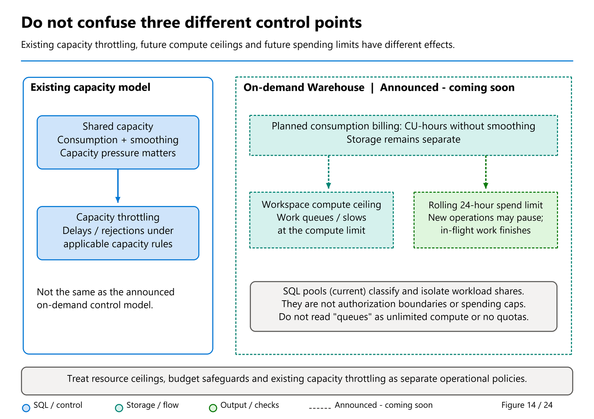
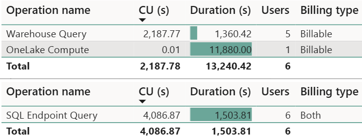

# 31. Billing and Consumption

[Book contents](../../index.md) | [Part VI contents](README.md) | [Previous: Chapter 30](30-troubleshooting.md) | [Next: Chapter 32](32-capacity-management.md)

**Applies to:** Warehouse and Lakehouse SQL analytics endpoint; capacity and storage charges also involve other Fabric workloads. **Level:** Intermediate operations. **Feature baseline:** revision checked 9 October 2026. Rates below are dated, not contractual prices. Warehouse on-demand billing is **public preview coming soon**, distinguished from the current shared-capacity model.

## Three questions that should not share one answer

"What did that query cost?" can mean three different things. The first is how much compute Fabric attributed to an item. The second is how much of the capacity's purchased throughput that activity consumed. The third is how much money the organization pays. These are related, but they are not interchangeable.

A capacity is shared by workloads. A warehouse query can consume capacity without creating a separate, directly identifiable invoice line for that query. Conversely, the capacity can incur charges while a particular warehouse is quiet. OneLake storage is a separate consideration, including retained historical data. A useful cost discussion therefore starts with the capacity's commercial arrangement, then examines item consumption, and only then models workload attribution.

Keep four units visible in every report: elapsed seconds, allocated vCore-seconds, capacity-unit seconds, and currency. Do not label all four "cost." The [consumption documentation](https://learn.microsoft.com/en-us/fabric/data-warehouse/usage-reporting) describes an allocation-based model, rather than a billing model derived solely from the CPU instructions a query executes.

## On-demand billing: a planned commercial model, not a new name for vNodes

**Public preview coming soon.** Tino Tereshko's [29 September roundup](https://www.linkedin.com/posts/valentinotereshko_speed-run-of-fabric-data-warehouse-announcements-activity-7510726240522293248-r4tC) uses that status explicitly; Kim Manis's [platform announcement](https://community.fabric.microsoft.com/blog/fbc_fabricupdatesblogs/build-deploy-and-govern-microsoft-fabric-at-scale/5369145) says availability is expected in the coming weeks. The [September feature summary](https://community.fabric.microsoft.com/blog/fbc_fabricupdatesblogs/fabric-september-2026-feature-summary/5325825) provides the planned accounting and governance model under its Coming Soon section. Screenshots and forward-looking descriptions are not instructions to assume the feature is enabled today.

The proposed model charges **actual compute consumption in CU-hours without smoothing**, with storage charged separately. Enablement is at **billing-category level across a capacity's workspaces**, not an isolated per-query choice. The Warehouse category is described as covering Warehouses, SQL analytics endpoints, Warehouse snapshots, and notebooks running T-SQL. Planned options include on-demand categories alongside provisioned F2-or-higher capacity and the zero-provisioned F0 entry point; neither means free compute or storage.

Within that category, each workspace is intended to scale up to a configured **compute ceiling**. Customers pay for actual CU consumption, not for the ceiling as if it were a permanently reserved allocation. Combine workspace boundaries and custom SQL pools to right-size and isolate workload classes. Those boundaries govern resources; they do not replace SQL security or make the rest of the capacity unlimited.



*Figure 14 — Conceptual comparison of current and announced capacity models.* Read the on-demand side as a design to evaluate when its public preview becomes available. A workspace compute ceiling controls available execution resources; a rolling CU-hour limit controls admission after accumulated spending. Neither box is an exact per-query currency meter.

| Question | Current shared-capacity accounting | Announced on-demand model |
| --- | --- | --- |
| What is purchased or charged? | Capacity throughput; item consumption helps explain its use. | Actual category compute consumption in CU-hours, separately from provisioned work. |
| How is consumption evaluated? | SQL background consumption is generally smoothed over 24 hours. | CU-hours without smoothing. |
| What is the workspace control? | Available backend resources, SKU guardrails, and pool allocation. | A workspace compute ceiling, complemented by custom pools. |
| Does storage disappear from the bill? | No. | No; storage remains separate. |
| Can this chapter assume it is available? | These are the documented existing mechanisms below. | No; public preview is coming soon at the revision cutoff. |

The planned **rolling 24-hour spending limit** is distinct from the compute ceiling: the summary says new operations pause at the spending limit while in-flight operations finish. That is not the same as ordinary queueing when execution resources are full, and not a promise of zero additional consumption after the threshold. [Chapter 32](32-capacity-management.md) works through those admission distinctions.

**Current capacity overage is a different, already GA feature.** It pays for eligible excess consumption that would otherwise cause throttling; it does not move a workload into the announced unsmoothed on-demand model or increase its execution resources. Likewise, today's allocation/vNode metering is not proof that Warehouse on-demand billing has shipped. Preserve the model name on every cost comparison.

For a month-end workload, ask whether a short unpredictable burst justifies variable compute charges while other categories remain provisioned. For steady reporting all day, compare the cost of the existing commercial arrangement with the eventual on-demand price and required service level; elasticity alone does not prove savings. Before a pilot, identify every workspace in the category, its peak and quiet periods, responsible owner, and tolerance for admission pauses. The summary describes category-dependent pricing multipliers but provides no universal monetary rate to bake into a calculator here.

## Current shared-capacity model: allocation, activity, and minimum windows

Fabric allocates and releases virtual nodes as demand changes. A **vNode contains four vCores**. Warehouse reads and writes use SQL compute; Lakehouse SQL endpoint reads use SQL compute too. The endpoint's read-only table-data surface does not mean its reads are free.

The documented baseline allocation window is one minute, with consumption measured and reported per second according to allocated resources. These two facts are compatible: per-second reporting does not mean every short query causes an independently billable allocation lasting exactly its execution time. A short burst can trigger resources that remain allocated after the result has returned. Concurrent queries can share an allocation; summing a separate one-minute minimum for every query would also be wrong.

Cache retention adds another consideration. The product-team article [Using Custom SQL Pools to balance performance and cost](https://community.fabric.microsoft.com/blog/fbc_fabricupdatesblogs/using-custom-sql-pools-to-balance-performance-and-cost-in-fabric-data-warehouse/5359735) describes cache-enabled resources remaining allocated for a minimum of five minutes after activity. That explains why read optimization can improve response time while extending the resource footprint. It is not a universal instruction to disable caching. Repeated reports might save substantial work by reusing warm resources.

Think of a restaurant kitchen rather than a stopwatch attached to each plate: the kitchen is staffed for a period, several orders share it, and clearing the final order does not instantly remove every resource. The analogy explains allocation persistence; it does not define Fabric's undisclosed scheduling implementation.

## A dated conversion, not a physical inventory

The [Fabric operations reference](https://learn.microsoft.com/en-us/fabric/enterprise/fabric-operations), dated 8 September 2026 and updated 29 September, gives these rates:

| SQL compute mode | CU per allocated core | Derived CU per four-core vNode |
|---|---:|---:|
| Standard | 0.538 | 2.152 |
| Query acceleration enabled | 3.446 | 13.784 |

Multiplying a rate by allocated core-seconds produces CU-seconds in a simplified accounting example. The table does not say that an F64 capacity is a fixed box containing a particular number of cores. Bursting, resource isolation, allocation granularity, and workload behavior remain relevant.

Suppose an **invented** standard-compute allocation consists of three vNodes held for 120 seconds. Its illustrative consumption is `3 * 4 * 120 * 0.538 = 774.72 CU-seconds`. If a report shows that amount over two minutes, dividing by 120 gives an average of 6.456 CUs over that interval. Dividing again by 2.152 gives three **vNode-equivalents**. It does not prove that exactly three vNodes existed throughout the interval: different allocation histories could produce the same integral.

Equally, dividing F64's 64 CUs by 2.152 yields about 29.74 standard vNode-equivalents at baseline throughput. That is an accounting equivalence, not an observed instantaneous allocation or a promised node count. Label such calculations explicitly or omit them from operational dashboards.

Acceleration changes the meter, not merely the color of a query plan. When it is enabled for a workspace, queries there use the accelerated meter even when a particular query is ineligible for GPU execution. [Chapter 34](34-gpu-acceleration.md) develops the performance-versus-consumption comparison.

## Why yesterday's work can appear at today's timepoint

In the current shared-capacity model, most Warehouse and SQL endpoint operations are categorized as background operations for capacity accounting. This includes queries submitted interactively by a person; the accounting category is not a description of the user's patience. Background consumption is smoothed over 24 hours. General interactive operations use a different smoothing window, typically at least five minutes. Do not apply this smoothing explanation to the announced on-demand CU-hour model above.

Consequently, a Capacity Metrics timepoint can include operations that completed earlier but are still being smoothed. A 30-second timepoint display is not a 30-second trace of backend CPU execution. Keep original operation timestamps separate from the timepoints over which their consumption is evaluated.

[Smoothing](https://learn.microsoft.com/en-us/fabric/data-warehouse/compute-capacity-smoothing-throttling) changes the evaluation of consumption; it does not reduce the total work or make an inefficient query efficient. A quiet period may provide room for earlier bursts. Sustained excess demand eventually defeats that benefit. Moving one daily batch by an hour might improve runtime contention without materially reducing the daily CU total.

System activity also matters. Compaction, optimization, and other system-generated SQL can consume resources. Catalog and DMV queries are billable. Repeatedly refreshing an operations dashboard is not outside the accounting model. Cross-database query usage is reported against the originating item, so a joined table's owner cannot assume every cost appears against the table's home warehouse.



*Documentation image D23. Microsoft, [Warehouse operations in Capacity Metrics](https://learn.microsoft.com/en-us/fabric/data-warehouse/usage-reporting); [original image](https://learn.microsoft.com/en-us/fabric/data-warehouse/media/usage-reporting/warehouse-operations.png). Unmodified source copy, retrieved 9 November 2026; [CC BY 4.0](https://creativecommons.org/licenses/by/4.0/) under the [Fabric documentation licence](https://github.com/MicrosoftDocs/fabric-docs/blob/aadea08f35c3edaa9c32535c772792f02555c9a4/LICENSE). These are Microsoft's example operations, not this book's measurements; CU accounting and statement execution identifiers remain distinct.*

## Correlation is not an identifier join

Capacity Metrics is the consumption evidence. Query Insights explains user query activity. The September [correlation guidance](https://learn.microsoft.com/en-us/fabric/data-warehouse/correlate-capacity-metrics-query-insights) explicitly states that Capacity Metrics **Operation ID is not Query Insights `distributed_statement_id`**. Do not join those fields, infer a relationship from similar-looking GUIDs, or present a failed join as missing telemetry.

Resolve the item, normalize both sources to UTC, and compare overlapping execution windows. The half-open overlap test is `query_start < window_end AND query_end > window_start`. It finds queries that began before the window and continued into it, unlike a filter that only tests query start time.

Query Insights is not a complete billing ledger. It excludes system queries, retains 30 days, and completed-query visibility can lag. The documented correlation solution's Capacity Metrics source exposes seven days; other app views can have different horizons. Record the actual overlap of your exports rather than assuming all histories have identical retention.

Allocated CPU time helps prioritize investigation, but it is not a direct CU measurement. A query waiting for data, an allocation kept warm, and system work create differences between the two sources.

## Weighted attribution, honestly labeled

The 11 August 2026 article by product-team author `Bret_Myers`, [Understanding Warehouse consumption with Capacity Metrics and Query Insights](https://community.fabric.microsoft.com/blog/fbc_fabricupdatesblogs/understanding-warehouse-consumption-with-capacity-metrics-and-query-insights/5357458), proposes weighting item consumption by query allocated CPU. This is useful for showback, provided its assumptions travel with the chart. Its later appearance in September announcements does not change its original publication date.

Imagine 1,000 CU-seconds for a selected item/window and two observed queries with 30 and 70 allocated vCore-seconds. A proportional model assigns 300 and 700 CU-seconds. Those are **modeled shares**, not exact per-query bills. Missing system activity, delayed history, and allocations outside query lifetimes can make the apparent precision misleading. Keep any known system category separate and disclose how unobserved consumption is handled.

A subtle implementation error arises when a long query is expanded into several time buckets. If its full allocated CPU is copied into each bucket, a ten-minute query gets counted repeatedly. Deduplicate when working at query grain. If modeling at bucket grain, distribute its total across overlap durations under an explicit uniform-use assumption, and verify that the allocated portions sum back to the original query total. Uniform distribution is still an estimate; history does not reveal a detailed per-second CPU curve.

Zero observed CPU is another boundary. It is not permission to divide by zero, assign all consumption to the only visible query, or classify the window as free. Report the attribution as unavailable.

## Worked investigation: explain a consumption window

**Prerequisites:** authorized access to a Capacity Metrics export and Query Insights for a nonproduction item. No capacity changes are required. This manuscript did not execute the lab against a tenant.

Choose a completed ten-minute UTC interval and one warehouse item. Record the item ID, operation category, reported CU-seconds, source timezone, and whether the export is smoothed or operation-level. Then run the following original read-only template in that warehouse's SQL editor. Replace both timestamps with the chosen interval; the dates shown are examples, not claims that the book dataset existed then.

**Template - T-SQL; execution location: selected Warehouse or SQL endpoint; effects: read-only diagnostic compute.**

```sql
DECLARE @WindowStart datetime2(0) = '2026-10-08T09:00:00';
DECLARE @WindowEnd   datetime2(0) = '2026-10-08T09:10:00';

SELECT distributed_statement_id, database_name, sql_pool_name,
       start_time, end_time, status,
       allocated_cpu_time_ms / 1000.0 AS allocated_vcore_seconds
FROM queryinsights.exec_requests_history
WHERE start_time < @WindowEnd
  AND end_time > @WindowStart
ORDER BY allocated_cpu_time_ms DESC;
```

The expected outcome is a candidate workload list, not an exact invoice reconciliation. Repeat the history read after its ingestion delay before concluding that a window lacks user work. Investigate system consumption and item identity separately. Stop when the evidence supports a bounded conclusion such as "the reporting pool dominated observed query CPU while this item consumed the reported CUs." That is stronger than an unsupported claim that one query caused the entire bill.

There are no lab objects to remove. Store exports only in an approved location: query text and login identities can disclose sensitive business activity even when the tables themselves were not exported.

## Pause does not erase consumption

Pausing an F capacity stops subsequent compute operation, but [remaining smoothed usage and cumulative overages are settled into the Azure bill](https://learn.microsoft.com/en-us/fabric/enterprise/pause-resume). It is not a way to cancel already consumed resources. Storage billing continues. Because a warehouse cannot be paused independently, a capacity pause also affects neighboring workloads. Make that decision through the capacity operating procedure in the next chapter, not a cost-report script.

## Key takeaways

- Allocation over time drives consumption; query elapsed time alone does not.
- Use 0.538 and 3.446 only as dated rates, and label derived equivalents.
- Correlate items and UTC windows; never join the two unrelated operation identifiers.
- Treat per-query showback as a model and account for its missing evidence.
- On-demand billing is coming soon; actual CU-hours, workspace ceilings, and rolling spending limits are different concepts.

## References

1. Microsoft Learn, [Warehouse consumption and utilization](https://learn.microsoft.com/en-us/fabric/data-warehouse/usage-reporting).
2. Microsoft Learn, [Fabric operations and consumption rates](https://learn.microsoft.com/en-us/fabric/enterprise/fabric-operations), September 2026.
3. Microsoft Learn, [Smoothing and throttling](https://learn.microsoft.com/en-us/fabric/data-warehouse/compute-capacity-smoothing-throttling).
4. Microsoft Learn, [Correlate Capacity Metrics and Query Insights](https://learn.microsoft.com/en-us/fabric/data-warehouse/correlate-capacity-metrics-query-insights), September 2026.
5. `Bret_Myers`, [Understanding Warehouse consumption with Capacity Metrics and Query Insights](https://community.fabric.microsoft.com/blog/fbc_fabricupdatesblogs/understanding-warehouse-consumption-with-capacity-metrics-and-query-insights/5357458), 11 August 2026.
6. Fabric product team, [Using Custom SQL Pools to balance performance and cost](https://community.fabric.microsoft.com/blog/fbc_fabricupdatesblogs/using-custom-sql-pools-to-balance-performance-and-cost-in-fabric-data-warehouse/5359735).
7. Microsoft Learn, [Pause and resume your Fabric capacity](https://learn.microsoft.com/en-us/fabric/enterprise/pause-resume).

---

[Previous: Chapter 30](30-troubleshooting.md) | [Book contents](../../index.md) | [Next: Chapter 32](32-capacity-management.md)
