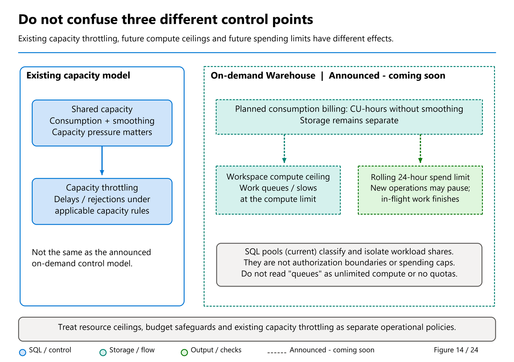

# 32. Capacity Management

[Book contents](../../index.md) | [Part VI contents](README.md) | [Previous: Chapter 31](31-billing-and-consumption.md) | [Next: Chapter 33](33-workload-management-and-sql-pools.md)

**Applies to:** Warehouse and SQL analytics endpoint within shared Fabric capacities, plus planning for announced on-demand billing. **Level:** Intermediate to advanced operations. **Feature baseline:** original controls reviewed 9 October 2026; future SQL-pool defaults reviewed against the 9 November advance notice. Guardrails depend on SKU/release; on-demand billing remains public preview coming soon.

## Manage a workload, not an isolated query

The question "Which F SKU does this warehouse need?" has no reliable answer without a workload definition. Six fact rows in `BookWarehouse` prove that a query is correct; they do not reveal the capacity needed for a Monday reporting peak, simultaneous ingestion, or an analyst who accidentally creates a many-to-many join.

Start with measurable service objectives: a reporting latency percentile, an ingestion completion deadline, a maximum acceptable failure rate, and a recovery target after idle periods. Add the concurrency and data distribution under which each objective must hold. A fast average can coexist with an unacceptable slow tail. A batch that finishes quickly in isolation can miss its deadline when it shares resources with production reports.

Capacity management combines three activities: reduce avoidable work, govern the remaining work, and purchase sufficient throughput and execution headroom. Scaling is legitimate, but it should solve an identified constraint rather than conceal a defective join or an uncontrolled retry loop.

## Four layers of resource behavior

First, the Fabric capacity establishes purchased CU throughput shared across workloads and workspaces. The warehouse does not own that entire baseline simply because it is the item currently under investigation.

Second, Warehouse backend resources scale autonomously with demand. The [workload-management reference](https://learn.microsoft.com/en-us/fabric/data-warehouse/workload-management) describes distributed tasks, scheduling, and acquisition of additional nodes under pressure. It explicitly provides no resource-assignment SLA. Do not promise that every cold, distributed query will achieve consistent subsecond latency.

Third, SKU-dependent guardrails limit how far execution can burst. Under default autonomous management, ingestion and query processing have separate boundaries. Custom pools change how the workspace's available resources are divided; they do not create a second purchased capacity.

Fourth, smoothing evaluates consumption over time. Execution headroom and accumulated consumption are different constraints. A workload can hit a resource limit without an existing history of capacity overload. Another workload can encounter rejection because earlier activity consumed future capacity allowance, even when the current SQL queue appears modest.

Diagnose these layers separately. "Capacity problem" is a useful incident category, but not a root cause.

## Bursting is useful, finite, and not free

The [burstable-capacity documentation](https://learn.microsoft.com/en-us/fabric/data-warehouse/burstable-capacity) lists different guardrails by SKU. At this baseline, default autonomous pools on F8 through F2048 have a maximum listed scale factor of 12, while F2, F4, F4096, and F8192 have different factors. These are guardrails, not guaranteed sustained speedups. The largest factors may appear only for seconds or milliseconds.

For a worked calculation, assume an invented F8 workload consumes 1,500 CU-seconds over 100 seconds. Its average consumption rate is 15 CUs, and `1500 / 100 / 8 = 1.875` describes the average scale relative to the baseline. It does not reveal its peak node allocation. It also does not authorize adding 1.875 to every other operation's factor without aligning measurement intervals and scope.

Bursting borrows against later capacity availability. It is especially useful for irregular demand with quiet periods, less useful as a strategy for a continuously overloaded service. Adding workspaces creates additional isolation boundaries but does not manufacture purchased CU throughput. Their consumption still converges on the assigned capacity.

A small SKU can sometimes finish a large query, yet perform more total work because of resource contention or spilling. Conversely, a larger SKU need not make a query faster if its bottleneck is elsewhere. Compare both service outcomes and total consumption; neither cost nor runtime is guaranteed to improve monotonically with size.

## Throttling is not a mid-query cancellation policy

Most SQL compute operations use the background accounting category and its 24-hour smoothing behavior. The [Warehouse throttling reference](https://learn.microsoft.com/en-us/fabric/data-warehouse/compute-capacity-smoothing-throttling) says in-flight operations are not throttled midway; the policy applies to subsequent operations after consumption is smoothed.

That distinction helps interpret an incident. A query canceled in flight may have been canceled by its client, by a capacity pause, by removal of its SQL pool, or by another event. Do not label every cancellation "capacity throttling." Preserve the error, timestamps, request identity, pool, and recent administrative changes before assigning cause.

Background rejection can also prevent DMV queries. A monitoring query that usually diagnoses the warehouse may fail during the very incident it is meant to inspect. Maintain access to Capacity Metrics outside that SQL troubleshooting path, and export useful historical evidence before it ages out.

Avoid a retry storm. Clients should apply bounded retries only to failures that the operation and error contract permit retrying. A failed read and a transaction with an uncertain commit outcome need different handling. Repeatedly resubmitting large queries during rejection adds operational noise and can prolong recovery once work is admitted.

## Planned on-demand controls: compute ceiling is not spending limit

The [September feature summary](https://community.fabric.microsoft.com/blog/fbc_fabricupdatesblogs/fabric-september-2026-feature-summary/5325825) describes Warehouse **on-demand billing under Coming Soon**. [Chapter 31](31-billing-and-consumption.md) explains its planned actual CU-hour charges without smoothing, separate storage, and category-level enablement across the capacity. Its workspace compute ceilings introduce a useful resource-management question: how much instantaneous headroom should this workload have, rather than how much should every workload share?

*Figure 14 — Use the same model comparison as an incident decision map.* First identify whether the boundary concerns execution resources or accumulated consumption, then identify the billing model. The on-demand controls are announced, not available knobs assumed by this exercise.

Tino's [29 September announcement](https://www.linkedin.com/posts/valentinotereshko_speed-run-of-fabric-data-warehouse-announcements-activity-7510726240522293248-r4tC) says that at the **compute ceiling**, work queues or slows rather than encountering the shared-capacity consumption-throttling behavior. This is a qualitative description of handling demand within a bounded resource envelope. Queue discipline, fairness, admission timeouts, and maximum waiting depth are not established by that announcement. It must not become "on-demand never throttles," "all queries start immediately," or "there are no quotas."

The **rolling 24-hour spending limit** answers a different question. The feature summary says that reaching it temporarily pauses **new operations**, while in-flight operations continue to completion. Treat this as accumulated-consumption admission control, not a full queue that merely needs another free worker. It is a rolling window, not an assumed midnight reset, and continuing work means a threshold is not a guarantee that spending stops at that exact instant.

| Observed or planned boundary | Meaning | Appropriate question |
| --- | --- | --- |
| Current pool/backend execution pressure | Work competes for finite resources. | Is the query shape, concurrency, or pool allocation appropriate? |
| Current shared-capacity throttling | Accumulated smoothed consumption affects subsequent admission. | What consumed capacity over the relevant history? |
| Announced on-demand workspace compute ceiling | Demand cannot obtain more execution resources beyond its ceiling; work is described as queueing/slowing. | Can this workload tolerate the wait, and is its ceiling justified? |
| Announced on-demand rolling spending limit | New operations can pause after accumulated CU-hours reach the limit. | Who owns the category's usage and its availability-versus-budget decision? |

Workspace ceilings and custom SQL pools are complementary: the first bounds the workspace envelope; the second divides and routes work within it. For example, separate a bursty exploratory workspace from predictable reporting, then distinguish reporting and ingestion within a workspace where useful. This is resource isolation, not a data-authorization boundary or an exact spend allocation. Running continuously below a compute ceiling can still accumulate substantial CU-hours.

Prepare a rollout decision rather than a fictitious configuration script. List all affected workspaces and the category owner; state the first-query and tail-latency objectives; model the consequence of a rolling spending-limit pause during month-end close; and decide who can approve changes. Measure actual whole-window consumption when a supported pilot becomes possible. Do not use an unavailable feature as today's incident remediation or copy current shared-capacity smoothing assumptions into its planned billing model.

## Overage and surge protection are not resizing

At the 8 October 2026 baseline, the [overage configuration guide](https://learn.microsoft.com/en-us/fabric/enterprise/enable-capacity-overage), updated 29 September, explicitly says capacity overage is **generally available**, while its email notifications are preview. The [surge-protection guide](https://learn.microsoft.com/en-us/fabric/enterprise/surge-protection), also updated 29 September, labels **workspace-level surge protection preview**. These controls are distinct from the on-demand billing and cache cooldown features marked "coming soon" in Tino's 29 September roundup discussed below.

The [capacity-overage overview](https://learn.microsoft.com/en-us/fabric/enterprise/capacity-overage-overview) describes an F-SKU safety net: pay for eligible excess consumption when it would otherwise trigger throttling. This can keep new work admissible, with additional charges, but **does not enlarge the SKU, add memory, or increase execution resources**. Resource and concurrency limits remain. Resizing changes the purchased baseline and relevant resource ceilings; SQL pools divide available workspace backend resources. Neither is equivalent to paying off accumulated consumption.

The overage threshold measures processed CU-hours in a rolling 24-hour window. It is **not a hard spending cap**: five-minute evaluations and continuing in-flight operations allow charges to exceed it. When the allowance is exhausted, throttling can resume until headroom returns. Current configuration guidance says new capacities enable overage by default, so inspect the actual setting and threshold rather than assuming additional charges require a later opt-in. Track billed overages in Azure Cost Management alongside Capacity Metrics.

Capacity-level surge protection instead rejects **new background operations**, using rejection and recovery thresholds against the smoothed 24-hour background percentage. Most Warehouse and SQL-endpoint SQL uses background accounting, including human-issued reporting queries; surge admission can therefore reject those queries too. It does not stop in-flight jobs or guarantee uninterrupted interactive work.

Workspace-level preview controls can block a workspace's new interactive and background requests. Their periodic evaluation makes limits soft, not exact consumption ceilings. Overage does **not** override surge protection. Choose the control for the diagnosed constraint, and validate admission and recovery behavior before relying on it for a critical reporting objective.

## Upcoming pool defaults depend on workspace generation

The [9 November SQL-pool announcement](https://community.fabric.microsoft.com/blog/fbc_fabricupdatesblogs/unifying-sql-pools-upcoming-changes-to-ui-and-apis/5397390) plans a different default for **new workspaces beginning January 2027**: one read-optimized pool serving all workloads with up to 100% of available compute, instead of the current default 50/50 configuration. Existing workspaces are stated to retain active configuration and workload behavior. This is future configuration guidance, not a present change to every workspace or the underlying F SKU.

Two nominally identical deployments can therefore need different baselines after rollout. Record workspace creation/configuration generation, effective pool settings and read optimization alongside the capacity SKU. More permitted execution headroom can change performance and consumption, but it does not guarantee a twofold change in either or give each workload a separate reservation of all compute. [Chapter 33](33-workload-management-and-sql-pools.md#upcoming-unification-prepare-clients-without-changing-todays-payload) gives the API preparation dates and preservation steps.

## Design the evidence before changing the SKU

Capture a baseline across representative busy and quiet periods. Include workload identity, application name, arrival rate, end-to-end latency, throughput, error count, item consumption, pool configuration, and cache state. Retain query hashes for grouping and distributed statement IDs for individual investigations.

Now classify the dominant problem:

| Evidence | First investigation |
|---|---|
| One query shape dominates work | Plan, statistics, join selectivity, and data layout |
| Many small requests overwhelm clients | Connection reuse, excessive polling, query frequency |
| Reporting degrades only during another application's burst | Workload isolation and classifier correctness |
| Broad rejection follows accumulated overuse | Capacity consumption and smoothing history |
| Slow first run after resume, faster repeats | Cold-start and cache behavior |
| Query exceeds execution resources on a small SKU | Query shape and SKU guardrail suitability |

These are investigation directions, not automatic remediations. For example, enlarging a pool might help its workload but increase capacity consumption or starve another pool. Improving a join can reduce runtime, concurrency overlap, and consumption simultaneously, making it preferable to an allocation change.

## A controlled capacity experiment

Change one material factor at a time. If you resize the capacity, enable acceleration, modify statistics, and change the pool classifier together, an improved result does not identify which change helped.

Use a realistic query mix with fixed correctness checks. Vary arrival rates deliberately instead of simply launching as many connections as possible. Record timeouts as failures rather than discarding them from the latency calculation. Run enough repetitions to distinguish a stable improvement from one warm-cache success.

For latency-sensitive reporting, compare median and tail latency at the required concurrency. For ingestion, compare the same data volume and distribution with the same validation rules. For cost, compare whole measurement windows and equivalent completed work, including the minimum allocation and cache-retention behavior explained in [Chapter 31](31-billing-and-consumption.md).

Decide the rollback rule before the experiment. "Return to the prior configuration if the reporting objective fails for two representative batches" is actionable. "Keep the cheaper-looking chart" is not. Record configuration timestamps so Query Insights and capacity reports can be interpreted against the correct setup.

## Pause and resume are scheduled outages

A Warehouse or Lakehouse cannot be paused independently. Pausing the underlying F capacity affects the workloads assigned to it. According to the [Warehouse pause reference](https://learn.microsoft.com/en-us/fabric/data-warehouse/pause-resume), new SQL work is rejected, in-flight work is canceled, and open user transactions roll back. System work is affected too.

Resuming starts with a clean warehouse cache and can take a couple of minutes before new work is accepted. Schedule resume early enough for readiness checks and deliberate warm-up if the business requires it. A warm-up query consumes capacity; it is not free merely because no analyst sees its result.

Pause also has financial and retention consequences. [Capacity-level guidance](https://learn.microsoft.com/en-us/fabric/enterprise/pause-resume) says remaining smoothed usage and cumulative overages are settled into the Azure bill. OneLake storage billing continues. Some cleanup catches up after resume, while retention age continues in calendar time. A pause is neither a data-retention extension nor a mechanism for erasing prior consumption.

For a nonproduction environment used a few hours per week, a scheduled pause may be a sensible tradeoff. For a production dashboard with unpredictable demand, it may violate availability and latency requirements. Obtain ownership of the full capacity workload inventory before automating the schedule.

## Worked tabletop exercise: the 09:00 incident

**Prerequisites:** the conceptual `BookWarehouse` workload, an example Capacity Metrics export, and authorized Query Insights access if you elect to inspect a nonproduction environment. This exercise requires no resize, pause, cancellation, or other tenant change.

Assume three invented observations: reporting becomes slow at 09:00, a large ingestion starts at 08:50, and rejection appears at 09:20. Initially, operators propose doubling the capacity.

First build a timeline in UTC. Determine whether the slow reporting and later rejection are separate phases. Check whether reporting used its intended pool, whether pool pressure was recorded, and whether capacity overuse had already accumulated overnight. Compare query shapes before and during the incident. If a query suddenly scans far more data, inspect its predicate and data distribution before attributing the regression to ingestion.

Next identify the counterfactual test. If pressure is localized to one application pool while the capacity has room, test a small, approved allocation change in an isolated workload. If all applications experience rejection after sustained consumption, prepare a capacity or workload-scheduling experiment instead. If a recent deployment changed the join grain, correcting the query takes precedence over either.

The expected outcome is a written hypothesis with supporting and contradicting evidence, one proposed change, a success criterion, and a rollback criterion. "Bigger capacity fixed it once" is not the expected outcome. There are no lab objects to clean up. Do not execute disruptive changes merely to manufacture an incident for this chapter.

## Turn experiments into an operating policy

Assign named owners for capacity, workspace configuration, application retries, and data quality. These responsibilities often span teams; ambiguity is itself an incident risk. A monthly review should connect changes in consumption to releases, workload growth, retention, and new applications, not just compare invoice totals.

Maintain headroom for operational work. Recovery, statistics work, historical investigations, and deployments also need compute. A service sized to a perfectly regular business workload with no contingency may be hardest to repair when it is most stressed.

Finally, distinguish announced features from controls verified in the environment. In his [29 September 2026 announcement roundup](https://www.linkedin.com/posts/valentinotereshko_speed-run-of-fabric-data-warehouse-announcements-activity-7510726240522293248-r4tC), Tino Tereshko explicitly marks on-demand billing and cache cooldown as public preview **coming soon**, while listing custom SQL pools as GA. This distinction matters operationally: a planned billing or cache control is not an available remedy for today's incident. Nor does an announcement establish that an existing script supports every setting. Read the current public contract before introducing a control into an automated runbook.

## Key takeaways

- Size for workload objectives and concurrency, not table size alone.
- Separate execution guardrails, pool pressure, and accumulated capacity rejection.
- Compare equivalent completed work and preserve cache and configuration context.
- Treat pause/resume as an outage with financial and recovery consequences.
- Keep on-demand compute-ceiling queueing distinct from its rolling spending-limit pause and from current capacity overage.

## References

1. Microsoft Learn, [Workload management](https://learn.microsoft.com/en-us/fabric/data-warehouse/workload-management).
2. Microsoft Learn, [Burstable capacity and SKU guardrails](https://learn.microsoft.com/en-us/fabric/data-warehouse/burstable-capacity), June 2026.
3. Microsoft Learn, [Warehouse smoothing and throttling](https://learn.microsoft.com/en-us/fabric/data-warehouse/compute-capacity-smoothing-throttling).
4. Microsoft Learn, [Warehouse consumption and utilization](https://learn.microsoft.com/en-us/fabric/data-warehouse/usage-reporting).
5. Microsoft Learn, [Pause and resume in Warehouse](https://learn.microsoft.com/en-us/fabric/data-warehouse/pause-resume).
6. Microsoft Learn, [Pause and resume your Fabric capacity](https://learn.microsoft.com/en-us/fabric/enterprise/pause-resume).
7. Microsoft Learn, [Custom SQL pools](https://learn.microsoft.com/en-us/fabric/data-warehouse/custom-sql-pools).
8. Tino Tereshko, [Speed-run of Fabric Data Warehouse announcements this week](https://www.linkedin.com/posts/valentinotereshko_speed-run-of-fabric-data-warehouse-announcements-activity-7510726240522293248-r4tC), 29 September 2026.

---

[Previous: Chapter 31](31-billing-and-consumption.md) | [Book contents](../../index.md) | [Next: Chapter 33](33-workload-management-and-sql-pools.md)
