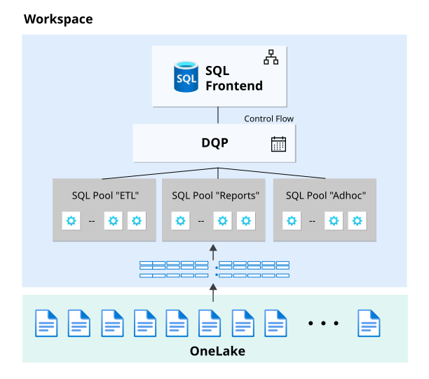

# 33. Workload Management and SQL Pools

[Book contents](../../index.md) | [Part VI contents](README.md) | [Previous: Chapter 32](32-capacity-management.md) | [Next: Chapter 34](34-gpu-acceleration.md)

**Applies to:** Warehouse and SQL analytics endpoint; custom configuration is workspace-scoped. **Level:** Advanced operations. **Feature baseline:** original API review 9 October 2026; official guidance and the 9 November advance-notice blog reviewed 9 November. September announcements label custom pools and statement classification **GA**; technical API qualifications and the future unification timeline are kept separate.

## Begin with the isolation problem

`BookWarehouse` serves two applications. `BookReporting` issues customer revenue queries throughout the working day. `BookLoad` prepares and loads data in scheduled batches. A third group uses ad hoc SQL clients. If their performance objectives differ, treating every request as equivalent makes predictable service difficult.

Fabric already performs autonomous workload management. The [public architecture description](https://learn.microsoft.com/en-us/fabric/data-warehouse/workload-management) separates default `SELECT` and non-`SELECT` compute pools, which scale independently. Custom SQL pools give administrators more explicit allocation and classification controls. They are not Synapse dedicated SQL pools with a separately purchased DWU setting, and they are not additional Warehouse items.

The useful question is not "How many pools can I create?" It is "Which workloads need different resource boundaries, and how will I verify their classification?" Begin with the smallest number that expresses a real business distinction. Every extra pool requires ownership, monitoring, and enough execution resources to make progress.

## Resolve status separately from API syntax

Tino Tereshko's [29 September 2026 announcement roundup](https://www.linkedin.com/posts/valentinotereshko_speed-run-of-fabric-data-warehouse-announcements-activity-7510726240522293248-r4tC) explicitly lists **Custom SQL Pools GA** and calls out SELECT/NONSELECT statement-type routing. The [Fabric feature summary published the same day](https://community.fabric.microsoft.com/blog/fbc_fabricupdatesblogs/fabric-september-2026-feature-summary/5325825) separately lists both custom pools and the statement-type classifier as generally available. However, the inspected [custom-pools Learn page](https://learn.microsoft.com/en-us/fabric/data-warehouse/custom-sql-pools), updated 2 September, still says preview. The [REST update reference](https://learn.microsoft.com/en-us/rest/api/fabric/warehouse/sql-pools/update-sql-pools-configuration%28beta%29), updated 15 September, still documents a beta interface requiring `beta=true`.

These dates should remain visible. A release announcement can be newer than the implementation examples without making the older parameter optional. This chapter uses the documented beta API contract where it discusses automation; it does not silently remove the query parameter because the feature has been announced GA.

The 9 November recheck found the official [API configuration how-to](https://learn.microsoft.com/en-us/fabric/data-warehouse/configure-custom-sql-pools-api) still using `beta=true`. The detailed beta REST reference was not retrievable during that recheck, so the complete October-inspected schema was not independently reconfirmed. Preserve the safeguards below, but revalidate the current complete request contract before an approved live update; a reachable how-to is not evidence that every older REST field is unchanged.

The same caution applies to statement-type classification. The September announcement expands the story beyond application names, while the inspected REST enumeration lists `Application Name` and `Application Name Regex`. Do not invent a JSON enumeration for the newly announced classifier. Verify its current supported interface in the target environment before automating it. This chapter's application-name examples stay within the inspected contract.

## Statement-type routing: rebalance SELECT and NONSELECT without naming clients

The **GA statement-type classifier** addresses a simpler distinction than application ownership. It routes `SELECT` work separately from `NONSELECT` work such as loading, transformation DML, and schema-changing DDL. An `INSERT ... SELECT` reads source rows but remains a data-modification statement; classification is not a claim that the NONSELECT class performs no reads. The [September announcement](https://community.fabric.microsoft.com/blog/fbc_fabricupdatesblogs/fabric-september-2026-feature-summary/5325825) says administrators can rebalance the built-in **50/50** compute split instead of defining application-name rules. This does not mean half of the invoice belongs to each class or that half of the requests must be SELECTs.

The current custom-pool guide scopes this classification to the **distributed SQL execution path**. Do not promise that every front-end-only operation appears in a custom pool merely because its text begins with SELECT or a DDL keyword. Verify routing using the relevant distributed execution evidence, not a count of all statements submitted by a client.

For `BookWarehouse`, consider two different requirements. If the problem is that daytime read demand needs more headroom than the load/transform class, statement-type routing is a natural pilot. If a trusted reporting application needs separation from exploratory `SELECT` queries, both are still SELECTs; application-name classification expresses that distinction better. An application can also submit both reads and writes, so routing by statement and routing by application are not equivalent policies.

On paper, compare the default split with an **illustrative**, not recommended, 70/30 SELECT/NONSELECT proposal for a read-heavy period. Would the load still finish before its deadline? Would long-running SELECTs crowd out short dashboard reads within the SELECT class? Would more read headroom change total consumption? Reverse the emphasis for a transformation-heavy workload only after examining both classes' service objectives. The right allocation follows measured work, not a count of statements.

The classifier is neither an authorization boundary nor a spending cap. It does not grant INSERT permission, distinguish trusted users automatically, or establish an exact CU-hour budget. Observe the resulting `sql_pool_name` and workload outcomes after an approved pilot. Keep this design exercise separate from automation: the older beta REST examples do not publish a verified statement-type enum, so there is no new JSON payload to copy from this chapter. Nor should their single-classifier constraints be interpreted as permission to invent a combined application-and-statement rules engine.



*Documentation image D17. Microsoft, [Custom SQL pool workload organization](https://learn.microsoft.com/en-us/fabric/data-warehouse/custom-sql-pools); [original image](https://learn.microsoft.com/en-us/fabric/data-warehouse/media/custom-sql-pools/custom-sql-pools.svg). Unmodified source copy, retrieved 9 November 2026; [CC BY 4.0](https://creativecommons.org/licenses/by/4.0/) under the [Fabric documentation licence](https://github.com/MicrosoftDocs/fabric-docs/blob/aadea08f35c3edaa9c32535c772792f02555c9a4/LICENSE). This is the documented pool model, not the proposed January 2027 default or a guaranteed spend/latency boundary.*

## What a resource percentage means

The maximum resource percentage controls a pool's share of the available workspace backend resources, including the relevant bursting behavior. It is not a fixed percentage of an invoice, a monthly budget, or an absolute currency ceiling.

For example, a proposed reporting/load/ad hoc split might allocate 50, 30, and 20 percent respectively. These are illustrative starting hypotheses, not recommended universal values. A pool can run longer with fewer resources, and a reduced allocation can sometimes increase total work because of contention. Evaluate consumption and completed work, not the percentage alone.

The API allows percentages from 1 through 100, with the sum no greater than 100, and only one default pool. The current conceptual documentation permits up to eight custom pools. Capacity resizing changes the resources behind the percentages; a sufficiently small resulting allocation can leave a pool with zero nodes and cause requests to fail until reconfigured. Percentages are therefore not portable performance guarantees between SKUs.

For the announced on-demand model, the workspace compute ceiling and these pool boundaries are intended to work together, as [Chapter 32](32-capacity-management.md) explains. That future commercial model does not need to be enabled for the GA pool feature to be useful, and a pool percentage must not be relabeled as its rolling 24-hour spending limit.

The `optimizeForReads` property controls enhanced caching. Its documented API default is true. Mark Pryce-Maher's example configuration deliberately sets it false for a particular consumption-control use case. That is a choice to test, not a universal optimization. Removing warm-cache behavior can lower persistent allocation but worsen latency and repeated read work.

## Classification is observable routing, not authorization

For application-name classification, configure clients deliberately. A connection string's application name identifies the workload for routing. Reuse stable names such as `BookReporting`, `BookLoad`, and `BookAdhoc`; do not place a random request ID into that field if it is also the classifier key.

Application names are supplied by clients. A caller able to choose its connection string can generally choose its name, so a pool is not a security boundary. Continue to use Fabric permissions and SQL authorization for data access. Nor does routing into a restricted pool mean that a user cannot consume capacity through another application or item.

Regular expressions require additional care. The inspected documentation says only the first expression in the classifier list is evaluated, all custom pools in a workspace use one classifier type, and overlapping regex matches can select a pool without priority guarantees. Prefer mutually exclusive rules and test explicit examples and near misses. A catch-all pool should have a clearly understood purpose.

Verify the result in `queryinsights.exec_requests_history` using `program_name` and `sql_pool_name`. A successful connection proves authentication, not correct routing. Include the actual observed mapping in your change record.

## A PATCH can remove more than you intended

The most important API safety rule is easy to miss: **a pool omitted from the update request is deleted**. PATCH does not mean "merge this one new pool into an untouched list."

Before any approved change, GET and preserve the entire current configuration, including pool names, percentages, classifier values, read-optimization flags, default designation, and enabled state. Record workspace ID, UTC retrieval time, and the public API version/contract. Keep the baseline independently of the proposed payload.

Construct the proposal from that baseline, explicitly retaining every pool not intended for removal. Compare the proposal against a fresh read immediately before execution. If another administrator changed the configuration, stop and reconcile; do not overwrite it using a stale export. Do not assume an undocumented ETag or concurrency parameter exists.

Removing a pool with a running query can cancel that query. The documentation distinguishes removal from resizing: resizing does not itself cause that documented cancellation. Disabling custom configuration and deleting its pools are also different operations; an empty pool array is not a harmless off switch.

## Upcoming unification: prepare clients without changing today's payload

Sowmya Sivaraman's **9 November 2026** Fabric Updates article, [Unifying SQL Pools: Upcoming changes to UI and APIs](https://community.fabric.microsoft.com/blog/fbc_fabricupdatesblogs/unifying-sql-pools-upcoming-changes-to-ui-and-apis/5397390), is **advance notice**, not a statement that the new model is already active. It describes one configuration model replacing the built-in/custom distinction.

| Announced milestone | Preparation and boundary |
| --- | --- |
| **By mid-December 2026** | Stop depending on `customSQLPoolsEnabled` to retrieve previously submitted **inactive** configurations. Preserve any needed history before GET/UI expose only effective configuration. |
| **Beginning January 2027** | New workspaces are planned to start with one read-optimized SQL pool able to serve all workloads with up to 100% of available compute. Existing workspaces retain their active configurations and workload behavior. |
| **Before the January rollout** | Prepare clients for removal of `customSQLPoolsEnabled` from PATCH and for reading the pool configuration directly, rather than branching on built-in/custom mode. Updated documentation is promised alongside rollout. |

The new-workspace default is not two reserved allocations of 100% each. SELECT and non-SELECT work would use the single pool's available envelope, rather than today's default 50/50 configuration. It does not double the purchased capacity, guarantee twice the speed, or imply unchanged consumption. `Optimize for Reads` is planned to be on by default; ingestion-heavy workloads with little cache reuse should evaluate it deliberately.

For automation, preserve **effective configuration, inactive saved configuration where still available, and change history** as distinct artifacts. After unification, a GET that omits an old inactive proposal is not proof that the proposal never existed. Review every reader, inventory job and update client that assumes the enablement flag will remain.

Do **not** remove today's required fields or beta parameter merely because an article shows a proposed future payload. The post explicitly directs readers to current REST documentation until rollout; its illustrative flag removal is not a new complete API schema or an additive-PATCH guarantee. Keep the full-configuration preservation safeguards above, verify the rolled-out contract, and approve a versioned client change separately. The book makes no pool update.

The same article discusses reducing cache cooldown **once configurability becomes available**. Its one-minute illustration is not evidence that a one-minute setting can be applied today; [Chapter 28](../05-statistics-and-performance/28-layout-caching-and-maintenance.md#cache-cooldown-plan-the-trade-off-not-an-invented-setting) retains that boundary.

## Mark's inventory-first automation pattern

Mark Pryce-Maher's [fabric-sql-pools-config repository](https://github.com/MarkPryceMaherMSFT/fabric-sql-pools-config/tree/89d3d3568ac454d64ad8744d0b726503aff73204), revision `89d3d35` dated 18 September 2026, provides a concrete operational model: discover visible workspaces, inventory their configurations, prepare actions, and gate the modifying cell behind `DRY_RUN`.

Its shipped `DRY_RUN=True`, restrictive placeholder allow-list, and `FORCE_UPDATE=False` are valuable defaults. Its inventory distinguishes failed reads from disabled configuration and records partial coverage. A 403 is not evidence that a workspace lacks custom pools.

There are two important qualifications. First, "dry run" means no pool-changing PATCH, not no writes anywhere: the notebook records inventory, action, and API-log Delta tables. Those writes consume capacity and need an approved destination. Second, an empty allow-list expands to all visible workspaces. Keep an explicit ID allow-list for controlled evaluation rather than relying on display-name uniqueness.

`FORCE_UPDATE=True` is especially consequential: the sample builds a single-pool replacement. Existing tuned pools and classifiers can disappear. This book adopts the dry-run and evidence-capture pattern, not that replacement behavior as an enterprise default. No notebook or API in this chapter was executed against a tenant.

## Read pool pressure as events

Mark's public [under_presure.sql gist](https://gist.github.com/MarkPryceMaherMSFT/852f837c83cbdbb73723a273e418bcd6/7e1f2391362694fc03c0913887e2832200df19c9) asks a useful question: how often do recorded rows indicate pressure? Its original percentage and "try lowering" labels must not be treated as a sizing policy.

The [system-view contract](https://learn.microsoft.com/en-us/sql/relational-databases/system-views/queryinsights-sql-pool-insights-transact-sql?view=fabric) is event-based. Rows are logged for configuration, capacity, or pressure-state changes; pressure must persist for at least one minute to generate the documented pressure-change event. Logging pauses when the warehouse is inactive.

Thus, ten pressure rows out of twenty rows means half the **recorded events** indicated pressure. It does not mean pressure occupied half the day. A quiet gap is not proof of continuous no-pressure time, and a long interval between two rows does not justify assigning the earlier state to every intervening second without a stated model.

The accompanying [read-only script](../../scripts/33-pool-pressure-events.sql) adapts the gist's grouping idea by preserving pool identity, limiting the time range, reporting event counts and configuration context, and removing automatic downsizing advice. Attribution: Mark Pryce-Maher, gist created 17 September 2026, substantive revision 18 September; original book adaptation dated 8 October 2026. Its 26 September history entry changes no code. The gist has no inspected explicit license; its use here is authorized by its author.

## Lab: propose, inspect, and stop

**Prerequisites:** public repository access for an offline review; optionally, an approved exported configuration and authorized read-only Query Insights access. Do not enable a pool or PATCH a workspace for this exercise.

Read the pinned notebook's parameter cell and list its blast-radius controls. Explain what happens when the allow-list is empty, a GET fails, custom pools already exist, or `FORCE_UPDATE` is true. Then build a proposal on paper for the three book applications. Specify the default pool, allocation percentages, classifier values, and read-optimization rationale.

For an existing nonproduction deployment, inspect recent routing using this original diagnostic:

**Runnable - T-SQL; execution location: authorized Warehouse or SQL endpoint; effects: read-only diagnostic compute.**

```sql
SELECT program_name, sql_pool_name, COUNT_BIG(*) AS recorded_requests
FROM queryinsights.exec_requests_history
WHERE start_time >= DATEADD(hour, -24, SYSUTCDATETIME())
GROUP BY program_name, sql_pool_name
ORDER BY program_name, sql_pool_name;
```

Run the linked pressure script only if additional evidence is needed. Compare configuration changes with workload outcomes. An unexpected default-pool assignment is a routing problem to investigate before resizing. A pressure event is a clue to correlate with throughput and latency, not an automatic failure.

The expected result is a reviewed proposal and a complete list of pools that must survive an eventual change. Include a before-state export, a stale-configuration check, an approval boundary, and a verification plan. Cleanup is limited to securely handling diagnostic exports; no SQL objects are created. If you run the author's inventory notebook separately, its Delta output tables are real artifacts and require their own retention and cleanup policy.

## Key takeaways

- Preserve the GA announcement and preview/beta documentation discrepancy.
- Choose statement type for SELECT/NONSELECT balance, application identity for distinctions within a statement class.
- Resource percentages govern execution, not spending or data authorization.
- Preserve every retained pool before PATCH; omission means deletion.
- Adopt Mark's dry-run discipline, not blind estate-wide replacement.
- Prepare for effective-only GET responses and the planned enablement-flag removal; do not apply a future API contract prematurely.
- Pressure rows are events, not a sampled percentage of wall-clock time.

## References

1. Microsoft Learn, [Workload management](https://learn.microsoft.com/en-us/fabric/data-warehouse/workload-management).
2. Fabric product team, [September 2026 feature summary](https://community.fabric.microsoft.com/blog/fbc_fabricupdatesblogs/fabric-september-2026-feature-summary/5325825), 29 September 2026.
3. Microsoft Learn, [Custom SQL pools](https://learn.microsoft.com/en-us/fabric/data-warehouse/custom-sql-pools).
4. Microsoft Learn, [Configure custom SQL pools through the API](https://learn.microsoft.com/en-us/fabric/data-warehouse/configure-custom-sql-pools-api), rechecked 9 November 2026; the [detailed beta REST reference](https://learn.microsoft.com/en-us/rest/api/fabric/warehouse/sql-pools/update-sql-pools-configuration%28beta%29) was inspected in October but not retrievable in the November recheck.
5. Mark Pryce-Maher, [fabric-sql-pools-config, pinned revision](https://github.com/MarkPryceMaherMSFT/fabric-sql-pools-config/tree/89d3d3568ac454d64ad8744d0b726503aff73204), 18 September 2026; MIT.
6. Mark Pryce-Maher, [under_presure.sql, pinned source](https://gist.github.com/MarkPryceMaherMSFT/852f837c83cbdbb73723a273e418bcd6/7e1f2391362694fc03c0913887e2832200df19c9), 18 September 2026 substantive revision.
7. Microsoft Learn, [queryinsights.sql_pool_insights](https://learn.microsoft.com/en-us/sql/relational-databases/system-views/queryinsights-sql-pool-insights-transact-sql?view=fabric).
8. Tino Tereshko, [Speed-run of Fabric Data Warehouse announcements this week](https://www.linkedin.com/posts/valentinotereshko_speed-run-of-fabric-data-warehouse-announcements-activity-7510726240522293248-r4tC), 29 September 2026, 15:44 UTC.
9. Sowmya Sivaraman, [Unifying SQL Pools: Upcoming changes to UI and APIs](https://community.fabric.microsoft.com/blog/fbc_fabricupdatesblogs/unifying-sql-pools-upcoming-changes-to-ui-and-apis/5397390), 9 November 2026; advance notice for mid-December/January, not an already completed rollout.

---

[Previous: Chapter 32](32-capacity-management.md) | [Book contents](../../index.md) | [Next: Chapter 34](34-gpu-acceleration.md)
