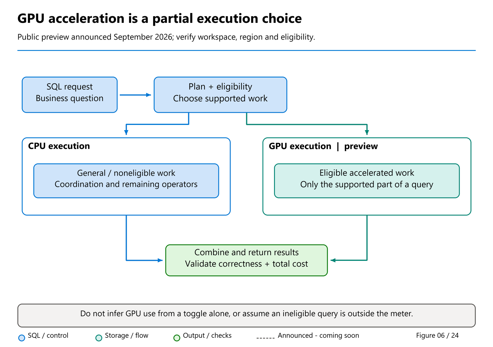
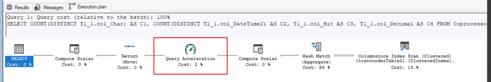

# 34. GPU Acceleration

[Book contents](../../index.md) | [Part VI contents](README.md) | [Previous: Chapter 33](33-workload-management-and-sql-pools.md) | [Next: Chapter 35](35-recovery-and-retention.md)

**Applies to:** eligible SQL execution in Warehouses and SQL analytics endpoints within an acceleration-enabled workspace. **Level:** Advanced performance and operations. **Evidence scope:** research/operational review 10 October 2026; targeted Build-roundup chronology and benchmark follow-up 10 November. Public preview was announced on 29 September; older Learn pages still describe limited-preview approval. This is not a GA or universal-availability claim.

## Acceleration is an execution choice, not a new database

GPU query acceleration adds a specialized execution path to Fabric's SQL engine. It does not require copying the warehouse into a separate GPU database, rewriting every query, or replacing T-SQL with a GPU programming language. The familiar frontend still compiles SQL, and distributed execution still coordinates the work. Eligible portions of a plan can execute on a GPU while other work remains on CPUs.

That distinction matters when predicting benefits. A query is not simply "a GPU query" or "a CPU query." One expensive join-and-aggregation fragment might benefit enough to dominate the result, even if other operators remain on CPUs. Conversely, accelerating one small fragment need not materially change the user's response time.

The [Learn overview](https://learn.microsoft.com/en-us/fabric/data-warehouse/query-acceleration) describes GPUs acting as coprocessors alongside CPUs in the same compute node. Treat that as the documented product model, not permission to infer an exact current GPU type, device count, interconnect topology, or memory quota for every capacity. Those details are not established by the public sources used here.



*Figure 6 — Conceptual cooperative CPU/GPU execution, also introduced in Chapter 6.* The GPU path is an eligible part of execution, not a second database or a promise that every operator moves to a GPU. Read the cost discussion below alongside the diagram: an ineligible query in an accelerated workspace still uses the accelerated meter.

## Read the release timeline instead of flattening it

Four statements belong in the release record:

1. Tino Tereshko's **4 June 2026** [Build roundup](https://community.fabric.microsoft.com/blog/fbc_fabricupdatesblogs/from-query-acceleration-to-cache-cooldown-everything-new-in-fabric-data-warehous/5191621) labels GPU acceleration **Coming Soon**. Its phrase "the coming few weeks" is historical, not a fresh countdown from the reader's visit.
2. The Learn overview dated **11 August 2026** calls the feature limited preview, describes requesting approval, and lists supported regions.
3. Bogdan Crivat's **29 September 2026** [FabCon Europe announcement](https://community.fabric.microsoft.com/blog/fbc_fabricupdatesblogs/bringing-governed-analytics-into-the-flow-of-work-fabric-analytics-at-fabcon-eur/5368918) says GPU-accelerated Warehouse query execution enters **public preview**.
4. Actual workspace eligibility, regional rollout, permissions, and availability still need verification before an operator attempts enablement.

The newer announcement supersedes a blanket description of the product as only an old limited preview. It does not establish that every tenant and region can immediately turn it on. Nor does it make the feature generally available.

The August page lists East US, East US 2, South Central US, South East Asia, and Germany West Central. This is a dated list, not a permanent deployment constraint. Consult current eligibility guidance rather than migrating a production workspace based solely on this chapter. The accompanying [ten-things product article](https://community.fabric.microsoft.com/blog/fbc_fabricupdatesblogs/10-things-to-know-about-gpu-powered-query-acceleration-in-fabric-data-warehouse-/5359441) also discusses preview access and five regions, illustrating why announcement status and onboarding instructions must be tracked separately.

Enabling or disabling acceleration **cancels running queries in the workspace**. This is an administrative change with outage potential, not a harmless per-query hint. An evaluation plan must drain or stop workload submission before toggling and deliberately restore the prior state afterward.

## Why analytical work can benefit

Scans, joins, filters, arithmetic, and aggregations can expose large amounts of parallel work. A GPU can process many similar operations concurrently and provide high memory bandwidth. Analytical queries often contain exactly these patterns, which explains the attraction.

But the total elapsed time includes more than accelerated arithmetic. Data movement, compilation, noneligible operators, network transfer to the client, queueing, and client rendering can dominate. A result set containing millions of rows still has to be delivered and consumed. GPU acceleration is not a substitute for selecting only necessary columns or aggregating at the right grain.

Concurrency changes the evaluation too. An improvement that looks modest for one analyst may free enough resources to improve throughput and tail latency for many simultaneous dashboards. That does not imply infinite concurrency or a flat latency curve for every workload. It means single-user latency is only one experiment.

The documentation names limited support for `nvarchar` and case-insensitive collations among common eligibility constraints. Do not change business semantics merely to make an eligibility flag turn on. Case sensitivity affects joins, filters, grouping, and uniqueness assumptions. A collation change can alter answers. Evaluate compatible data types and collations as part of data modeling, and retain correctness as the first acceptance test.

## Original TQP: reuse the machine-learning execution ecosystem

The 2022 paper [*Query Processing on Tensor Computation Runtimes*](https://www.vldb.org/pvldb/vol15/p2811-he.pdf) introduces **TQP**, the Tensor Query Processor. Its research question is about engineering leverage: can relational execution reuse tensor runtimes and their hardware support rather than require another low-level database engine for every device? The prototype translates Spark physical plans into tensor programs expressed with PyTorch operations. Optional compilation paths use TorchScript, ONNX, or TVM; Hummingbird integration lets relational processing and trained-model inference share an execution runtime. This is research ancestry, not a supported Fabric deployment procedure. [Original TQP §§3–4, pp.2813–2815; PAPER05.]

Expressing a join as tensor operations requires more than putting columns into arrays. TQP composes sorting, histograms, prefix sums, indexing, and scatter operations into relational algorithms. Filters use masks; aggregation identifies groups and combines their values. Avoiding new custom low-level operators is deliberate: each new hardware-specific implementation would reduce the portability and maintenance advantage the prototype is testing. [§§3.3, 5, pp.2813, 2815–2817.]

The limitations explain the next research step. Padded rectangular tensors make strings awkward; decimals are unsupported; the initial SQL frontend is Spark-only; and not every query can use every backend. TQP generally trails DuckDB on CPUs, with PyTorch's intra-operator parallelism and some single-threaded work limiting scaling. Hand-optimized plans improve selected cases, but do not establish that automatic translation wins universally. [§§4.1–4.3, 6.1, 6.3, 6.6, pp.2814–2815, 2818–2819, 2820–2821.]

Its principal experiments used an Azure NC6 v2 VM with six CPU virtual cores, 112 GB RAM, and a 16 GB P100, using contemporary 2021–2022 software. TPC-H covered SF1–10, substituted doubles for decimals, and used five warm-up runs followed by the median of five measured runs. At SF1, interpreted TQP handled all 22 queries, but TorchScript lacked Q15; BlazingSQL and OmniSciDB supported only 17 and 18 queries respectively. The separate TPU, integrated-GPU, and browser demonstration used hand-optimized Q6 at SF1, not the full suite on every device. These are historical, warmed prototype evaluations—not end-to-end OneLake latency measurements or Fabric CU comparisons. [§§6–6.4, pp.2817–2819; §6.9, pp.2821–2822.]

## TQP++: SQL-aware compilation rather than stock tensor operations

The supplied Microsoft Research URL containing `tqp-bridging-ml-compilers` now describes **TQP++**, not the original TQP paper. The full [2026 PVLDB paper](https://www.vldb.org/pvldb/vol19/p4116-cui.pdf) addresses the tension between portable but inefficient generic operations and fast, hardware-specific handwritten kernels. TQP++ uses **Antares** compiler infrastructure to generate GPU code from SQL-oriented expressions. Its intermediate representation adds conditionals, indirect indexing, multiple reductions, and external functions. Portability does not mean that every component is automatically invented: hash-table mechanics still use a hand-optimized function, while the compiler handles surrounding scheduling and fusion. [TQP++ §§1, 3–4, pp.4116–4119; PAPER06.]

Three contributions are particularly relevant to a Warehouse engineer:

- **Schedule across the memory hierarchy.** `LIKE` processing reuses overlapping character windows in shared memory; aggregation combines register, shared-memory, and high-bandwidth-memory work; join-output compaction coordinates threads to reduce global atomic contention. Efficient execution depends on where values live, not only the number of GPU arithmetic units. [§5, pp.4119–4121.]
- **Fuse work, but account for compilation.** Just-in-time fusion (**JTF**) generates query-specific combined kernels. Ahead-of-time fusion (**ATF**) selects precompiled kernels and avoids per-query kernel-compilation delay. Fusion removes intermediate tensors within a fused stage, not every intermediate between stages. [§6.1, pp.4121–4122.]
- **Choose algorithms using runtime data.** Switch nodes select paths for compact versus sparse grouping domains, or unique-key versus potentially expanding many-to-many joins. SQL output sizes and distributions are data-dependent; one fixed dense-tensor strategy is not sufficient. [§6.2, pp.4122–4123.]

The evaluation's portability claim also has a boundary. Its broad device comparison uses SSB SF16 and TPC-H SF10 across NVIDIA and AMD hardware and the Xbox platform. It does not establish that every device ran the SF100 workload. SQL semantics remain another boundary: the TPC-H evaluation uses double precision rather than decimals, so its timings are not evidence that replacing exact financial arithmetic is acceptable. [§§9, 9.3, pp.4124–4125.]

### The research-to-product boundary is explicit

TQP++ §10 says productization began in 2023. The initial Fabric DW GPU runtime was a C++ port incorporating ATF kernels, dispatch logic, and PyTorch integration. The team subsequently rewrote the ATF kernels directly in CUDA. Overflow detection, ANSI null behavior, and locale-sensitive string/date semantics required attention beyond the prototype's emphasis; the first product version's NVIDIA target also reduced the immediate value of cross-vendor kernel generation.

Most importantly, **the product team did not adopt JTF because of compilation latency**. Thus TQP++ supplies both compiler research and a useful account of its limits in production. It does not establish that today's Warehouse runs the paper's compiler, uses its benchmark hardware, or exposes its research switches to administrators. [§10, pp.4126–4127.]

## CoddSpeed: architectural evidence with a clear boundary

[*CoddSpeed: Hardware Accelerated Query Processing in Microsoft Fabric*](https://www.microsoft.com/en-us/research/publication/coddspeed-hardware-accelerated-query-processing-in-microsoft-fabric/) reports the production-oriented integration of hardware acceleration with Fabric. Its public abstract describes hardware independence, a GPU engine derived from TQP, and data movement using NVLink and InfiniBand. Matteo Interlandi's [2 June 2026 award article](https://community.fabric.microsoft.com/blog/fbc_fabricupdatesblogs/from-research-to-product-microsoft-fabric-wins-best-industry-paper-at-sigmod-202/5191608), updated 3 June, provides the more detailed public explanation used here. The **SIGMOD 2026 Industry Track Best Paper** award is independently confirmed by the [conference awards list](https://2026.sigmod.org/sigmod_awards.shtml). [PAPER04; TEAM12.]

The article describes two deliberately limited interfaces:

- **CAL, the Coprocessor Abstraction Layer**, offloads plan fragments, reports coprocessor capabilities, and exchanges columnar inputs and outputs. The host retains optimization responsibility. Partitionable execution and per-partition CPU fallback address fragments that cannot fit in GPU high-bandwidth memory.
- **DAL, the Data Abstraction Layer**, provides a unified caching and shuffle interface over transports such as NVLink, InfiniBand, PCIe, Ethernet, and Infinity Fabric. Long-term caching decisions remain with the host scheduler; hiding the transport does not mean data movement is free.

This is an evolutionary architecture: retain the optimizer and SQL service, identify executable fragments, and make the coprocessor and transport replaceable behind interfaces. Larger eligible fragments amortize transfers better than repeated CPU/GPU crossings around isolated operators. Broader SQL coverage is therefore a performance concern as well as a compatibility concern. The article's account of custom CUDA kernels and correct null/overflow behavior is consistent with TQP++'s explicit productization boundary.

The review scope is **CoddSpeed's abstract, bibliographic record, and award article—not its full text**. The ACM endpoints were inaccessible during this revision. The summaries of CAL/DAL and the CoddSpeed measurements below are consequently attributed to the article, without invented paper-section citations. References to FPGAs, ASICs, or network accelerators describe architectural flexibility, not a hardware-selection menu for a Fabric workspace.

The June article describes early access as forthcoming. That is a historical release statement, not October availability evidence; the September public-preview announcement and current onboarding guidance remain the operational references.

## Reported experiments: preserve the comparison, not just the multiplier

The following are **authors' reported measurements**, not benchmarks executed or independently reproduced for this book. TPC-H and SSB scale factors describe their respective generated datasets; they are not interchangeable with compressed production size. Research-engine timings, service comparisons, and Bogdan's concurrency experiment below answer different questions.

### Build roundup: a separate cloud-provider comparison

The **4 June Build article** reports **up to 7 times** faster performance than three unnamed leading cloud warehouses. It also reports completing a full **22-query, 100-GB workload in approximately five seconds** across **one to 64 concurrent users**, describing near-flat response times in that tested range.

The article does not provide a complete reproducible query/configuration package, named competitor configurations, cache methodology or CU accounting. The figures therefore remain attributed product-team claims, not a certified TPC comparison, universal concurrency guarantee or equal-cost result. Do not combine them with CoddSpeed's CPU-Fabric comparisons, TQP++'s warmed GPU-resident research timings, or Bogdan's later F64/1,000-user experiment. Those have different baselines and measurement boundaries.

### TQP++: warmed execution and the cost of moving the input

The paper's common procedure loads data into each system, places it in GPU memory where applicable, runs ten times, discards the first five as warm-up, and reports the median of the final five. The CPU-resident-input experiment separately includes transfer. CPU baselines use 64 logical cores on a Xeon Platinum 8370C machine with 256 GB RAM: SQL Server with columnar indexes and DuckDB 1.1. HeavyDB 8.1 fragment sizes are tuned per query, and its comparison uses manually unnested queries with `COUNT DISTINCT` moved out. These are not CPU Fabric Warehouse baselines. [TQP++ §9, pp.4124–4125.]

| Experiment and starting data location | Reported result | Comparison boundary |
|---|---|---|
| TPC-H SF100, one A100, warmed GPU-resident input | TQP++ totals **1.1 s** across all 22 queries; HeavyDB approximately **7.1 s** across 21; SQL Server **16.1 s**, DuckDB **16.4 s** | HeavyDB does not support Q21, so coverage differs. The abstract's rounded multipliers refer to these particular configurations, not Fabric capacity or billing. |
| TPC-H SF100, warmed GPU-resident input, newer devices | TQP++ totals **0.69 s on H100** and **0.65 s on MI300**, compared with **1.1 s on A100** | Same research engine and 22-query workload; not a promise of subsecond end-to-end service execution. |
| SSB SF16, A100, warmed GPU-resident input | TQP++ **26.5 ms**, optimized Crystal **18.3 ms**, HeavyDB **251 ms** | TQP++ does not beat optimized Crystal here. Crystal uses handwritten CUDA queries and supports only SSB. |
| TPC-H SF100, A100, input initially in CPU memory | **15.7 s**, including **14.6 s transfer**, versus **1.1 s** for the GPU-resident case | Includes a cost excluded from the resident-input result. This is not CoddSpeed's separately defined cold-cache experiment. |

These results come from §§9.1–9.2, pp.4124–4125, and §§9.5–9.7, p.4126, including Figures 12–15 and Table 4. Compilation is measured separately and can cost more than the short GPU execution it prepares. SF100 peak memory includes inputs and live intermediate results; expanding joins can constrain single-GPU scale. The engineering lesson is to account for compilation, transfer, and intermediate storage, not to copy the fastest timing into a service-level objective.

### CoddSpeed: award-article results against CPU Fabric DW

The article states that its speedups use **baseline CPU Fabric DW**, with **medians of repeated runs and warm caches unless otherwise stated**. That methodological statement applies to the following table, not to TQP++ or Bogdan's experiment.

| Article experiment | Reported speedup over CPU Fabric DW | Required qualification |
|---|---|---|
| One A100, TPC-H SF100 | **7.9× warm; 4.7× cold** | Separate cache conditions; the article does not fully define its cold-cache procedure or initial data placement. |
| Internal customer workload, 300 GB compressed, 16 queries | **14.9× warm; 9.7× cold** | The article does not identify the GPU configuration for this workload. Do not borrow the preceding A100 setup. |
| Eight H100s in one node, TPC-H SF1000, warm | **2.1× without DAL; 27.1× with DAL over NVLink** | Both are relative to the CPU baseline, not a claim that adding DAL itself gives 27.1×. This comparison emphasizes the shuffle path. |
| Sixteen H100s across two nodes, TPC-H SF1000, warm | **30.4× with NVLink and InfiniBand** | A different multi-GPU system, not an acceleration setting guaranteed to provision this topology. |

The article does not supply the complete CPU hardware configuration, repeat count, detailed cross-query aggregation method, concurrency configuration, precise cold-cache definition, or capacity/CU accounting. Warm caches do not by themselves establish identical GPU-resident input treatment to TQP++. These gaps prevent reconstruction of the full comparison; the inaccessible paper might provide more detail, but this chapter does not presume it. Neither table demonstrates equal-CU savings or identifies hardware assigned to a current tenant.

## Related work: correctness and precisely attributed awards

The 2026 paper [*Scalable GPU Acceleration of Scalar Functions in Analytical Databases: Compilation, Benchmarking, and Optimization*](https://www.vldb.org/pvldb/vol19/p1441-rajan.pdf) explains a closely related obstacle: faithfully recreating many scalar functions by hand is expensive. The authors lift existing SQL Server C++ implementations through Polygeist into MLIR, optimize structured code and data layouts, and compile GPU kernels ahead of time. Reusing implementations helps preserve difficult decimal, collation, calendar, and edge-case semantics while allowing larger fragments to remain on GPU. [§§2–4, pp.1443–1447; PAPER08.]

This is not proof of universal GPU function eligibility. Its extended **TPC-H-scalar** benchmark changes the original query semantics in three cases, and an expert handwritten substring kernel remains faster than the generated version. Much of this work involves integer operations rather than tensor cores. The relevant lesson for operators is why coverage and exact results matter, not a reason to relax numeric or collation requirements. [§5.2, pp.1448–1449; §§6–6.5, pp.1449–1451.]

> **Awards belong to specific papers.** CoddSpeed won the SIGMOD 2026 Industry Track Best Paper award. The earlier TQP demonstration, [*Share the Tensor Tea: How Databases can Leverage the Machine Learning Ecosystem*](https://www.vldb.org/pvldb/vol15/p3598-interlandi.pdf), won [VLDB 2022 Best Demonstration](https://www.vldb.org/2022/?conference-awards); its notebooks and TensorBoard profiling show a research prototype, not a Fabric monitoring interface. The scalar-function paper received [VLDB 2026 Best Research Paper Honorable Mention](https://vldb.org/2026/conference-awards.html). No TQP++ award was confirmed in that conference list. These distinctions avoid attributing an award for a demonstration, or for CoddSpeed, to every paper in the family. [PAPER07–PAPER08.]

## Find the full papers and view source figures

| Main paper | Discovery record | Full-paper route |
|---|---|---|
| Original TQP, *Query Processing on Tensor Computation Runtimes*, PVLDB 15(11), pp.2811–2825 (2022) | [Microsoft Research](https://www.microsoft.com/en-us/research/publication/query-processing-on-tensor-computation-runtimes/) · [DOI](https://doi.org/10.14778/3551793.3551833) | [Published PDF, 15 pages](https://www.vldb.org/pvldb/vol15/p2811-he.pdf) |
| TQP++, *Bridging ML Compilers and Analytical Query Processing on GPUs*, PVLDB 19(12), pp.4116–4129 (2026) | [Microsoft Research](https://www.microsoft.com/en-us/research/publication/tqp-bridging-ml-compilers-and-analytical-query-processing-on-gpus/) · [DOI](https://doi.org/10.14778/3827998.3828020) | [Published PDF, 14 pages](https://www.vldb.org/pvldb/vol19/p4116-cui.pdf) |
| CoddSpeed, *Hardware Accelerated Query Processing in Microsoft Fabric*, SIGMOD Companion, pp.359–372 (2026) | [Microsoft Research](https://www.microsoft.com/en-us/research/publication/coddspeed-hardware-accelerated-query-processing-in-microsoft-fabric/) · [DOI](https://doi.org/10.1145/3788853.3803077) | [Publisher PDF endpoint](https://dl.acm.org/doi/pdf/10.1145/3788853.3803077); access was blocked during review |

The TQP++ Microsoft Research page's generic PDF link leads to a [10-page presentation](https://www.microsoft.com/en-us/research/wp-content/uploads/2026/05/TQP.pdf), not the 14-page paper cited here. Use the published PVLDB PDF for its evaluation and §10 productization account. Appendix D records the full-text review of the TQP-family and scalar-function papers separately from CoddSpeed's abstract-plus-article scope.

**View at source; not reproduced here:** the [award article's per-query comparison chart](https://community.fabric.microsoft.com/blog/fbc_fabricupdatesblogs/from-research-to-product-microsoft-fabric-wins-best-industry-paper-at-sigmod-202/5191608) shows its single-A100 TPC-H SF100 comparison; [TQP++ Figure 11](https://www.vldb.org/pvldb/vol19/p4116-cui.pdf#page=9) shows compilation, and [Figure 15](https://www.vldb.org/pvldb/vol19/p4116-cui.pdf#page=11) shows timings when input begins in CPU memory. These are useful companions to the summaries, but public availability is not redistribution permission. Reuse rights for the blog chart were not established, and the PVLDB papers' CC BY-NC-ND terms do not automatically clear figures for arbitrary book publication. The separately licensed Microsoft documentation screenshot below has its own attribution.

## Bogdan's experiment: useful because its conditions are visible

Bogdan Crivat's [We Put a GPU Behind Fabric DW](https://community.fabric.microsoft.com/blog/fbc_fabricupdatesblogs/we-put-a-gpu-behind-fabric-dw/5262382), published 7 July 2026, is a useful worked example of transparent performance reporting. He describes a personal experiment rather than an official performance test, using an F64 Trial capacity, a 100 GB TPC-H-derived workload, a client in the same region, and disabled result-set caching. Query order and scalar predicate values were randomized.

For 1,000 concurrent users, the article reports approximately 16.9 queries per second on CPU versus 101.4 with GPU, with reported p95 latencies of 97.7 and 15.1 seconds respectively. The experiment also preserves a noisy 256-user GPU result instead of hiding it. That admission is as instructive as the headline speedup: a performance report should show instability rather than select only its most flattering runs.

Read the conclusions with their boundaries attached. This is not a certified TPC benchmark comparison, not a universal production forecast, and not an equal-CU experiment simply because both sides use an F64-labelled capacity. Acceleration has a different consumption rate. The paper's 1 TB result, the product team's comparisons with other providers, and Bogdan's 100 GB experiment are different evidence sets; combining them into one speedup claim would be misleading.

Nor should the article's capacity-equivalence extrapolation become a sizing formula. Six times the throughput in one experiment does not establish that six times the CPU capacity produces the same response, or that a hypothetical intermediate SKU is available. Measure the actual alternatives your organization can deploy.

## The economic test includes ineligible work

The current [Fabric operations reference](https://learn.microsoft.com/en-us/fabric/enterprise/fabric-operations) gives **0.538 CU per standard core** and **3.446 CU per accelerated-mode core**, dated September 2026. Their ratio is approximately **6.405**.

In a deliberately simplified example with identical allocated core counts and no allocation-window or cache differences, accelerated execution would need to finish in less than roughly one-sixth of the standard time to reduce CU-seconds. Real workloads violate those assumptions: allocations differ, concurrency overlaps, minimum windows apply, and caching changes resource lifetime. The ratio is a useful sensitivity calculation, not a production break-even rule.

More importantly, the [FAQ](https://learn.microsoft.com/en-us/fabric/data-warehouse/query-acceleration-faq) states that all queries in an acceleration-enabled workspace are billed through the acceleration meter, including queries that are not accelerated. The configuration is workspace-wide across Warehouses and SQL endpoints. A beneficial reporting workload can therefore change the economics of unrelated lightweight reads, diagnostics, and noneligible work in the same workspace.

Compare total consumption for equivalent completed work over comparable windows. Include failures and retries, and keep the standard and accelerated phases separate from administrative transition periods. If one phase completes more requests, reporting only its larger CU total hides efficiency; reporting only CU per successful request can hide failed requests. Show both, alongside latency and throughput.

This is also why a six-row book query cannot establish value. Its fixed correctness result is useful, but startup and other overheads overwhelm any meaningful large-scale analytic comparison.

## Observe what actually happened

The portal's query history can show whether acceleration applied. Query Insights exposes `is_accelerated` in `exec_requests_history`; the long-running and frequently-run views expose accelerated-run counts. Execution plans can show a Query Acceleration operator.

Use those observations together. An enabled workspace setting is not proof that a particular query used the GPU. An `is_accelerated=1` flag is not proof that every operator did, nor a measurement of GPU occupancy. A zero may mean that acceleration was disabled or that the query was ineligible.



*Documentation image D06 — Microsoft's illustrative graphical execution plan, not an observed execution of this book's examples.* Credit: Microsoft. [Source article and context](https://learn.microsoft.com/en-us/fabric/data-warehouse/query-acceleration#view-query-acceleration-in-execution-plan) · [Original image](https://learn.microsoft.com/en-us/fabric/data-warehouse/media/query-acceleration/graphical-execution-plan-operator.png). Retrieved 10 October 2026, unmodified; reproduced under [CC BY 4.0](https://creativecommons.org/licenses/by/4.0/) from the [MicrosoftDocs content license](https://github.com/MicrosoftDocs/fabric-docs/blob/main/LICENSE).

Use the image to recognize the operator, not to infer that the six-row example was accelerated. Consult the linked current documentation for supported clients and plan-capture methods: actual-plan support and available execution details vary. The screenshot does not establish universal actual-plan support or replace query-history evidence.

Power BI deserves the same precision. DirectQuery scenarios that generate eligible warehouse SQL can benefit. DAX itself is not directly GPU-accelerated by this feature. A semantic model or visual may spend time outside the SQL operation, so a faster warehouse query does not guarantee the same proportional improvement in end-to-end report rendering.

## Lab: design a reproducible evaluation without changing a tenant

**Prerequisites:** the chapter 4 book dataset for correctness; a workload manifest and measurement worksheet for an offline evaluation design. A future live experiment additionally requires an approved nonproduction workspace, current feature eligibility, authorized monitoring, representative synthetic data, and a maintenance window. This book performs no enablement or tenant benchmark.

First establish a correctness anchor:

**Runnable - T-SQL; execution location: `BookWarehouse`, or its independently seeded Lakehouse SQL endpoint; effects: read-only query compute.**

```sql
SELECT c.CountryCode,
       SUM(CAST(s.Quantity * s.UnitPrice AS decimal(18,2))) AS Revenue
FROM book.FactSales AS s
JOIN book.DimCustomer AS c ON c.CustomerKey = s.CustomerKey
GROUP BY c.CountryCode
ORDER BY c.CountryCode;
```

The unchanged seed returns DE 180.00 and GB 185.00. Confirm the joins have the intended cardinality; the example has no enforced primary-key assumption. Preserve the exact numeric result as a correctness test, not a performance baseline.

Next design a representative query mix. Include a large aggregation, a selective join, a less eligible expression pattern, and the common low-cost queries that share the workspace. Specify input scale, skew, data types, client region, connection reuse, arrival rate, warm-up policy, and result-set-caching treatment. Distinguish engine-performance tests with result caching excluded from user-experience tests that intentionally include it.

For each future phase, record correctness, elapsed-time percentiles, successful throughput, errors, acceleration evidence, and item/workspace CU-seconds. Repeat the standard and accelerated phases rather than assuming one run is representative. Do not toggle with active submissions.

When authorized observations already exist, this original query inspects recent acceleration evidence:

**Runnable - T-SQL; execution location: authorized Warehouse or SQL endpoint; effects: read-only diagnostic compute.**

```sql
SELECT TOP (100)
       distributed_statement_id, start_time, end_time,
       status, is_accelerated, allocated_cpu_time_ms, sql_pool_name
FROM queryinsights.exec_requests_history
WHERE start_time >= DATEADD(hour, -2, SYSUTCDATETIME())
ORDER BY start_time DESC;
```

Allow for history ingestion delay. Correlate consumption by item and overlapping UTC windows, not Capacity Metrics Operation ID, as [Chapter 31](31-billing-and-consumption.md) explains.

The expected outcome is an evaluation package with acceptance thresholds, not an assumed speedup. For example: preserve exact decimal results, meet the required reporting p95, remain within a stated consumption envelope, and avoid regression for unrelated applications. Include a stop condition if unexpected cancellations or correctness differences appear.

The offline lab creates no artifacts. In a later approved live evaluation, preserve the prior setting, drain work before returning to it, and remove only explicitly named synthetic benchmark objects. Do not alter production collations or overwrite shared tables as cleanup.

## When to defer acceleration

Defer if the workload is too small to justify the higher meter, if most work is ineligible, if the business objective is already met cheaply, or if the organization cannot perform a controlled comparison. Defer also when the apparent bottleneck is client rendering or an incorrect query plan rather than eligible compute.

Adopt when measured benefits at the required concurrency outweigh whole-workspace consumption and operational complexity. Hardware acceleration is valuable precisely when it solves the workload's actual constraint, not merely when the feature is new.

## Key takeaways

- September's public-preview announcement and August's approval guidance are distinct dated evidence.
- CPUs and GPUs cooperate; eligibility and partial acceleration matter.
- TQP, TQP++, and CoddSpeed describe related but different systems; research JTF was not adopted in the product.
- Resident-input research timings and service warm/cold-cache comparisons are different experiments.
- Bogdan's experiment and CoddSpeed motivate testing, not universal or equal-CU claims.
- The accelerated meter applies to ineligible queries too.
- Toggling cancels running workspace queries; plan the transition.

## References

1. Bogdan Crivat, [Fabric Analytics at FabCon Europe 2026](https://community.fabric.microsoft.com/blog/fbc_fabricupdatesblogs/bringing-governed-analytics-into-the-flow-of-work-fabric-analytics-at-fabcon-eur/5368918), 29 September 2026.
2. Microsoft Learn, [Query acceleration](https://learn.microsoft.com/en-us/fabric/data-warehouse/query-acceleration), 11 August 2026.
3. Microsoft Learn, [Query acceleration FAQ](https://learn.microsoft.com/en-us/fabric/data-warehouse/query-acceleration-faq), July/August 2026.
4. Matteo Interlandi and coauthors, [CoddSpeed publication and abstract](https://www.microsoft.com/en-us/research/publication/coddspeed-hardware-accelerated-query-processing-in-microsoft-fabric/), SIGMOD Companion 2026, pp.359–372; [PAPER04](../../appendices/D-bibliography.md#paper04). Full text was not reviewed.
5. Bogdan Crivat, [We Put a GPU Behind Fabric DW](https://community.fabric.microsoft.com/blog/fbc_fabricupdatesblogs/we-put-a-gpu-behind-fabric-dw/5262382), 7 July 2026.
6. Fabric product team, [Ten things to know about GPU-powered query acceleration](https://community.fabric.microsoft.com/blog/fbc_fabricupdatesblogs/10-things-to-know-about-gpu-powered-query-acceleration-in-fabric-data-warehouse-/5359441).
7. Microsoft Learn, [Fabric operations](https://learn.microsoft.com/en-us/fabric/enterprise/fabric-operations), September 2026 rates.
8. Dong He and coauthors, [Query Processing on Tensor Computation Runtimes](https://www.vldb.org/pvldb/vol15/p2811-he.pdf), PVLDB 15(11), pp.2811–2825, 2022; [PAPER05](../../appendices/D-bibliography.md#paper05). Complete published paper reviewed in the GPU research pass.
9. Wei Cui, Peng Cheng, Carlo Curino, Rathijit Sen, and Matteo Interlandi, [TQP++: Bridging ML Compilers and Analytical Query Processing on GPUs](https://www.vldb.org/pvldb/vol19/p4116-cui.pdf), PVLDB 19(12), pp.4116–4129, 2026; [PAPER06](../../appendices/D-bibliography.md#paper06). Complete published paper reviewed; §10 governs the research/product distinction.
10. Matteo Interlandi, [From research to product: Microsoft Fabric wins best industry paper at SIGMOD 2026 for GPU-accelerated data warehousing](https://community.fabric.microsoft.com/blog/fbc_fabricupdatesblogs/from-research-to-product-microsoft-fabric-wins-best-industry-paper-at-sigmod-202/5191608), 2 June 2026, updated 3 June; [TEAM12](../../appendices/D-bibliography.md#team12). Source of the CAL/DAL explanation and explicitly article-reported CoddSpeed measurements.
11. Yuki Asada and coauthors, [Share the Tensor Tea: How Databases can Leverage the Machine Learning Ecosystem](https://www.vldb.org/pvldb/vol15/p3598-interlandi.pdf), PVLDB 15(12), pp.3598–3601, 2022; [PAPER07](../../appendices/D-bibliography.md#paper07).
12. Kaushik Rajan and coauthors, [Scalable GPU Acceleration of Scalar Functions in Analytical Databases: Compilation, Benchmarking, and Optimization](https://www.vldb.org/pvldb/vol19/p1441-rajan.pdf), PVLDB 19(7), pp.1441–1454, 2026; [PAPER08](../../appendices/D-bibliography.md#paper08).
13. Conference award records: [SIGMOD 2026](https://2026.sigmod.org/sigmod_awards.shtml), [VLDB 2022](https://www.vldb.org/2022/?conference-awards), and [VLDB 2026](https://vldb.org/2026/conference-awards.html), checked 10 October 2026.
14. Tino Tereshko, [From query acceleration to cache cooldown: Everything new in Fabric Data Warehouse at Build 2026](https://community.fabric.microsoft.com/blog/fbc_fabricupdatesblogs/from-query-acceleration-to-cache-cooldown-everything-new-in-fabric-data-warehous/5191621), published 4 June, modified 5 June 2026; full article reviewed 10 November. Its provider-comparison claims are not independently reproduced here.

---

[Previous: Chapter 33](33-workload-management-and-sql-pools.md) | [Book contents](../../index.md) | [Next: Chapter 35](35-recovery-and-retention.md)
