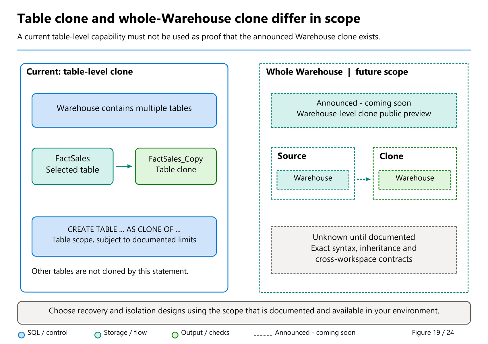
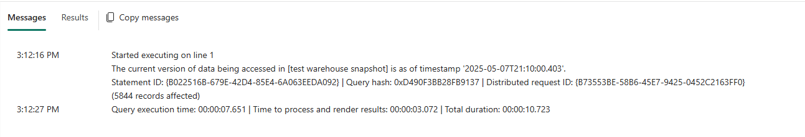

# 35. Recovery and Retention

[Book contents](../../index.md) | [Part VI contents](README.md) | [Previous: Chapter 34](34-gpu-acceleration.md) | [Next: Chapter 36](36-development-and-automation.md)

**Applies to:** Warehouse recovery, historical queries, table clones, and snapshots; SQL endpoint time travel has separate prerequisites and Lakehouse retention. **Level:** Intermediate to advanced operations. **Feature baseline:** original revision checked 9 October 2026; snapshot boundaries and the Warehouse-clone roadmap rechecked 9 November. Warehouse-level CLONE remains a future planned preview, not the existing table-clone feature.

## Define what must be recovered

A recovery request should identify an object, an acceptable point in time, and an acceptable interruption. "Restore the warehouse" might mean inspect one customer's earlier values, recover a damaged table, reverse a release, or recover a deleted Fabric item. Those are different operations with different blast radii.

Start with the least disruptive mechanism that answers the question. A historical SELECT can establish what happened without modifying current data. A table clone can provide an independent table representation for analysis or a controlled repair. Restore in-place replaces the existing warehouse state and requires a much broader decision.

Recovery also involves the pipeline that produced the data. If the bad load immediately runs again after a successful restore, the warehouse is not recovered operationally. Preserve the failing input, transformation version, batch identifier, and checkpoint. Correct or suspend the faulty path before resuming normal ingestion.

## Retention is a forward-looking policy

Warehouse [configurable retention](https://learn.microsoft.com/en-us/fabric/data-warehouse/data-retention) defaults to **30 calendar days** and supports **1 through 120 days** at this baseline. It governs historical access used by time travel, point-in-time clones, restore points, and warehouse snapshots.

Increasing retention cannot recreate history already lost under a shorter policy. If a warehouse retained seven days and you increase the setting to sixty, sixty days of past data do not suddenly become available. The larger history accumulates over time.

Decreasing retention is a potentially irreversible data-access decision. Versions outside the new boundary become unavailable and eligible for cleanup; increasing the setting again does not safely undo that decision. Do not treat a temporary reduction as a reversible storage experiment.

The `time_travel_retention_cutoff_date` column in `sys.databases` identifies the actual earliest available time-travel boundary, which can differ from the configured number of days. Check it when preparing a historical query. Calendar age includes time while the capacity is paused, even if cleanup waits until compute resumes.

Retained historical files occupy storage. The cost depends on the volume and pattern of modifications, not merely current table size multiplied by retention days. Restore-point metadata also occupies storage, while creating and using recovery artifacts can consume compute. A policy should balance investigation delay, recovery needs, compliance requirements, and storage consumption; maximum retention is not automatically the right answer.

## Time travel answers a data question

[Time travel](https://learn.microsoft.com/en-us/fabric/data-warehouse/time-travel) uses `OPTION (FOR TIMESTAMP AS OF ...)` on a SELECT. The timestamp applies to the statement, including joined warehouse tables. It is UTC, deterministic, and accepts up to millisecond precision.

Historical data is not a historical copy of every schema definition. The current schema participates in the query. A column that did not exist at the requested time cannot be treated as if it did. Dropping and recreating a table loses the old table's history even when the replacement has the same name. Explicit projection is therefore safer than an unexamined `SELECT *` during recovery.

The SQL analytics endpoint now has time-travel support documented as preview, but only for endpoints created with new metadata sync enabled. Its historical data availability depends on the underlying Lakehouse table's vacuum retention, not the Warehouse's 30-day default. Do not run Warehouse retention instructions against a Lakehouse and assume Spark's historical files are protected.

The time-travel reference also excludes the hint in **Power BI Desktop DirectQuery** and **Explore this data**. A successful historical SELECT in a SQL editor does not establish support in those clients. Retained history, latest-schema compatibility and client applicability are independent checks.

Business dates are not commit timestamps. The book facts have January 2026 `DateKey` values and a synthetic `LastModifiedUtc`. If you create `BookWarehouse` in October, those values do not make January storage history exist. Choose a timestamp after the data was actually committed and within the actual retention boundary.

## Clones and snapshots solve different problems

A [Warehouse table clone](https://learn.microsoft.com/en-us/fabric/data-warehouse/clone-table) initially references existing data files through copied metadata. Subsequent changes to the source and clone are independent. Creating a clone is a write operation that creates a new table, not a free SELECT.

At this baseline, table clones are supported within a warehouse, including across its schemas, but not across warehouses or workspaces and not on Lakehouse SQL endpoints. Historical clone creation is retention- and schema-dependent. Once created, a clone persists until deleted; it should have an owner and cleanup policy. "Zero-copy" does not mean "no governance" or "independent off-platform backup."

A [Warehouse snapshot](https://learn.microsoft.com/en-us/fabric/data-warehouse/warehouse-snapshot) is a read-only child item representing its parent at a selected time. It supports stable consumption and can be rolled forward. It is not a table clone and not a restorable external backup file.

The October snapshot guidance is especially important: stable reporting applies to **data**, not immutable schema. Later parent schema changes can break a report using the snapshot. Permissions reflect the parent's current security, rather than granting a user access they had at the historical timestamp. Direct Lake is not supported for Warehouse snapshots at this baseline; DirectQuery and Import are the documented Power BI choices.

Snapshots do not have independently configurable retention: their historical availability depends on the parent's retention boundary. They are also **not OneLake shortcut sources**. The current recovery guidance says associated snapshots are restored with the Warehouse, correcting an older instruction to recreate them. That does not restore an external report's configuration or make the snapshot an independent backup. These are clarified existing boundaries, not new November availability claims.

These distinctions matter during a release. A snapshot may stabilize data while a load runs, but it does not make an incompatible column removal safe for existing consumers.



*Figure 19 — Conceptual table-clone versus warehouse-clone scope, not interchangeable commands.* Other tables are not included by cloning one table. The warehouse-level branch is marked as announced because the current table-clone contract does not implement it. The read-only snapshot discussed above is a third mechanism, not either of these clone operations.



*Documentation image D18. Microsoft, [Data versions read through a Warehouse snapshot](https://learn.microsoft.com/en-us/fabric/data-warehouse/warehouse-snapshot); [original image](https://learn.microsoft.com/en-us/fabric/data-warehouse/media/warehouse-snapshot/current-version-of-data-being-accessed.png). Unmodified source copy, retrieved 9 November 2026; [CC BY 4.0](https://creativecommons.org/licenses/by/4.0/) under the [Fabric documentation licence](https://github.com/MicrosoftDocs/fabric-docs/blob/aadea08f35c3edaa9c32535c772792f02555c9a4/LICENSE). Snapshot data versions are distinct from source schema/current permissions, a writable clone and an independent backup.*

## Warehouse-level CLONE: prepare the use case, not the syntax

**Future planned preview, not an available lab dependency.** Tino Tereshko's [29 September roundup](https://www.linkedin.com/posts/valentinotereshko_speed-run-of-fabric-data-warehouse-announcements-activity-7510726240522293248-r4tC) called Warehouse CLONE "public preview coming soon," while Bogdan Crivat's [FabCon Europe article](https://community.fabric.microsoft.com/blog/fbc_fabricupdatesblogs/bringing-governed-analytics-into-the-flow-of-work-fabric-analytics-at-fabcon-eur/5368918) placed warehouse clones in its looking-ahead discussion. The [public roadmap](https://roadmap.fabric.microsoft.com/?product=datawarehouse), inspected 9 November, lists Warehouse Clones as **planned public preview in Q1 2027**. That is a changeable plan, not a release commitment or evidence of present availability.

This is a broader proposed scope than today's **`CREATE TABLE ... AS CLONE OF ...`** table operation. The current [table-clone documentation](https://learn.microsoft.com/en-us/fabric/data-warehouse/clone-table#limitations) still explicitly excludes cloning an entire warehouse or schema. A roadmap description of cross-workspace Warehouse clones does not make cross-workspace **table** cloning available today.

The distinction matters for development. A team testing a change to `FactSales` may need one isolated table representation and its related test dependencies. A team rehearsing a release across facts, dimensions, views, and procedures wants a coherent environment, including permissions and external connections. Repeating table-clone operations is not evidence that the complete environment has been cloned. A read-only snapshot, in turn, cannot serve as a writable release rehearsal.

Before evaluating the future warehouse-level capability, define what "copy" must include:

- Is the goal writable development, stable reporting, selective recovery, or a disaster-recovery copy?
- Must all tables represent one point in time, and which definitions and dependencies must accompany them?
- What source permissions, destination access, security inheritance, and cross-workspace rules must the eventual contract document?
- How will ownership, retained storage, compute charges, independent changes, and cleanup be verified?

The announcement does not establish those answers. Do not infer whole-warehouse syntax, security inheritance, cross-workspace support, or independent-backup guarantees from the table feature. This chapter therefore offers no runnable warehouse-CLONE statement. Today's recovery plan must use currently documented mechanisms; a future clone can be evaluated against the checklist rather than quietly becoming an untested dependency.

## Restore in-place is a coordinated replacement

The [restore-in-place documentation](https://learn.microsoft.com/en-us/fabric/data-warehouse/restore-in-place) says system restore points are created every eight hours while the warehouse is active and its capacity is not paused. It describes an eight-hour recovery-point objective. A newly created or inactive warehouse should not be assumed to have the full expected point history; inspect actual availability.

User-defined restore points are useful before risky changes. Their creation still requires authorization, compute, and verification. A request to create a point is not proof that it completed successfully.

The documentation describes a minimum of twenty restore points under the default or longer retention, with lower minimums for shorter periods. This is a special restore-point retention behavior, not evidence that arbitrary time-travel queries work indefinitely. Inspect the available point list and actual historical-query cutoff separately.

Restore in-place overwrites the current warehouse using one of its own restore points. It does not create a differently named warehouse in another workspace. The workspace administrator must coordinate ingestion, report consumers, recovery-point selection, validation, and restart. Warehouse-associated state can also be affected, so preserve relevant diagnostics and deployment evidence before restoration.

Recovering a deleted Warehouse item belongs to Fabric's separate item-recovery policy and tenant setting. It should be recorded in the disaster-recovery runbook, not confused with restoring an existing item to an earlier data state. Likewise, a regional-resilience plan requires its own documented architecture; local historical recovery alone is not a complete disaster-recovery strategy.

## FindChanges: a snapshot is not CDC

Mark Pryce-Maher's [FindChanges repository](https://github.com/MarkPryceMaherMSFT/FindChanges/tree/cc7cb7f2f232e87f7709879bfc2ac5a97a16734e), pinned to 8 June 2026, offers several useful examples. The `findchanges_safe.sql` procedure validates a table name, quotes identifiers, and queries a historical timestamp. Despite its family name, this procedure returns a **snapshot**, not a stream of changes.

Its original timestamp clamping avoids some errors by moving a request before table creation forward, or a future request backward to now. That can be convenient interactively, but it changes the requested question. It also does not guarantee that a timestamp satisfies retention or schema constraints. A recovery workflow should reject unsuitable timestamps or report any adjustment explicitly.

Mark's [13 June 2026 safer-time-travel article](https://medium.com/@sqltidy/safer-time-travel-queries-in-microsoft-fabric-data-warehouse-sql-analytics-endpoint-7e87d9083fb5) describes that clamping policy. The book deliberately makes a different acceptance choice: preserve the caller's requested historical question by failing visibly rather than silently selecting another time. "Safer" input handling and a complete retention/schema-compatible recovery contract are not synonymous.

The simple FindChanges example compares two snapshots using `EXCEPT`. Set comparison removes duplicate multiplicity. If an identical row changes from two copies to one, ordinary EXCEPT can miss the difference. A changed row can appear as a removed old row and an inserted new row, not a native update event. Intermediate changes that cancel out between snapshots are invisible.

Therefore none of these patterns constitutes log-based CDC with ordered change events, complete update/delete capture, or a durable ingestion checkpoint. If snapshot comparison is the intended contract, validate business-key uniqueness or compare grouped row counts, and document its limitations.

The accompanying [35-facts-at-time.sql](../../scripts/35-facts-at-time.sql) adopts the safe snapshot idea but narrows it to `book.FactSales`, rejects NULL, future, pre-creation, and known out-of-retention timestamps, and explicitly projects the book columns. It creates no stored procedure or staging table and does not silently clamp time. Attribution: Mark Pryce-Maher, FindChanges revision `cc7cb7f`, 8 June 2026; substantial book adaptation, 8 October 2026. No explicit standard license was inspected; the author authorized this use.

## Lab: rehearse the decision without restoring anything

**Prerequisites:** an isolated `BookWarehouse` with the unchanged six-row seed, authorized SELECT/catalog access, and a recorded UTC time after the seed committed. Do not infer that time from `DateKey` or `LastModifiedUtc`. No tenant execution was performed for this manuscript.

First inspect the available history boundary:

**Runnable - T-SQL; execution location: `BookWarehouse`; effects: read-only catalog compute.**

```sql
SELECT name, time_travel_retention_cutoff_date
FROM sys.databases
WHERE name = DB_NAME();
```

Open the accompanying script and replace its intentionally NULL `@PointInTime` with the recorded valid timestamp. Run it as one batch. The default script fails before querying until a timestamp is supplied; this is a deliberate safety property.

For unchanged seeded data, expect six facts whose quantities total ten and whose revenue totals 365.00. An out-of-range error is an expected validation outcome, not a reason to repeatedly move the timestamp until some answer appears. Explain which boundary failed and select a different timestamp only if it still answers the recovery question.

Now conduct a tabletop incident: a later faulty process doubles quantities. Identify the last known-good batch and decide whether the smallest repair is a historical read, a clone-assisted table repair, or a coordinated warehouse restore. Account for correct data that arrived after the chosen point. Restoring an older state without replaying those valid arrivals can exchange one data error for another.

The expected result is a recovery decision with scope, lost-work exposure, validation checks, and restart sequencing. There are no objects to remove; diagnostic reads consume capacity. Do not execute a production restore or drop historical objects to complete the exercise.

## Make recovery measurable

Record both recovery-point objective and recovery-time objective. The first concerns acceptable lost work; the second concerns acceptable outage. The existence of automatic restore points does not prove the complete business process can resume within the required time.

Rehearsals should validate row counts, business totals, duplicate behavior, permissions, dependent reports, and ingestion checkpoints. Reopening a connection is necessary but insufficient. The final acceptance criterion is a consistent, governed service that will not immediately repeat the fault.

## Key takeaways

- Retention extension cannot recreate lost history; reduction is consequential.
- Time travel, clones, snapshots, restore points, and item recovery are distinct.
- Warehouse snapshots stabilize data, not every schema dependency.
- Warehouse-level CLONE remains planned; current table cloning does not provide that scope.
- FindChanges' safe variant returns a snapshot, not CDC.
- Recover data and the process that produces it together.

## References

1. Microsoft Learn, [Configurable Warehouse retention](https://learn.microsoft.com/en-us/fabric/data-warehouse/data-retention), August 2026.
2. Microsoft Learn, [Time travel](https://learn.microsoft.com/en-us/fabric/data-warehouse/time-travel).
3. Microsoft Learn, [Clone table](https://learn.microsoft.com/en-us/fabric/data-warehouse/clone-table).
4. Microsoft Learn, [Warehouse snapshots](https://learn.microsoft.com/en-us/fabric/data-warehouse/warehouse-snapshot), updated 7 October 2026.
5. Microsoft Learn, [Restore in-place](https://learn.microsoft.com/en-us/fabric/data-warehouse/restore-in-place), August 2026.
6. Mark Pryce-Maher, [FindChanges source at `cc7cb7f`](https://github.com/MarkPryceMaherMSFT/FindChanges/tree/cc7cb7f2f232e87f7709879bfc2ac5a97a16734e), 8 June 2026.
7. Microsoft Fabric, [Data Warehouse roadmap](https://roadmap.fabric.microsoft.com/?product=datawarehouse), observed 9 November 2026; Warehouse Clones planned public preview Q1 2027, not a supported current clone command.

---

[Previous: Chapter 34](34-gpu-acceleration.md) | [Book contents](../../index.md) | [Next: Chapter 36](36-development-and-automation.md)
