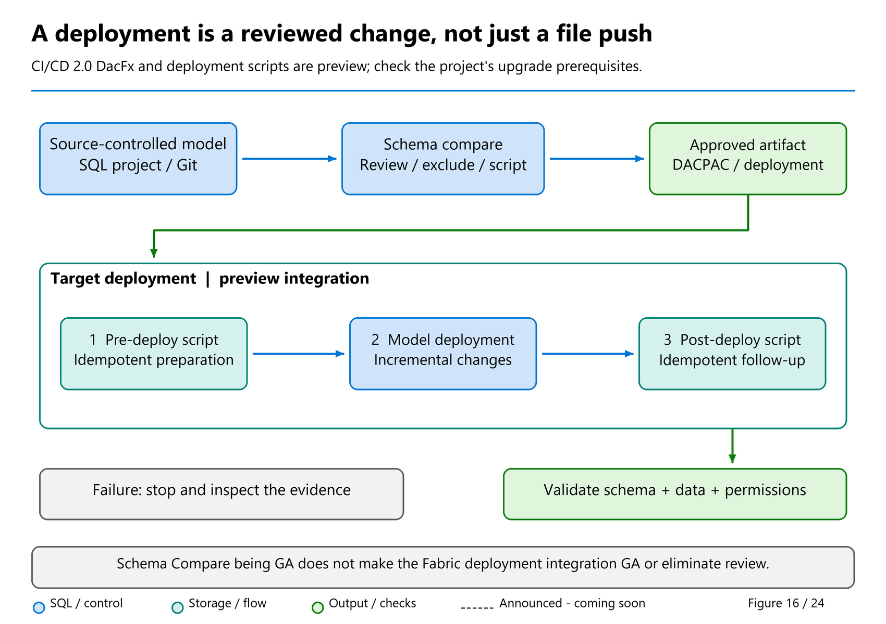
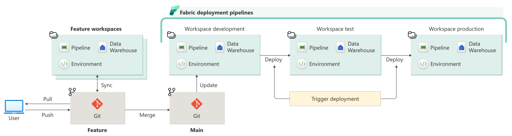

# 36. Development and Automation

[Book contents](../../index.md) | [Part VI contents](README.md) | [Previous: Chapter 35](35-recovery-and-retention.md) | [Next: Chapter 37](../07-migration-and-production-design/37-migration-planning.md)

**Applies to:** Warehouse schema lifecycle, associated semantic-model deployment and operational automation; Lakehouse SQL endpoint lifecycle has important differences. **Level:** Intermediate to advanced development. **Feature baseline:** original revision checked 9 October 2026; view refresh, scalar-UDF, Direct Lake parameter rules, REST identity and remote SQL MCP guidance reviewed 9 November. Warehouse CI/CD 2.0 with DacFx, pre/post-deployment scripts, native scalar UDFs, external Fabric Functions integration and remote SQL MCP retain their documented preview scope. VS Code Schema Compare is GA.

## A commit is not a deployment, and a deployment is not recovery

Good automation makes a known operation repeatable and observable. It does not make an unknown operation safe. Before choosing a CI/CD tool, identify what the release changes: SQL schema, reference data, permissions, workspace configuration, ingestion code, semantic models, or some combination.

These components have different lifecycle rules. A database project describes schema; it does not contain the fact rows in `book.FactSales`. A Git commit records a definition; it does not prove that production contains that definition. A successful deployment does not prove that every requested drop occurred or that every downstream report still works.

Recovery is separate again. Reverting a Git commit cannot recreate data lost by a migration. The release plan therefore needs both a forward deployment path and a data-aware recovery decision, using the mechanisms in [Chapter 35](35-recovery-and-retention.md).

## Separate definition, environment, and evidence

Keep desired SQL definitions in source control, organized by schema and object type. Keep environment mappings separate: workspace IDs, Warehouse item IDs, connection endpoints, application names, and permitted destinations. Store credentials in an approved identity or secret-management mechanism, never in the repository, a notebook output, or a generated deployment log.

A third category is release evidence: the source revision, artifact checksum, target identity, comparison result, approvals, execution status, and post-deployment checks. These are not interchangeable with desired state. Record them so a later operator can answer which artifact reached which environment.

Use immutable artifact promotion when practical. Building independently in test and production can pick up different dependency versions even when the SQL source looks unchanged. Pin tool and package versions, review updates, and retain the generated artifact together with the build result.

Branch isolation also needs a physical boundary. Editing SQL in a Git-connected live Warehouse changes that Warehouse; the Git branch does not turn the live SQL editor into an offline sandbox. Use dedicated development workspaces and explicit promotion.



*Figure 16 — Conceptual release evidence pipeline, not an automatic approval flow.* A successful build advances an artifact to comparison and review, not directly to production. Pre/post scripts execute around the approved schema deployment; correctness and remaining drift must still be checked afterward. Recovery stays a separate, data-aware decision.

## CI/CD 2.0 and DacFx: upgrade the project contract deliberately

The announced **CI/CD 2.0 / DacFx integration is preview**. It compares a desired schema definition with the target and produces an incremental deployment, rather than requiring every object to be recreated. The benefit is reviewable change: a new view and an altered column can be identified as distinct actions. It does not mean every difference is harmless, data is included in Git, or environment-specific permissions have been reproduced.

Existing Git-integrated Warehouses need the documented [system-file upgrade](https://learn.microsoft.com/en-us/fabric/data-warehouse/upgrade-warehouse) to adopt the latest definition contract. Fabric does **not** apply that change automatically. The `.platform` file's `config.version` records the system-file generation; it is not a query-engine version or a replacement for pinning the SQL build tooling.

The safe sequence is to commit existing work first, then apply the available system update, review the generated `.sqlproj` and other system-file differences, and commit that update separately. The documented action updates **all Warehouses of that item type in the workspace**, not an individually selected Warehouse. Inventory the workspace before treating an upgrade as a one-item experiment. This is planning guidance, not an instruction to edit a version number manually or upgrade a production workspace for the lab.

## Database projects provide a schema contract

The [current project guidance](https://learn.microsoft.com/en-us/fabric/data-warehouse/develop-warehouse-project) supports SDK-style SQL database projects targeting **Synapse Data Warehouse in Microsoft Fabric**. Its October 2026 example uses `Microsoft.Build.Sql` 2.3.0 and the `Microsoft.SqlServer.Dacpacs.FabricDw` system reference 170.0.4. Those are dated examples; select reviewed versions compatible with your current toolchain rather than embedding an unbounded "latest" dependency.

The Fabric-specific target matters. A generic SQL Server project may accept syntax or object types that Fabric does not support. Likewise, an old Fabric-targeted compiler may reject newly supported syntax. A failed build can indicate a dependency mismatch rather than unsupported engine functionality.

For system-object references, the current documentation calls out the `master` database-literal metadata on the Fabric system package. Omitting it can allow a build to pass but make later Script or Publish actions fail. This illustrates why compilation, deployment planning, and execution are distinct validation stages.

Build locally before connecting a deployment identity:

**Template - PowerShell; execution location: your reviewed local SQL-project folder; effects: local build artifacts and normal dependency restore, no Fabric deployment.**

```powershell
dotnet build .\BookWarehouse.sqlproj --configuration Release
```

This command assumes you created that project with the supported tooling; it is not a claim that the manuscript includes a complete project or that its build was executed here.

## Warehouse definition APIs are not row-data backups

The original September feature summary announces Warehouse item-definition support in CRUD workflows. The current [Warehouse REST group](https://learn.microsoft.com/en-us/rest/api/fabric/warehouse/items) and its **28 October 2026** operation references provide the more precise contract.

| Operation | Documented boundary |
| --- | --- |
| [Get Warehouse Definition](https://learn.microsoft.com/en-us/rest/api/fabric/warehouse/items/get-warehouse-definition) | Uses POST, supports long-running operations, and returns a public definition in `sqlproj` (default) or `dacpac` format. The documented permission is **read and write**, not merely an assumed read grant. |
| [Update Warehouse Definition](https://learn.microsoft.com/en-us/rest/api/fabric/warehouse/items/update-warehouse-definition) | Overrides the specified definition through a POST/LRO workflow. Review the complete desired artifact and deployment effects; it is not an additive table-data load or an automatic recovery operation. |

Both references list user, service-principal and managed-identity support. That does not override Chapter 15's different **List SQL Endpoints** identity restriction: support belongs to the operation, not a shared API hostname or the word Get.

Definition parts can contain SQL/project artifacts encoded as Base64. Encoding is not encryption, and a definition is not the rows, pipeline state, source credentials or a complete operational backup. Secure exported object names and logic as source material.

The Get reference says the **sensitivity label is not part of the exported definition**, while Update does not change the existing item's label. Encrypted-label usage rights must still be honored. Do not treat export as permission to remove protection or assume artifact promotion reproduces classification automatically.

Preserve the artifact hash, target, tool/API contract, approval, final operation result and post-deployment verification. A 202 response is acceptance, not proof of completion; bounded LRO polling and `Retry-After` handling still apply. The generic API metadata date is not its release date, and an unqualified announcement heading does not make every associated lifecycle capability GA.

No Warehouse API is invoked by this section. [The dated roadmap snapshot](../../appendices/H-roadmap-snapshot.md#snapshot-9-november-2026) separately lists planned schema/API and endpoint-deployment milestones; a listed target must not be used to invent an operation or payload absent from current references.

## Reusable SQL logic needs workload-level tests

Srdjan Matin's [June 2025 scalar-UDF announcement](https://community.fabric.microsoft.com/blog/fbc_fabricupdatesblogs/inline-scalar-user-defined-functions-udfs-in-microsoft-fabric-warehouse-preview/5172706), published under `SMATIN`, connects code reuse with query optimization. It explains how an inlineable function body can become scalar expressions or subqueries inside the calling query, allowing the optimizer to consider the combined work. This is a substantive development lesson: testing a function on one constant is not enough to validate its use across a large fact-table query.

For a reusable sales calculation, test NULL behavior, numeric precision, boundary values, and representative calling-query plans. A small function edit can affect many reports and execution costs. Keep function dependencies in the deployment review, and do not put table-changing DML inside a scalar UDF body.

Preserve the source's date. Matin's companion [inlineability tutorial](https://community.fabric.microsoft.com/blog/fbc_fabricupdatesblogs/how-to-make-your-sql-scalar-user-defined-function-udf-inlineable-in-microsoft-fa/5172705) explicitly says it is obsolete as of September 2026; its old restriction matrix is not a current release gate. The [CREATE FUNCTION reference revised 20 October](https://learn.microsoft.com/en-us/sql/t-sql/statements/create-function-sql-data-warehouse?view=fabric&preserve-view=true) still labels scalar and external UDFs preview. Tino's broader ["Fabric UDFs GA" roundup wording](https://www.linkedin.com/posts/valentinotereshko_speed-run-of-fabric-data-warehouse-announcements-activity-7510726240522293248-r4tC) must not be read as overriding that specific T-SQL contract or conflating it with Fabric User Data Functions.

### Three function concepts, three deployment boundaries

| Concept | Where the logic lives | Status and engineering consequence |
| --- | --- | --- |
| Fabric User Data Functions product | Published serverless Python code in a Fabric item, callable from Fabric and external applications. | The roundup says “Fabric UDFs GA”; the sources here do not independently establish a separate Python-product GA date. This is not a native T-SQL scalar-UDF GA declaration. |
| Native T-SQL scalar UDF | SQL function definition interpreted through the Warehouse engine's supported execution/inlining behavior. | **Preview** in current `CREATE FUNCTION`; test supported call shapes and inlineability. |
| Fabric Functions / external UDF integration | A Warehouse T-SQL proxy calls a published Fabric Python function remotely. | **Preview** in the dedicated Warehouse integration guide; deployment and runtime depend on both items. |

The [Python product overview](https://learn.microsoft.com/en-us/fabric/data-engineering/user-data-functions/user-data-functions-overview) describes reusable serverless functions for pipelines, notebooks, applications, and REST invocation. The [Warehouse integration guide](https://learn.microsoft.com/en-us/fabric/data-warehouse/fabric-user-data-functions) is a narrower contract: a SQL proxy references a published function. A Python function can use external services or data connections, so its side effects and authorization cannot be inferred merely from the calling SQL beginning with SELECT.

**Illustrative T-SQL template; applies to Warehouse's external-function integration preview, not a runnable core lab.** Before any separately approved execution, supply a real published item and function name, Read/invoke access to that item, and permission to create the Warehouse function. This statement creates or alters SQL metadata; later calls execute remote Python logic.

```sql
CREATE OR ALTER FUNCTION dbo.NormalizeName
AS EXTERNAL FUNCTION FunctionSetName.normalizeName;
```

The signature is inferred from the published function. If that signature changes, the current reference requires recreating the proxy to synchronize it; a Python deployment alone is not sufficient. Test nulls, type conversion, returned size, remote failures, authentication, and payload/service limits. The guide also documents an optional preview remote-batching path, but batching remote invocations does not make Python a local SQL batch-mode scalar operator or remove network overhead. For simple trimming or arithmetic already expressible in T-SQL, prefer native logic rather than crossing this boundary unnecessarily.

Native scalar execution has its own details. The 20 October guidance distinguishes **Expression Block (ExprBlock) inlining** from scalar UDF inlining that can incorporate data-access logic. ExprBlock does not support references to tables, views, inline TVFs, or other scalar UDFs; the other technique has different limitations on control flow and calling-query shape. `sys.sql_modules.is_inlineable` and `inline_eligibility_mask` describe eligibility, not a guarantee of inlining in every call. `WITH INLINE = AUTO` permits a non-inlineable definition, not distributed user-table execution of that function. Use [Chapter 11's mechanism and mask checks](../02-building-analytical-solutions/11-tsql-compatibility.md#read-the-inlining-mechanism-not-just-the-word-inlineable) and test real fact-table calls rather than only constants.

## Learn from a real exported workspace

Mark Pryce-Maher's [fabric-warehouse-lab](https://github.com/MarkPryceMaherMSFT/fabric-warehouse-lab/tree/3f7cdc0239cabe873d2f636f73eeac98d004494d), pinned to 21 August 2026, shows a real source-controlled arrangement: a Warehouse folder with `.sqlproj`, individual table and procedure scripts, `.platform` metadata, a Lakehouse definition, and notebooks.

Use it to understand artifact boundaries, not as a script to deploy wholesale. It includes benchmark and lab objects unrelated to the book dataset. Its project pins `Microsoft.Build.Sql` `0.1.19-preview`, older than the current Learn example, and specifies a case-insensitive collation. Neither should be silently inherited into a new production project.

The repository also contains `xmla.json`; the current [Git integration documentation](https://learn.microsoft.com/en-us/fabric/data-warehouse/git-integration) says that file is excluded or ignored in current integration workflows. A checked-in historical artifact is evidence of a repository version, not proof that the present service synchronizes it.

This is an Apache-2.0-licensed example, distinct from the MIT-licensed pool-configuration repository and author repositories without an inspected standard license. Keep attribution attached to anything actually adapted; do not place a blanket license over unrelated source material.



*Documentation image D19. Microsoft, [Warehouse deployment lifecycle](https://learn.microsoft.com/en-us/fabric/data-warehouse/deploy-pipelines); [original image](https://learn.microsoft.com/en-us/fabric/data-warehouse/media/deploy-pipelines/pipeline-deployment-lifecycle.svg). Unmodified source copy, retrieved 9 November 2026; [CC BY 4.0](https://creativecommons.org/licenses/by/4.0/) under the [Fabric documentation licence](https://github.com/MicrosoftDocs/fabric-docs/blob/aadea08f35c3edaa9c32535c772792f02555c9a4/LICENSE). The stages illustrate promotion; they do not prove this book deployed an item or that every stage/effect rolls back atomically.*

## Review the deployment plan and the remaining drift

[Fabric deployment pipelines](https://learn.microsoft.com/en-us/fabric/data-warehouse/deploy-pipelines) use DacFx-based comparison and incremental schema deployment. The documented safety settings include blocking possible data loss and not automatically dropping target objects absent from the source.

That is a sensible default, but it means "deployment succeeded" and "target exactly matches source" are different claims. A requested table removal can be skipped while the operation reports success. Compare again afterward and classify the residual drift deliberately.

Security principals and permissions are not automatically handled as ordinary schema promotion. Database settings, workspace controls, credentials, and capacity assignments also need separate treatment. Do not assume a Warehouse deployment has reproduced the complete environment.

Cross-item dependencies require particular care. Use explicit dependency order and environment-aware references, and avoid cyclic Warehouse dependencies. Keep collations consistent between environments. Current Git and deployment-pipeline references still document lack of SQL analytics endpoint support for those native lifecycle paths. Announced future endpoint support does not justify treating an endpoint as a Warehouse deployment target.

### Refresh dependent view metadata after schema changes

The [Warehouse tables guidance](https://learn.microsoft.com/en-us/fabric/data-warehouse/tables), extended 13 October, explicitly directs users to **`sys.sp_refreshview`** when a relevant underlying-object change leaves persistent metadata on a non-schema-bound view needing refresh. A schema-bound view instead prevents changes that would affect its definition. Neither behavior removes the need to review dependencies.

**Optional metadata-changing T-SQL template - Warehouse only, connected to `BookWarehouse`.** Use this only if the later lab's `book.Lab26RevenueByCountry` view has actually been deployed, a relevant underlying change was separately approved, and the caller has **ALTER on that view**. This changes persistent view metadata; it creates no rows or new view.

```sql
EXEC sys.sp_refreshview N'book.Lab26RevenueByCountry';
```

The [procedure reference](https://learn.microsoft.com/en-us/sql/relational-databases/system-stored-procedures/sp-refreshview-transact-sql?view=fabric&preserve-view=true) restricts the target to a view in the **current database**, even when a multipart name is supplied. Connect to each intended Warehouse explicitly rather than assuming a three-part name redirects the operation.

Place a justified refresh after the underlying schema change, then verify the view's columns, permissions and expected results. It cannot repair an invalid definition or recreate a dropped column. It is also not Lakehouse Delta metadata synchronization, Power BI framing or a data reload. The six-row release lab does not require inventing a schema change merely to execute this procedure.

### Rebind Direct Lake on OneLake with parameter rules

The [Direct Lake development guide](https://learn.microsoft.com/en-us/fabric/fundamentals/direct-lake-develop#use-m-parameters-with-deployment-pipelines) gained this procedure on **2 November**, with clarification through **4 November 2026**. It distinguishes unsupported **data-source rules** for Direct Lake on OneLake from supported **text M parameters plus deployment parameter rules**. Do not dismiss the documented parameter route because a data-source-rule screen is unavailable.

Work from an existing, reviewed semantic-model definition and approved development/test targets:

| Step | Evidence to preserve |
| --- | --- |
| Inventory the existing shared M expression | Keep its name, annotations and connection options; do not replace the entire expression with an unrelated tutorial fragment. |
| Introduce text M parameters in the documented model/TMDL editing workflow | Parameterize workspace and source-item IDs, or the complete OneLake URL, while preserving the original connection behavior. |
| Configure the target stage's parameter rules | Supply the approved **Lakehouse or Warehouse item ID**, not a SQL analytics endpoint ID. A friendly display name is not an ID. |
| Deploy the reviewed model definition | Confirm the intended parameter substitutions and separately provisioned source tables and permissions. |
| Refresh and verify | Inspect lineage, effective query/refresh identities and the expected 6 / 10 / 365.00 results before switching readers. A successfully changed parameter alone is not acceptance. |

Keep the identifier domains explicit:

| Task | Identifier needed |
| --- | --- |
| Direct Lake on OneLake source binding | Workspace ID and **Lakehouse/Warehouse item ID**. |
| SQL endpoint metadata refresh | Workspace ID and **SQL endpoint ID**, obtained through the documented parent-item response. |

Parameter substitution does not copy data, create target tables, grant source access or make Warehouse/endpoint native Git support identical. The semantic-model owner and the configured refresh/query identities still need their documented access, as [Chapter 13](../02-building-analytical-solutions/13-power-bi-and-clients.md#identity-is-part-of-the-model) explains.

Zoe Douglas's [DataZoe walkthrough](https://www.datazoe.blog/post/deployment-pipelines-and-power-bi-semantic-models-with-direct-lake-on-onelake-tables), published in December 2025 and revised in September 2026, supplies a useful named-author explanation of this pattern and the item-ID distinction. It predates the November Learn addition: neither source justifies calling this a newly launched November feature. No model or deployment pipeline is changed by this book's review.

## VS Code Schema Compare: GA inspection does not mean automatic application

The MSSQL extension's **Schema Compare is GA**. The [pinned public changelog](https://github.com/microsoft/vscode-mssql/blob/b564d8928766c661ff4c4cba0fca0498435d4ced/CHANGELOG.md) dates that release to **20 August 2025, version 1.35.0**; its appearance in a September 2026 roundup is not a new GA date. A GA development tool does not change the preview status of the Fabric deployment path it helps prepare.

The [current Schema Compare guide](https://learn.microsoft.com/en-us/sql/tools/visual-studio-code-extensions/mssql/mssql-schema-compare?view=fabric) supports databases, SQL projects, and DACPACs as comparison endpoints. It presents actions that would make the **target match the source**. Choose those sides carefully: reversing them can turn the intended new view into an apparent object to remove. Set the comparison scope, review each difference, and exclude actions that are not part of the release.

For `BookWarehouse`, compare the candidate project containing `book.Lab26RevenueByCountry` with the baseline project or DACPAC. Review the expected view addition and explain any unrelated table or security differences. Generating a script for later review is different from applying it to a live target. Save the reviewed comparison and script as release evidence; use the supported Fabric target and toolchain, obtain approval, then deploy and compare again. **Compare** is not **Apply**, and no automatic application is required by this chapter.

## Pre/post-deployment scripts (preview): use the newer contract

There is an important dated documentation change. Older Git guidance warns that pre/post-deployment settings added through Git are not preserved. The newer [30 September 2026 deployment-scripts page](https://learn.microsoft.com/en-us/fabric/data-warehouse/deployment-scripts), updated 1 October, documents designated shared SQL queries whose metadata round-trips through the Warehouse `.sqlproj`.

The newer feature supports one pre-deployment and one post-deployment script, runs them on every deployment, and requires the latest source-control experience for full Git workflow participation. Its guidance explicitly distinguishes that Git prerequisite from deployment pipelines.

In the documented portal workflow, designate an existing **shared SQL query** in the Warehouse item's **Settings > CI/CD** section, or reach the same setting from Object Explorer. A personal query is not automatically a deployment script. The same shared query cannot be both pre and post; deleting it or changing it back to a user query clears its designation. Treat that shared query as executable release code, with review and ownership, not an informal scratchpad.

Do not generalize from traditional SQL projects: composing these Fabric scripts from multiple files with SQLCMD `:r` is not supported by the inspected feature contract. The page's path examples vary between `sharedqueries` and `.sharedqueries`; use the actual exported project structure and verify the designated query round-trip in a disposable development environment rather than inventing a path convention.

Write repeatable scripts. "Insert the three customers" is not idempotent if it runs every deployment. Reference-data migrations need a tested business key, duplicate checks, and an explicit update/delete policy. Permissions should be environment-specific and least-privilege, not copied wholesale from development administrators.

A pre-script can modify data before the schema plan runs. If later execution fails, do not assume the entire release is automatically rolled back as one transaction. Preserve stage outcomes and design recovery for partially completed work.

These scripts are **not validated against the database model at build time**. Their errors can surface only during deployment, and a script failure halts deployment. The deploying identity also needs the permissions required by the script itself. A green schema build therefore does not prove that a post-script can seed data or recreate a role safely. Test the pre/schema/post sequence in an isolated environment, including repeated execution and a deliberately reviewed failure path, before approving production use.

## Remote SQL MCP: execution is not automatically read-only

The [Fabric Data Warehouse remote MCP guide](https://learn.microsoft.com/en-us/fabric/data-warehouse/data-warehouse-mcp-server) documents a **preview** service for Warehouse and SQL analytics endpoint access. This is distinct from [Fabric IQ MCP's GA Power BI semantic-model route](../02-building-analytical-solutions/13-power-bi-and-clients.md#fabric-iq-mcp-the-ga-semantic-model-route). Remote SQL MCP provides SQL execution; it does not require a semantic model or make every future Warehouse-specific IQ integration available.

The guide supplies a global endpoint and an item-scoped endpoint:

```text
https://api.fabric.microsoft.com/v1/mcp/dataPlane/sqlEndpoint
https://api.fabric.microsoft.com/v1/mcp/dataPlane/workspaces/<workspace-id>/items/<item-id>/sqlEndpoint
```

These are **configuration references, not a lab connection**. The illustrated item-scoped setup uses an actual **Warehouse item ID**. Although the guide explicitly includes SQL analytics endpoints in its applicability and prerequisites, it does not supply a Lakehouse-specific item-ID selection recipe; do not substitute a Lakehouse ID merely because the URL ends in `sqlEndpoint`. The global route receives target context through the interaction. Neither route grants permissions beyond the signed-in user's existing access.

Learn names one execution tool, **`executeSQL`**; schema discovery and history inspection are SQL workflows through that tool, not separately promised metadata tools. Salil Kanade's [20 August product-team article](https://community.fabric.microsoft.com/blog/fbc_fabricupdatesblogs/bringing-agentic-warehouse-development-to-fabric-data-warehouse-with-mcp-and-age/5360190) corroborates the remote preview but calls the tool `execute_query`. Inspect the server's advertised tool schema before binding a client; no hard-coded invocation or live schema was tested for this manuscript.

Most importantly, SQL execution is not inherently read-only. An agent using a write-capable Warehouse identity can propose data or schema changes. The Lakehouse endpoint's read-only table-data contract still does not make every supported SQL metadata operation harmless. Use least privilege, an explicit target, bounded diagnostic queries, and approval of the exact generated writes. Skills provide task-specific instructions; MCP provides an execution channel. Neither is authorization to mutate a system.

A safe offline exercise is to specify a catalog-and-history investigation, its target, UTC interval and no-change boundary. Review the proposed SQL and required permissions before connecting any client. Do not grant Admin merely to make an agent's answer more complete, and do not send unrestricted query text or results to an unapproved destination.

## Operational automation needs the same discipline

Mark's [fabric-sql-pools-config](https://github.com/MarkPryceMaherMSFT/fabric-sql-pools-config/tree/89d3d3568ac454d64ad8744d0b726503aff73204) demonstrates a useful sequence: inventory, prepare a proposal, record decisions, and gate modification behind a dry-run switch. [Chapter 33](33-workload-management-and-sql-pools.md) explains its actual write scope and replacement risk. Carry that pattern into other administrative scripts.

The [9 November pool-unification advance notice](https://community.fabric.microsoft.com/blog/fbc_fabricupdatesblogs/unifying-sql-pools-upcoming-changes-to-ui-and-apis/5397390) also creates a future client-maintenance task. Inventory dependencies on `customSQLPoolsEnabled`, preserve any needed inactive configuration by the mid-December preparation deadline, and prepare for the January flag removal and effective-only GET model. Do not silently rewrite the pinned notebook or send its proposed successor payload to today's API; follow [Chapter 33's dated transition checklist](33-workload-management-and-sql-pools.md#upcoming-unification-prepare-clients-without-changing-todays-payload) and the eventual rollout documentation.

Mark's [fabric-warehouse-demo collector](https://github.com/MarkPryceMaherMSFT/fabric-warehouse-demo/tree/805b43d2d07ce951f47ad9c23c17f0a53f0e2091), substantive revision 21 August 2026, shows another practical boundary. It persists collected Query Insights in Warehouse mode but returns session-temporary results on the SQL endpoint, whose underlying tables are read-only.

The collector refreshes its output snapshot; it is not automatically a durable, append-only archive. Long-term monitoring needs an explicit archive destination, deduplication strategy, collection watermark, and retention policy. Repeatedly appending overlapping 30-day snapshots without deduplication would inflate query counts and modeled consumption. Preserve source workspace/item identity with each request identity.

For REST orchestration, handle pagination, bounded retries, `Retry-After`, and long-running-operation polling where the specific API documents them. A 202 response can mean accepted, not completed. A timed-out write can have an uncertain outcome; inspect state before replaying a non-idempotent request. Never log access tokens or authorization headers.

Identity support belongs to **each operation**, not merely the resource family. Get Lakehouse and Refresh SQL Endpoint Metadata support service principals/managed identities, while List SQL Endpoints does not. The book refresh template therefore discovers through the known parent Lakehouse, then requires provisioning `Success` before POST. [Chapter 15](../03-sql-analytics-endpoint/15-metadata-sync-v1-v2.md#endpoint-discovery-has-its-own-identity-contract) records the current contracts, selection/timeout limits and complete-result checks.

Schema-enabled Lakehouses also have a discovery boundary: the [Lakehouse API guide](https://learn.microsoft.com/en-us/fabric/data-engineering/lakehouse-api) says the older List Tables and Load Table routes return `UnsupportedOperationForSchemasEnabledLakehouse`. Use the documented OneLake table APIs for that discovery rather than interpreting the error as an empty Lakehouse. Endpoint discovery, table discovery and metadata refresh are three different operations.

The [Microsoft Fabric toolbox](https://github.com/microsoft/fabric-toolbox) provides useful CI/CD accelerators and operational examples, but explicitly positions them as samples. Automated KILL routines, table-rebuild workarounds, and copy-Warehouse tools are not safe default repair actions. Link and review them for a bounded use case instead of importing an entire script collection into a production scheduler.

## Lab: prove a release without publishing one

**Prerequisites:** the chapter 4 synthetic schema and seed definitions, a local Git repository, and the supported project tooling if you choose to build. Optional data checks require read access to an isolated, unchanged `BookWarehouse`. No publishing or tenant change is required, and none was performed for this manuscript.

Create a local project representation of the four book tables, preserving their types and nullability. Do not add enforced-key assumptions or change the synthetic facts. In a feature branch, draft a reporting view:

**Illustrative project definition - T-SQL; location: a local project file; effects only if separately approved and deployed: creates a Warehouse view. Do not paste into production.**

```sql
CREATE VIEW book.Lab26RevenueByCountry
AS
SELECT c.CountryCode,
       SUM(CAST(s.Quantity * s.UnitPrice AS decimal(18,2))) AS Revenue
FROM book.FactSales AS s
JOIN book.DimCustomer AS c ON c.CustomerKey = s.CustomerKey
GROUP BY c.CountryCode;
```

Review the diff and build the project if your environment has the prerequisites. Then define post-deployment assertions before any publication: six facts, quantity ten, revenue 365.00, unique synthetic keys as a data property, and no missing dimension references.

The original [36-verify-book-seed.sql](../../scripts/36-verify-book-seed.sql) performs those checks read-only and fails explicitly when an assumption is false. It is for the untouched seed, not a production dataset that has legitimately grown. Successful compilation cannot replace these data assertions.

Finally review an imagined plan that also drops `book.DimDate`. Explain why the view build alone would not prove that change safe, how default deployment behavior could leave drift, and which downstream dependencies need review. The expected outcome is a release evidence bundle and an approval-ready plan, not a changed tenant.

Local build artifacts can be removed under your repository's normal cleanup rules. The lab creates no tenant objects unless you separately choose to deploy its illustrative view. Any later cleanup must target that named lab object only, not drop the shared `book` schema.

## Key takeaways

- Separate schema, environment configuration, data migration, and release evidence.
- Pin the toolchain; build success is only one validation stage.
- Use the newer pre/post-deployment contract with its rollout prerequisites.
- Distinguish Python functions, native scalar UDFs, and remote proxies; they do not share one GA status.
- Review Schema Compare actions before applying them; a system-file upgrade is deliberate, not automatic.
- Refresh dependent view metadata only when justified; remote MCP SQL execution needs its own permission and write-approval boundary.
- Direct Lake on OneLake uses parameter rules for source rebinding; the source item ID is not a SQL endpoint ID.
- Treat public repositories as reviewed examples, not guaranteed runbooks.
- Verify data and residual drift after deployment; Git rollback is not data recovery.

## References

1. Microsoft Learn, [Develop Warehouse projects](https://learn.microsoft.com/en-us/fabric/data-warehouse/develop-warehouse-project), updated 1 October 2026.
2. Microsoft Learn, [Warehouse Git integration](https://learn.microsoft.com/en-us/fabric/data-warehouse/git-integration).
3. Microsoft Learn, [Warehouse deployment pipelines](https://learn.microsoft.com/en-us/fabric/data-warehouse/deploy-pipelines).
4. Microsoft Learn, [Pre/post-deployment scripts](https://learn.microsoft.com/en-us/fabric/data-warehouse/deployment-scripts), 30 September 2026.
5. Mark Pryce-Maher, [fabric-warehouse-lab at `3f7cdc0`](https://github.com/MarkPryceMaherMSFT/fabric-warehouse-lab/tree/3f7cdc0239cabe873d2f636f73eeac98d004494d), 21 August 2026; Apache-2.0.
6. Mark Pryce-Maher, [fabric-warehouse-demo at `805b43d`](https://github.com/MarkPryceMaherMSFT/fabric-warehouse-demo/tree/805b43d2d07ce951f47ad9c23c17f0a53f0e2091), 21 August 2026.
7. Srdjan Matin (`SMATIN`), [Inline scalar UDFs in Fabric Warehouse](https://community.fabric.microsoft.com/blog/fbc_fabricupdatesblogs/inline-scalar-user-defined-functions-udfs-in-microsoft-fabric-warehouse-preview/5172706), 23 June 2025; reconcile with the [current CREATE FUNCTION reference](https://learn.microsoft.com/en-us/sql/t-sql/statements/create-function-sql-data-warehouse?view=fabric&preserve-view=true).
8. Microsoft Fabric Customer Advisory Team, [fabric-toolbox](https://github.com/microsoft/fabric-toolbox), MIT.
9. Microsoft Learn, [Warehouse tables](https://learn.microsoft.com/en-us/fabric/data-warehouse/tables) and [sp_refreshview](https://learn.microsoft.com/en-us/sql/relational-databases/system-stored-procedures/sp-refreshview-transact-sql?view=fabric&preserve-view=true), view-refresh clarification added 13 October; reviewed 9 November 2026.
10. Microsoft Learn, [Remote MCP server for Fabric Data Warehouse](https://learn.microsoft.com/en-us/fabric/data-warehouse/data-warehouse-mcp-server), preview, explicit analytical-endpoint applicability, endpoints, tool and permissions; reviewed 9 November 2026.
11. Salil Kanade, [Bringing agentic Warehouse development to Fabric Data Warehouse with MCP and agent skills](https://community.fabric.microsoft.com/blog/fbc_fabricupdatesblogs/bringing-agentic-warehouse-development-to-fabric-data-warehouse-with-mcp-and-age/5360190), 20 August 2026; historical preview evidence, with tool-name discrepancy retained.
12. Microsoft Learn, [Use M parameters with Direct Lake deployment pipelines](https://learn.microsoft.com/en-us/fabric/fundamentals/direct-lake-develop#use-m-parameters-with-deployment-pipelines), added 2 November and clarified through 4 November 2026; reviewed 9 November.
13. Zoe Douglas / DataZoe, [Deployment pipelines and Power BI semantic models with Direct Lake on OneLake tables](https://www.datazoe.blog/post/deployment-pipelines-and-power-bi-semantic-models-with-direct-lake-on-onelake-tables), December 2025, revised September 2026; implementation explanation, not release-policy authority.
14. Microsoft Learn, [Lakehouse REST API](https://learn.microsoft.com/en-us/fabric/data-engineering/lakehouse-api), schema-enabled operation limitations; reviewed 9 November 2026.

---

[Previous: Chapter 35](35-recovery-and-retention.md) | [Book contents](../../index.md) | [Next: Chapter 37](../07-migration-and-production-design/37-migration-planning.md)
