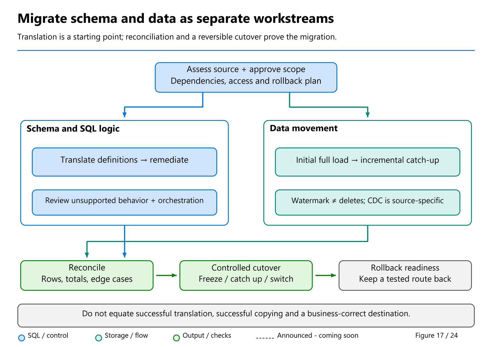
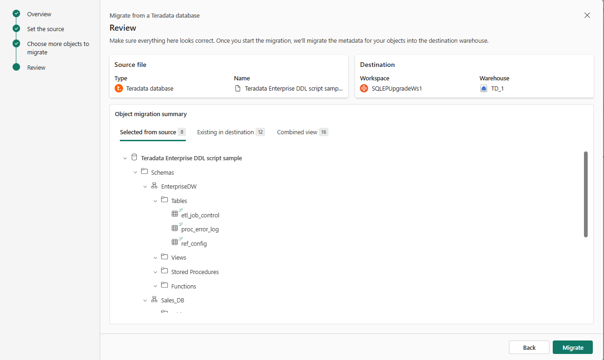
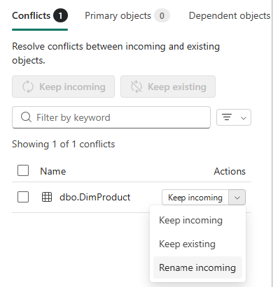

# 37. Planning a Migration That Can Be Proved Correct

[Book contents](../../index.md) | [Part VII contents](README.md) | [Previous: Chapter 36](../06-operating-the-platform/36-development-and-automation.md) | [Next: Chapter 38](38-migrating-synapse-dedicated-sql-pools.md)

**Applies to:** Fabric Warehouse as a writable analytical destination; Lakehouse SQL analytics endpoint as a read-only SQL surface over lake data. **Level:** Intermediate to advanced. **Revision evidence:** original planning review 9 October 2026; Migration Assistant's incremental metadata workflow reviewed 9 November against the 16 October documentation addition. Connector eligibility and preview status still require checks before execution.

## Begin with the service, not the table count

A migration succeeds when a business service works on its new platform, not when the last table finishes copying. Consider a daily sales report. Its service includes extraction, currency and time rules, customer attribution, access controls, refresh schedules, and the person who repairs a failed load. Moving its fact table without those dependencies produces a convincing demonstration and an incomplete migration.

Microsoft's migration planning guidance separates assessment, design, migration, governance, and modernization [1]. Treat these as overlapping workstreams, with explicit acceptance gates between rehearsal and production. Inventory the current service before choosing a tool. Record who consumes it, when data is considered complete, what correction history exists, and how the source can be recovered. The first meeting should establish which failures would make the migration unacceptable.

Choose a bounded business domain for the first wave. A useful wave contains a small but genuine dependency chain: a few dimensions, a fact, transformations, a report, and its security. The book's sales model is a correctness exercise with that shape. Its six facts are not evidence of production throughput. A later performance rehearsal needs representative volume, skew, table width, and competing workloads.

## Make five contracts explicit

The **semantic contract** describes what the data means. Does revenue mean quantity multiplied by unit price, or does it include discounts and returns? Are customer attributes current or effective at transaction time? Are repeated rows legitimate business events? Preserve these definitions even when the target SQL is shorter.

The **representation contract** records column types, precision, nullability, encoding, collation, and key rules. A successful cast is not proof of preservation. Converting an offset timestamp to a timestamp without an offset requires a documented normalization rule. Narrowing text after changing encoding can lose valid values. Fabric's persisted types differ from the types accepted in expressions and parameters [2].

The **movement contract** describes the source state that a batch represents. It names an extraction boundary, immutable batch identifier, files or source query, transformation version, and completion evidence. "All rows copied today" is insufficient if dimensions were extracted before a correction and facts after it.

The **service contract** specifies freshness, availability, latency, concurrency, recovery point, recovery time, and cost guardrails. Separate a report's query runtime from the total time until its data becomes available. For Lakehouse consumption, Delta arrival and SQL endpoint metadata visibility are different stages; review [Chapter 15](../03-sql-analytics-endpoint/15-metadata-sync-v1-v2.md).

Finally, the **ownership contract** identifies who approves business results, deploys code, rotates credentials, monitors capacity, and invokes rollback. Automation can execute a cutover, but it cannot decide whether an unexplained accounting difference is acceptable. Name the accountable business owner before migration begins.

## Read the migration flow as separate gates



*Figure 17. A conceptual migration flow, not an observed deployment topology. Metadata, data, and security meet at acceptance gates; success in one lane does not authorize work in another.*

Read the metadata lane as **discover, assess, review, deploy**. Its output is a target definition whose changes can be explained. Read the data lane as **establish a source boundary, extract, load, reconcile**. Its output is a proven target state, not merely a successful copy. Security crosses both: metadata exports can expose business structure, data exports need their own storage permissions, and readers need tested target access.

The approval gates matter because a metadata operation can still write. Migration Assistant's **Migrate** action creates a Warehouse and deploys supported objects; running a remediation query can create an object [6]. Those are not offline assessments. A data job can then insert rows or perform other configured destination actions. Record the exact target, selected objects, write policy, and reviewer before passing each gate.

For the related public Synapse migration skill described in [Chapter 38](38-migrating-synapse-dedicated-sql-pools.md#the-migration-agent-skill-a-verified-related-public-route), production-source discovery stays read-only, and any approved export uses a separate user-managed restored copy. That restored-copy requirement belongs to that skill's Warehouse route; the figure does not claim every connector creates a restore or offers one common cross-system snapshot.

## Inventory behavior as well as schema

Start with catalog metadata, then connect it to observed workloads and deployment assets. Tables and views are the visible portion. Scheduled jobs, notebook transformations, report filters, exports, external storage permissions, and client connection settings can be equally important. Database dependency metadata will not discover every dynamically constructed object name or application query.

[The read-only inventory script](../../scripts/37-schema-inventory.sql) adapts Mark Pryce-Maher's `tables-columns-datatypes.sql` gist, substantive revision 10 March 2026 [3]. It retains the catalog joins and adds a schema filter, ordinal, collation, object identifier, and explicit byte-length naming. It generates no DDL. Those changes make the result an assessment artifact rather than an unreviewed converter.

For every object, assign a disposition: migrate unchanged, adapt, replace, archive, or exclude. Record the reason, dependency owner, validation query, and blocking difference. Distinguish "not used during observation" from "safe to delete." A quarter-end report may be absent from a week of query history.

Do not concatenate arbitrary spreadsheet text into generated SQL. Resolve schema and object names against a reviewed allowlist, quote each identifier separately, and parameterize values. Catalog metadata can contain awkward names, and a parameter intended as a schema list must not become executable SQL.

## Choose a destination and a migration method

A SQL-centric analytical service with writable relational transformations is a natural Warehouse candidate. A service centered on Spark-produced Delta tables may belong in a Lakehouse with a SQL analytics endpoint for readers. The endpoint does not become a writable Warehouse because a client connects through TDS. Resolve that distinction using [Chapter 14](../03-sql-analytics-endpoint/14-sql-analytics-endpoint.md), before generating target DDL.

Migration Assistant provides a guided metadata conversion, remediation, and data-copy workflow for documented source families [4]. Its current coverage includes Synapse dedicated SQL pools, SQL Database Engine platforms, and Teradata metadata in preview. This is not a promise that every object or every named database product is supported. Inspect the actual source route, review conversion diagnostics, and test the generated result.

## Fabric DW migrations with Migration Assistant

The native [Migration Assistant for Fabric Data Warehouse](https://learn.microsoft.com/en-us/fabric/data-warehouse/migration-assistant), rechecked **9 November 2026**, supports an integrated migration journey **to a writable Warehouse**. It is not a switch that converts a Lakehouse SQL analytics endpoint into a Warehouse, nor a guarantee that every source SQL feature has a target equivalent.

The source families listed in the overview are **Azure Synapse dedicated SQL pools**, **SQL Server and other SQL Database Engine platforms**, and **Teradata metadata (preview)**. Source selection matters. The supported routes include a direct connection or an appropriate definition package: DACPAC and source-specific SQL/BTEQ zip workflows are not interchangeable formats for every source.

| Stage | What the Assistant supports | Acceptance gate owned by the migration team |
| --- | --- | --- |
| Select and assess | Connect to the documented source route or upload its supported metadata package. | Confirm source/target identities, approved object scope, export protection, permissions and an owned consistency boundary. |
| Convert and deploy definitions | Translate supported tables, views, functions and procedures into Warehouse objects. | Review type/collation/key changes and actual deployment effects; a successful object creation is not semantic equivalence. |
| Fix problems | Inspect failed scripts and repair primary objects before dependent objects, manually or with optional Copilot assistance. | Review the proposed SQL before **Run**; execution can deploy objects and dependencies, not merely validate text offline. |
| Review security | The overview documents automatic migration for many roles, permissions and dynamic data masks, while flagging incompatible security objects. | Validate Microsoft Entra identities, Fabric item access and effective reader/writer permissions before exposing copied data. |
| Move data | Hand off to **Fabric Data Factory Copy job** for the selected data-copy route. | Prove source boundary, mappings, keys, write/replay policy, failures and reconciliation. Metadata migration is not data completeness. |
| Validate and cut over | Compare old and new results, then redirect applications/consumers. | Approve business totals, row multiplicity, security, workload objectives and rollback before switching traffic. |

In the **Fix problems** experience, fixing a table can unblock dependent views, but it can also reveal another object as a new primary failure. The number of primary failures need not decrease monotonically. Preserve the actual errors and dependency outcomes instead of treating the count as a completion percentage.

Copilot can suggest repairs when enabled, but generated SQL can be wrong or change business semantics. Review and test it just like a manual rewrite. Moving a script from the failure pane into the database is a write decision; no remediation or data-copy action is executed by this book.

**Security migration is not identity equivalence.** SQL-authenticated users need a supported Microsoft Entra design and Fabric item access. Roles/grants/masks that migrate must still be tested under representative users, including inherited access and every direct-storage/report route. Masking is not encryption: the overview's mitigation suggestions do not make DDM equivalent to source column-level cryptography. Unresolved protection requirements need their own supported design.

The supported current T-SQL reference, not a generic source-type mapping or AI suggestion, governs the target. For example, IDENTITY support has Fabric-specific rules, and unsupported source objects such as external tables or multi-statement TVFs need a deliberate disposition. Do not remove a behavior merely because its DDL could not be copied.



*Documentation image D21. Microsoft, [Reviewing a native Migration Assistant migration](https://learn.microsoft.com/en-us/fabric/data-warehouse/migrate-using-connection-to-source-system); [original image](https://learn.microsoft.com/en-us/fabric/data-warehouse/media/migrate-using-connection-to-source-system/review-migration-assistant.png). Unmodified source copy, retrieved 9 November 2026; [CC BY 4.0](https://creativecommons.org/licenses/by/4.0/) under the [Fabric documentation licence](https://github.com/MicrosoftDocs/fabric-docs/blob/aadea08f35c3edaa9c32535c772792f02555c9a4/LICENSE). Reviewing a migration is different from approving Migrate, remediation execution or data transfer; all can have real effects.*

### Choose the aid without mixing its contract with another

Keep similarly named aids separate:

| Aid | Its role in the plan | What its name does not establish |
|---|---|---|
| Native Migration Assistant | Guided metadata translation/remediation, documented iteration into an existing Warehouse, and a **Copy data → Use a copy job** handoff [6,10] | Data-preserving conflict resolution, automatic semantic equivalence, security preservation, or an independent CDC engine |
| Fabric Data Factory Copy job | Full or incremental row movement with connector-specific read and destination-write behavior [7] | Delete capture through an ordinary watermark, or safe replay into every existing target |
| Public `synapse-migration` skill | Agent instructions and supporting resources for a reviewed Synapse route; examined in Chapter 38 [8] | A general Teradata converter, a managed replication service, or authorization to execute |
| Mark Pryce-Maher's mirroring/migration toolkit | Initial-copy and ongoing producer/apply paths, plus a controlled migration workflow analyzed in Chapter 38 | Native Assistant behavior, native Synapse mirroring, automatic cutover or the Microsoft skill |

Tino Tereshko's September announcement names both **Migration Assistant — incremental migration** and **Migration Agent Skill** [9]. The October documentation now describes two distinct incremental tracks: additional or changed **object definitions** through the Assistant, and continuing **row movement** through Copy job. Neither establishes an Assistant-owned CDC engine or an automatically data-preserving schema merge. The exact mapping between the announcement's skill label and the related public repository also remains unconfirmed. Use the concrete workflow and approval contract, not the label, in a migration commitment.

Manual pipelines or staged-file loads offer more control over extraction boundaries, partitioning, and restart behavior. They also leave more engineering responsibility with the migration team. A hybrid is often sensible: use assistance for metadata discovery, review target schemas in source control, and move data through a batch-controlled ingestion process. Do not allow multiple tools to become competing authorities for the same target schema.

Separate the historical copy from continuing synchronization. An initial snapshot answers "what existed at the boundary?" An incremental process answers "what changed afterward?" Neither implies the other. A timestamp filter that finds new inserts may miss updates, deletes, backdated events, or rows that commit late. [Chapter 41](41-reconciliation-cutover-and-rollback.md) develops the boundary and replay rules.

## Iterate metadata without assuming data preservation

The [source-connection migration guide](https://learn.microsoft.com/en-us/fabric/data-warehouse/migrate-using-connection-to-source-system#resolve-conflicts-and-fix-objects), extended publicly on **16 October 2026**, documents returning to an **existing Warehouse** through **Migration > Get more objects**. It supports iterative definition migration rather than requiring every assessment to create a new destination. This is newly incorporated documentation, not a separately established GA release date.

Selected objects include their direct dependencies by default. Review the expanded set before approving deployment. Nonconflicting objects can migrate while naming conflicts remain pending; a partially populated results screen is not proof that the complete release is deployed.

| Conflict action | Decision to review |
| --- | --- |
| **Keep existing** | Retain the target definition rather than replace it with the incoming object. Record the deliberate difference. |
| **Keep incoming** | Replace the target definition. For a table, this **drops and recreates the existing table**, losing its data. |
| **Rename incoming** | Introduce the incoming object under a different name; review references, dependencies and consumer routing rather than assuming a transparent replacement. |

**Keep incoming is not an in-place, data-preserving table alteration.** The documented table workflow requires loading the data again. If the incoming script fails and the earlier object definition is restored, that definition recovery **does not recover dropped rows**. Save definitions and a separately verified data-recovery path before approving a replacement. A successful DDL rollback message is not a data-reconciliation result.

For the book, consider a proposed incoming definition that conflicts with `book.FactSales` **on paper only**. Preserving its six facts, ten units and 365.00 revenue is a different requirement from accepting its new columns. Choose an approved new-table rehearsal, a suitable supported schema change, or a separately authorized reload/recovery plan; do not use Keep incoming against the canonical seed to discover what the button does.

Definition iteration and incremental Copy job state must be coordinated but not conflated. The former can invalidate tables or downstream objects; the latter does not deploy revised procedures, recreate permissions or automatically know that a target was replaced. Version the two tracks together and reconcile data and consumer access again before cutover.



*Documentation image D22. Microsoft, [Migration Assistant conflict actions](https://learn.microsoft.com/en-us/fabric/data-warehouse/migrate-using-connection-to-source-system); [original image](https://learn.microsoft.com/en-us/fabric/data-warehouse/media/migrate-using-connection-to-source-system/conflict-resolution-actions.png). Unmodified source copy, retrieved 9 November 2026; [CC BY 4.0](https://creativecommons.org/licenses/by/4.0/) under the [Fabric documentation licence](https://github.com/MicrosoftDocs/fabric-docs/blob/aadea08f35c3edaa9c32535c772792f02555c9a4/LICENSE). Keep incoming for a populated table can drop/recreate it; a familiar menu is not evidence of data-preserving replacement.*

## Design a rehearsal that can fail usefully

Create a rehearsal matrix before running the first copy. Include ordinary rows, nulls, maximum-length text, non-ASCII text, decimal extremes, timestamp ties, duplicate keys, and source corrections. Choose cases from the actual representation contract, not just a convenient random sample. A one-row Unicode example may reveal a mapping error that a million ASCII rows conceal.

Exercise at least three operational failures: extraction stops after writing some files; the target commits but the orchestrator loses its acknowledgment; and a credential expires between batches. The expected behavior should be documented. A failed extraction must not publish an incomplete batch. A lost acknowledgment must not double-count committed data. An authentication error must not be misreported as an empty source.

Keep the source and target comparison bounded to equivalent states. For a stopped source, this may be a maintenance interval. For a changing source, it requires source-specific snapshot and change-capture semantics. Do not infer a universal distributed snapshot from the fact that individual SQL statements are transactional.

Capacity is part of rehearsal design. Measure source extraction pressure as well as target loading. Parallelism that accelerates the target can starve the operational source or overload a gateway. Use [Chapter 31](../06-operating-the-platform/31-billing-and-consumption.md) and [Chapter 32](../06-operating-the-platform/32-capacity-management.md) to separate measured consumption, allocated capacity, and planning estimates.

## Lab: build the first migration decision record

**Prerequisites:** Complete [Chapter 4](../01-getting-started/04-first-warehouse.md), with the unchanged `BookWarehouse` seed. You need permission to read the `book` tables and their metadata. Catalog visibility depends on permissions; a partial inventory is not evidence that hidden objects do not exist.

Run `37-schema-inventory.sql` against `BookWarehouse`. With only the four core tables present, expect 17 column rows: three for customers, three for products, four for dates, and seven for sales. Other chapter labs can add rows. Restrict your decision record to `DimCustomer`, `DimProduct`, `DimDate`, and `FactSales`.

**Runnable, read-only T-SQL; execution location: BookWarehouse.** This establishes the business baseline without changing data.

```sql
SELECT COUNT_BIG(*) AS FactRows,
       SUM(CAST(Quantity AS bigint)) AS Quantity,
       SUM(CAST(Quantity * UnitPrice AS decimal(18,2))) AS Revenue
FROM book.FactSales;
```

The expected result is six facts, quantity 10, and revenue 365.00. These are computed expectations from the published seed, not a claim that a tenant run occurred. Record them beside the source version and the fact that every seed timestamp is `2026-01-04T00:00:00`. Equal timestamps already demonstrate why time alone is not a unique event identifier.

Write a short decision record in your team's existing project system. Select Warehouse as the writable destination, identify the three dimensions as dependencies, and choose a frozen seed as the extraction boundary. Specify zero unexplained row differences and zero duplicate sales keys as acceptance criteria. Assign separate technical and business reviewers, even if this training exercise uses one person in both roles.

Then introduce a proposed requirement: sales can be corrected three days after arrival. Explain why append-only synchronization no longer satisfies it. Select an explicit change-capture or bounded re-extraction design for further testing rather than quietly widening a timestamp filter and calling it complete.

The lab creates no objects and needs no database cleanup. Retain only approved metadata and results; schema exports can themselves disclose sensitive business structure in a real estate.

## From assessment to authorization

A migration wave is ready to execute when every blocking difference has an owner and tested disposition, the source boundary is reproducible, and rollback remains possible. "Most objects converted" is progress, not authorization. Equally, do not require modernization of every old pattern before moving a sound analytical model. Preserve validated behavior first; remove unnecessary compatibility scaffolding after the service is stable.

Source files, generated SQL, and public skill instructions are evidence to review, **not authorization to act**. A source comment suggesting a grant, a reset, or an export cannot expand the approved scope. Separate approval of the design from approval to run code that creates objects, moves rows, changes access, or deletes anything. The offline assessment exercise in Chapter 38 lets you practice that separation without connecting to a tenant.

The next chapters apply these contracts to [dedicated Synapse](38-migrating-synapse-dedicated-sql-pools.md), [SQL Server and Azure SQL](39-migrating-sql-server-and-azure-sql.md), and [other platforms](40-migrating-other-platforms.md). Their tool choices differ. Their obligation to explain and prove the result does not.

## Key takeaways

- Migrate an owned business service, not an isolated list of tables.
- Separate semantic, representation, movement, service, and ownership contracts.
- Tool success does not replace boundary-aware reconciliation and failure rehearsal.
- Incremental definition migration and incremental data copying are separate; an incoming table replacement can destroy existing rows.

## References

1. Microsoft Learn, [Synapse dedicated SQL pool migration planning](https://learn.microsoft.com/en-us/fabric/data-warehouse/migration-synapse-dedicated-sql-pool-planning), reviewed 8 October 2026.
2. Microsoft Learn, [Data types in Fabric Data Warehouse](https://learn.microsoft.com/en-us/fabric/data-warehouse/data-types), 11 June 2026.
3. Mark Pryce-Maher, [column inventory gist, pinned revision](https://gist.github.com/MarkPryceMaherMSFT/32f9e21deb2f784bbb47b2d50f71d412/47df0d6920436ac9a85ece3d3fea4fc6d4fe0aaa), 10 March 2026; adapted with the author's authorization, no explicit gist license.
4. Microsoft Learn, [Migration Assistant for Fabric Data Warehouse](https://learn.microsoft.com/en-us/fabric/data-warehouse/migration-assistant), current overview rechecked 9 November 2026; source families, object/security coverage, remediation and data-copy/cutover stages.
5. Microsoft Learn, [T-SQL surface area](https://learn.microsoft.com/en-us/fabric/data-warehouse/tsql-surface-area), September 2026 revision.
6. Microsoft Learn, [Migration Assistant: upload metadata and integrate Copy job](https://learn.microsoft.com/en-us/fabric/data-warehouse/migrate-using-upload-file), 21 September 2026, updated 29 September; reviewed 9 October 2026.
7. Microsoft Learn, [Incremental copy in Copy job](https://learn.microsoft.com/en-us/fabric/data-factory/incremental-copy-job), 15 September 2026; reviewed 9 October 2026.
8. Microsoft, [`synapse-migration/SKILL.md`, pinned reading reference](https://github.com/microsoft/skills-for-fabric/blob/bc42aaf734771bf752c1d7082dd91e5a6ca72b9f/skills/synapse-migration/SKILL.md), reviewed 9 October 2026; not installed or executed for this book.
9. Tino Tereshko, [Fabric Data Warehouse announcement roundup](https://www.linkedin.com/posts/valentinotereshko_speed-run-of-fabric-data-warehouse-announcements-activity-7510726240522293248-r4tC), 29 September 2026; original post text reviewed 9 October 2026.
10. Microsoft Learn, [Migration Assistant: connect to a source and migrate more objects](https://learn.microsoft.com/en-us/fabric/data-warehouse/migrate-using-connection-to-source-system), incremental metadata/conflict guidance added 16 October 2026; reviewed 9 November.

---

[Previous: Chapter 36](../06-operating-the-platform/36-development-and-automation.md) | [Book contents](../../index.md) | [Next: Chapter 38](38-migrating-synapse-dedicated-sql-pools.md)
