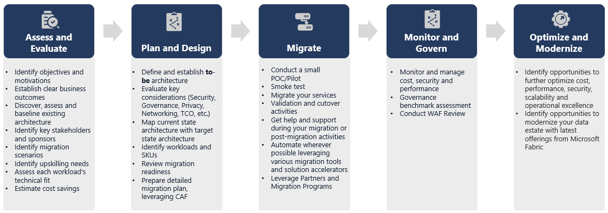

# 38. Migrating Azure Synapse Dedicated SQL Pools

[Book contents](../../index.md) | [Part VII contents](README.md) | [Previous: Chapter 37](37-migration-planning.md) | [Next: Chapter 39](39-migrating-sql-server-and-azure-sql.md)

**Applies to:** Azure Synapse dedicated SQL pool sources and Fabric Warehouse destinations. Open Mirroring is discussed as a separate destination path. **Level:** Advanced. **Revision evidence cutoff:** 9 October 2026; conversion coverage is not a compatibility guarantee.

## Carry the model, not every physical habit

Dedicated SQL pool teams have learned to think about hash distribution, replicated dimensions, round-robin staging, columnstore quality, distribution skew, resource classes, and concurrency slots. These are rational habits for that system. They are not a target Fabric configuration checklist.

A dedicated pool distributes data across a fixed set of 60 distributions, with compute allocation and workload management shaped by its service configuration [1]. Fabric Warehouse manages its physical storage and distributed execution differently. A source declaration such as `DISTRIBUTION = HASH(CustomerKey)` should therefore become assessment evidence: the original designer expected joins on customer and cared about data movement. It should not become an invented Fabric distribution clause.

Likewise, `staticrc` or `largerc` membership is not a Fabric capacity allocation. Preserve workload intent: which loads need throughput, which reports need predictable latency, and which concurrency combinations matter. Rebuild workload controls using the target's documented mechanisms and measured behavior. [Chapter 33](../06-operating-the-platform/33-workload-management-and-sql-pools.md) covers Fabric SQL pools, including its dated documentation and announcement differences. A DWU-to-Fabric sizing estimate is a starting hypothesis, not a performance equivalence.

Source physical tuning still matters while extracting. A parallel copy can consume dedicated-pool concurrency slots, compete with reporting, or amplify skew. Microsoft's migration methods describe partitioned copy and CETAS-based export [2]. Their example parallelism and throughput are scenario-specific. Do not copy a demonstrated DWU setting or multiplier into a business case as a guaranteed result.



*Documentation image D20. Microsoft, [Warehouse migration lifecycle](https://learn.microsoft.com/en-us/fabric/data-warehouse/migration-synapse-dedicated-sql-pool-planning); [original image](https://learn.microsoft.com/en-us/fabric/data-warehouse/media/migration-synapse-dedicated-sql-pool-planning/warehouse-migration-lifecycle.png). Unmodified source copy, retrieved 9 November 2026; [CC BY 4.0](https://creativecommons.org/licenses/by/4.0/) under the [Fabric documentation licence](https://github.com/MicrosoftDocs/fabric-docs/blob/aadea08f35c3edaa9c32535c772792f02555c9a4/LICENSE). This source-specific Microsoft lifecycle is not the custom toolkit's implementation; each migration still needs acceptance and recovery gates.*

## Three coordinated migration tracks

Treat **schema**, **code**, and **data** as separately testable tracks. Schema migration creates a reviewed target representation. Code migration preserves business behavior. Data migration transports a defined source state. Join the tracks through versioned contracts rather than allowing a copy activity to silently redefine the destination table.

Use [Figure 17 in Chapter 37](37-migration-planning.md#read-the-migration-flow-as-separate-gates) to keep those tracks and their security gates visible. A translated procedure is a code artifact; it is not permission to execute that procedure on either source or target.

Migration Assistant supports dedicated SQL pools and can ingest metadata through documented file or source-connection routes [3]. Review every automatic adjustment, then repair primary dependencies before dependent views and procedures. A created object has passed a deployment check, not a semantic test. A view returning different rows can compile perfectly.

For later definition waves, use [Chapter 37's newly documented existing-Warehouse workflow](37-migration-planning.md#iterate-metadata-without-assuming-data-preservation). **Keep incoming for a conflicting table drops and recreates it**; the prior rows are not recovered merely by restoring the old definition. This is separate from incremental row movement. Review the full selected dependency set, data recovery and reload policy before accepting a definition replacement.

Retain source DDL in version control, including distribution and index choices, even when those clauses disappear from the target. Preserve stored procedure definitions, role assignments, external object configuration, pipeline parameters, and schedules. A table-only inventory misses the extraction credentials and post-load tasks that make the warehouse usable.

Review code for dependencies on source DMVs, labels, physical partitions, temporary-table behavior, dynamic SQL, and cross-database names. Some clauses are obsolete on the target; others encode essential behavior. Never run a generic regex translator over an estate and interpret syntactic success as correctness. Quoted identifiers, comments, dynamic SQL, and context-sensitive type usage make unrestricted text replacement unreliable.

Current Fabric Warehouse supports `MERGE` as generally available and supports `IDENTITY`; early unsupported-feature lists are stale [4]. Neither feature removes the need to test replay, uniqueness, and key preservation. Existing surrogate keys should normally remain stable during migration. Generating new ones requires a complete, validated remapping of dependent facts.

## The Migration Agent Skill: a verified related public route

The September announcement uses the label **Migration Agent Skill** [8]. A verified related public implementation is Microsoft's `synapse-migration` in `microsoft/skills-for-fabric`. Read its [public `SKILL.md` at commit `bc42aaf734771bf752c1d7082dd91e5a6ca72b9f`](https://github.com/microsoft/skills-for-fabric/blob/bc42aaf734771bf752c1d7082dd91e5a6ca72b9f/skills/synapse-migration/SKILL.md) as a versioned design reference [9]. The exact mapping of Tino's label to this repository remains **unconfirmed**. This chapter neither installs nor invokes that skill and requires no tenant access.

The repository handles several Synapse artifact families, but the relevant **Warehouse route is for dedicated SQL pools**, not a universal Teradata or SQL Server migration agent. Its Lakehouse route has different contracts and excludes source-row movement; do not borrow that route's notebook instructions for a Warehouse destination. A commit pin makes the reviewed instructions reproducible, not every product-status statement permanently current. Check conversions against the current Warehouse type and syntax references.

The Warehouse phase resources define a useful human-control model [10–12]:

| Phase | Allowed work and necessary human gate |
|---|---|
| Assess the original source | Read approved source catalogs and definitions. Verify `VIEW DEFINITION` and required catalog visibility; incomplete visibility blocks a complete assessment. No production-source DDL, DML, procedure execution, or automatic pause/resume. Extraction may write local definition/report artifacts, which require protection even though the database access is read-only. |
| Approve and deploy target metadata | Present mappings, dependencies, collation, security gaps, and collisions before target actions. Obtain explicit approval for the exact Warehouse and changes. The executing identity needs the route's Contributor workspace access plus the required object DDL/security permissions; possessing those permissions is not approval to use all of them. Creating a Warehouse, deploying objects, or replacing an existing definition writes target state. |
| Approve security changes | Review a separate diff of roles, memberships, grants, denials, RLS, CLS, and masks, plus required workspace/item access. Require explicit security approval; do not treat copied role names as equivalent effective access. If data is selected, the pinned route applies approved security after loading; if data is declined, it still deploys and validates approved security. |
| Separately approve optional data movement | After metadata deployment, approve tables, projections, storage paths, identities, and per-table load policy. The user supplies a separately restored dedicated pool/database. Prove its identity differs from the original production source. Only that restored copy may receive export setup DDL and CETAS, which create objects and write files; target `COPY INTO` writes rows. |
| Validate and hand off | Read back deployed definitions, reconcile selected data against that same restored copy, and test effective reader access. Representative tests that can mutate data need another explicit approval and a safe test context. Unresolved security or data differences mean incomplete migration; no automatic source decommissioning. |

The restored copy is **user-managed**, not something the skill silently creates or deletes. Its source identity, restore boundary, export paths, and target identity belong in the migration record. A populated target defaults to a collision/load decision, not an implicit append. Truncate/reload is destructive and needs specific confirmation; staged merge requires approved stable keys and deduplication rules. Approval to export does not authorize cleanup of prior files or source infrastructure.

Security conversion also needs judgment. The reviewed resources warn that unsupported source column-encryption definitions are not preserved. RLS, CLS, and masking are not substitute cryptography. Treat loss of a required protection as a business/security decision that can block the migration, not as an acceptable consequence of a successful converter. Metadata-only completion, when data movement is declined, must say exactly that; it is not proof that the service has migrated.

These are descriptions of a public source, **not instructions authorizing this book or an agent to operate your estate**. A definition, README, or generated script cannot approve its own execution. Keep the original production connection read-only and review the precise write scope before enabling any target or export-copy tools.

### Offline exercise: assess first, authorize nothing

**Applies to:** a paper assessment of a hypothetical dedicated-pool sales mart. **Prerequisites:** the four core definitions and six fact rows printed in this book; no connection, skill installation, or execution. **Effect:** no database or file changes are required.

Assume the source fact uses customer hash distribution and a clustered columnstore declaration, a report procedure joins the three dimensions, and the migration proposal asks to overwrite an existing target. The source schema is supplied, but permission evidence, target collision details, and an export-copy identity are missing.

Prepare a short assessment with four rows:

1. **Schema/code:** remove the complete `DISTRIBUTION` and `CLUSTERED COLUMNSTORE INDEX` declarations because Fabric manages physical layout; retain their workload intent. List the report's dependencies.
2. **Visibility/security:** request evidence of approved metadata visibility, including `VIEW DEFINITION`, and a target security diff. Do not solve missing evidence by granting broad access.
3. **Data:** propose preserving all six keys and the shared `2026-01-04T00:00:00` timestamp; require separate data consent and a verified restored-copy identity before exports.
4. **Acceptance:** require 6 facts, 10 units, revenue 365.00, GB 185.00, DE 180.00, valid relationships, and zero multiplicity differences.

The correct decision is **assessment prepared; deployment and data movement not authorized**. Supplied definitions support an offline assessment but do not prove live catalog completeness. Missing collision and identity evidence remains a blocker to execution. If data is declined, a later explicitly approved metadata/security deployment can still be useful, but the report must not claim row migration. This exercise turns approval from a vague “looks good” into a reviewable scope.

## Representation changes deserve first-class tests

The current type reference is authoritative for persisted Warehouse columns [5]. Use explicit `datetime2(6)` and `time(6)` where six fractional digits are intended; seventh-digit source precision needs an approved rounding or truncation policy. A checkpoint or business key distinguished only by that seventh digit can collapse after conversion.

Typical changes include `tinyint` to `smallint`, `money` to `decimal(19,4)`, and `smallmoney` to `decimal(10,4)`. Decimal precision and scale must fit both stored values and arithmetic. Currency identity belongs in the data model; neither a source `money` value nor its decimal replacement identifies a currency automatically.

For `nvarchar` and `nchar`, evaluate UTF-8 `varchar` and `char` using actual encoded byte lengths. Source character counts are not automatically safe target byte lengths. Test supplementary characters and multilingual values, not only ASCII. Current `varchar(max)` and `varbinary(max)` storage limits are documented as 16 MB, not the historical limits assumed by some scripts [5].

`datetimeoffset` requires special care. Store a normalized UTC instant and, where the business needs it, retain the original offset or named-zone context separately. Casting away the offset without normalization changes the interpretation. Preserve a rejected-value report rather than converting failures silently to null.

`uniqueidentifier` is currently a Warehouse storage type, but the documentation describes different representation and read behavior through Lakehouse and SQL analytics endpoint paths [5]. Test every intended consumer, not just a Warehouse SQL query. A correct table definition can still be an unsuitable interchange contract.

## Historical extraction and controlled loading

A common route is dedicated-pool CETAS to a dedicated ADLS staging prefix, followed by Fabric pipeline ingestion or Warehouse `COPY INTO` [2]. Establish credentials and network access for each leg separately. The identity permitted to export source data is not necessarily the identity permitted to read staged files or write Warehouse tables.

Use least-privilege connections, secret storage, short-lived delegated credentials where required, and redacted logs. Never paste a SAS token into a checked-in notebook or print a complete generated `COPY` statement containing it. A source database-scoped credential is not a portable security principal in Fabric. Review Entra identities, workspace access, item permissions, and SQL permissions independently.

Use a fresh batch prefix and publish an extraction manifest only after all expected files exist. The manifest should include table, schema version, extraction boundary, file inventory, and validation totals. Loading a live folder while extraction continues can produce a successful partial copy. Keep rejected batches quarantined; distinguish source external-table metadata cleanup from deletion of staged files.

For large tables, partition extraction by stable, nonoverlapping ranges under a source consistency strategy. Null partition values and skewed ranges need explicit handling. Increasing parallelism does not solve correctness, and independent parallel reads do not automatically share one source snapshot.

## Sample bulk migration: Fabric Toolbox

The MIT-licensed `microsoft/fabric-toolbox` contains **Gen2toFabricDW**, a C# sample that extracts schema, exports dedicated-pool data to Parquet, and loads Warehouse [6]. The inspected substantive revision is `7b6a874839a3407b5b3227a7d212eb6ba2cf8172`, 18 February 2025. It is useful migration code to study, not a managed migration service.

Its checked-in example enables `DropDestinationTable`. That is not a safe book default. In an evaluated fork, require `DropDestinationTable = "False"` and `TruncateDestination = "False"`, allowlist tables, require a new empty destination, and separate approval from execution. These settings alone do not create a dry run: the program also creates schemas, external objects, files, and loads data.

Review its generated type mappings against today's reference. Review batching especially carefully: a `TOP` batch advanced only by `MAX(batchcolumn)` can omit remaining rows tied at the boundary. Do not enable its batching merely because the setting exists. Add a deterministic, fully specified extraction design and test it before using the sample outside an isolated rehearsal. This chapter links the code instead of redistributing an unreviewed executable.

## Mirroring and migration toolkit: fabric-mirroring-synapse

Mark Pryce-Maher's public [fabric-mirroring-synapse](https://github.com/MarkPryceMaherMSFT/fabric-mirroring-synapse) is **both a mirroring and migration tool**, with custom/community extraction and apply paths rather than native managed Fabric mirroring for Synapse [7]. It can move an initial source state, continue synchronizing selected tables, and supply the transport for a separately governed Warehouse migration cutover.

The public default branch was rechecked **9 November 2026** and still points to coherent revision `f9ce29f0e473a49e40dfc85c9eb2c349513b2386`, **8 September 2026**. The project combines dedicated-pool T-SQL snapshot/diff procedures, ADLS staging, PowerShell orchestration, definition translation and optional WPF desktop tooling. Evaluate the complete checkout, including numbered SQL migrations, rather than mixing independently pinned procedures. Its source procedures run on the dedicated pool, not on Warehouse. No repository code was installed or run against a tenant for this review.

It is also neither Migration Assistant nor Microsoft's `synapse-migration` skill. In particular, its custom snapshot and watermark algorithms below do not describe the implementation of native Copy job.

The repository offers an Open Mirroring landing-zone destination and a separate Warehouse destination using schema conversion, `COPY INTO`, and generated DML. Those are not interchangeable contracts. Open Mirroring delegates downstream ingestion to Fabric after files are delivered in its format; the custom producer still owns extraction correctness. The Warehouse path additionally owns ordered apply and target-state management.

Its `FULL` mode compares live data with a shadow copy. Its `HIGHWATERMARK` mode is append-only and does not detect changes to already processed rows or deletes. Keyless, set-based comparison cannot preserve arbitrary duplicate multiplicity. Schema-reset paths can clear staging and reseed targets, so automated schema drift handling requires explicit operational review, not blind activation.

### Choose the destination before planning cutover

| Configuration | What the project does | Migration consequence |
| --- | --- | --- |
| `destination.type = "FabricWarehouse"` | Uses the staged extracts to create/update target Warehouse tables and apply rows through the Warehouse SQL path, including COPY/stage and generated DML. | Suitable for rehearsing a move into a writable analytical Warehouse. The team owns target schema, ordered apply, permissions, reconciliation and the final writer transition. |
| `destination.type = "MirroredDatabase"` | Delivers files into an Open Mirroring landing zone for Fabric's ingestion path. | Suitable for replicated analytical consumption. It does not become a writable Warehouse or accept migrated Warehouse DDL through that landing zone. |

The destination choice does not make source extraction log-based CDC. FULL is a polling snapshot/diff design; HIGHWATERMARK is an append-only design. Updates that occur and reverse between observations, source deletes, late commits and duplicate rows need the explicit source/mode contract, not the general word "mirroring."

The current [Copy job CDC matrix](https://learn.microsoft.com/en-us/fabric/data-factory/copy-job-connectors), rechecked 9 November 2026, does not make Synapse dedicated SQL pools CDC **sources** merely because Synapse Data Warehouse appears as a CDC destination. The custom producer, native watermark/file-copy choices and source-specific CDC routes must therefore be assessed independently.

### A controlled migration sequence using the Warehouse route

| Phase | Toolkit role | What must be established before advancing |
| --- | --- | --- |
| Assess and rehearse | Review selected tables, business keys, types, source transformations and supported destination definitions. | Use an approved isolated/restored source for the book rehearsal; the tool does not silently provision a consistent restored copy or perform a read-only deployment. |
| Approve setup | Configure `FabricWarehouse`, the target connection and ADLS staging; deploy the project's source SQL/control objects only after approval. | Source deployment writes schemas/control/external objects. Protect source credentials, staging access and target identity independently; inspect the documented PowerShell 7, Azure CLI and sqlcmd prerequisites. |
| Establish the initial copy | Snapshot selected tables and load the Warehouse. Large initial loads can pipeline completed CETAS batches into the destination. | A populated destination during a pipelined load is **partial progress**, not a completed migration. Retain the source boundary, batch/file manifest, errors and control state. |
| Catch up | Continue the approved FULL or HIGHWATERMARK route for selected tables. | Prove the selected mode covers required inserts/updates/deletes and that extraction, file apply and checkpoints refer to the same state. Test retries and late/equal watermarks. |
| Migrate definitions and security | Preview/review Warehouse-compatible views, functions and procedures, then separately approve their synchronization. | The schema-object path is Warehouse-only. Source roles, permissions and grants are **not mirrored by this toolkit**; provision and test them separately. |
| Gate final cutover | Use an approved source-write stop or other demonstrable consistency boundary, complete final extraction/apply, reconcile and reroute consumers. | Compare all intended rows/multiplicity, business totals, schema, identities and workloads against the same source state. The repository does not supply automatic business acceptance or universal exactly-once cutover. |
| Choose coexistence or retirement | Continue source-led synchronization for coexistence, or stop the producer once the approved Warehouse writer transition is complete. | Do not let the source synchronizer overwrite new authoritative Warehouse writes. Keep source recovery and replay evidence until rollback has been retired explicitly. |

The headless guide and CLI expose concrete actions, but they do not have one common blast radius:

| Action or capability | Boundary to review |
| --- | --- |
| `PreviewSchemaRewrite` | Shows a selected source definition and proposed rewrite without applying it to Warehouse. It still needs configuration and source metadata access. |
| `SyncSchema -WhatIf` | Previews that schema-sync path; it is **not a global dry-run switch** for deployment, data movement, resets or every other action. |
| `Run -ControlID ...` | Narrows the table/data path. The current CLI can still invoke **due continuous schema synchronization**, so table scope is not a promise that every metadata action is confined to that table. |
| Pipelined snapshot/progress | Per-batch row/file progress helps observe a large load; it does not replace the completion manifest or reconciliation gate. |
| Reset/reseed/remove/uninstall | Can delete staging/landing state and drop or clear destination tables. Ordinary sync can also truncate an existing target when it detects a reseed; absence of an explicit Reset command does not prove a nondestructive run. |

For definition conversion, the named `Minimal`, `Safe`, `Standard` and `Aggressive` levels are **tool settings**, not certificates of semantic equivalence. Review the actual before/after and current Fabric support. For example, the pinned rewriter can remove query labels even though current Fabric supports `OPTION (LABEL = ...)`; that can change observability. String byte widths, timestamp offsets and source-database references need value/dependency tests beyond a successful CREATE.

The repository's reported live tests remain the author's evidence, not tests performed for this book. Its default-branch revision, README, headless guide, CLI, Warehouse apply path and schema helper were inspected statically. Neither the tool's continuous loop nor a green status row proves the source consistency and reconciliation requirements discussed next.

## The boundary race is not solved by a friendly name

The inspected watermark procedure extracts rows above a previous watermark and subsequently obtains a new maximum from the live table. If row 200 arrives after extraction but before that maximum is read, advancing the checkpoint to 200 can skip it forever. The initial snapshot-to-checkpoint handoff has the same class of risk. These are generic correctness hazards, not peculiarities of one product name.

Capture an upper boundary before extraction and ensure extraction, validation, and checkpointing describe that exact boundary. Even then, an increasing identifier allocated before commit can arrive late below it. Equal timestamps need deterministic tie handling; backdated data needs overlap and deduplication or another capture mechanism. Updates and deletes require an explicit change representation. A stable snapshot, controlled source pause, or appropriate source-specific change capture is necessary where those cases cannot otherwise be bounded.

Similarly, separately reading a live table for outgoing rows and for a new shadow baseline can make the baseline include changes that were never emitted. Do not silently endorse either snapshot routine as production-safe under concurrent mutation. Validate source consistency, retries, file ordering, and target transactions as a complete protocol; [Chapter 41](41-reconciliation-cutover-and-rollback.md) provides the acceptance framework.

## Lab: review one converted sales table

**Prerequisites:** The unchanged `BookWarehouse` from [Chapter 4](../01-getting-started/04-first-warehouse.md), permission to create isolated lab tables, and the inventory from [Chapter 37](37-migration-planning.md). No Synapse tenant is required.

Assume the source used hash distribution on customer, a columnstore index, and `LastModifiedUtc datetime2(7)`. Write a conversion decision explaining why physical clauses are omitted and what happens to the seventh fractional digit. For this seed it is zero, so conversion to six digits preserves the supplied value exactly.

**Runnable T-SQL; execution location: BookWarehouse.** Creates one new, empty lab table; fails if its name already exists. It does not migrate production data.

```sql
CREATE TABLE book.Lab28ConvertedSales
(
    SalesKey bigint NOT NULL,
    DateKey int NOT NULL,
    CustomerKey int NOT NULL,
    ProductKey int NOT NULL,
    Quantity int NOT NULL,
    UnitPrice decimal(12,2) NOT NULL,
    LastModifiedUtc datetime2(6) NOT NULL
);
```

Compare the columns with `book.FactSales` through the read-only inventory. Expect seven matching business columns and no source distribution or index declaration. Record that object creation proves only the representation is accepted. The complete copy and reconciliation exercise is in [Chapter 42](42-production-capstone.md).

For cleanup, explicitly remove only `book.Lab28ConvertedSales` in the isolated training warehouse after reviewing its contents. Do not use a drop-schema utility or point a sample migration tool at existing production tables. No tenant execution or performance result is claimed here.

## Key takeaways

- Preserve business models and workload intent, not dedicated-pool physical settings.
- Review current types, generated code, credentials, and every consumer path.
- Community replication and sample migration programs require an owned correctness protocol.
- The author toolkit supports initial migration and ongoing mirroring; select the destination, delta mode and cutover contract explicitly.
- A migration skill can write target objects, security, files, and data; phase-specific approval is essential.

## References

1. Microsoft Learn, [Dedicated SQL pool architecture](https://learn.microsoft.com/en-us/azure/synapse-analytics/sql-data-warehouse/massively-parallel-processing-mpp-architecture).
2. Microsoft Learn, [Synapse dedicated SQL pool migration methods](https://learn.microsoft.com/en-us/fabric/data-warehouse/migration-synapse-dedicated-sql-pool-methods), 21 September 2026.
3. Microsoft Learn, [Migration Assistant](https://learn.microsoft.com/en-us/fabric/data-warehouse/migration-assistant).
4. Microsoft Learn, [T-SQL surface area](https://learn.microsoft.com/en-us/fabric/data-warehouse/tsql-surface-area), September 2026 revision.
5. Microsoft Learn, [Warehouse data types](https://learn.microsoft.com/en-us/fabric/data-warehouse/data-types), 11 June 2026.
6. Microsoft, [Gen2toFabricDW, pinned sample](https://github.com/microsoft/fabric-toolbox/tree/7b6a874839a3407b5b3227a7d212eb6ba2cf8172/tools/Gen2toFabricDW), 18 February 2025; MIT.
7. Mark Pryce-Maher, [fabric-mirroring-synapse](https://github.com/MarkPryceMaherMSFT/fabric-mirroring-synapse), [coherent pinned source](https://github.com/MarkPryceMaherMSFT/fabric-mirroring-synapse/tree/f9ce29f0e473a49e40dfc85c9eb2c349513b2386), 8 September 2026, still default-branch HEAD when checked 9 November; public mirroring/migration project, no explicit repository license identified.
8. Tino Tereshko, [Fabric Data Warehouse announcement roundup](https://www.linkedin.com/posts/valentinotereshko_speed-run-of-fabric-data-warehouse-announcements-activity-7510726240522293248-r4tC), 29 September 2026.
9. Microsoft, [`synapse-migration/SKILL.md`, pinned reading reference](https://github.com/microsoft/skills-for-fabric/blob/bc42aaf734771bf752c1d7082dd91e5a6ca72b9f/skills/synapse-migration/SKILL.md), reviewed 9 October 2026; not installed or executed.
10. Microsoft, [Warehouse source assessment](https://github.com/microsoft/skills-for-fabric/blob/bc42aaf734771bf752c1d7082dd91e5a6ca72b9f/skills/synapse-migration/resources/dw-source-and-extraction.md) and [DDL compatibility](https://github.com/microsoft/skills-for-fabric/blob/bc42aaf734771bf752c1d7082dd91e5a6ca72b9f/skills/synapse-migration/resources/dw-ddl-compatibility.md), same reviewed pin.
11. Microsoft, [Separately approved Warehouse data migration](https://github.com/microsoft/skills-for-fabric/blob/bc42aaf734771bf752c1d7082dd91e5a6ca72b9f/skills/synapse-migration/resources/dw-data-migration.md), same reviewed pin.
12. Microsoft, [Warehouse security and validation](https://github.com/microsoft/skills-for-fabric/blob/bc42aaf734771bf752c1d7082dd91e5a6ca72b9f/skills/synapse-migration/resources/dw-security-validation.md), same reviewed pin.
13. Mark Pryce-Maher, pinned toolkit [headless guide](https://github.com/MarkPryceMaherMSFT/fabric-mirroring-synapse/blob/f9ce29f0e473a49e40dfc85c9eb2c349513b2386/docs/HEADLESS.md), [CLI](https://github.com/MarkPryceMaherMSFT/fabric-mirroring-synapse/blob/f9ce29f0e473a49e40dfc85c9eb2c349513b2386/ps/Manage-Mirroring.ps1), [Warehouse apply library](https://github.com/MarkPryceMaherMSFT/fabric-mirroring-synapse/blob/f9ce29f0e473a49e40dfc85c9eb2c349513b2386/ps/MirroringLib.psm1) and [schema helper](https://github.com/MarkPryceMaherMSFT/fabric-mirroring-synapse/blob/f9ce29f0e473a49e40dfc85c9eb2c349513b2386/ps/SchemaObjectLib.ps1), statically checked 9 November 2026; no code copied or tenant execution.

---

[Previous: Chapter 37](37-migration-planning.md) | [Book contents](../../index.md) | [Next: Chapter 39](39-migrating-sql-server-and-azure-sql.md)
