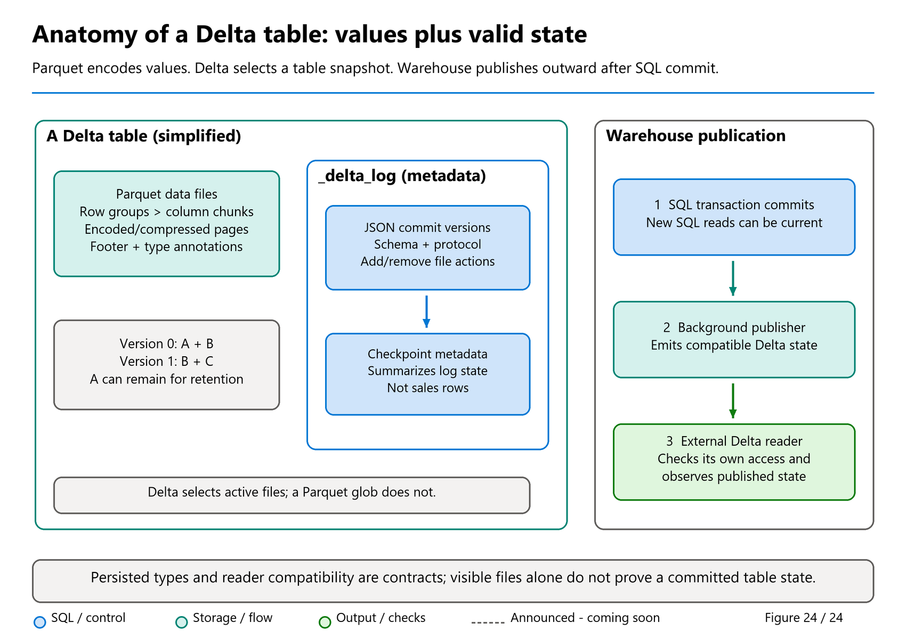

# 39. Migrating Analytical Workloads from SQL Server and Azure SQL

[Book contents](../../index.md) | [Part VII contents](README.md) | [Previous: Chapter 38](38-migrating-synapse-dedicated-sql-pools.md) | [Next: Chapter 40](40-migrating-other-platforms.md)

**Applies to:** SQL Server, Azure SQL Database, and Azure SQL Managed Instance as sources; Fabric Warehouse for analytical data and transformations. **Level:** Intermediate to advanced. **Revision evidence:** original comparison 9 October 2026; incremental metadata/conflict guidance reviewed 9 November. Connectivity, source version, and change-capture eligibility require source-specific checks.

## First ask whether the workload belongs here

"Move SQL Server to Fabric" is not a sufficiently precise requirement. A SQL Server estate might host order entry, a dimensional warehouse, application sessions, operational reports, and a nightly export in one instance. Those workloads do not necessarily share a target.

Fabric Warehouse is an analytical destination. A well-designed reporting mart can be a strong migration candidate. An application that depends on frequent singleton transactions, triggers, enforced relational constraints, or very low-latency operational writes requires a separate transactional-platform decision. Do not present Warehouse as a transparent replacement for the OLTP application merely because both accept T-SQL.

A common outcome is **analytical separation**: the transactional application stays on its appropriate database platform while governed data movement feeds Fabric. Another is **analytical relocation**: the existing mart, its transformations, and reports move together. The first requires an enduring synchronization service; the second eventually permits retirement of the old mart. Agree which outcome is intended before promising savings or a decommissioning date.

Microsoft's SQL Server migration planning documentation is explicitly about data warehouses [1]. Its guided Migration Assistant source route also covers Azure SQL Database and Azure SQL Managed Instance through the documented SQL Server database tile [2]. That tool coverage does not imply every source feature, topology, or authentication arrangement converts automatically.

## Classify compatibility by behavior

Inventory tables, views, functions, procedures, SQL Agent jobs, external integrations, security, and report dependencies. Azure SQL Database and Managed Instance differ from on-premises SQL Server, so do not assume that a job or export mechanism exists unchanged on every source. Discover what this service actually uses.

For each dependency, distinguish storage syntax from business behavior. A computed source column might become an explicitly calculated value in the loading transformation or a target view. A trigger that maintains an audit table must become an owned pipeline or application responsibility if the target does not support it. Removing the trigger definition without replacing its effect silently changes the service.

Fabric's current T-SQL surface supports `MERGE` and `IDENTITY`, but it does not support every SQL Server feature [3]. Constraint declarations for primary, unique, and foreign keys are not enforced in Warehouse [4]. If the source rejected duplicate order lines, the target loading design must perform its own duplicate validation before publishing them. Metadata is not a substitute for that check.

Review transaction behavior separately. Warehouse transactions provide atomicity and snapshot consistency, but source locking assumptions and isolation-setting instructions are not portable tuning controls. Avoid row-at-a-time procedural rewrites that retain operational database habits without their original guarantees. Batch-oriented analytical transformations are usually easier to reconcile and restart.

Do not treat an index migration count as a success metric. Source indexes reveal access patterns and integrity assumptions; target optimization should follow measured query plans, statistics, and workload design. Preserve a list of important predicates and joins, then use [Chapter 27](../05-statistics-and-performance/27-query-plans-and-tuning.md) to evaluate their new plans.



*Figure 24, reused for source-type assessment.* A successful source expression does not establish a lossless persisted destination. Compare values, precision, encoding and every intended reader before deploying the new schema.

## Map values, not just type names

Use the current Fabric persisted-type reference when designing target tables [5]. `datetime2` and `time` have at most six fractional digits. `money` normally maps to an appropriate fixed-precision decimal; `tinyint` widens to `smallint`. XML, spatial objects, and user-defined types require explicit representation and behavior decisions rather than a cosmetic rename.

For Unicode strings, calculate required UTF-8 byte capacity. A source `nvarchar(100)` and target `varchar(100)` are not equivalent maximum-size promises for all languages. Test names containing accents, supplementary characters, and trailing spaces under the intended collation. Warehouse supports case-sensitive and case-insensitive UTF-8 collations, and an existing item's collation cannot simply be changed later [6].

The current direct-connection Migration Assistant guide says its new Warehouse uses case-insensitive collation [2]. Verify the created destination instead of assuming the workspace default won. A collation change can alter grouping, equality, ordering, and duplicate detection. Test examples such as `Aster` versus `ASTER` against the business rule, not just a developer's preference.

Do not discard rejected conversions. Keep original values, object and column identifiers, batch identifiers, and an approved reason code in a secured exception process. A load that replaces unconvertible values with null can appear healthier than one that fails, while being much harder to reconcile.

## Pick a transport with a recoverable boundary

Migration Assistant and Data Factory offer guided metadata and copy workflows. Schema-first migration followed by staged-file loading gives more explicit control over target types and batch boundaries [7]. Choose based on source access, consistency requirements, volume, and operational ownership, not merely the shortest demonstration.

For on-premises or network-restricted sources, validate the applicable connector and gateway path before scheduling a migration window. Test authentication as the production execution identity, not only as the developer who configured the connection. A successful interactive query does not prove an unattended job can refresh a token or traverse the required network.

Jovan Popovic's public article describes an Azure SQL Managed Instance pattern using CETAS to export Parquet to Azure storage and `COPY INTO` to ingest Warehouse [8]. This is useful architectural background, not a universal script for every SQL Server or Azure SQL deployment. The article predates this book's recent-script selection window; its code is not reproduced here. Source support, export configuration, credentials, and network rules must be validated afresh.

Separate source read permission, storage write permission, storage read permission, and destination write permission. Keep credentials out of SQL text saved in source control and out of notebook output. Prefer supported managed identities or other governed Entra-based connections where available; where a secret is required, use approved secret storage, rotation, and short scope.

Historical extraction and continuing synchronization need one consistent handoff. A database snapshot or source-specific change-capture mechanism may help, but its retention and failure behavior must be understood. A `rowversion` value is not a UTC event time, and an application timestamp is not automatically a commit sequence. Hard deletes are invisible to an insert-only timestamp scan.

### A Copy job bridge during coexistence

The documented Assistant workflow hands **Copy data** to **Use a copy job**, where the team chooses the copy mode and destination mappings [9]. For incremental mode, Copy job performs an initial full load, then uses its stored state for subsequent changes [10]. That is data synchronization, not automatic incremental deployment of changed procedures or table definitions.

The source-connection guide now separately documents **Migration > Get more objects** for definition iteration into an existing Warehouse [2]. Its conflict choice **Keep incoming drops and recreates a table**, requiring its rows to be loaded again; restoring the preceding definition after failure does not recover the data. Use [Chapter 37's conflict checklist](37-migration-planning.md#iterate-metadata-without-assuming-data-preservation). Do not combine a definition replacement with an assumed-safe Copy job restart.

For SQL Server, Azure SQL Database, or Azure SQL Managed Instance, check the exact connector's **CDC source** support and whether the selected source tables are actually CDC-enabled [11]. The current guide/matrix, rechecked 9 November, documents base CDC separately from **SCD Type 2 preview**; do not retain an older blanket preview label for every CDC operation or promote every history/source combination to GA. Where supported and configured, CDC carries inserts, updates and deletes. Source selection alone does not enable it or establish retention. Source-side changes need the owner's approval.

With a watermark instead, only qualifying inserts and updates whose watermark advances are found; deletes are absent. Choose the target write behavior separately: appending a corrected version does not update the old row. Record keys, null-watermark handling, and the recovery plan using [Chapter 41's decision table](41-reconciliation-cutover-and-rollback.md#migration-assistant-incremental-migration-and-copy-job). Resetting a job clears its progress state, not its destination, so a reset-and-append can repeat the historical copy. None of these Copy job capabilities certify a source-specific snapshot or exactly-once application protocol.

## Adapt a public view-migration pattern safely

Mark Pryce-Maher's `migrate_views.py` gist, revision `aa59d2d2453a61dbe5b57383cd79bb521f0a5be6` from 11 August 2025, demonstrates selecting source view definitions and applying them to Fabric. The book uses that discovery idea in [a read-only extraction script](../../scripts/39-review-view-definitions.sql), rather than shipping an automatic translator.

The adaptation is deliberate. It identifies views by **schema and name**, not name alone; retrieves definitions without displaying an entire estate; includes dependency metadata; and performs no target execution. It avoids embedding source passwords and does not copy the gist's token-acquisition implementation. Authentication should use the documented SQL audience and supported credential mechanism for the chosen client, not a token chosen merely because it worked for a REST call.

The gist's text substitution from `CREATE VIEW` to `CREATE OR ALTER VIEW` is not a general SQL parser. A global replacement can affect comments or text, and it does not resolve dependency order or incompatible expressions. Review each selected definition, edit its header deliberately, and deploy dependency-first. Retain original and reviewed definitions together.

Also avoid one broad transaction that catches per-view exceptions and continues as though all subsequent work remains valid. Use explicit deployment units with clear failure status. Do not report a view as migrated until its definition exists, permissions are correct, and its result has passed comparison. Failed-definition exports may contain sensitive object names or literals; secure them like source code.

## Lab: migrate one report contract

**Prerequisites:** The unchanged core dataset from [Chapter 4](../01-getting-started/04-first-warehouse.md), Warehouse read permission, and permission to create an isolated view. The optional source inventory runs on a SQL Server-family source with approved metadata access; it is not required for the synthetic exercise.

Run the source extraction script only after replacing its schema and view filters with approved names. If no matching view is visible, investigate permissions and names. Do not interpret an empty result as successful migration. If a module definition is null, obtain an authorized source definition rather than constructing one from guesses.

For the synthetic exercise, deliberately author the target definition. This is an original view over the common dataset, not translated source code.

**Runnable T-SQL; execution location: BookWarehouse.** Execute the creation statement as its own batch. It creates one lab view and fails if that view already exists.

```sql
CREATE VIEW book.Lab29RevenueByCountry
AS
SELECT c.CountryCode,
       SUM(CAST(f.Quantity * f.UnitPrice AS decimal(18,2))) AS Revenue
FROM book.FactSales AS f
JOIN book.DimCustomer AS c ON c.CustomerKey = f.CustomerKey
GROUP BY c.CountryCode;
```

**Runnable, read-only T-SQL; execution location: BookWarehouse, subsequent batch.**

```sql
SELECT CountryCode, Revenue
FROM book.Lab29RevenueByCountry
ORDER BY CountryCode;
```

Expect `DE = 180.00` and `GB = 185.00`. Verify that the total is 365.00 and that each fact joins exactly one customer. A duplicate dimension key could inflate this view while leaving the fact count unchanged. That failure is precisely why migration tests include relationships as well as table totals.

In your acceptance record, distinguish deployment success, semantic success, and security success. The first is view creation; the second is the expected values and valid joins; the third requires tests under representative reader identities. Do not claim the third merely because the creator can query the view.

Cleanup consists only of removing `book.Lab29RevenueByCountry` when the isolated exercise is finished. Keep the four core tables unchanged. No source database, credentials, or production environment is needed for this lab.

## Key takeaways

- Separate analytical migration from transactional application replacement.
- Replace lost behavior, not only unsupported syntax.
- Review view definitions and authentication rather than deploying broad text substitutions.

## References

1. Microsoft Learn, [SQL Server migration planning](https://learn.microsoft.com/en-us/fabric/data-warehouse/migration-sql-server-planning).
2. Microsoft Learn, [Migration Assistant: connect to the source](https://learn.microsoft.com/en-us/fabric/data-warehouse/migrate-using-connection-to-source-system), original September guide with incremental metadata/conflict sections added 16 October; reviewed 9 November 2026.
3. Microsoft Learn, [T-SQL surface area](https://learn.microsoft.com/en-us/fabric/data-warehouse/tsql-surface-area).
4. Microsoft Learn, [Primary, foreign, and unique keys](https://learn.microsoft.com/en-us/fabric/data-warehouse/table-constraints), 8 September 2026.
5. Microsoft Learn, [Warehouse data types](https://learn.microsoft.com/en-us/fabric/data-warehouse/data-types).
6. Microsoft Learn, [Warehouse collation](https://learn.microsoft.com/en-us/fabric/data-warehouse/collation).
7. Microsoft Learn, [SQL Server migration methods](https://learn.microsoft.com/en-us/fabric/data-warehouse/migration-sql-server-methods); Mark Pryce-Maher, [view-migration gist, pinned revision](https://gist.github.com/MarkPryceMaherMSFT/a834d3043c38ea498029e147d061624b/aa59d2d2453a61dbe5b57383cd79bb521f0a5be6), 11 August 2025; discovery pattern adapted with author authorization, no explicit gist license.
8. Jovan Popovic, [Copy data from Azure SQL Managed Instance to Microsoft Fabric DW](https://devblogs.microsoft.com/azure-sql/how-to-copy-data-from-azure-sql-managed-instance-to-microsoft-fabric-dw/), 2023; historical architectural background, not a reproduced script.
9. Microsoft Learn, [Migration Assistant upload workflow and Copy job integration](https://learn.microsoft.com/en-us/fabric/data-warehouse/migrate-using-upload-file), updated 29 September 2026; reviewed 9 October 2026.
10. Microsoft Learn, [Incremental copy in Copy job](https://learn.microsoft.com/en-us/fabric/data-factory/incremental-copy-job), 15 September 2026.
11. Microsoft Learn, [Copy job connector matrix](https://learn.microsoft.com/en-us/fabric/data-factory/copy-job-connectors), updated 9 November 2026, and [CDC guide](https://learn.microsoft.com/en-us/fabric/data-factory/cdc-copy-job); current CDC-source/destination and separate SCD Type 2 preview boundaries rechecked 9 November.

---

[Previous: Chapter 38](38-migrating-synapse-dedicated-sql-pools.md) | [Book contents](../../index.md) | [Next: Chapter 40](40-migrating-other-platforms.md)
