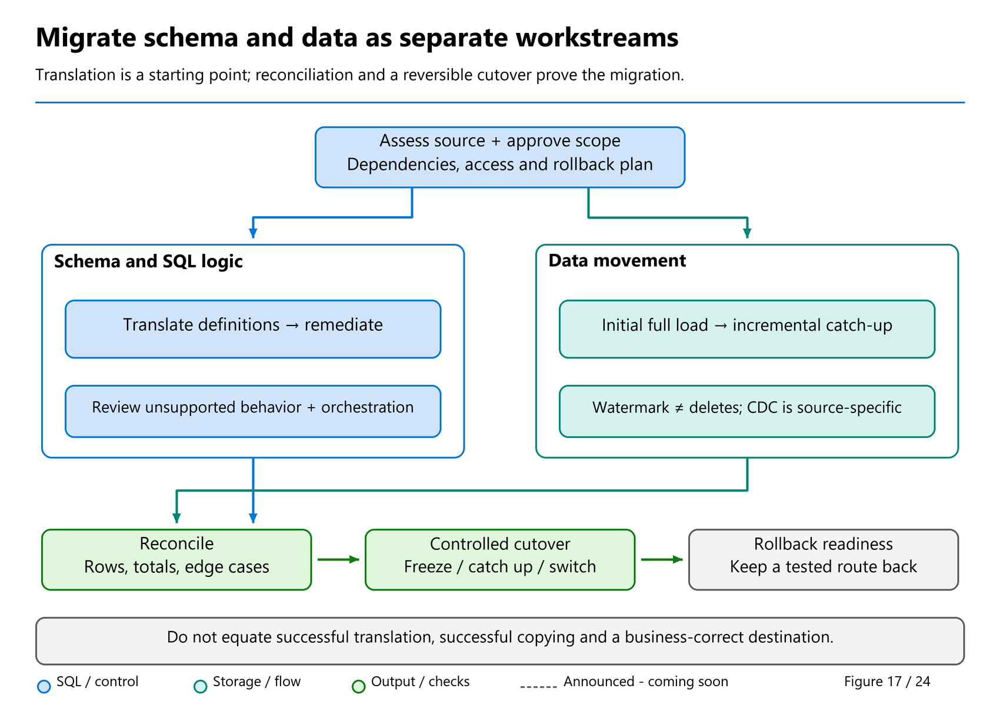

# 40. Migrating Other Platforms Without Inventing Compatibility

[Book contents](../../index.md) | [Part VII contents](README.md) | [Previous: Chapter 39](39-migrating-sql-server-and-azure-sql.md) | [Next: Chapter 41](41-reconciliation-cutover-and-rollback.md)

**Applies to:** Heterogeneous analytical sources and Fabric Warehouse; Lakehouse is an alternative landing and transformation layer. **Level:** Advanced. **Revision evidence cutoff:** 9 October 2026. Teradata metadata migration is documented as preview; other source names do not imply Migration Assistant support.

## Separate four meanings of "supported"

A platform can have a connector without having an automatic SQL translator. It can have a metadata translator without having continuous replication. It can have data movement without equivalent security or recovery behavior. A migration proposal should state which of these capabilities is actually available.

Use four separate questions. Can the source be read through the required network and identity? Can its values be represented without unacceptable loss? Can its SQL and procedural behavior be recreated? Can the resulting service be operated with the necessary freshness and recovery guarantees? An affirmative answer to the first does not settle the other three.

The Fabric Data Factory connector matrix distinguishes Dataflow Gen2, pipeline, and Copy job support, including source versus destination direction [1]. Check the specific row and feature documentation for the selected method. A source supported by a dataflow is not automatically supported by a Copy job in the same way. Authentication, gateway requirements, incremental options, and supported versions remain connector-specific.

This chapter therefore provides a detailed, documented Teradata route and a disciplined evaluation framework for Oracle, Snowflake, Amazon Redshift, PostgreSQL, and other analytical estates. It does not claim that Migration Assistant translates all those products.

## Teradata: a documented metadata route, with preview boundaries

The current Migration Assistant documentation explicitly lists **Teradata metadata (preview)** [2]. Microsoft's Teradata method is to upload a zip containing `.sql` and/or `.bteq` object-definition files, translate and deploy supported metadata, remediate failures, and move data through a separate ingestion step [3]. Query-only files are not a substitute for the required object definitions.

Follow the metadata lane in [Figure 17](37-migration-planning.md#read-the-migration-flow-as-separate-gates), not an imagined one-click transfer. The documented source tile is **Teradata (Preview)**. Review the detected objects and dependencies, select the intended wave, then obtain approval for the new Warehouse and deployed definitions before **Migrate**. This action writes the target; uploading definitions is not equivalent to a local dry run.

Include dependencies in each migration wave. Capture tables, views, macros, procedures, functions, roles, and the orchestration around them. Export the migration summary and preserve both source and translated definitions. Objects that need remediation should remain visible in the delivery register, not disappear from the denominator when a progress report is prepared.

Preview is a product-status statement, not a guarantee that every tenant exposes the same interface or that every translated object has equivalent semantics. Confirm actual eligibility and review support expectations before making the feature a critical production dependency. Where the workflow offers AI assistance, a reviewer still owns every accepted change.

The remediation loop is concrete: inspect automatic adjustments in the summary, open **Objects to fix** / **Fix problems**, review the source and generated SQL, correct it, and test its behavior [3,8]. Copilot's **Fix query errors** suggestions are optional and depend on the documented tenant, capacity, and regional prerequisites; they are not a substitute for review. The subsequent **Run** action can create the object, so approve its write effect as well as its syntax.

Resolve collation explicitly. The Teradata-specific methods page describes a destination collation choice, while the shared upload guide still says the created Warehouse is case-insensitive [3,8]. That documentation mismatch is not a reason to guess. Record the intended choice, verify the actual created collation in an authorized rehearsal, and test case-sensitive identifiers and comparisons before accepting the metadata.

Teradata migration is especially instructive because physical design and business semantics can look deceptively similar in DDL. A primary index is not simply a SQL primary key to be recreated in Fabric. A source `SET` table's duplicate-row behavior is not preserved just by translating it to a normal Warehouse table. Source temporal periods need an explicit target representation and comparison rules [4].

Microsoft's translation guidance also calls out BTEQ statements that are removed rather than reproduced. An operating-system command, export directive, or error-policy statement may be absent from the generated procedure. That can be reasonable translation behavior, but it leaves an operational task for the migration team. Recreate its purpose in a pipeline, notebook, scheduler, or external service; otherwise the translated SQL is only part of the original program.

Use a small remediation register to distinguish a translated object from preserved behavior:

| Source construct | Documented direction | Acceptance work still required |
|---|---|---|
| Teradata macro | Stored procedure | Compare parameter handling, returned rows, errors, and caller behavior; update the calling workflow deliberately. |
| BTEQ SQL and supported control flow | Stored-procedure translation, with review | Recreate scheduling, branching, and return-code handling where they live outside the generated SQL. |
| BTEQ `.EXPORT`, `.OS`, `.RUN FILE`, and unsupported error-policy commands | Removed from translated code | Inventory the lost effects, assign an orchestration owner, and test failure/restart paths. A removed command is not a migrated export. |
| `SET` duplicate enforcement or source-specific physical design | Regular table / omitted physical clauses | Add loading checks for required invariants and measure the redesigned workload; do not invent target index clauses. |

The public Synapse migration skill in [Chapter 38](38-migrating-synapse-dedicated-sql-pools.md#the-migration-agent-skill-a-verified-related-public-route) is a different route, not the engine behind this Teradata preview. Nor is Mark Pryce-Maher's custom Synapse replication toolkit a Teradata Assistant implementation.

Use the general Warehouse surface-area reference to validate proposed targets [5]. For example, a migration mapping may suggest a materialized structure for a source join index, but current Warehouse documentation lists materialized views as unsupported. Choose a supported, explicitly maintained pre-aggregation table when appropriate. A mapping guide is a design aid, not permission to bypass the target engine's documented limits.



*Figure 17, reused for heterogeneous migration.* The phases organize the work; they do not mean one translator, connector or source-snapshot mechanism supports every platform.

## Moving Teradata data is another workstream

After reviewed table definitions exist, select a guided copy or an approved unload-to-files route. The documented Teradata workflow includes Copy job, pipelines, and staged files with `COPY INTO` [3]. Incremental behavior depends on the source configuration and selected connector capability; do not assume every full-copy path discovers updates and deletes.

For guided movement, **Copy data → Use a copy job** leads to a separate data job with its own source credentials, table/column mappings, copy mode, and destination-write policy. **Save + Run** starts an actual transfer, not another metadata assessment; obtain the data owner's approval first. Incremental mode starts with a full copy and continues from saved state. The reviewed Copy job matrix supports **Teradata watermark-based incremental reads**, but does **not** list Teradata as a supported CDC source [9,10]. A changing watermark can identify qualifying updates as well as inserts; it cannot discover hard deletes.

For example, if a Teradata sale is corrected and its reliable modification value advances, a watermark job can capture the revised row; the Warehouse apply policy must then match the approved key rather than blindly append a second current version. If the sale is deleted, design a separate approved deletion/reconciliation mechanism or a bounded replacement process. A `MERGE` destination does not manufacture source delete events. Use [the incremental decision table in Chapter 41](41-reconciliation-cutover-and-rollback.md#migration-assistant-incremental-migration-and-copy-job), including its reset warning, before promising coexistence.

For a staged load, specify the schema, encoding, decimal representation, timestamp normalization, null representation, and extraction boundary in the manifest. Prefer an immutable batch prefix. Record which files form the complete batch and distinguish a failed export from a genuinely empty table.

Replace utilities by behavior, not by name. A MultiLoad-style process may imply error tables, restart checkpoints, key-based updates, and partial-failure rules. A target `MERGE` statement addresses only part of that contract. A BTEQ script may interpret row counts to select its next operation; reproduce that control flow and test both branches.

During parallel operation, reconcile equivalent source and target states. A fast historical transfer is of limited value if the continuing-delta path cannot catch up within the intended cutover window. Measure sustained change arrival, extraction, loading, and validation together, without borrowing throughput numbers from unrelated demonstrations.

## Other estates: use a source-specific decision sheet

For **Oracle-based analytical services**, inspect the actual numeric domains, temporal rules, empty-string and null behavior, sequence usage, procedural packages, and application-side dependencies. Do not select a target decimal merely from a broad source type name; profile actual precision, scale, and permitted future values. Decide which procedures become batch transformations and which responsibilities remain outside Warehouse.

For **Snowflake-based services**, inventory relational data separately from semi-structured values, tasks, streams, stored procedures, security policies, and consumer sharing arrangements. A table export does not migrate the continuing-change contract or access model. Decide whether semi-structured values should be retained as text, flattened into relational columns, or handled in a Lakehouse transformation layer.

For **Amazon Redshift-based services**, identify distribution and sort choices as workload evidence, then redesign physical tuning for the target rather than translating physical clauses mechanically. Review unload manifests, external-data dependencies, IAM-to-Entra identity changes, and the intended network route. The connector matrix documents a pipeline source path, but that does not establish a complete estate-conversion service [1].

For **PostgreSQL-based services**, inspect identifier casing, arrays, JSON, custom types, procedural extensions, and time semantics. Determine whether an analytical projection is a better migration unit than the entire operational database. Extensions or source-side functions must have explicit replacements; the ability to read their resulting columns is not the ability to execute them on Fabric.

These are assessment prompts, not claims that every estate uses every feature. Obtain the source version and relevant source documentation for the actual migration. A general chapter cannot certify an unseen platform configuration.

## Build a semantic test corpus

The most valuable migration asset is often a small collection of difficult examples. Include values whose ordering, equality, null behavior, rounding, or timezone interpretation matters to the business. Capture the expected source result and the approved target result with each case. Where behavior intentionally changes, record the business approval rather than hiding the difference.

Test duplicates explicitly. SQL operations can compare sets, bags, or ordered results. A set comparison can report equality while one side contains additional identical rows. A ranking query can produce the same row count while choosing different rows when its ordering has ties. A checksum can conceal differences through collisions or inconsistent serialization.

Keep exact and approximate analytics separate. If a report uses approximate distinct counts, the acceptance rule should describe the allowed error and business consequence. Financial totals over fixed-precision synthetic data can demand exact equality. One percentage tolerance pasted across every result is not a meaningful validation strategy.

Do not build a generic regex SQL translator. Use source-aware tooling where documented, then review syntax and behavior. An apparent replacement such as removing a database qualifier might point a query at a different object. An apparent type simplification might alter string comparison or decimal arithmetic. Faster translation without explainable output increases reconciliation effort later.

## Lab: make a ranking rule portable and explicit

**Prerequisites:** The unchanged `BookWarehouse` seed from [Chapter 4](../01-getting-started/04-first-warehouse.md), with read access to `book.FactSales`. No external platform or credentials are required.

Suppose a report needs one selected sale per customer, chosen by greatest `DateKey`, then greatest `SalesKey` on that date. The second ordering rule is an explicit report contract, not an assertion that a larger surrogate key always means a later business event.

**Runnable, read-only T-SQL; execution location: BookWarehouse.** The CTE form makes the selection rule visible.

```sql
WITH RankedSales AS
(
    SELECT CustomerKey, SalesKey, DateKey,
           ROW_NUMBER() OVER
           (
               PARTITION BY CustomerKey
               ORDER BY DateKey DESC, SalesKey DESC
           ) AS SelectionRank
    FROM book.FactSales
)
SELECT CustomerKey, SalesKey, DateKey
FROM RankedSales
WHERE SelectionRank = 1
ORDER BY CustomerKey;
```

Expect customer 1 to select sale 1003, customer 2 sale 1005, and customer 3 sale 1006. Fabric currently also documents `QUALIFY` in the new SQL syntax preview; see [Chapter 7](../02-building-analytical-solutions/07-tsql-for-analytics.md). This example does not perpetuate the old claim that every `QUALIFY` query must be rewritten. The CTE uses existing syntax and is chosen for readability and explicit review; it does not require the new preview syntax.

Now consider ranking only by `LastModifiedUtc`. All six seed facts share that timestamp. Without another rule, the chosen row within a customer can be nondeterministic. Adding a key makes the ordering deterministic for these unique seed keys, but does not turn the query into change capture or prove that late-arriving corrections will be found.

Record both the output and the reasoning in the migration test corpus. Repeat the exercise conceptually for duplicate source rows, a null ordering column, and a legitimate correction. Decide which behavior is required before selecting a translation. The lab is read-only and requires no cleanup.

## Key takeaways

- Connector, metadata conversion, replication, and operational compatibility are separate claims.
- Teradata metadata migration is documented preview, with separate data movement.
- Preserve semantics and orchestration; deterministic SQL alone is not a complete migration.

## References

1. Microsoft Learn, [Data Factory connector overview](https://learn.microsoft.com/en-us/fabric/data-factory/connector-overview), reviewed 8 October 2026.
2. Microsoft Learn, [Migration Assistant](https://learn.microsoft.com/en-us/fabric/data-warehouse/migration-assistant), Teradata metadata preview scope.
3. Microsoft Learn, [Teradata migration methods](https://learn.microsoft.com/en-us/fabric/data-warehouse/migration-teradata-methods), 21 September 2026.
4. Microsoft Learn, [Translate Teradata SQL for Fabric Data Warehouse](https://learn.microsoft.com/en-us/fabric/data-warehouse/migration-teradata-sql-translation), 21 September 2026.
5. Microsoft Learn, [T-SQL surface area](https://learn.microsoft.com/en-us/fabric/data-warehouse/tsql-surface-area), September 2026 revision.
6. Microsoft Learn, [Teradata migration planning](https://learn.microsoft.com/en-us/fabric/data-warehouse/migration-teradata-planning), 21 September 2026.
7. Microsoft Learn, [Warehouse data types](https://learn.microsoft.com/en-us/fabric/data-warehouse/data-types).
8. Microsoft Learn, [Upload a file with Migration Assistant](https://learn.microsoft.com/en-us/fabric/data-warehouse/migrate-using-upload-file), 21 September 2026, updated 29 September; reviewed 9 October 2026.
9. Microsoft Learn, [Copy job connector matrix](https://learn.microsoft.com/en-us/fabric/data-factory/copy-job-connectors), updated/rechecked 9 November 2026; Teradata watermark support remains separate from the CDC-source matrix.
10. Microsoft Learn, [Incremental copy in Copy job](https://learn.microsoft.com/en-us/fabric/data-factory/incremental-copy-job), 15 September 2026; reviewed 9 October 2026.

---

[Previous: Chapter 39](39-migrating-sql-server-and-azure-sql.md) | [Book contents](../../index.md) | [Next: Chapter 41](41-reconciliation-cutover-and-rollback.md)
