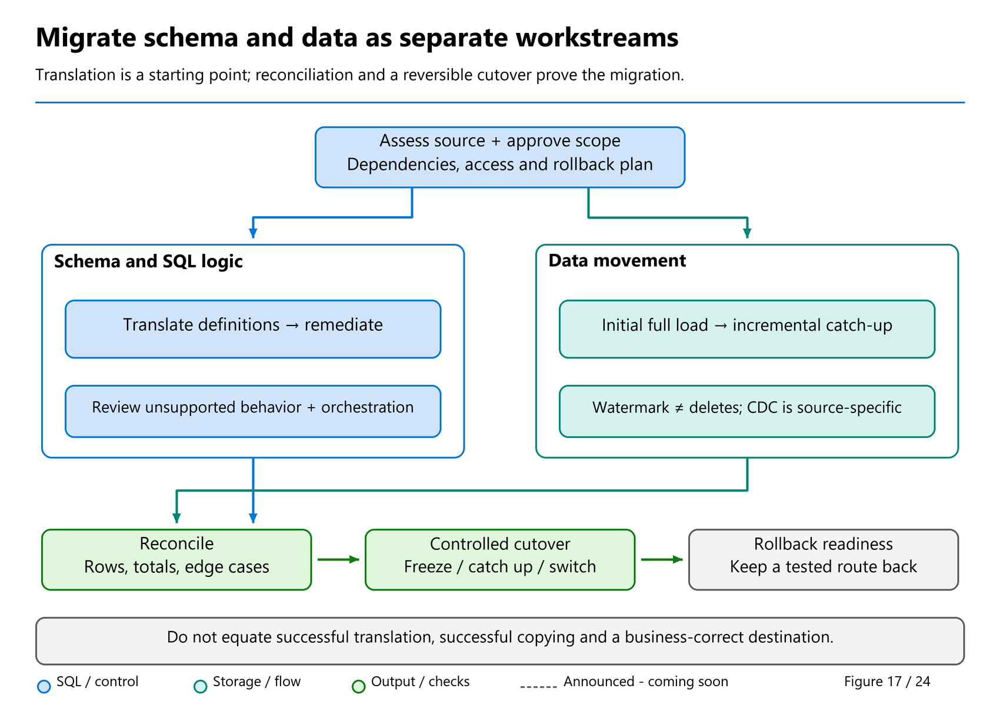

# 41. Reconciliation, Cutover, and Rollback

[Book contents](../../index.md) | [Part VII contents](README.md) | [Previous: Chapter 40](40-migrating-other-platforms.md) | [Next: Chapter 42](42-production-capstone.md)

**Applies to:** Fabric Warehouse migrations and analytical replication; SQL analytics endpoint readers have an additional visibility boundary. **Level:** Advanced. **Revision evidence:** original protocols reviewed 9 October 2026; Assistant metadata iteration and replacement risks reviewed 9 November. The protocols are engineering designs, not claims of automatic cross-system atomicity.

## Reconciliation is a chain of evidence

A copy activity reports what it did, not necessarily what the business needed. "Rows written: six" cannot establish that the correct six rows arrived, that quantities are unchanged, or that a repeated file was rejected. Reconciliation starts with an agreed source state and follows it through staging, transformations, target storage, and consumption.

Use progressively stronger checks. First compare schema and batch identity. Then compare row counts, null counts, key multiplicity, and relevant aggregates. Finally compare row-level values and business reports at the agreed grain. Cheap checks find many failures quickly, but they do not replace stronger checks at a cutover gate.

The common seed makes the distinction concrete. It has six facts, quantity 10, revenue 365.00, and country revenue of GB 185.00 and DE 180.00. A migration could preserve six rows and the overall total while assigning one sale to the wrong customer. The country breakdown catches a class of error the global total cannot.

Conversely, a report total may hide offsetting mistakes. A 10.00 overstatement and a 10.00 understatement cancel. Keep both business-level checks and full-row comparisons. Design reconciliations around what can go wrong, not around the easiest query to write.

Revisit [Figure 17's metadata, data, and security gates](37-migration-planning.md#read-the-migration-flow-as-separate-gates). This chapter supplies the evidence needed to cross the data-validation and consumer-cutover gates. An Assistant completion screen, an agent's deployment summary, and a copy-job checkpoint each describe only part of that flow.



*Figure 17, reused at the acceptance gate.* Successful transport is evidence about one lane. Reconciliation must still prove equivalent source states, multiplicity, semantics and the reader's actual visibility.

## Compare equivalent states

Choose the reconciliation boundary before extracting data. For a static source, this is straightforward. For a live source, record the source-specific snapshot or change position and the transformation version that produced the target. Comparing a target loaded at noon with a live source at 12:15 can produce a correct discrepancy.

When multiple tables must agree, define consistency across them. A fact extracted after a new customer arrives cannot safely be joined to a customer snapshot from before that arrival. Loading dimensions first is helpful orchestration, but it does not by itself establish a common source state.

Within Warehouse, an explicit transaction can provide a consistent view and atomic target changes under its documented snapshot behavior [1]. It does not create a universal transaction spanning an arbitrary source, object storage, pipeline state, and report cache. The capstone deliberately uses one Warehouse transaction to isolate the learning exercise; a real heterogeneous migration needs its own source boundary.

Track consumer visibility separately. Warehouse SQL commit, Warehouse Delta publication for other engines, Lakehouse SQL endpoint synchronization, and semantic-model refresh are different transitions. A successful writer is not proof that every reader sees the new version. Reconcile the actual consumption path described in [Chapter 23](../04-how-the-engine-works/23-storage-onelake-and-delta-log-publishing.md), [Chapter 15](../03-sql-analytics-endpoint/15-metadata-sync-v1-v2.md), and [Chapter 13](../02-building-analytical-solutions/13-power-bi-and-clients.md).

## Make duplicates observable

Warehouse keys are not enforced uniqueness checks [2]. Validate key multiplicity in the load process and in acceptance tests. An append retried after a lost acknowledgment can create duplicates even when the source has a reliable primary key.

Bare `EXCEPT` compares distinct rows. If one side contains two identical copies and the other one, set equality can still hold. For bag equality, group by every compared column and include `COUNT_BIG(*)`, then compare both directions. Alternatively, combine positive and negative multiplicities and require each grouped balance to be zero.

Hashes can accelerate investigation, but they need a defined serialization and a collision policy. Nulls, separators inside strings, encoding, collation, decimal formatting, and timestamp precision can make independently constructed hashes incomparable. A checksum mismatch locates a problem; a matching weak checksum is not an unconditional proof of equality.

For very large data, reconcile partitions and important business slices first, then drill into mismatching ranges. Retain enough immutable source evidence to repeat the detailed comparison. Sampling is useful for discovery, but the confidence it provides is not equivalent to a full exact comparison.

## Watermarks must describe what was actually captured

Suppose the previous checkpoint is 100. An extraction reads rows above 100, then another query obtains the current maximum, now 200. If row 200 committed between those operations and was not extracted, checkpointing 200 loses it. The inspected community Synapse watermark procedure illustrates why this pattern needs review [3]; the same defect can appear in any hand-written replication system.

A better append-only design captures an upper boundary, extracts a bounded interval, validates and applies that interval, and advances the checkpoint only after durable success. Persist the batch identifier and boundary before processing so retries refer to the same work.

However, the upper bound is necessary, not sufficient. A transaction may reserve an increasing identifier and commit later. An application may assign yesterday's timestamp to today's correction. A precision conversion may make several times equal. A source row arriving late below a completed boundary is still missed unless the source contract or recovery strategy covers it.

For timestamp-based paging, a composite `(timestamp, stable key)` position can disambiguate equal timestamps in an immutable, consistently observed input. It does not detect updates that keep the same position, hard deletes, or arbitrarily late arrivals behind the checkpoint. An overlap window plus idempotent apply is reasonable only when lateness is bounded and monitored. Beyond that bound, use an appropriate source-specific change feed, a controlled snapshot, or periodic full reconciliation and repair.

The same discipline applies to snapshot/diff systems. If outgoing changes and the new shadow baseline are read from different live states, the baseline can advance beyond what was emitted. A shadow table is not automatically a change feed. Preserve duplicate multiplicity, establish source consistency, and publish the new baseline only with recoverable evidence of the outgoing batch.

## Migration Assistant incremental migration and Copy job

Tino Tereshko's announcement names **Migration Assistant — incremental migration** [6]. October's source-connection documentation now verifies iterative **metadata** migration through **Migration > Get more objects**, separately from Assistant's **Copy data > Use a copy job** integration for full or incremental **data** movement [7,10]. These are two workflows, not an Assistant-owned CDC engine or a promise to deploy every source schema change automatically.

Before reconciling a later wave, establish whether a definition conflict replaced any populated target. **Keep incoming drops and recreates a conflicting table**; restoring its previous definition after a failed incoming script does not restore its rows. [Chapter 37](37-migration-planning.md#iterate-metadata-without-assuming-data-preservation) gives the conflict decisions. A copy-job checkpoint that still exists is not evidence that the replaced target contains the earlier batches.

In Copy job's incremental mode, the first run performs a full load; later runs move qualifying changes from saved state [8]. Database watermarks and CDC are different read mechanisms, and destination append/merge behavior is another choice again. The custom procedure race analyzed above is not evidence that native Copy job uses that algorithm.

### Incremental decision table

| Requirement and source contract | Candidate route | What must be proved before approval |
|---|---|---|
| One historical state; no continuing synchronization required | One-time full copy or immutable staged files | Equivalent source boundary, all intended rows, explicit destination policy, and reconciliation. Repeating a full copy is not automatically a safe retry. |
| New rows and corrections; a reliable non-null watermark advances on every relevant insert/update | Watermark-based Copy job: initial full load, then incremental runs | Later rows must satisfy the documented watermark comparison. Match corrected rows with approved keys and an appropriate write method; append alone retains old versions. Hard deletes are not detected. |
| Inserts, updates, and deletes must propagate | CDC-enabled source supported by the current Copy job **CDC source** matrix [9] | Source/table enablement, retention, connector/destination eligibility, identity, keys and tested delete/apply behavior. Base CDC and SCD Type 2 preview have different qualifications; a CDC destination entry is not source support. |
| Teradata coexistence | Watermark-based Copy job where the source column meets its contract | Teradata supports watermark reads but is not a supported CDC source in the reviewed matrix [9]. Approve another delete-handling/reconciliation design; do not promise native Teradata CDC through this route. |
| Backdated, unchanged, or null modification values; no usable supported CDC path | Redesign capture, use a controlled snapshot/diff, or reconcile and replace bounded data under an owned protocol | A timestamp filter cannot discover missing events by itself. Establish source consistency, late-arrival limits, duplicate handling, and recovery before selecting automation. |

For database watermarks, subsequent loads select rows whose value is greater than the recorded watermark. A changed business value with an unchanged watermark is invisible. NULL-watermark rows require explicit initial-load handling and are excluded from subsequent incremental loads. Review the documented column-type behavior rather than treating any timestamp-looking field as reliable.

The **9 November 2026** matrix still lists Fabric Warehouse and Synapse Data Warehouse as **CDC destinations, not CDC sources**. Teradata remains absent from its CDC-source list. SCD Type 2 is explicitly preview and has additional restrictions, including the documented Oracle-source limitation. Do not equate base CDC availability, destination support and complete historical capture with one universal mode.

Use the seed to rehearse this on paper, without updating it. After the initial copy, every fact has `LastModifiedUtc = 2026-01-04T00:00:00`. If sale 1001 changes and its watermark advances to January 5, it qualifies for another read. If sale 1002 changes but keeps January 4, it does not. If sale 1004 is hard-deleted, no surviving row tells the watermark scan to remove it. These are three different acceptance cases, not three configurations of the same append.

### Reset progress is not reset destination

**Reset clears Copy job's incremental state; it does not delete, truncate, or otherwise clear destination data** [8]. The next run can reread the full input. With append behavior, that input can be written again. A reset is therefore an operational change with a destination-replay consequence, not an automatic repair.

If an unchanged six-row seed is copied again into a destination already holding it, a blind append produces **12 facts, 20 units, and revenue 730.00**. A set comparison can still find the same distinct rows. Require the multiplicity checks below.

Before approving reset, record the selected tables, why state is being discarded, retained evidence, and the destination apply policy. An approved keyed merge can handle replay only if its keys and mappings are correct; it does not infer missing deletes. A clear-and-reload can be valid in an isolated or explicitly authorized target, but clearing data is a **separate destructive action**, never an implicit consequence of selecting Reset. Do not truncate a production destination merely to make a green rerun.

## Replay is part of the normal path

Design for an acknowledgment to be lost after the target commits. A blind append cannot distinguish "not applied" from "applied but acknowledgment missing." Use durable batch identity, a single controlled writer where appropriate, and a target apply protocol that is idempotent or detects prior completion.

Where target data and a control record can commit in the same supported Warehouse transaction, use that atomic unit. Prevent competing orchestrators from applying the same batch; a control table without enforced uniqueness is not itself a lock. External state updates still require reconciliation with committed target evidence. Do not promise exactly-once delivery merely because a retry setting is enabled.

Retain file identity, not just a last-modified timestamp. Multiple files can share a timestamp, and re-listing a live folder may change the apparent batch. A manifest names the complete immutable input. A completed-batch record should distinguish extraction completion, target application, reconciliation, and publication.

## Cut over through gates, not optimism

Begin with a rehearsed checklist and a named decision owner. Freeze schema changes for the migration wave, verify recovery access, and confirm that source retention covers the rollback interval. Record final versions of pipelines, SQL definitions, credentials references, and connection configuration.

At the agreed boundary, stop or coordinate source changes as required by the design, finish the final delta, and reconcile the target. Gate on zero unexplained differences, approved exceptions, current security tests, and the actual report experience. A known discrepancy is not automatically acceptable; acceptance belongs to its business owner.

Switch a controlled group of consumers first when feasible. Verify connection routing, identity, freshness, query behavior, and operational monitoring. Avoid a prolonged split in which some writers use the old system and others the new one without a designed synchronization protocol. A read-only report cutover and a writer cutover have very different risk.

Do not decommission the source at the first successful query. Maintain a defined observation period, then obtain explicit authorization to remove old jobs, credentials, replicas, and retained data. Governance and cost cleanup are part of completion, but premature cleanup destroys rollback options [4].

## Rollback means restoring a valid service

Routing readers back is simple only if the old service is still valid and sufficiently current. If Fabric has accepted new authoritative writes, routing back may lose them. Define whether rollback requires reverse movement, replay from retained input, or a business-approved loss window. Do not improvise reverse replication during an incident.

Separate rollback from recovery. Restoring a Warehouse state, discussed in [Chapter 35](../06-operating-the-platform/35-recovery-and-retention.md), does not automatically restore source pipelines, permissions, semantic models, or downstream exports. Rehearse the complete service restoration and record the elapsed time as an observation, not a contractual guarantee inferred from one exercise.

## Lab: expose a duplicate that set comparison misses

**Prerequisites:** The unchanged six-row `book.FactSales` table and read permission. This investigation is read-only: the extra row exists only in a CTE.

**Runnable, read-only T-SQL; execution location: BookWarehouse.**

```sql
WITH Candidate AS
(
    SELECT SalesKey FROM book.FactSales
    UNION ALL
    SELECT SalesKey FROM book.FactSales WHERE SalesKey = 1001
),
SignedCounts AS
(
    SELECT SalesKey, COUNT_BIG(*) AS Delta
    FROM Candidate
    GROUP BY SalesKey
    UNION ALL
    SELECT SalesKey, -COUNT_BIG(*) AS Delta
    FROM book.FactSales
    GROUP BY SalesKey
)
SELECT SalesKey, SUM(Delta) AS ExtraCopies
FROM SignedCounts
GROUP BY SalesKey
HAVING SUM(Delta) <> 0;
```

Expect sale 1001 with one extra copy. A distinct-key comparison would find the same set of keys and miss this defect. If the full fact row were duplicated, the candidate would have seven rows, quantity 12, and revenue 415.00, with GB rising to 235.00. These values follow from adding the seed's two lamps at 25.00 each.

State the acceptance decision: reject the batch, preserve its evidence, and investigate replay rather than deleting an arbitrary duplicate. Without a business key and batch lineage, an apparently repeated row might be a legitimate second event. The full capstone adds all-column comparisons so matching keys cannot hide changed values. This lab needs no cleanup.

## Key takeaways

- Reconcile the same source boundary through every stage and consumer.
- Bounded extraction still needs explicit late-arrival, update, delete, and replay semantics.
- Native Copy job integration is verified; watermark, CDC, target write mode, and reset are separate decisions.
- Cutover and rollback are owned service transitions, not connection-string edits alone.

## References

1. Microsoft Learn, [Transactions in Fabric Data Warehouse](https://learn.microsoft.com/en-us/fabric/data-warehouse/transactions), June 2026 revision.
2. Microsoft Learn, [Primary, foreign, and unique keys](https://learn.microsoft.com/en-us/fabric/data-warehouse/table-constraints), September 2026 revision.
3. Mark Pryce-Maher, [pinned watermark procedure](https://github.com/MarkPryceMaherMSFT/fabric-mirroring-synapse/blob/f9ce29f0e473a49e40dfc85c9eb2c349513b2386/sql/14_ReplicateWatermark_Procedure.sql) and [snapshot procedure](https://github.com/MarkPryceMaherMSFT/fabric-mirroring-synapse/blob/f9ce29f0e473a49e40dfc85c9eb2c349513b2386/sql/04_Snapshot_Procedure.sql), repository revision 8 September 2026; analyzed, not reproduced or endorsed for concurrent production capture.
4. Microsoft Learn, [Migration planning and governance](https://learn.microsoft.com/en-us/fabric/data-warehouse/migration-synapse-dedicated-sql-pool-planning).
5. Microsoft Learn, [Teradata migration acceptance checklist](https://learn.microsoft.com/en-us/fabric/data-warehouse/migration-teradata-planning), 21 September 2026.
6. Tino Tereshko, [Fabric Data Warehouse announcement roundup](https://www.linkedin.com/posts/valentinotereshko_speed-run-of-fabric-data-warehouse-announcements-activity-7510726240522293248-r4tC), 29 September 2026.
7. Microsoft Learn, [Migration Assistant upload workflow and Copy job integration](https://learn.microsoft.com/en-us/fabric/data-warehouse/migrate-using-upload-file), updated 29 September 2026; reviewed 9 October 2026.
8. Microsoft Learn, [Incremental copy and reset behavior in Copy job](https://learn.microsoft.com/en-us/fabric/data-factory/incremental-copy-job), 15 September 2026; reviewed 9 October 2026.
9. Microsoft Learn, [Copy job connectors and CDC source/destination matrix](https://learn.microsoft.com/en-us/fabric/data-factory/copy-job-connectors), updated/rechecked 9 November 2026, and [CDC write methods](https://learn.microsoft.com/en-us/fabric/data-factory/cdc-copy-job), base CDC versus SCD Type 2 preview.
10. Microsoft Learn, [Source-connection migration and conflict resolution](https://learn.microsoft.com/en-us/fabric/data-warehouse/migrate-using-connection-to-source-system#resolve-conflicts-and-fix-objects), incremental metadata sections added 16 October 2026; reviewed 9 November.

---

[Previous: Chapter 40](40-migrating-other-platforms.md) | [Book contents](../../index.md) | [Next: Chapter 42](42-production-capstone.md)
