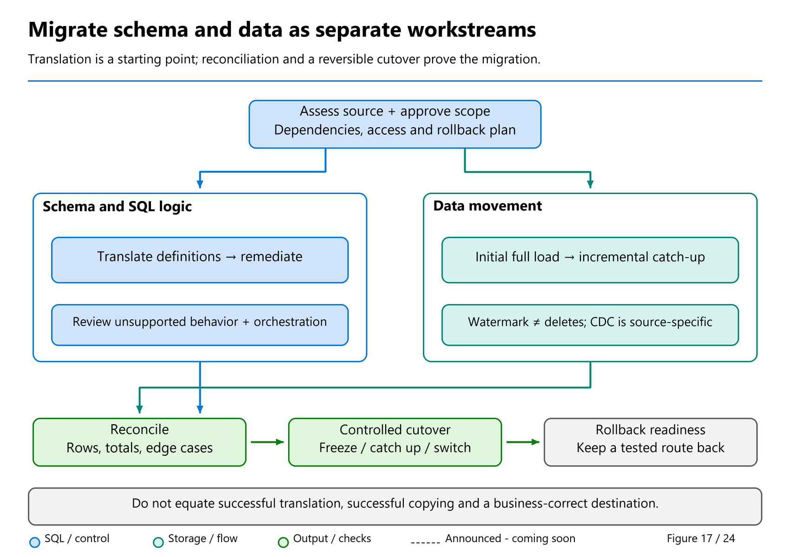

# 42. Production Capstone: Build, Migrate, Prove, and Operate

[Book contents](../../index.md) | [Part VII contents](README.md) | [Previous: Chapter 41](41-reconciliation-cutover-and-rollback.md) | [Next: Glossary](../../appendices/A-glossary-and-reader-routes.md)

**Applies to:** A writable Fabric Warehouse, with an optional independent Lakehouse SQL analytics endpoint comparison. **Level:** Intermediate to advanced. **Revision evidence cutoff:** 9 October 2026. This is an executable correctness lab plus a production readiness exercise, not a performance benchmark or a claim of tenant-tested deployment.

## The service you are building

Your service publishes sales revenue by country from an owned dimensional model. Its technical path is source tables, validated staging, migrated tables, and a SQL report. Its operational path includes identity, deployment, monitoring, recovery, and an approved consumer switch.

The exercise deliberately uses the same original synthetic dataset throughout the book. `BookWarehouse` contains schema `book`; customers are Aster Retail, Birch Stores, and Cedar Market; products are Desk lamp, Travel bag, Notebook, and Headphones. Three date rows cover 1-3 January 2026. Six sales carry the shared modification timestamp `2026-01-04T00:00:00`.

That small size makes every result explainable. It also prevents a tempting mistake: reporting demonstration timings as production performance. You will prove data handling, inspect failure behavior, and define the remaining production tests. You will not infer a capacity SKU, concurrency limit, or financial saving from six rows.



*Figure 17, reused to orient the capstone.* The actual lab is a small local Warehouse rehearsal, not an external-source copy or CDC deployment. Its transaction and acceptance gates are specified by the accompanying script, not inferred from the illustration.

## 1. Establish the learning environment

Use an isolated workspace and follow [Chapter 4: First Warehouse](../01-getting-started/04-first-warehouse.md). Run [the canonical Warehouse seed](../../scripts/04-create-book-warehouse.sql) against a fresh `BookWarehouse`. The seed is not a destructive reset. If the objects already exist, inspect their provenance and results instead of replacing them.

The current item must be a **Warehouse**, not a Lakehouse SQL analytics endpoint. Warehouse permits the writes used below; the Lakehouse endpoint is a read-only table-data surface [1]. Confirm the database and item before executing any script.

You need read access to the four core tables and permission to create the named lab tables. The capstone has no external connections, credentials, real customer data, or source platform dependency. Keep the environment quiet while running it. Its transaction is intentionally tiny; do not extrapolate the same long-transaction approach to a multi-terabyte migration.

Read [Chapter 8](../02-building-analytical-solutions/08-dimensional-modeling.md) for the model, [Chapter 10](../02-building-analytical-solutions/10-transformations-and-transactions.md) for transactional transformations, and [Chapter 12](../02-building-analytical-solutions/12-security-and-governance.md) for access boundaries. Those are functional prerequisites, not optional operational decoration.

## 2. Verify the published baseline

Before migrating anything, run this query on the core dataset.

**Runnable, read-only T-SQL; execution location: BookWarehouse.**

```sql
SELECT COUNT_BIG(*) AS FactRows,
       SUM(CAST(Quantity AS bigint)) AS Quantity,
       SUM(CAST(Quantity * UnitPrice AS decimal(18,2))) AS Revenue
FROM book.FactSales;
```

Expected results are **6 facts, quantity 10, revenue 365.00**. The arithmetic is 50 + 80 + 30 + 25 + 100 + 80. GB contributes 50 + 30 + 25 + 80 = **185.00**; DE contributes 80 + 100 = **180.00**.

Also expect three customers, four products, and three dates. These are acceptance values derived from the seed. They are not fabricated observations from a Fabric tenant. If your results differ, stop and determine whether another exercise changed the data or you connected to a different item. Do not normalize the expected values to an unexplained actual result.

Run [the schema inventory](../../scripts/37-schema-inventory.sql). Confirm the four core definitions, including `UnitPrice decimal(12,2)` and `LastModifiedUtc datetime2(6)`. The common model intentionally has no assumed enforced primary or foreign keys. Data quality must be checked explicitly [2].

## 3. Run the staged migration

Open [42-production-capstone.sql](../../scripts/42-production-capstone.sql) and execute it as **one batch** in `BookWarehouse`. Read its header and guard conditions first. It refuses to run in another named database or when any of its eight lab tables already exists. There is no automatic drop, truncate, or overwrite.

The script creates these persistent staging tables:

- `book.Lab32StageCustomer`
- `book.Lab32StageProduct`
- `book.Lab32StageDate`
- `book.Lab32StageSales`

It then creates matching target tables named `Lab32MigratedCustomer`, `Lab32MigratedProduct`, `Lab32MigratedDate`, and `Lab32MigratedSales`, also in schema `book`.

All eight creations and loads occur inside one explicit Warehouse transaction. The staging reads therefore share the source snapshot, and a failing acceptance gate rolls back the lab work [3]. The four core tables are never modified. CTAS carries the selected business columns into the isolated copies; it does not assert that all production constraints, security objects, or physical metadata migrate automatically.

This is a **local migration rehearsal**, not a simulation of network failure or source CDC. Its consistent source is the Warehouse seed, not a live external platform. In production, replace the source-reading stage with the reviewed extraction and manifest protocol from [Chapter 37](37-migration-planning.md) and the relevant source chapter: [Synapse](38-migrating-synapse-dedicated-sql-pools.md), [SQL Server/Azure SQL](39-migrating-sql-server-and-azure-sql.md), or [other platforms](40-migrating-other-platforms.md).

## 4. Understand the acceptance gates

The script first checks the canonical dimension values and key multiplicity. It verifies all six fact tuples and their shared timestamp, then checks that each staged fact has a customer, product, and date. A missing relationship fails before the target is accepted.

Next it compares **every selected column and row multiplicity** across source, staging, and migrated copies. Grouped origin counts must agree for each distinct row. This catches extra identical copies as well as changed values; it does not rely on bare `EXCEPT` or a weak checksum.

Finally it checks quantity, total revenue, and country revenue. The expected result sets are:

| Result | Expected |
|---|---:|
| Staging facts / quantity / revenue | 6 / 10 / 365.00 |
| Migrated facts / quantity / revenue | 6 / 10 / 365.00 |
| Migrated GB revenue | 185.00 |
| Migrated DE revenue | 180.00 |
| Customer/product/date rows in each copy | 3 / 4 / 3 |
| All-column multiplicity differences | 0 |
| Duplicate keys and missing relationships | 0 |

Only after the gates pass does the transaction commit. The final `PASS` message is generated by your execution after those checks; the manuscript does not claim that execution has already occurred. Save approved query output, script revision, execution time in UTC, item identity, and reviewer decision as the evidence for your run.

## 5. Query the migrated service

The consumer query must use the migrated customer dimension, not a convenient join back to the source dimension. Otherwise the report can mask a failed dimension migration.

**Runnable, read-only T-SQL; execution location: BookWarehouse, after the capstone script succeeds.**

```sql
SELECT c.CountryCode,
       SUM(CAST(f.Quantity * f.UnitPrice AS decimal(18,2))) AS Revenue
FROM book.Lab32MigratedSales AS f
JOIN book.Lab32MigratedCustomer AS c
  ON c.CustomerKey = f.CustomerKey
GROUP BY c.CountryCode
ORDER BY c.CountryCode;
```

Expect DE 180.00 and GB 185.00 again. Use [Chapter 13](../02-building-analytical-solutions/13-power-bi-and-clients.md) when attaching an approved reporting client. Check model relationships, aggregation, filters, and authentication separately; a correct SQL query does not certify an independently configured semantic model.

Optionally follow [Chapter 5](../01-getting-started/05-first-lakehouse-and-sql-endpoint.md) and [its Spark seed](../../scripts/05-create-book-lakehouse.py) to create the independent `BookLakehouse` copy. Query its SQL endpoint with the baseline SELECT once tables are visible. Expect the same six facts, quantity, and revenue. This proves agreement of two independently seeded examples, **not replication** between them. If endpoint visibility lags, investigate [metadata synchronization](../03-sql-analytics-endpoint/15-metadata-sync-v1-v2.md); do not issue Warehouse DML against the Lakehouse endpoint.

## 6. Exercise failure without damaging the seed

Run the read-only duplicate projection in [Chapter 41](41-reconciliation-cutover-and-rollback.md). It produces an extra copy of sale 1001 without writing any table. Explain why distinct-key equality misses it and why multiplicity comparison rejects it.

Now rerun `42-production-capstone.sql` unchanged. Expect an existing-object error before any lab reset or append occurs. This is deliberate fail-safe behavior, not an idempotent refresh implementation. Inspect the existing eight tables and retain the successful run's evidence. A production loader would instead use durable batch identity and its designed replay protocol.

Discuss a second failure: an external extraction finishes, but its checkpoint is advanced beyond the rows actually captured. The local capstone cannot reproduce that cross-system race. Describe the frozen upper bound, late-arrival rule, update/delete capture, and checkpoint acknowledgment required in your real source design before calling it ready.

### Add an offline tool-and-approval rehearsal

No extra execution is required. Lay your proposal beside [Figure 17](37-migration-planning.md#read-the-migration-flow-as-separate-gates) and the [incremental decision table](41-reconciliation-cutover-and-rollback.md#migration-assistant-incremental-migration-and-copy-job). Answer these three questions before calling the capstone a migration plan:

- **If using Migration Assistant, what writes occur?** Separate target metadata deployment and remediation from Copy job data movement. For Teradata, identify the preview ZIP-definition route, macro-to-procedure review, and replacement of removed BTEQ orchestration; neither successful translation nor an optional AI suggestion proves business equivalence.
- **If keeping a source live, what changes are captured?** State initial full load, qualifying watermark inserts/updates, and the separate delete plan—or verify a supported CDC-enabled source. Explain why resetting state and appending the seed again would produce 12 facts and revenue 730.00 without clearing the destination. Do not actually reset or change the seed.
- **If considering an agent, who approves its writes?** Use the [public Synapse skill's offline assessment](38-migrating-synapse-dedicated-sql-pools.md#offline-exercise-assess-first-authorize-nothing) as reading, not an installation or execution step. Require production-source read-only discovery, explicit target/security approval, and separate data consent using a verified user-managed restored export copy. Do not substitute the custom replication toolkit's behavior for that contract.

Your deliverable is a decision record with owners and unresolved gates, not another green status. This capstone's local transaction proves none of those external tooling paths.

## 7. Assign production responsibilities

Turn the rehearsal into an owned service using the following responsibility map.

| Responsibility | Required evidence before production |
|---|---|
| Data owner | Business definitions, reconciliation approval, accepted exceptions |
| Pipeline owner | Immutable batch identity, restart tests, schema-drift policy |
| Security owner | Least-privilege identities, positive and negative access tests |
| Platform owner | Capacity observations, concurrency rehearsal, cost guardrails |
| Operations owner | Freshness alerts, error triage, escalation and recovery rehearsal |
| Release owner | Reviewed deployment, environment configuration, rollback decision |
| Migration-tool approver | Named route/version, source-read scope, explicit target/security writes, separate data/export consent, and reset/replay policy |

Test readers who should see the report and readers who should not. Also test access through other available data paths; SQL policy does not automatically secure direct Spark or OneLake access. Do not grant broad workspace roles merely to make a permission error disappear.

Use [Chapter 29](../06-operating-the-platform/29-monitoring.md) and [Chapter 30](../06-operating-the-platform/30-troubleshooting.md) to observe real executions. Use [billing](../06-operating-the-platform/31-billing-and-consumption.md), [capacity](../06-operating-the-platform/32-capacity-management.md), and [workload management](../06-operating-the-platform/33-workload-management-and-sql-pools.md) to plan representative tests. Record cold and warm behavior, concurrent loads, failures, and actual consumption; this fixture supplies none of those production measurements.

Keep reviewed SQL and deployment assets under the workflow from [Chapter 36](../06-operating-the-platform/36-development-and-automation.md). Rehearse recovery using [Chapter 35](../06-operating-the-platform/35-recovery-and-retention.md), including pipelines and consumer configuration, not just database state. Cut over only with the source-boundary and rollback gates in Chapter 41 satisfied.

## Cleanup and completion

[42-cleanup-lab.sql](../../scripts/42-cleanup-lab.sql) removes only the eight named capstone tables. Its default confirmation flag is zero, so execution refuses deletion until you deliberately opt in after reviewing the script. Preserve evidence first. The core `book` tables, other chapter labs, and optional Lakehouse remain untouched.

Completion means you can explain the expected values, show your own successful evidence, identify which failures were exercised, and name the remaining production tests and their owners. That is a stronger outcome than a screenshot of a green pipeline.

## Key takeaways

- A complete flow preserves one known dataset through staging, migration, and consumption.
- Exact acceptance results prove this fixture, not production throughput or external CDC.
- Production readiness includes named owners, negative tests, recovery, and rollback.

## References

1. Microsoft Learn, [T-SQL surface area](https://learn.microsoft.com/en-us/fabric/data-warehouse/tsql-surface-area).
2. Microsoft Learn, [Warehouse key constraints](https://learn.microsoft.com/en-us/fabric/data-warehouse/table-constraints).
3. Microsoft Learn, [Warehouse transactions](https://learn.microsoft.com/en-us/fabric/data-warehouse/transactions).
4. Microsoft Learn, [CREATE TABLE AS SELECT](https://learn.microsoft.com/en-us/sql/t-sql/statements/create-table-as-select-azure-sql-data-warehouse?view=fabric).
5. Microsoft Learn, [Warehouse performance guidelines](https://learn.microsoft.com/en-us/fabric/data-warehouse/guidelines-warehouse-performance).

---

[Previous: Chapter 41](41-reconciliation-cutover-and-rollback.md) | [Book contents](../../index.md) | [Next: Glossary](../../appendices/A-glossary-and-reader-routes.md)
